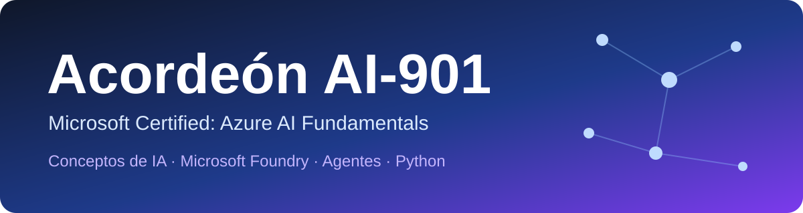
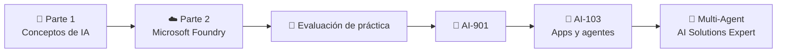

  

  
  
  
  
  

  
  
  
  
  
  

# 📚 Acordeón AI-901

Aquí tienes el acordeón no oficial de la certificación **AI-901 Microsoft Certified: Azure AI Fundamentals**

  

> [!IMPORTANT]
> Revisa esto de abajo 🔽​
- **[Revisa esto pero YA que de aquí viene el examen (guía de estudio AI-901)](https://learn.microsoft.com/es-es/credentials/certifications/resources/study-guides/ai-901)**

- **[Página oficial de la certificación (y evaluación de práctica gratuita)](https://learn.microsoft.com/es-es/credentials/certifications/azure-ai-fundamentals/)**

- **[¿Cómo es hacer una certificación de Microsoft? Tips y consideraciones](/docs/tips.md)**

- **[¿Vienes de cero? Empieza por el Onboarding: qué instalar y qué conceptos saber](/docs/parte1/modulo1/tema1.md)**

> [!NOTE]
> Si hay algo que esté desactualizado o incorrecto házmelo saber en los issues o dando un PR

> [!WARNING]
> Microsoft Foundry cambia muy rápido (nombres de servicios, portal y versiones de SDK). El código de este acordeón se probó contra la documentación vigente en octubre de 2026; si algo no te funciona, revisa la versión del paquete con `pip show <paquete>`.

---
## 🗺️ Ruta de estudio

---
## 🎯 ¿Qué evalúa el examen?

La AI-901 tiene **dos dominios** y se aprueba con **700 de 1,000 puntos**. A diferencia de la AI-900, **más de la mitad es de implementación** con Microsoft Foundry y Python.

| Dominio | Peso | Dónde lo estudias en este acordeón |
|---|---|---|
| **Identificar conceptos y capacidades de IA** | 40–45% | [Parte 1](#-parte-1-conceptos-de-inteligencia-artificial-para-desarrolladores-y-profesionales-tecnológicos) |
| ↳ Principios de IA responsable | | [IA responsable](/docs/parte1/modulo1/tema7.md), [Guardrails](/docs/parte2/modulo7/tema5.md) |
| ↳ Componentes y configuración de modelos | | [Embeddings y transformers](/docs/parte1/modulo2/tema1.md), [Elegir modelo](/docs/parte2/modulo2/tema1.md) |
| ↳ Cargas de trabajo de IA | | [Módulos 1 a 7 de la Parte 1](#-parte-1-conceptos-de-inteligencia-artificial-para-desarrolladores-y-profesionales-tecnológicos) |
| **Implementar soluciones de IA con Microsoft Foundry** | 55–60% | [Parte 2](#-parte-2-introducción-a-las-aplicaciones-y-agentes-de-inteligencia-artificial-en-azure) |
| ↳ Apps y agentes generativos | | [Agente con Python](/docs/parte2/modulo1/tema4.md), [Modelos vs. agentes](/docs/parte2/modulo2/tema2.md) |
| ↳ Texto y voz | | [Análisis de texto](/docs/parte2/modulo3/tema1.md), [Speech](/docs/parte2/modulo4/tema1.md), [Voice Live](/docs/parte2/modulo4/tema2.md) |
| ↳ Visión y generación de imágenes | | [Multimodal](/docs/parte2/modulo5/tema2.md), [Imágenes](/docs/parte2/modulo5/tema3.md), [Video](/docs/parte2/modulo5/tema4.md) |
| ↳ Extracción de información | | [Content Understanding](/docs/parte2/modulo6/tema1.md) |

---
# 🧠 Parte 1: Conceptos de inteligencia artificial para desarrolladores y profesionales tecnológicos

- Aquí puedes ver toda la ruta de aprendizaje **[-> DA CLIC AQUÍ <-](https://learn.microsoft.com/es-es/training/paths/ai-concepts/)**

> [!NOTE]
> Las prácticas de Microsoft Learn están en inglés. Puedes traducirlas con el navegador y si no funciona algo intenta hacerlo en una ventana de incógnito y/o cambiar de región

---
## 🤖 1. Introducción a los conceptos de IA

Este módulo te introduce al mundo de la IA: qué tipos de soluciones hace posibles (generativa y agentes, visión, voz, texto y extracción de información) y qué consideraciones de IA responsable debes tener.

- Aquí puedes ver todos los temas del módulo **[-> DA CLIC AQUÍ <-](https://learn.microsoft.com/es-es/training/modules/get-started-ai-fundamentals/)**
- [Resumen rápido](/docs/parte1/modulo1/resumen.md)

### 🧪 Práctica de Microsoft Learn
- [Ejercicio: Explorar cargas de trabajo de IA](https://learn.microsoft.com/es-es/training/modules/get-started-ai-fundamentals/7b-exercise)

### 📌 Temas del acordeón
- [Tema 1: Onboarding — Qué instalar y qué conceptos debes saber antes de iniciar](/docs/parte1/modulo1/tema1.md)
- [Tema 2: ¿Qué es la IA realmente? Acercamiento técnico](/docs/parte1/modulo1/tema2.md)
- [Tema 3: IA, ML, Deep Learning, IA Generativa e IA Agéntica: definición, diferencias y cuándo usar cada una](/docs/parte1/modulo1/tema3.md)
- [Tema 4: Bases técnicas de cómo funciona el análisis de texto y el lenguaje natural](/docs/parte1/modulo1/tema4.md)
- [Tema 5: Bases técnicas de cómo funciona speech to text y text to speech](/docs/parte1/modulo1/tema5.md)
- [Tema 6: Bases técnicas de cómo funciona computer vision](/docs/parte1/modulo1/tema6.md)
- [Tema 7: Principios de IA responsable](/docs/parte1/modulo1/tema7.md)
- [Tema 8: ¿Para qué sí y para qué no usar la IA?](/docs/parte1/modulo1/tema8.md)

---
## ✨ 2. Introducción a la inteligencia artificial y los agentes generativos

La IA generativa impulsa aplicaciones que crean contenido, responden preguntas y ayudan con tareas. Aquí exploras los modelos de lenguaje (LLM), los prompts y los agentes de IA.

- Aquí puedes ver todos los temas del módulo **[-> DA CLIC AQUÍ <-](https://learn.microsoft.com/es-es/training/modules/fundamentals-generative-ai/)**
- [Resumen rápido](/docs/parte1/modulo2/resumen.md)

### 🧪 Práctica de Microsoft Learn
- [Ejercicio: Explorar la IA generativa](https://learn.microsoft.com/es-es/training/modules/fundamentals-generative-ai/7a-exercise)

### 📌 Temas del acordeón
- [Tema 1: Las bases de cómo funciona la IA — Espacio vectorial, tokenización y embeddings](/docs/parte1/modulo2/tema1.md)
- [Tema 2: Cómo usar correctamente el RAG, el prompt y el system prompt en un agente](/docs/parte1/modulo2/tema2.md)
- [Tema 3: Tutorial — Mi primer agente en Microsoft Foundry](/docs/parte1/modulo2/tema3.md)

---
## 💬 3. Introducción a los conceptos de procesamiento de lenguaje natural

El procesamiento de lenguaje natural (NLP) permite crear aplicaciones que analizan texto para inferir su significado semántico.

- Aquí puedes ver todos los temas del módulo **[-> DA CLIC AQUÍ <-](https://learn.microsoft.com/es-es/training/modules/introduction-language/)**
- [Resumen rápido](/docs/parte1/modulo3/resumen.md)

### 🧪 Práctica de Microsoft Learn
- [Ejercicio: Explorar el análisis de texto](https://learn.microsoft.com/es-es/training/modules/introduction-language/4b-exercise)

### 📌 Temas del acordeón
- [Tema 1: Análisis estadístico de texto — Fundamentos técnicos](/docs/parte1/modulo3/tema1.md)
- [Tema 2: Modelos de lenguaje semántico — Explicación técnica](/docs/parte1/modulo3/tema2.md)

---
## 🎙️ 4. Introducción a los conceptos de voz de IA

Imagina apps y agentes con los que puedes hablar. Aquí exploras los conceptos detrás de la voz con IA: el reconocimiento y la síntesis de voz.

- Aquí puedes ver todos los temas del módulo **[-> DA CLIC AQUÍ <-](https://learn.microsoft.com/es-es/training/modules/introduction-ai-speech/)**
- [Resumen rápido](/docs/parte1/modulo4/resumen.md)

### 🧪 Práctica de Microsoft Learn
- [Ejercicio: Explorar la voz de IA](https://learn.microsoft.com/es-es/training/modules/introduction-ai-speech/5-exercise-speech)

### 📌 Temas del acordeón
- [Tema 1: Captura de audio — Convertir audio analógico en digital (fundamentos técnicos desde el espectrograma)](/docs/parte1/modulo4/tema1.md)
- [Tema 2: Diferencia técnica entre speech to text y text to speech](/docs/parte1/modulo4/tema2.md)
- [Tema 3: Así funciona Alexa internamente](/docs/parte1/modulo4/tema3.md)
- Speech to Text y Text to Speech:
  - [Text-to-Speech 101: The Ultimate Guide](https://medium.com/neuralspace/text-to-speech-101-the-ultimate-guide-9a4b10e20fef)
  - [Audio Deep Learning Made Simple: Automatic Speech Recognition (ASR), How it Works](https://medium.com/towards-data-science/audio-deep-learning-made-simple-automatic-speech-recognition-asr-how-it-works-716cfce4c706)
  - [Understanding the Mel Spectrogram](https://medium.com/analytics-vidhya/understanding-the-mel-spectrogram-fca2afa2ce53)

---
## 👁️ 5. Introducción a los conceptos de computer vision

La visión por computadora es el área de la IA en la que el software procesa entrada visual: imágenes, video y cámaras en vivo. Aquí ves las tareas de visión, el procesamiento de imágenes, las CNN, los Vision Transformers, los modelos multimodales y la generación de imágenes.

- Aquí puedes ver todos los temas del módulo **[-> DA CLIC AQUÍ <-](https://learn.microsoft.com/es-es/training/modules/introduction-computer-vision/)**
- [Resumen rápido](/docs/parte1/modulo5/resumen.md)

### 🧪 Práctica de Microsoft Learn
- [Ejercicio: Explorar computer vision](https://learn.microsoft.com/es-es/training/modules/introduction-computer-vision/5b-exercise)

### 📌 Temas del acordeón
- [Tema 1: Cuándo y cómo usar clasificación, detección, segmentación y análisis contextual de imágenes](/docs/parte1/modulo5/tema1.md)
- [Tema 2: Imágenes y procesamiento de imágenes](/docs/parte1/modulo5/tema2.md)
- [Tema 3: Redes neuronales convolucionales (CNN) — Fundamentos técnicos](/docs/parte1/modulo5/tema3.md)
- [Tema 4: Vision Transformers y modelos multimodales — Fundamentos técnicos](/docs/parte1/modulo5/tema4.md)
- [Tema 5: Generación de imágenes — Fundamentos técnicos (incluye el Google Colab de VQGAN + CLIP)](/docs/parte1/modulo5/tema5.md)

---
## 📄 6. Introducción a los conceptos de extracción de información con IA

La extracción de información con IA te permite obtener valores de datos de documentos, imágenes y otras fuentes no estructuradas.

- Aquí puedes ver todos los temas del módulo **[-> DA CLIC AQUÍ <-](https://learn.microsoft.com/es-es/training/modules/introduction-information-extraction/)**
- [Resumen rápido](/docs/parte1/modulo6/resumen.md)

### 🧪 Práctica de Microsoft Learn
- [Ejercicio: Explorar la extracción de información con IA](https://learn.microsoft.com/es-es/training/modules/introduction-information-extraction/6b-exercise)

### 📌 Temas del acordeón
- [Tema 1: Fundamentos de minería de datos](/docs/parte1/modulo6/tema1.md)
- [Tema 2: Reconocimiento óptico de caracteres (OCR) — Fundamentos técnicos](/docs/parte1/modulo6/tema2.md)

---
## 🔎 7. Introducción a los conceptos de generación aumentada por recuperación (RAG)

El RAG ayuda a que las aplicaciones de IA generativa den respuestas fundamentadas en información relevante. Aquí ves cómo una solución RAG prepara, recupera y usa los datos para generar respuestas.

- Aquí puedes ver todos los temas del módulo **[-> DA CLIC AQUÍ <-](https://learn.microsoft.com/es-es/training/modules/rag-fundamentals/)**
- [Resumen rápido](/docs/parte1/modulo7/resumen.md)

### 🧪 Práctica de Microsoft Learn
- [Ejercicio: Explorar RAG](https://learn.microsoft.com/es-es/training/modules/rag-fundamentals/6-exercise)

### 📌 Temas del acordeón
- [Tema 1: Arquitectura de una solución de generación aumentada por recuperación](/docs/parte1/modulo7/tema1.md)
- [Tema 2: Grounding y métricas de evaluación](/docs/parte1/modulo7/tema2.md)

---
# 🔷 Parte 2: Introducción a las aplicaciones y agentes de inteligencia artificial en Azure

- Aquí puedes ver toda la ruta de aprendizaje **[-> DA CLIC AQUÍ <-](https://learn.microsoft.com/es-es/training/paths/get-started-ai-apps-agents/)**

> [!NOTE]
> Esta parte requiere una suscripción de Azure y conocimientos básicos de Python. Al terminar cada práctica **borra tus recursos** (o el grupo de recursos completo) para no generar costos.

---
## ☁️ 1. Introducción a la IA en Azure

Aprende cómo Microsoft te permite construir IA con la tecnología más reciente, de forma segura y a escala: Azure desde cero, desarrollo de apps de IA y Microsoft Foundry.

- Aquí puedes ver todos los temas del módulo **[-> DA CLIC AQUÍ <-](https://learn.microsoft.com/es-es/training/modules/get-started-with-ai-in-azure/)**
- [Resumen rápido](/docs/parte2/modulo1/resumen.md)

### 🧪 Práctica de Microsoft Learn
- [Ejercicio: Introducción a Microsoft Foundry](https://learn.microsoft.com/es-es/training/modules/get-started-with-ai-in-azure/6-exercise)

### 📌 Temas del acordeón
- [Tema 1: Introducción a Azure desde cero](/docs/parte2/modulo1/tema1.md)
- [Tema 2: Todos los servicios y funcionalidades de Microsoft Foundry](/docs/parte2/modulo1/tema2.md)
- [Tema 3: Diferencias y usos entre los SDKs de Microsoft Foundry (AIProjects, OpenAI, AzureOpenAI…)](/docs/parte2/modulo1/tema3.md)
- [Tema 4: Tutorial desde cero y comentado paso a paso — Implementar un agente de Microsoft Foundry con Python](/docs/parte2/modulo1/tema4.md)

---
## 🛠️ 2. Introducción a la IA generativa y a los agentes en Azure

Aprende a usar modelos de IA generativa y agentes con Microsoft Foundry: catálogo de modelos, despliegue, Playground y llamadas a agentes desde código.

- Aquí puedes ver todos los temas del módulo **[-> DA CLIC AQUÍ <-](https://learn.microsoft.com/es-es/training/modules/get-started-with-generative-ai-and-agents/)**
- [Resumen rápido](/docs/parte2/modulo2/resumen.md)

### 🧪 Práctica de Microsoft Learn
- [Ejercicio: Introducción a la IA generativa y los agentes en Microsoft Foundry](https://learn.microsoft.com/es-es/training/modules/get-started-with-generative-ai-and-agents/6-exercise)

### 📌 Temas del acordeón
- [Tema 1: Cómo elegir el modelo de IA adecuado para los requerimientos](/docs/parte2/modulo2/tema1.md)
- [Tema 2: Comprender la diferencia entre los modelos y los agentes y cuándo usar uno u otro](/docs/parte2/modulo2/tema2.md)

---
## 💬 3. Introducción al análisis de texto en Azure

Aprende a usar modelos de propósito general y **Azure Language en Foundry Tools**, y construye un cliente ligero en Python que analiza texto.

- Aquí puedes ver todos los temas del módulo **[-> DA CLIC AQUÍ <-](https://learn.microsoft.com/es-es/training/modules/get-started-text-analysis-azure/)**
- [Resumen rápido](/docs/parte2/modulo3/resumen.md)

### 🧪 Práctica de Microsoft Learn
- [Ejercicio: Introducción al análisis de texto en Microsoft Foundry](https://learn.microsoft.com/es-es/training/modules/get-started-text-analysis-azure/5-exercise)

### 📌 Temas del acordeón
- [Tema 1: Un agente de IA con un LLM no siempre es la solución — Por qué y cuándo usar los otros modelos de texto, visión y voz de Microsoft Foundry](/docs/parte2/modulo3/tema1.md)
- [Tema 2: Introducción a los MCP (Model Context Protocol)](/docs/parte2/modulo3/tema2.md)

---
## 🎙️ 4. Introducción a la voz en Azure

Aprende a reconocer y sintetizar voz con **Azure Speech en Foundry Tools** y a crear agentes de voz en tiempo real con **Voice Live**.

- Aquí puedes ver todos los temas del módulo **[-> DA CLIC AQUÍ <-](https://learn.microsoft.com/es-es/training/modules/get-started-speech-azure/)**
- [Resumen rápido](/docs/parte2/modulo4/resumen.md)

### 🧪 Práctica de Microsoft Learn
- [Ejercicio: Introducción a la voz en Microsoft Foundry](https://learn.microsoft.com/es-es/training/modules/get-started-speech-azure/5-exercise)

### 📌 Temas del acordeón
- [Tema 1: Tutorial de reconocimiento de voz con Azure Speech](/docs/parte2/modulo4/tema1.md)
- [Tema 2: Explicación de los SDK de voz y Voice Live de Microsoft Foundry con Python](/docs/parte2/modulo4/tema2.md)

---
## 🖼️ 5. Introducción a computer vision en Azure

Conoce las capacidades de visión en Foundry: analizar imágenes con modelos multimodales y generar contenido visual con modelos de imagen y video.

- Aquí puedes ver todos los temas del módulo **[-> DA CLIC AQUÍ <-](https://learn.microsoft.com/es-es/training/modules/get-started-vision-azure/)**
- [Resumen rápido](/docs/parte2/modulo5/resumen.md)

### 🧪 Práctica de Microsoft Learn
- [Ejercicio: Introducción a computer vision en Microsoft Foundry](https://learn.microsoft.com/es-es/training/modules/get-started-vision-azure/5-exercise)

### 📌 Temas del acordeón
- [Tema 1: Modelos de IA multimodales — Fundamentos técnicos](/docs/parte2/modulo5/tema1.md)
- [Tema 2: Tutorial de implementación con el SDK de Python de un modelo multimodal](/docs/parte2/modulo5/tema2.md)
- [Tema 3: Tutorial de implementación con el SDK de Python de un modelo de generación de imágenes](/docs/parte2/modulo5/tema3.md)
- [Tema 4: Tips de generación de videos con Microsoft Foundry](/docs/parte2/modulo5/tema4.md)

---
## 📄 6. Introducción a la extracción de información con IA en Azure

La IA te permite desbloquear información de tus datos. Aprende a usar **Azure Content Understanding en Foundry Tools** para extraer información de documentos, imágenes, audio y video.

- Aquí puedes ver todos los temas del módulo **[-> DA CLIC AQUÍ <-](https://learn.microsoft.com/es-es/training/modules/get-started-information-extraction/)**
- [Resumen rápido](/docs/parte2/modulo6/resumen.md)

### 🧪 Práctica de Microsoft Learn
- [Ejercicio: Introducción a la extracción de información en Microsoft Foundry](https://learn.microsoft.com/es-es/training/modules/get-started-information-extraction/4-exercise)

### 📌 Temas del acordeón
- [Tema 1: Tutorial de implementación con el SDK de Python de un modelo de Content Understanding](/docs/parte2/modulo6/tema1.md)

---
## 🧩 7. Introducción a Microsoft Foundry IQ

Aprende cómo **Foundry IQ** ayuda a los agentes de IA a recuperar información relevante de los datos de tu empresa y a generar respuestas fundamentadas y con citas.

- Aquí puedes ver todos los temas del módulo **[-> DA CLIC AQUÍ <-](https://learn.microsoft.com/es-es/training/modules/get-started-foundry-iq/)**
- [Resumen rápido](/docs/parte2/modulo7/resumen.md)

### 🧪 Práctica de Microsoft Learn
- [Ejercicio: Introducción a Foundry IQ en Microsoft Foundry](https://learn.microsoft.com/es-es/training/modules/get-started-foundry-iq/5-exercise)

### 📌 Temas del acordeón
- [Tema 1: Diferencia entre Foundry IQ y Work IQ](/docs/parte2/modulo7/tema1.md)
- [Tema 2: Cuándo usar system prompt, cuándo usar RAG y cuándo usar fine-tuning](/docs/parte2/modulo7/tema2.md)
- [Tema 3: Qué diferencia hay técnicamente y en respuesta entre usar Foundry IQ y cargar archivos directo al agente](/docs/parte2/modulo7/tema3.md)
- [Tema 4: Tutorial de conexión de Foundry IQ con un agente de Microsoft Foundry](/docs/parte2/modulo7/tema4.md)
- [Tema 5: Guardrails o límites de protección en Microsoft Foundry](/docs/parte2/modulo7/tema5.md)

---
## 📝 Exámenes de prueba

> [!IMPORTANT]
> Las evaluaciones de módulo de Microsoft Learn las puedes hacer las veces que quieras. Úsalas para medir qué temas te faltan reforzar antes de la evaluación de práctica oficial.

- **[Preguntas rápidas para repasar](/docs/preguntas-rapidas.md)**
- **[Evaluación de práctica oficial AI-901 (en la página de la certificación, requiere iniciar sesión)](https://learn.microsoft.com/es-es/credentials/certifications/azure-ai-fundamentals/)**
- Evaluaciones de módulo — Parte 1:
  [1. Conceptos de IA](https://learn.microsoft.com/es-es/training/modules/get-started-ai-fundamentals/8-knowledge-check) ·
  [2. IA generativa y agentes](https://learn.microsoft.com/es-es/training/modules/fundamentals-generative-ai/8-knowledge-check) ·
  [3. NLP](https://learn.microsoft.com/es-es/training/modules/introduction-language/5-knowledge-check) ·
  [4. Voz](https://learn.microsoft.com/es-es/training/modules/introduction-ai-speech/6-knowledge-check) ·
  [5. Computer vision](https://learn.microsoft.com/es-es/training/modules/introduction-computer-vision/6-knowledge-check) ·
  [6. Extracción de información](https://learn.microsoft.com/es-es/training/modules/introduction-information-extraction/7-knowledge-check) ·
  [7. RAG](https://learn.microsoft.com/es-es/training/modules/rag-fundamentals/7-knowledge-check)
- Evaluaciones de módulo — Parte 2:
  [1. IA en Azure](https://learn.microsoft.com/es-es/training/modules/get-started-with-ai-in-azure/7-knowledge-check) ·
  [2. IA generativa y agentes en Azure](https://learn.microsoft.com/es-es/training/modules/get-started-with-generative-ai-and-agents/7-knowledge-check) ·
  [3. Análisis de texto](https://learn.microsoft.com/es-es/training/modules/get-started-text-analysis-azure/6-knowledge-check) ·
  [4. Voz](https://learn.microsoft.com/es-es/training/modules/get-started-speech-azure/6-knowledge-check) ·
  [5. Computer vision](https://learn.microsoft.com/es-es/training/modules/get-started-vision-azure/6-knowledge-check) ·
  [6. Extracción de información](https://learn.microsoft.com/es-es/training/modules/get-started-information-extraction/5-knowledge-check) ·
  [7. Foundry IQ](https://learn.microsoft.com/es-es/training/modules/get-started-foundry-iq/6-knowledge-check)

## 📖 Recursos adicionales

Del [acordeón AI-900](https://github.com/josejesusguzman/acordeon-ia-900) te sirven mucho como base:

#### [Inicio en la ciencia de datos](https://github.com/josejesusguzman/acordeon-ia-900/blob/main/docs/inicio_ciencia_datos.md)

#### [Ligera introducción a Deep Learning (Redes neuronales)](https://github.com/josejesusguzman/acordeon-ia-900/blob/main/docs/intro_deep_learning.md)

#### [Fundamentos matemáticos de la IA](https://github.com/josejesusguzman/acordeon-ia-900/blob/main/docs/intro_mates.md)

#### [Introducción a Python](https://github.com/josejesusguzman/acordeon-ia-900/blob/main/docs/intro_python.md)

### Recursos en línea de Microsoft (gratuitos y en GitHub)

- **[Generative AI for Beginners](https://github.com/microsoft/generative-ai-for-beginners)**
  - Curso de Microsoft con lecciones de IA generativa: prompts, RAG, agentes, seguridad y más.
- [AI Agents for Beginners](https://github.com/microsoft/ai-agents-for-beginners)
  - Lecciones para empezar a construir agentes: patrones de diseño, herramientas, RAG agéntico, multiagente y más.
- [MCP for Beginners](https://github.com/microsoft/mcp-for-beginners)
  - Curso práctico del Model Context Protocol con ejemplos en varios lenguajes.
- [Muestras oficiales del SDK de Foundry (azure-ai-projects)](https://github.com/Azure/azure-sdk-for-python/tree/main/sdk/ai/azure-ai-projects/samples)
  - Ejemplos de agentes con herramientas: MCP, Code Interpreter, File Search, Azure AI Search, Foundry IQ, generación de imágenes y más.

---
## 🚀 ¿Qué sigue?

Después de la AI-901, el siguiente paso natural en el camino de Microsoft es la certificación de nivel asociado **AI-103: Microsoft Certified: Azure AI Apps and Agents Developer Associate** (la que reemplaza a la AI-102), y después el nivel experto **Multi-Agent AI Solutions Expert**.

- **[-> AI-103: Azure AI Apps and Agents Developer Associate <-](https://learn.microsoft.com/es-es/credentials/certifications/azure-ai-apps-and-agents-developer-associate/)**
- [Anuncio de la nueva certificación Multi-Agent AI Solutions Expert](https://techcommunity.microsoft.com/blog/skills-hub-blog/new-microsoft-certified-multi-agent-ai-solutions-expert-certification/4494122)

- [🎵 Una Playlist para estudiar full concentración​](https://open.spotify.com/playlist/3TxfEUkuXd0FNiiczwII0e?si=NlmITeOlQ_SRrIwTdw7gdw&pi=u-7I30bgv-SrWl)

---
## 🧭 Temas complementarios para seguir aprendiendo

> [!NOTE]
> La AI-901 te da las bases. Estos temas van **más allá de Microsoft Learn** y son los que más se piden hoy en proyectos reales. No tienes que verlos todos ni en orden: elige el camino que más te interese.

### 🤖 Si quieres enfocarte en agentes de inteligencia artificial

1. **Patrones de diseño de agentes: cuándo usar un workflow y cuándo un agente**
   - Encadenamiento de prompts, enrutamiento, paralelización, orquestador–trabajadores, evaluador–optimizador y el patrón ReAct (razonar → actuar → observar). Aprende a empezar por lo más simple.
   - [Building effective agents – Anthropic](https://www.anthropic.com/research/building-effective-agents) · [AI Agents for Beginners – Microsoft](https://github.com/microsoft/ai-agents-for-beginners)
2. **Diseño de herramientas y function calling**
   - Cómo describir herramientas para que el modelo las use bien: nombres claros, esquemas JSON estrictos, errores útiles, herramientas idempotentes y con el mínimo privilegio.
   - [Function calling – OpenAI](https://platform.openai.com/docs/guides/function-calling) · [Function calling en Foundry Agent Service](https://learn.microsoft.com/es-es/azure/foundry/agents/how-to/tools/function-calling)
3. **MCP a fondo: construye tu propio servidor**
   - Expón tus APIs y bases de datos como herramientas MCP reutilizables; transportes stdio y HTTP, autenticación y aprobación de herramientas.
   - [Documentación oficial de MCP](https://modelcontextprotocol.io/) · [MCP for Beginners](https://github.com/microsoft/mcp-for-beginners)
4. **Comunicación entre agentes: protocolo A2A (Agent2Agent)**
   - Estándar abierto para que agentes de distintos proveedores y frameworks colaboren entre sí. Complementa a MCP (MCP conecta agente↔herramienta; A2A conecta agente↔agente).
   - [Especificación A2A](https://a2a-protocol.org/) · [¿Qué es A2A? – IBM](https://www.ibm.com/think/topics/agent2agent-protocol)
5. **Orquestación multiagente con frameworks**
   - **Microsoft Agent Framework** (sucesor de Semantic Kernel y AutoGen; GA en abril de 2026, Python y .NET) con patrones secuencial, concurrente, *handoff* y *group chat*. Compáralo con LangGraph, OpenAI Agents SDK y CrewAI.
   - [Microsoft Agent Framework](https://github.com/microsoft/agent-framework) · [LangGraph](https://www.langchain.com/langgraph) · [OpenAI Agents SDK](https://openai.github.io/openai-agents-python/) · [Hugging Face Agents Course](https://huggingface.co/learn/agents-course)
6. **Context engineering y memoria de agentes**
   - Qué información entra en la ventana de contexto en cada paso: memoria de corto y largo plazo, resumen de conversaciones, *memory stores*, selección de herramientas y contexto dinámico.
   - [Effective context engineering for AI agents – Anthropic](https://www.anthropic.com/engineering/effective-context-engineering-for-ai-agents)
7. **Humano en el ciclo y agentes de larga duración**
   - Aprobaciones antes de acciones irreversibles, *checkpointing*, reanudación de flujos y manejo de errores en procesos que duran horas o días.
8. **Seguridad de agentes**
   - Prompt injection directo e indirecto, exfiltración de datos por herramientas, permisos excesivos, *red teaming* y defensa en profundidad.
   - [OWASP Top 10 para aplicaciones LLM y agénticas](https://genai.owasp.org/) · [PyRIT (red teaming de Microsoft)](https://github.com/Azure/PyRIT)
9. **Evaluación de agentes**
   - Ir más allá de "¿la respuesta es buena?": finalización de tareas, precisión en llamadas a herramientas, resolución de la intención y evaluación de la trayectoria completa.
   - [Evaluadores de agentes en Microsoft Foundry](https://learn.microsoft.com/es-es/azure/foundry/concepts/evaluation-evaluators/agent-evaluators)
10. **Observabilidad de agentes**
    - Trazas de cada paso (modelo, herramientas, tokens, latencia, costo) con OpenTelemetry y sus convenciones semánticas para IA generativa.
    - [OpenTelemetry GenAI semantic conventions](https://opentelemetry.io/docs/specs/semconv/gen-ai/)
11. **Agentes de voz, *computer use* y automatización de navegador**
    - Agentes que hablan en tiempo real (Voice Live, Realtime API) y agentes que operan interfaces gráficas o navegadores web.
12. **Publicar agentes donde está la gente**
    - Llevar tus agentes a Microsoft 365 Copilot, Teams y otros canales; agentes declarativos vs. *custom engine agents*; Copilot Studio.
    - [Extensibilidad de Microsoft 365 Copilot](https://learn.microsoft.com/es-es/microsoft-365-copilot/extensibility/)
13. **Gobernanza de flotas de agentes**
    - Inventario, identidad y políticas para decenas o cientos de agentes en una organización (Foundry Control Plane, identidades de agente en Microsoft Entra).

### 🧠 Si quieres seguir el camino de AI Engineer

1. **Python profesional y APIs**
   - Tipado, `async`, manejo de errores, pruebas, empaquetado y construcción de APIs con FastAPI y Pydantic para exponer tus soluciones de IA.
   - [FastAPI](https://fastapi.tiangolo.com/es/) · [Pydantic](https://docs.pydantic.dev/)
2. **Matemáticas y fundamentos de machine learning**
   - Álgebra lineal, probabilidad, estadística y optimización; regresión, clasificación, métricas y sobreajuste.
   - [Machine Learning Specialization – Andrew Ng](https://www.coursera.org/specializations/machine-learning-introduction) · [3Blue1Brown](https://www.youtube.com/c/3blue1brown) · [Fundamentos matemáticos (acordeón AI-900)](https://github.com/josejesusguzman/acordeon-ia-900/blob/main/docs/intro_mates.md)
3. **Deep learning y Transformers por dentro**
   - Implementa una red neuronal y un mini-GPT desde cero para entender atención, entrenamiento y tokenización.
   - [Neural Networks: Zero to Hero – Andrej Karpathy](https://karpathy.ai/zero-to-hero.html) · [Curso de LLMs – Hugging Face](https://huggingface.co/learn/llm-course)
4. **Prompting avanzado y salidas estructuradas**
   - *Few-shot*, cadenas de razonamiento, salidas JSON con esquema, optimización automática de prompts.
   - [Prompt engineering – Microsoft Foundry](https://learn.microsoft.com/es-es/azure/foundry/openai/concepts/prompt-engineering) · [DSPy](https://dspy.ai/)
5. **RAG avanzado**
   - Estrategias de chunking, búsqueda híbrida, *re-ranking*, reescritura de consultas, RAG agéntico y GraphRAG.
   - [GraphRAG – Microsoft Research](https://microsoft.github.io/graphrag/) · [Azure AI Search](https://learn.microsoft.com/es-es/azure/search/)
6. **Bases de datos vectoriales**
   - Índices (HNSW), métricas de distancia, filtros por metadatos y costos: Azure AI Search, PostgreSQL con pgvector, Cosmos DB, Qdrant.
   - [pgvector](https://github.com/pgvector/pgvector)
7. **Evaluaciones (evals): la habilidad más valorada**
   - Análisis de errores, conjuntos de prueba, LLM como juez, pruebas de regresión en CI y evaluación en producción.
   - [LLM Evals FAQ – Hamel Husain y Shreya Shankar](https://hamel.dev/blog/posts/evals-faq/) · [azure-ai-evaluation](https://learn.microsoft.com/es-es/python/api/azure-ai-evaluation/azure.ai.evaluation) · [promptfoo](https://www.promptfoo.dev/) · [RAGAS](https://docs.ragas.io/)
8. **Fine-tuning y modelos abiertos**
   - SFT, DPO y RFT; LoRA/QLoRA para ajustar modelos abiertos con poco hardware; cuándo NO hacer fine-tuning.
   - [Hugging Face TRL](https://huggingface.co/docs/trl) · [Unsloth](https://unsloth.ai/) · [Fine-tuning en Foundry](https://learn.microsoft.com/es-es/azure/foundry/openai/concepts/fine-tuning-considerations)
9. **Inferencia y despliegue de modelos**
   - Cuantización, servidores de inferencia, SLMs en el dispositivo y modelos locales.
   - [vLLM](https://docs.vllm.ai/) · [Ollama](https://ollama.com/) · [Foundry Local](https://learn.microsoft.com/es-es/azure/foundry-local/)
10. **LLMOps / MLOps**
    - CI/CD para apps de IA, versionado de prompts y modelos, infraestructura como código (Bicep/Terraform), contenedores (Azure Container Apps, AKS) y despliegues seguros.
11. **Optimización de costos y latencia**
    - *Prompt caching*, *streaming*, procesamiento por lotes, enrutamiento entre modelos baratos y caros (Model Router de Foundry) y presupuestos de tokens.
    - [Model router en Microsoft Foundry](https://learn.microsoft.com/es-es/azure/foundry/openai/concepts/model-router)
12. **Seguridad, privacidad y regulación**
    - Content Safety, manejo de PII, residencia de datos, gobernanza y marcos regulatorios como la Ley de IA de la Unión Europea.
    - [OWASP Top 10 for LLM Applications](https://genai.owasp.org/llm-top-10/)
13. **Libros recomendados**
    - *AI Engineering: Building Applications with Foundation Models* — Chip Huyen (O'Reilly, 2025).
    - *Hands-On Large Language Models* — Jay Alammar y Maarten Grootendorst (O'Reilly, 2024).
    - *Build a Large Language Model (From Scratch)* — Sebastian Raschka (Manning, 2024).

Hecho con ♥️ y ☕ por [@brujeriatech](https://www.instagram.com/brujeriatech/)
