# Tema 2: ¿Qué es la IA realmente? Acercamiento técnico

### Descripción
En el día a día "IA" se usa como palabra mágica, pero técnicamente una IA moderna es **una función matemática con millones (o billones) de parámetros ajustados a partir de datos**. Recibe una entrada (texto, imagen, audio), la convierte en números, hace operaciones (sumas y multiplicaciones, muchísimas) y devuelve una salida: una etiqueta, un número, el siguiente token o los píxeles de una imagen.

Analogía: el software tradicional es como un instructivo de IKEA donde un humano escribió cada paso. Un modelo de IA es como un chef que aprendió probando miles de platillos: nadie le escribió las reglas, **las dedujo de los ejemplos**.

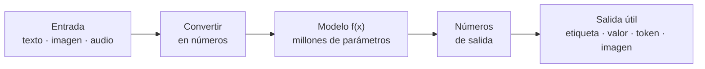

---

### 1. Una definición útil (y una que no lo es)

- **Definición de diccionario:** "máquinas que imitan la inteligencia humana". Es correcta, pero no te dice cómo funciona.
- **Definición técnica:** un sistema de IA **aprende una función** que transforma entradas en salidas a partir de **ejemplos**, y la usa para hacer **predicciones** sobre datos nuevos.
- **IA estrecha (narrow AI) vs. IA general (AGI):**
  - Todo lo que usarás en Foundry es **IA estrecha**: modelos muy buenos en un tipo de tarea (o un conjunto amplio de tareas de lenguaje, en el caso de los LLMs).
  - La **AGI** (una IA con capacidad general equivalente a la humana en cualquier tarea) sigue siendo un objetivo de investigación, no un producto que puedas desplegar.

### 2. Breve historia: de las reglas a los datos

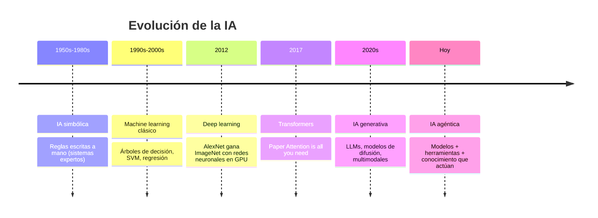

- **IA simbólica (sistemas expertos):** humanos escriben miles de reglas `si... entonces...`. Funcionan en dominios cerrados, pero se rompen ante casos no previstos y son imposibles de mantener a gran escala.
- **Machine learning:** en lugar de escribir reglas, se dan **ejemplos** y el algoritmo encuentra las reglas.
- **Deep learning:** redes neuronales con muchas capas que aprenden por sí solas qué características son importantes (no hay que diseñarlas a mano).
- **IA generativa y agéntica:** modelos tan grandes y entrenados con tantos datos que pueden generar contenido nuevo y, combinados con herramientas, actuar.

### 3. Programación tradicional vs. aprendizaje automático

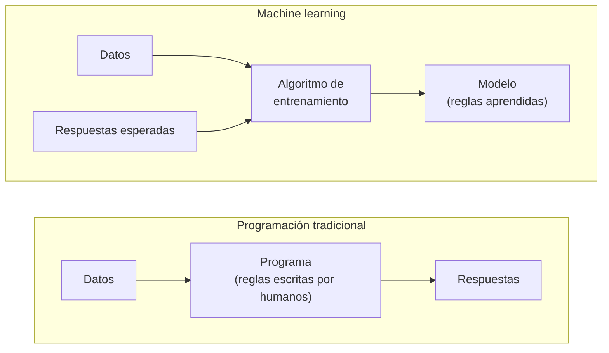

| | Programación tradicional | Machine learning |
|---|---|---|
| Entrada | Datos + **reglas** escritas por humanos | Datos + **respuestas esperadas** (o datos sin etiquetar) |
| Salida | Respuestas | **Reglas aprendidas** (el modelo) |
| Ejemplo | `if monto > 10000: alerta()` | Un modelo que aprende qué transacciones son fraude viendo miles de ejemplos |
| Cuando cambia el problema | Reescribes el código | Reentrenas con datos nuevos |
| Explicabilidad | Total: lees la regla | Parcial: hay que usar técnicas de interpretabilidad |

### 4. Un modelo es una función `y = f(x)`

- `x` son las **características** (*features*): los datos de entrada convertidos en números (tamaño de una casa, píxeles de una foto, IDs de tokens).
- `y` es la **etiqueta** (*label*) o la predicción (precio, "gato", siguiente token).
- `f` tiene **parámetros** (pesos y sesgos) que se ajustan durante el **entrenamiento** para reducir el error.

**Ejemplo con datos tabulares:**

| Tamaño del taco (cm) `x` | Precio real (MXN) `y` |
|---|---|
| 10 | 25 |
| 15 | 35 |
| 20 | 45 |

El modelo más simple posible es una línea: `precio = peso × tamaño + sesgo`. Entrenar es **encontrar el `peso` y el `sesgo`** que mejor se ajustan a la tabla (aquí la respuesta es `peso = 2`, `sesgo = 5`).

### 5. La neurona artificial: el ladrillo básico

Una neurona hace tres cosas: **multiplica** cada entrada por un peso, **suma** todo más un sesgo y pasa el resultado por una **función de activación**.

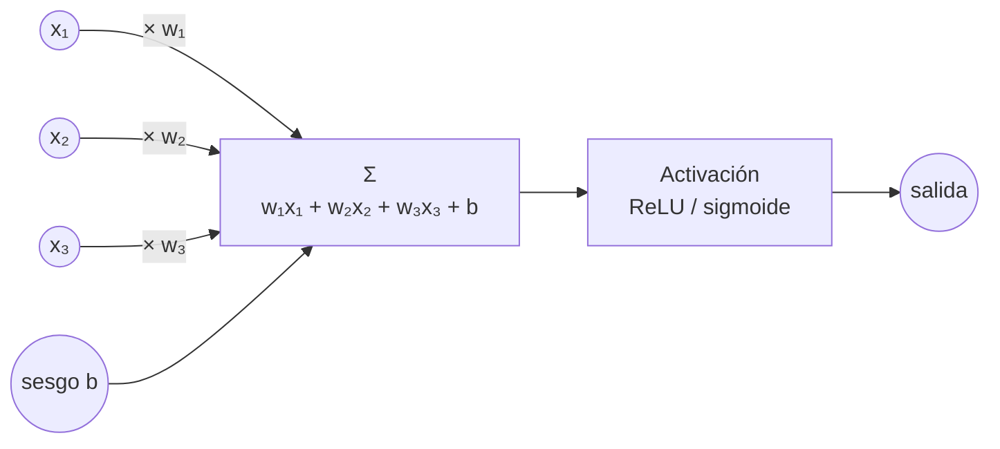

- **Pesos (`w`):** qué tan importante es cada entrada.
- **Sesgo (`b`):** un ajuste base, como la ordenada al origen de una recta.
- **Función de activación:** introduce **no linealidad**. Sin ella, apilar capas sería equivalente a una sola recta.
  - **ReLU:** `max(0, x)`. La más usada en capas ocultas.
  - **Sigmoide:** comprime cualquier número entre 0 y 1 (útil para probabilidades en clasificación binaria).

### 6. De una neurona a una red profunda

Una **red neuronal** apila neuronas en **capas**. "Profunda" (*deep*) solo significa que tiene muchas capas ocultas.

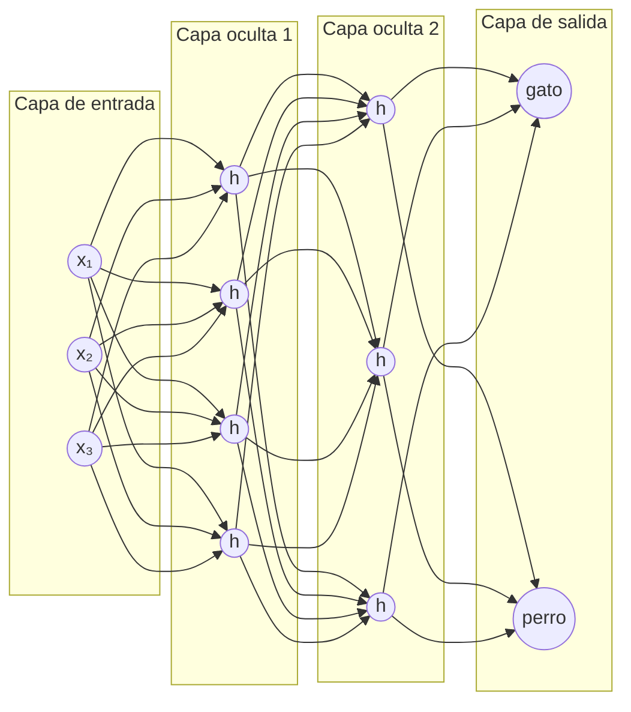

- Cada flecha es un **peso** (un parámetro). Esta red de juguete tiene 3×4 + 4×3 + 3×2 = **30 pesos** (más los sesgos).
- Las capas iniciales aprenden patrones simples; las finales, conceptos complejos.
- **Escala real:** un modelo pequeño de lenguaje tiene miles de millones de parámetros; los LLMs más grandes, cientos de miles de millones o más. Cada parámetro es un número que se ajustó durante el entrenamiento.

### 7. ¿Cómo aprende? Pérdida y descenso de gradiente

Entrenar es un ciclo que se repite miles o millones de veces:

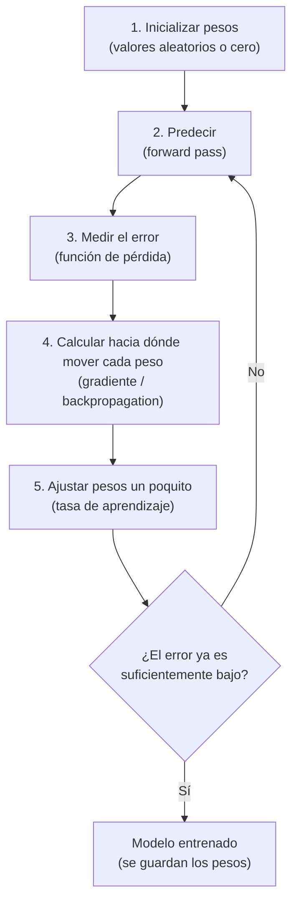

- **Función de pérdida (*loss*):** un número que mide qué tan mal predice el modelo.
  - Regresión: **error cuadrático medio** (MSE) = promedio de `(predicción − real)²`.
  - Clasificación y LLMs: **entropía cruzada** (*cross-entropy*): castiga dar baja probabilidad a la respuesta correcta.
- **Gradiente:** indica en qué dirección y cuánto cambia la pérdida si mueves cada peso. Se calcula para todos los pesos a la vez con **backpropagation**.
- **Descenso de gradiente:** mover cada peso en la dirección que **reduce** la pérdida.
- **Tasa de aprendizaje (*learning rate*):** el tamaño del paso. Muy grande: el modelo "brinca" y no converge. Muy pequeña: tarda muchísimo.
- **Época (*epoch*):** una pasada completa por todos los datos de entrenamiento.

Analogía: estás en una montaña con neblina y quieres bajar al valle (la pérdida mínima). No ves el valle, pero sí sientes la inclinación del suelo bajo tus pies (el gradiente). Das un paso cuesta abajo (tasa de aprendizaje) y repites.

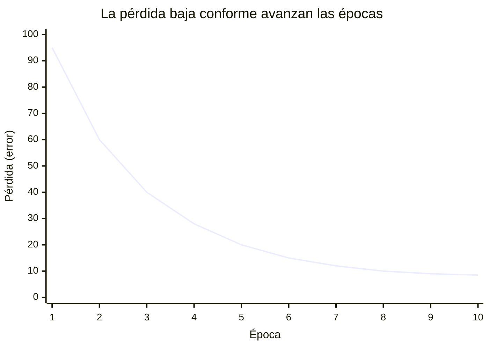

**Práctica: un modelo de una sola neurona entrenado desde cero**
```python
# Predecir el precio de un taco según su tamaño (y = peso * x + sesgo)
peso, sesgo = 0.0, 0.0                       # 1) inicializar
datos = [(10, 25), (15, 35), (20, 45)]       # (tamaño en cm, precio en MXN)
tasa = 0.001                                 # tasa de aprendizaje

for epoca in range(5000):
    perdida = 0
    for x, y_real in datos:
        y_pred = peso * x + sesgo            # 2) predecir (inferencia)
        error = y_pred - y_real              # 3) medir el error
        perdida += error ** 2
        peso  -= tasa * error * x            # 4-5) gradiente y ajuste
        sesgo -= tasa * error
    if epoca in (0, 10, 100, 1000, 4999):
        print(f"época {epoca:4d} | pérdida MSE {perdida/len(datos):9.3f} | peso {peso:.3f} | sesgo {sesgo:.3f}")

print(f"Precio estimado de un taco de 18 cm: ${peso * 18 + sesgo:.2f}")   # ≈ $41
```
- **Explicación:**
  - Empieza sin saber nada (pesos en cero) y en cada vuelta corrige un poquito.
  - Verás que la pérdida baja época tras época y que `peso` y `sesgo` se acercan a 2 y 5.
  - `error * x` es el gradiente de la pérdida respecto al peso (derivada del error cuadrático, sin el factor 2 que se absorbe en la tasa).
  - Un LLM hace **exactamente este proceso**, pero con miles de millones de pesos, billones de tokens de texto y miles de GPUs.

### 8. Datos de entrenamiento, validación y prueba

Un modelo no se evalúa con los mismos datos con los que aprendió (sería como calificar un examen con las mismas preguntas de la guía).

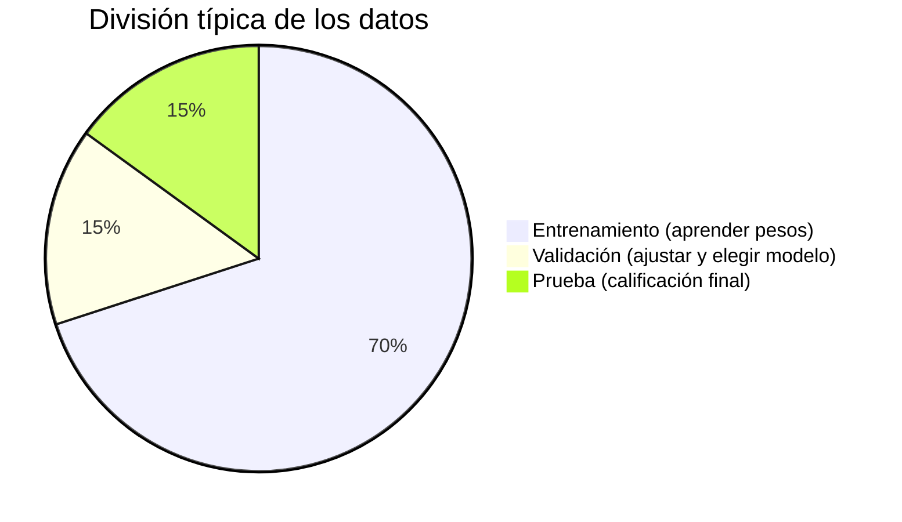

- **Entrenamiento:** con estos datos se ajustan los pesos.
- **Validación:** se usan durante el desarrollo para ajustar hiperparámetros (tasa de aprendizaje, número de capas) y detectar sobreajuste.
- **Prueba:** se usan **una sola vez** al final para estimar cómo le irá al modelo en el mundo real.

**Generalización, sobreajuste y subajuste:**

| | Subajuste (*underfitting*) | Buen ajuste | Sobreajuste (*overfitting*) |
|---|---|---|---|
| Qué pasa | El modelo es demasiado simple | Captura el patrón real | Memoriza los datos, incluido el ruido |
| Error en entrenamiento | Alto | Bajo | Muy bajo |
| Error en datos nuevos | Alto | Bajo | **Alto** |
| Analogía | No estudiaste | Entendiste el tema | Te aprendiste las respuestas de memoria |
| Remedio | Modelo más complejo, más características | — | Más datos, regularización, modelo más simple |

### 9. Entrenamiento vs. inferencia

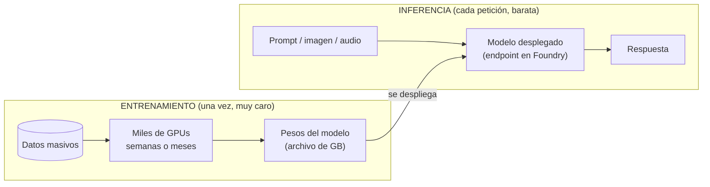

| | Entrenamiento | Inferencia |
|---|---|---|
| Qué ocurre | Se ajustan los pesos | Se usan los pesos ya fijos |
| Frecuencia | Una vez (o en cada nueva versión) | Millones de veces al día |
| Costo | Altísimo (millones de dólares en modelos grandes) | Por petición (por token, por imagen, por minuto) |
| Quién lo hace | El proveedor del modelo (OpenAI, Microsoft, Meta...) | **Tú**, cada vez que llamas a un endpoint |
| En Foundry | Fine-tuning (ajuste parcial) | Deployments, Playground, agentes |

En la AI-901 **casi nunca entrenas**: consumes modelos ya entrenados (del catálogo o de Foundry Tools) y los adaptas con **prompts**, **herramientas** y **datos (RAG)**. El fine-tuning es la excepción.

### 10. Tipos de aprendizaje

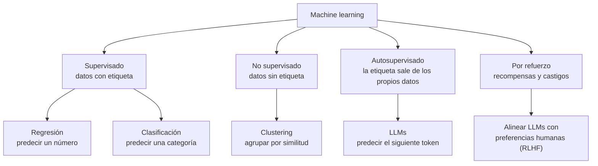

| Tipo | Ejemplo | Pregunta típica del examen |
|---|---|---|
| **Regresión** | Predecir ventas del próximo mes | "Predecir un valor numérico" |
| **Clasificación** | ¿El correo es spam o no? | "Asignar una categoría" |
| **Clustering** | Segmentar clientes por comportamiento | "Agrupar sin etiquetas previas" |
| **Autosupervisado** | Un LLM aprende leyendo texto y prediciendo la palabra siguiente | — (es cómo se preentrenan los LLMs) |
| **Por refuerzo** | Un agente aprende a jugar ajedrez; un LLM se alinea con calificaciones humanas | — |

Dato importante: los LLMs se preentrenan con **aprendizaje autosupervisado**. Nadie etiquetó billones de textos: la "etiqueta" es simplemente la siguiente palabra del propio texto. Por eso pudieron entrenarse con cantidades enormes de datos de internet.

### 11. Todo se convierte en números

La IA no "entiende" como un humano: encuentra **patrones estadísticos** en representaciones numéricas.

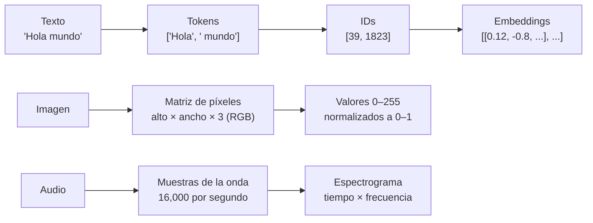

| Tipo de dato | Representación | Ejemplo de tamaño |
|---|---|---|
| Texto | Tokens → IDs → vectores (*embeddings*) | Una página ≈ 500–700 tokens |
| Imagen | Matriz de píxeles por canal RGB | Foto de 1920×1080 = 6.2 millones de números |
| Audio | Muestras de la onda → espectrograma | 1 segundo a 16 kHz = 16,000 números |
| Tabla | Cada columna es una característica | Una fila de un CSV = un vector |

### 12. La IA es probabilística

Un modelo no dice "esto es un gato"; produce **puntajes** que se convierten en **probabilidades** con la función **softmax**.

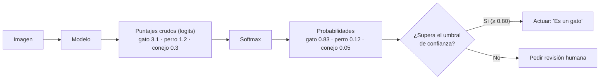

```python
import math

def softmax(puntajes, temperatura=1.0):
    exps = [math.exp(p / temperatura) for p in puntajes]
    total = sum(exps)
    return [round(e / total, 3) for e in exps]

logits = [3.1, 1.2, 0.3]                     # gato, perro, conejo
print(softmax(logits))                       # [0.826, 0.124, 0.05 ]  normal
print(softmax(logits, temperatura=0.3))      # [0.998, 0.002, 0.0  ]  más seguro / determinista
print(softmax(logits, temperatura=2.0))      # [0.612, 0.237, 0.151]  más "creativo"
```
- **Explicación:**
  - **Softmax** convierte puntajes en probabilidades que suman 1.
  - La **temperatura** controla qué tan "puntiaguda" es la distribución. En un LLM, temperatura baja = elige casi siempre el token más probable (respuestas consistentes); temperatura alta = explora tokens menos probables (respuestas más variadas). Es el mismo parámetro `temperature` que configuras en el Playground de Foundry.
- Un LLM no "sabe" la respuesta: calcula cuál es el siguiente token más probable dado el contexto. Por eso existen las **alucinaciones**: el modelo puede generar texto muy probable lingüísticamente pero falso.
- Por eso el principio de **confiabilidad y seguridad** insiste en umbrales de confianza, revisión humana y fundamentación (RAG).

### 13. Lo que la IA NO es (mitos comunes)

| Mito | Realidad técnica |
|---|---|
| "La IA piensa y entiende como un humano" | Encuentra patrones estadísticos; no tiene intenciones ni comprensión consciente |
| "Si lo dice la IA, es verdad" | Es probabilística: puede alucinar con total seguridad |
| "La IA aprende de cada conversación" | En inferencia los pesos **no cambian**; lo que "recuerda" es el historial que la app le reenvía |
| "La IA es objetiva" | Hereda los sesgos de sus datos de entrenamiento |
| "Más grande siempre es mejor" | Modelos más pequeños o servicios especializados suelen ser más baratos, rápidos y suficientes |
| "La IA sabe lo que pasó hoy" | Solo sabe lo que había en sus datos de entrenamiento (fecha de corte), salvo que le des información nueva (RAG, búsqueda web) |

### 14. Mapa completo: cómo encaja todo

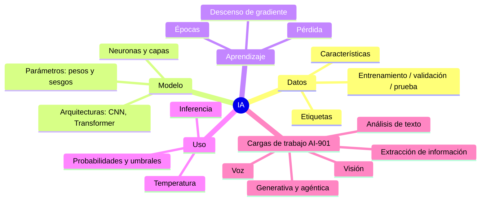

### 15. Las cargas de trabajo (workloads) de IA que evalúa el examen

| Carga de trabajo | Qué hace | Ejemplo | En Foundry |
|---|---|---|---|
| **IA generativa y agéntica** | Crea contenido y actúa con herramientas | Asistente que responde dudas y crea tickets | Modelos del catálogo, Foundry Agent Service |
| **Análisis de texto** | Extrae significado del texto | Sentimiento de reseñas, detección de PII | Azure Language |
| **Voz** | Audio ↔ texto | Subtítulos, IVR, agente de voz | Azure Speech, Voice Live |
| **Visión por computadora** | Interpreta o genera imágenes y video | Describir fotos, generar imágenes | Modelos multimodales, GPT-Image, Sora |
| **Extracción de información** | Saca datos estructurados de documentos y medios | Campos de facturas, resumen de llamadas | Content Understanding |

### Para el examen
- "Predecir un valor numérico" → **regresión**; "asignar una categoría" → **clasificación**; "agrupar sin etiquetas" → **clustering**.
- "Crear contenido nuevo a partir de lenguaje natural" → **IA generativa**.
- "Tomar acciones usando herramientas" → **agente**.
- "Usar un modelo ya entrenado para obtener una predicción" → **inferencia**.
- "El modelo funciona perfecto con los datos de entrenamiento pero mal con datos nuevos" → **sobreajuste**.
- "Hacer las respuestas más consistentes y menos creativas" → **bajar la temperatura**.
- "Solo actuar si el modelo está suficientemente seguro" → **umbral de confianza** (confiabilidad y seguridad).

### Recursos
- [Introducción a los conceptos de machine learning – Microsoft Learn](https://learn.microsoft.com/es-es/training/modules/fundamentals-machine-learning/)
- [Redes neuronales – 3Blue1Brown (serie en video)](https://www.youtube.com/playlist?list=PLZHQObOWTQDNU6R1_67000Dx_ZCJB-3pi)
- [Machine Learning Crash Course – Google](https://developers.google.com/machine-learning/crash-course)
- [Ligera introducción a Deep Learning (acordeón AI-900)](https://github.com/josejesusguzman/acordeon-ia-900/blob/main/docs/intro_deep_learning.md)
