# Tema 3: IA, Machine Learning, Deep Learning, IA Generativa e IA Agéntica

### Descripción
Estos cinco términos se usan como sinónimos, pero son **capas que se contienen una dentro de otra**, como muñecas rusas (matrioskas). Toda IA generativa es deep learning, todo deep learning es machine learning y todo machine learning es IA, pero no al revés. Entender la diferencia te ayuda a **elegir la herramienta correcta** (y la más barata) y a no caer en las trampas del examen.

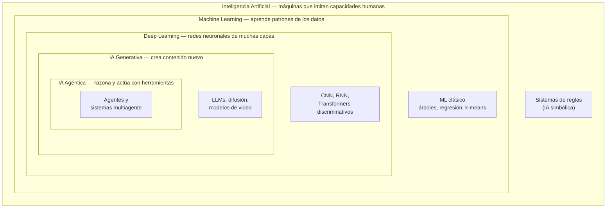

> [!NOTE]
> La IA agéntica no es un tipo de modelo nuevo: es una **forma de construir sistemas** alrededor de un modelo generativo (modelo + instrucciones + herramientas + memoria). Por eso aparece dentro de la capa generativa.

---

## 1. Inteligencia Artificial (IA)

### Definición
Cualquier técnica que permite a una máquina imitar capacidades humanas: percibir, razonar, decidir, comunicarse. Es el **paraguas**: incluye desde un sistema de reglas de los años 80 hasta un agente con GPT-5.

### IA simbólica (basada en reglas)
Antes del machine learning, la IA eran **reglas escritas por expertos**: los famosos *sistemas expertos*.

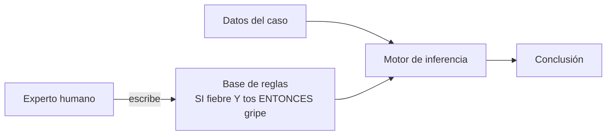

```python
# IA "clásica": un filtro de spam con reglas escritas a mano
def es_spam(correo: str) -> bool:
    palabras_prohibidas = ["gana dinero", "cura milagrosa", "haz clic aquí"]
    return any(p in correo.lower() for p in palabras_prohibidas)

print(es_spam("¡HAZ CLIC AQUÍ y gana dinero hoy!"))   # True
print(es_spam("G4na d1nero fácil"))                    # False  ← se rompe con variaciones
```
- **Explicación:** funciona para casos previstos, pero cualquier variación ("G4na d1nero") la evade. Mantener miles de reglas es imposible: por eso nació el machine learning.

### Cuándo sigue siendo la mejor opción
- Reglas **pocas, claras y estables** (validar un RFC, calcular el IVA, aplicar una política fija).
- Se necesita **explicabilidad total y auditoría** (regulación).
- No hay datos para entrenar.

---

## 2. Machine Learning (ML / aprendizaje automático)

### Definición
Modelos que **aprenden patrones a partir de datos** en lugar de seguir reglas explícitas. Un humano elige el algoritmo y prepara las **características** (*features*); el algoritmo encuentra la relación entre características y resultado.

### Tipos de aprendizaje

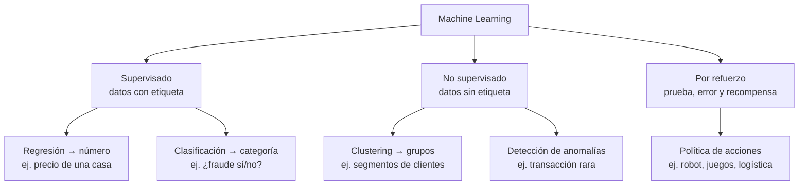

### Algoritmos típicos

| Algoritmo | Tipo | Para qué | Ventaja |
|---|---|---|---|
| Regresión lineal | Supervisado – regresión | Predecir un valor continuo | Simple y explicable |
| Regresión logística | Supervisado – clasificación | Sí/no (aunque se llame "regresión") | Rápida, da probabilidades |
| Árbol de decisión | Supervisado | Clasificar o predecir con reglas aprendidas | Se puede leer como diagrama |
| Random forest / gradient boosting (XGBoost, LightGBM) | Supervisado | Datos tabulares en producción | Muy preciso en tablas |
| Naive Bayes | Supervisado – clasificación | Texto (spam, sentimiento) | Muy rápido |
| K-means | No supervisado | Agrupar | Fácil de entender |
| Isolation Forest | No supervisado | Anomalías | Detecta lo "raro" sin etiquetas |

### El ciclo de vida de un modelo de ML

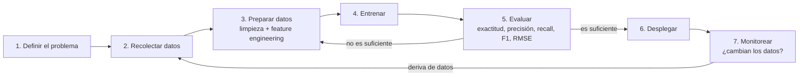

### Feature engineering: la clave del ML clásico
En ML clásico, **un humano decide qué características** ve el modelo. Para detectar spam podrías crear: número de signos de exclamación, porcentaje de mayúsculas, si contiene enlaces, longitud del correo...

```python
# pip install scikit-learn
from sklearn.feature_extraction.text import TfidfVectorizer
from sklearn.linear_model import LogisticRegression
from sklearn.pipeline import make_pipeline

correos = ["gana dinero ya haz clic", "reunión de equipo a las 10", "cura milagrosa oferta",
           "te envío la minuta", "g4na d1nero fácil oferta", "revisión del presupuesto Q3"]
etiquetas = [1, 0, 1, 0, 1, 0]   # 1 = spam

modelo = make_pipeline(TfidfVectorizer(analyzer="char_wb", ngram_range=(2, 4)), LogisticRegression())
modelo.fit(correos, etiquetas)

print(modelo.predict(["G4na d1nero con esta oferta"]))     # [1]  ← detecta la variación
print(modelo.predict_proba(["minuta de la reunión"])[0])   # probabilidad [no spam, spam]
```
- **Explicación:**
  - `TfidfVectorizer` con n-gramas de **caracteres** convierte el texto en características numéricas; por eso "g4na d1nero" se parece a "gana dinero".
  - `LogisticRegression` aprende qué características indican spam.
  - Con más ejemplos, el modelo generaliza mucho mejor que las reglas, y **nadie tuvo que escribir la regla**.

### Cuándo usar ML clásico
- Datos **tabulares y estructurados** (ventas, transacciones, sensores, CRM).
- Necesitas una **predicción numérica o una categoría** con buena explicabilidad.
- Tienes datos históricos etiquetados.
- Ejemplos: predecir demanda, *churn* de clientes, scoring de crédito, mantenimiento predictivo, detección de fraude.
- Suele ser **más barato, rápido y explicable** que un LLM para estas tareas.

---

## 3. Deep Learning (aprendizaje profundo)

### Definición
ML basado en **redes neuronales con muchas capas** que **aprenden por sí solas las características** relevantes directamente de los datos crudos (píxeles, ondas de audio, texto).

### La gran diferencia: quién diseña las características

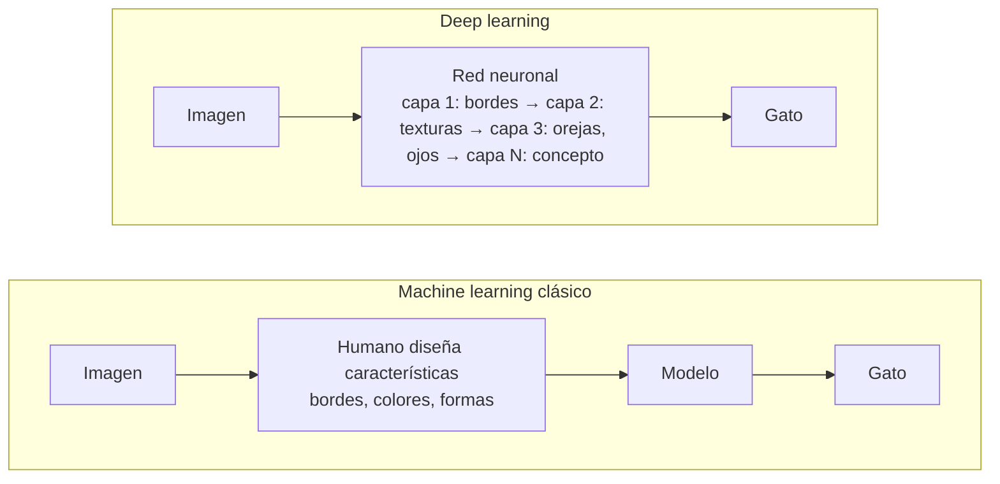

### Arquitecturas principales

| Arquitectura | Año clave | Ideal para | Idea central |
|---|---|---|---|
| **MLP** (perceptrón multicapa) | 1980s | Datos tabulares sencillos | Capas totalmente conectadas |
| **CNN** (red convolucional) | 2012 (AlexNet) | Imágenes | Filtros que detectan patrones locales |
| **RNN / LSTM** | 1997–2014 | Secuencias (texto, audio) | Memoria paso a paso; lentas y "olvidadizas" |
| **Transformer** | 2017 | Texto, imágenes, audio, todo | **Atención**: relaciona todas las partes a la vez, en paralelo |

### ¿Por qué despegó en 2012?
Tres ingredientes coincidieron:

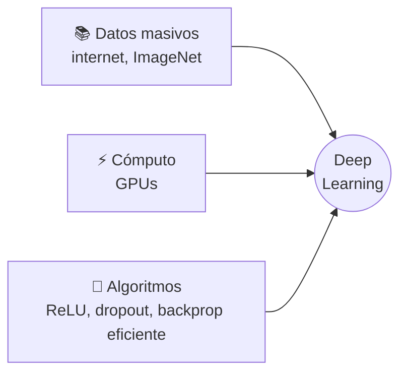

### Datos vs. rendimiento
El deep learning necesita muchos datos, pero sigue mejorando donde el ML clásico se estanca:

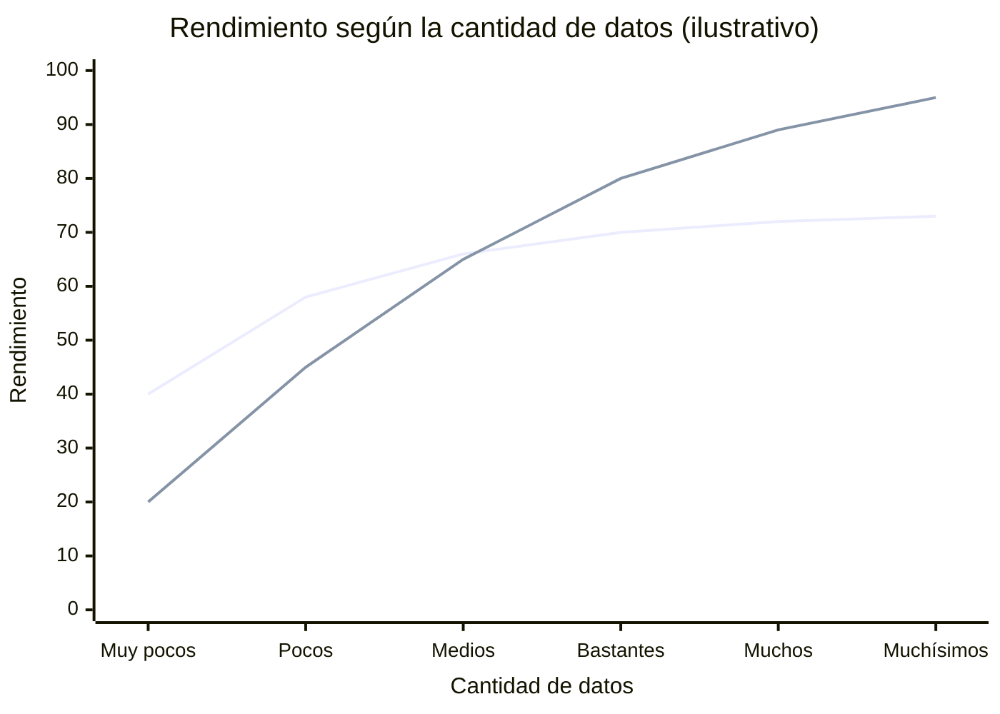
*Línea que se estanca: ML clásico. Línea que sigue subiendo: deep learning.*

### Cuándo usar deep learning (entrenado por ti)
- Datos **no estructurados** (imágenes, audio, texto) y **muchos** ejemplos.
- Tareas de percepción: reconocer productos en fotos, transcribir voz, detectar defectos.
- **En la práctica de la AI-901:** rara vez entrenas una red desde cero; usas modelos de deep learning ya entrenados a través de **Foundry Tools** (Vision, Speech, Language) o del **catálogo de modelos**.

---

## 4. IA Generativa

### Definición
Modelos de deep learning que **crean contenido nuevo** (texto, imágenes, video, audio, código) a partir de un *prompt*, aprendiendo la **distribución** de los datos con los que se entrenaron.

### Discriminativo vs. generativo

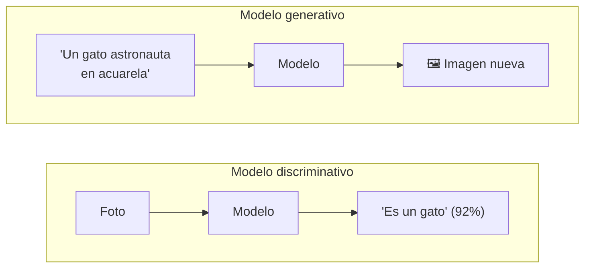

| | Discriminativo | Generativo |
|---|---|---|
| Pregunta | "¿Qué es esto?" | "Crea algo como esto" |
| Aprende | La frontera entre clases | Cómo se ven los datos (su distribución) |
| Salida | Etiqueta, número, probabilidad | Texto, imagen, audio, video, código |
| Ejemplos | Clasificador de spam, detector de objetos | GPT, Claude, GPT-Image, Sora |

### Familias de modelos generativos

| Familia | Cómo genera | Ejemplos |
|---|---|---|
| **Autorregresivos (LLMs)** | Predicen el siguiente token, uno a la vez | GPT-5, Claude, Llama, Phi, Mistral |
| **Difusión** | Parten de ruido y lo eliminan paso a paso | Stable Diffusion, FLUX |
| **GAN** | Un generador compite contra un discriminador | StyleGAN (rostros sintéticos) |
| **VAE** | Comprimen a un espacio latente y reconstruyen | Componentes de modelos de difusión |
| **Multimodales nativos** | Un mismo modelo entiende y genera varias modalidades | GPT-Image, modelos de audio en tiempo real |

### Cómo se construye un LLM moderno

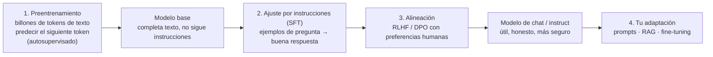

### Fortalezas y limitaciones

| Fortalezas | Limitaciones |
|---|---|
| Entiende y genera lenguaje natural en muchos idiomas | **Alucinaciones**: inventa con seguridad |
| Una sola herramienta para cientos de tareas | Conocimiento limitado a su **fecha de corte** |
| No requiere entrenamiento: basta un prompt | Salida **no determinista** |
| Resume, traduce, redacta, programa | Costo por token y latencia |
| Multimodal (texto + imagen + audio) | Sesgos heredados de los datos |

### Cuándo usarla
Redactar, resumir, traducir, conversar, generar código o imágenes, extraer información de texto libre: tareas **abiertas** donde hay muchas respuestas válidas.

### Cuándo NO
Cuando necesitas un resultado **exacto, determinista y auditable** (un cálculo fiscal, una regla de negocio fija) o cuando un servicio especializado lo hace más barato y consistente (detectar idioma, OCR).

---

## 5. IA Agéntica

### Definición
Sistemas que usan un modelo generativo como "cerebro" para **razonar, planear y actuar** usando herramientas, de forma (semi)autónoma, hasta cumplir un **objetivo**.

### Componentes de un agente

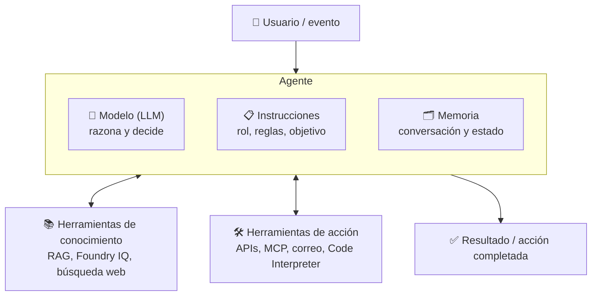

### El ciclo del agente (patrón ReAct: razonar → actuar → observar)

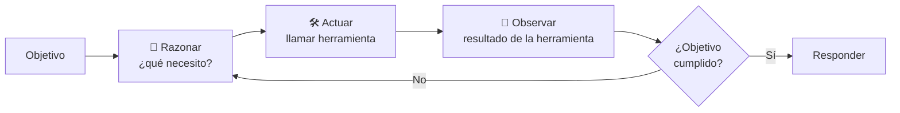

```python
# Simulación del ciclo de un agente (sin nube) para entender la lógica
herramientas = {
    "consultar_politica": lambda dias: "100%" if dias > 7 else "50%" if dias >= 2 else "0%",
    "crear_reembolso":    lambda pct: f"Reembolso del {pct} creado con folio R-1042",
}

def agente(objetivo, dias_anticipacion):
    print(f"🎯 Objetivo: {objetivo}")
    # Paso 1: razonar -> necesito saber la política
    print("🤔 Necesito saber cuánto se reembolsa según la anticipación")
    pct = herramientas["consultar_politica"](dias_anticipacion)          # actuar
    print(f"👀 Observación: corresponde {pct}")                          # observar
    # Paso 2: razonar -> ya sé el porcentaje, ahora ejecuto la acción
    if pct == "0%":
        return "No aplica reembolso según la política."
    print("🤔 Ya tengo el porcentaje; ahora creo el reembolso")
    return herramientas["crear_reembolso"](pct)

print("✅", agente("Cancelar el viaje y pedir reembolso", dias_anticipacion=5))
```
- **Explicación:** en un agente real **el LLM decide** qué herramienta llamar, con qué parámetros y cuándo parar; aquí lo simulamos con `if` para ver el flujo. En Foundry las herramientas son MCP, OpenAPI, funciones, Code Interpreter o Foundry IQ.

### Workflow vs. agente
No todo lo que usa un LLM debe ser un agente:

| | Workflow (flujo fijo) | Agente |
|---|---|---|
| Quién decide los pasos | **Tu código** | **El modelo** |
| Predecibilidad | Alta | Menor |
| Costo y latencia | Menores | Mayores (varias llamadas) |
| Ideal para | Procesos repetibles y conocidos | Tareas abiertas con caminos variables |
| Ejemplo | Siempre: extraer factura → validar → guardar | "Resuelve la queja de este cliente" |

### Niveles de autonomía

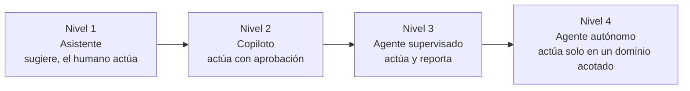
A mayor autonomía, más importantes son los **guardrails**, la **aprobación humana** en acciones irreversibles y la **observabilidad**.

### Sistemas multiagente
Varios agentes especializados se coordinan (un orquestador reparte el trabajo):

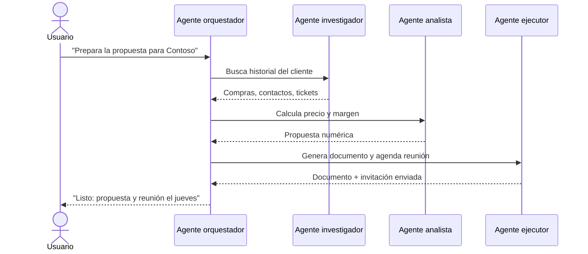

### Cuándo usarla
Procesos de **varios pasos** que requieren **decidir qué hacer** y **tocar otros sistemas**: atender una solicitud de reembolso completa, investigar y redactar un reporte, resolver tickets de soporte.

### Cuándo NO
Si el flujo es siempre el mismo y predecible, un **workflow** tradicional (o un solo prompt) es más barato, rápido y confiable.

---

## 6. Comparación global

| Criterio | IA basada en reglas | ML clásico | Deep learning | IA generativa | IA agéntica |
|---|---|---|---|---|---|
| ¿Aprende de datos? | ❌ | ✅ | ✅ | ✅ | ✅ (usa un modelo que aprendió) |
| Datos típicos | Ninguno | Tabulares | Imágenes, audio, texto | Texto, imagen, multimodal | Cualquiera + sistemas externos |
| Cantidad de datos para entrenar | — | Cientos a miles | Miles a millones | Billones de tokens (lo hace el proveedor) | — (usa modelos existentes) |
| Cómputo | Mínimo | CPU | GPU | Muchas GPUs | Varias llamadas al modelo |
| Explicabilidad | ⭐⭐⭐⭐⭐ | ⭐⭐⭐⭐ | ⭐⭐ | ⭐ | ⭐ (mejora con trazas) |
| Salida | Decisión fija | Número o categoría | Etiqueta, cajas, transcripción | Contenido nuevo | Acciones + contenido |
| Determinista | ✅ | ✅ | ✅ | ❌ | ❌ |
| En Microsoft | Lógica de tu app | Azure Machine Learning | Foundry Tools | Catálogo de modelos de Foundry | Foundry Agent Service |

## 7. Árbol de decisión

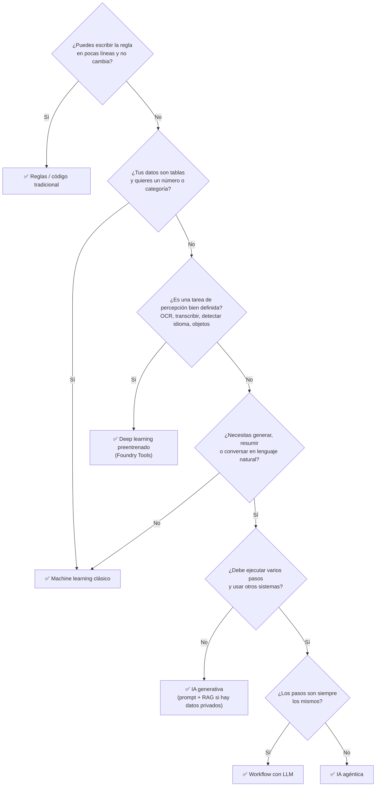

## 8. El mismo problema, resuelto en cada capa

**Problema:** una aseguradora recibe miles de correos de clientes al día.

| Capa | Solución | Resultado |
|---|---|---|
| Reglas | Si el asunto contiene "siniestro" → área de siniestros | Rápido, pero falla con "choqué mi carro" |
| ML clásico | Clasificador entrenado con correos históricos etiquetados | Enruta por categoría con 90%+ de exactitud |
| Deep learning | Modelo preentrenado de NLP detecta idioma, sentimiento y entidades (póliza, fecha) | Prioriza clientes molestos y extrae el número de póliza |
| IA generativa | LLM + RAG con las pólizas redacta una respuesta personalizada | Borrador de respuesta en segundos para que lo revise un humano |
| IA agéntica | Agente que lee el correo, consulta la póliza, abre el siniestro en el sistema, agenda al ajustador y responde | Caso resuelto de principio a fin; humano aprueba los pasos críticos |

En una solución real **se combinan**:

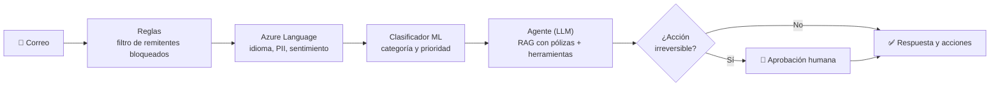

## Tabla de decisión rápida

| Necesito... | Usa |
|---|---|
| Validar que un RFC tenga el formato correcto | Reglas (regex) |
| Predecir ventas del próximo mes con datos históricos | Machine learning (regresión) |
| Segmentar clientes sin categorías previas | Machine learning (clustering) |
| Detectar defectos en fotos de una línea de producción | Deep learning (visión) |
| Detectar el idioma de miles de correos de forma consistente | Servicio especializado (Azure Language), no un LLM |
| Responder preguntas de clientes en lenguaje natural | IA generativa (+ RAG) |
| Atender una solicitud completa: entender, consultar sistemas y ejecutar acciones | IA agéntica |

### Para el examen
- "Crear contenido nuevo a partir de un prompt" → **IA generativa**.
- "Usar herramientas para completar tareas de forma autónoma" → **agente**.
- "Agente que define su rol" → **instrucciones**; "agente que consulta datos o actúa" → **herramientas**.
- "Varios agentes especializados colaborando" → **sistema multiagente**.
- "Predecir un número / una categoría / agrupar" → **regresión / clasificación / clustering** (ML).
- "LLM vs. SLM": LLM = más datos y parámetros, generaliza; SLM = enfocado, barato, ideal en dispositivos.
- Distractor común: proponer un LLM para una tarea que un servicio especializado o una regla resuelve más barato.

### Recursos
- [Introducción a los conceptos de machine learning – Microsoft Learn](https://learn.microsoft.com/es-es/training/modules/fundamentals-machine-learning/)
- [Building effective agents – Anthropic](https://www.anthropic.com/research/building-effective-agents)
- [AI Agents for Beginners – Microsoft](https://github.com/microsoft/ai-agents-for-beginners)
- [Ligera introducción a Deep Learning (acordeón AI-900)](https://github.com/josejesusguzman/acordeon-ia-900/blob/main/docs/intro_deep_learning.md)
