# Tema 4: Bases técnicas de cómo funciona el análisis de texto y el lenguaje natural

### Descripción
El **procesamiento de lenguaje natural (NLP)** es la rama de la IA que permite a las computadoras analizar, entender y generar lenguaje humano. Para una computadora, "Me encantó el servicio" es solo una cadena de caracteres; el NLP la convierte en números con los que se puede calcular algo útil: sentimiento, idioma, entidades, temas, un resumen o una respuesta.

Analogía: es como enseñarle a alguien a leer un idioma que no conoce. Primero separa las palabras (tokenización), luego cuenta cuáles se repiten (estadística) y, con suficiente práctica, entiende qué significan según el contexto (modelos semánticos).

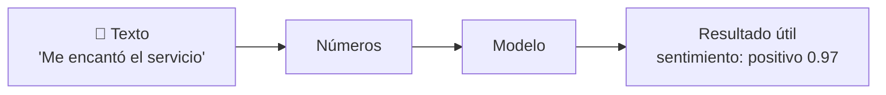

---

## 1. NLU, NLG y por qué el lenguaje es difícil

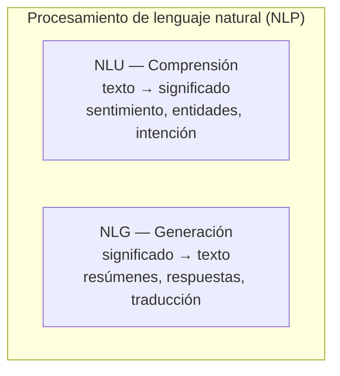

- **NLU (Natural Language Understanding):** entender. La mayoría del "análisis de texto" del examen es NLU.
- **NLG (Natural Language Generation):** producir texto. Es lo que hacen los LLMs.

**¿Por qué es difícil para una máquina?**

| Fenómeno | Ejemplo | Reto |
|---|---|---|
| **Ambigüedad léxica** | "Fui al **banco**" (dinero o asiento) | La misma palabra, varios significados |
| **Ambigüedad sintáctica** | "Vi a la mujer con los binoculares" | ¿Quién tenía los binoculares? |
| **Correferencia** | "Ana habló con Sofía porque **ella** estaba molesta" | ¿Quién es "ella"? |
| **Ironía y sarcasmo** | "¡Qué maravilla, otra vez se cayó el sistema!" | Palabras positivas, sentimiento negativo |
| **Variantes regionales** | "chido", "guay", "bacán" | Mismo significado, distintas palabras |
| **Mezcla de idiomas** | "Mándame el *update* del *deck*" | *Code-switching* |
| **Errores y abreviaturas** | "q onda, x fa mandame el doc" | Texto informal de redes sociales |
| **Negación** | "No está **nada** mal" | Doble negación = positivo |

---

## 2. El pipeline completo de NLP

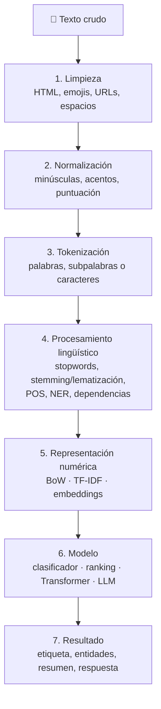

> [!NOTE]
> Con los modelos modernos (Transformers, LLMs) varios pasos desaparecen: el modelo recibe el texto casi crudo y su propio tokenizador hace el trabajo. Las etapas 2 y 4 son esenciales en el **NLP estadístico** clásico.

---

## 3. Preprocesamiento paso a paso

### 3.1 Normalización
Convertir el texto a una forma estándar para que "Hola", "HOLA" y "hola!!!" cuenten como lo mismo.

```python
import re, unicodedata

def normalizar(texto, quitar_acentos=False):
    texto = texto.lower()
    texto = re.sub(r"https?://\S+", " ", texto)          # quitar URLs
    texto = re.sub(r"[^\w\sáéíóúüñ]", " ", texto)        # quitar puntuación y emojis
    if quitar_acentos:
        texto = "".join(c for c in unicodedata.normalize("NFD", texto) if unicodedata.category(c) != "Mn")
    return re.sub(r"\s+", " ", texto).strip()

print(normalizar("¡¡ME ENCANTÓ el servicio!! 😍 https://contoso.mx"))   # 'me encantó el servicio'
```
- **Cuidado:** normalizar demasiado puede perder significado ("Mr Banks" vs "banks"; "¡NO!" en mayúsculas expresa enojo).

### 3.2 Tokenización: tres niveles

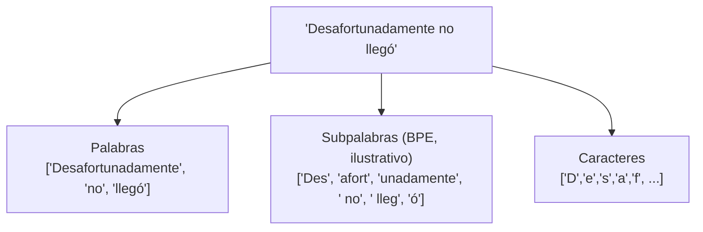

| Nivel | Ventaja | Desventaja | Quién lo usa |
|---|---|---|---|
| Palabras | Intuitivo | Vocabulario enorme; palabras nuevas = "desconocidas" | NLP clásico |
| Caracteres | Vocabulario mínimo | Secuencias muy largas, poco significado por token | Algunos modelos especializados |
| **Subpalabras** | Equilibrio: palabras comunes enteras, raras en pedazos | Los cortes no siempre son "lingüísticos" | **Todos los LLMs** (BPE, WordPiece) |

**BPE (Byte-Pair Encoding)**, el algoritmo que usan los GPT, funciona así: empieza con caracteres sueltos y **fusiona repetidamente el par más frecuente** hasta llegar al tamaño de vocabulario deseado.

```python
from collections import Counter

# Corpus de juguete: palabras separadas en caracteres
corpus = [list("bajar"), list("bajo"), list("bajamos"), list("subir"), list("subo")]

def par_mas_frecuente(corpus):
    pares = Counter((p[i], p[i + 1]) for p in corpus for i in range(len(p) - 1))
    return pares.most_common(1)[0][0]

def fusionar(corpus, par):
    nuevo = []
    for p in corpus:
        i, res = 0, []
        while i < len(p):
            if i < len(p) - 1 and (p[i], p[i + 1]) == par:
                res.append(p[i] + p[i + 1]); i += 2
            else:
                res.append(p[i]); i += 1
        nuevo.append(res)
    return nuevo

for paso in range(4):
    par = par_mas_frecuente(corpus)
    corpus = fusionar(corpus, par)
    print(f"Fusión {paso + 1}: {par} -> {corpus}")
```
- **Explicación:** en pocas fusiones aparece el token `baj` (raíz compartida por "bajar", "bajo", "bajamos"). Así un LLM puede manejar palabras que nunca vio, combinando subpalabras conocidas. También explica por qué **el español consume más tokens** que el inglés: los vocabularios se construyeron con más texto en inglés.

### 3.3 Procesamiento lingüístico

| Técnica | Qué hace | Ejemplo |
|---|---|---|
| **Eliminación de stopwords** | Quita palabras muy frecuentes con poco significado | "el", "de", "que", "y" |
| **Stemming** | Recorta terminaciones de forma mecánica | "corriendo", "corrió" → "corr" |
| **Lematización** | Lleva a la forma de diccionario con reglas lingüísticas | "corriendo", "corrió" → "correr" |
| **POS tagging** | Etiqueta la categoría gramatical | "Ana/PROPN corre/VERB rápido/ADV" |
| **NER** | Detecta entidades con nombre | "Ana/PERSONA viajó a Oaxaca/LUGAR" |
| **Análisis de dependencias** | Relaciones sintácticas (sujeto, objeto) | "Ana" es sujeto de "compró" |
| **N-gramas** | Agrupa palabras consecutivas | "inteligencia artificial" (bigrama) |

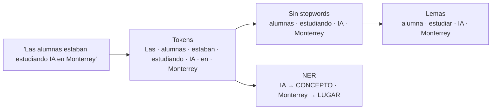

---

## 4. Cómo representar texto como números: la evolución

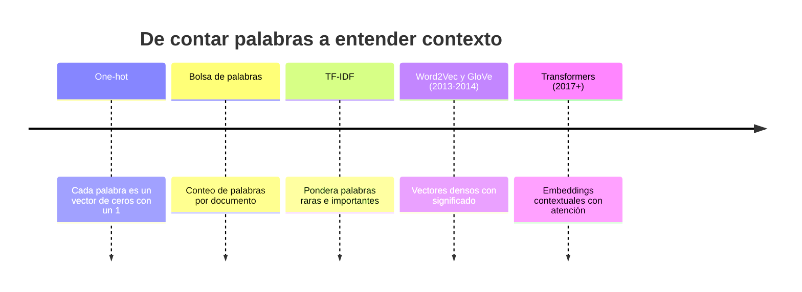

| Representación | Ejemplo para "el perro ladra" | Captura significado | Captura contexto |
|---|---|---|---|
| **One-hot** | `perro = [0,0,1,0,...,0]` (tamaño = vocabulario) | ❌ | ❌ |
| **Bolsa de palabras (BoW)** | `{el:1, perro:1, ladra:1}` | ❌ | ❌ (ignora el orden) |
| **TF-IDF** | `{perro:0.62, ladra:0.62, el:0.1}` | Parcial (importancia) | ❌ |
| **Embeddings estáticos** | `perro = [0.8, 0.6, 0.1, ...]` | ✅ | ❌ ("banco" tiene un solo vector) |
| **Embeddings contextuales** | `perro` cambia según la oración | ✅ | ✅ |

```python
# pip install scikit-learn
from sklearn.feature_extraction.text import CountVectorizer, TfidfVectorizer

docs = ["el perro ladra", "el gato maúlla", "el perro y el gato juegan"]

bow = CountVectorizer().fit(docs)
print(bow.get_feature_names_out())
print(bow.transform(docs).toarray())          # bolsa de palabras: conteos

tfidf = TfidfVectorizer().fit(docs)
print(tfidf.transform(["el perro ladra"]).toarray().round(2))   # 'el' pesa menos que 'ladra'
```
- **Explicación:** en BoW, "el perro ladra" y "ladra el perro" son idénticos (se pierde el orden). TF-IDF baja el peso de "el" porque aparece en todos los documentos. Los embeddings los verás a fondo en el [Módulo 3](../modulo3/tema2.md).

---

## 5. Las tareas de análisis de texto (lo que pregunta el examen)

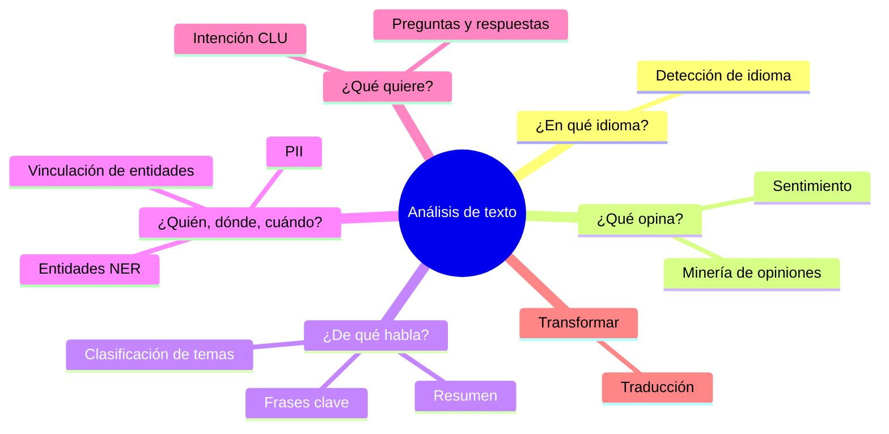

| Tarea | Entrada | Salida |
|---|---|---|
| **Detección de idioma** | "¡Hola! Me llamo Josefina y vivo en Madrid" | `Spanish`, `es`, confianza `1.0` |
| **Análisis de sentimiento** | "El hotel era precioso pero el servicio lentísimo" | `mixed` (positivo 0.45, negativo 0.52, neutral 0.03) |
| **Minería de opiniones** | La misma reseña | `hotel → precioso (+)`, `servicio → lentísimo (−)` |
| **Frases clave** | "La nueva app de Contoso mejora la seguridad de los pagos" | `nueva app`, `Contoso`, `seguridad de los pagos` |
| **Reconocimiento de entidades (NER)** | "Ana viajó a Oaxaca el 2 de marzo" | Ana → Persona; Oaxaca → Ubicación; 2 de marzo → FechaHora |
| **Vinculación de entidades** | "Mercurio está cerca del Sol" | Mercurio → enlace a "Mercurio (planeta)" en Wikipedia |
| **Detección de PII** | "María llamó del 55 1234 5678" | `***** llamó del ************` + categorías |
| **Resumen extractivo** | Documento largo | Las 3 oraciones más importantes, **copiadas** |
| **Resumen abstractivo** | Documento largo | Un párrafo **nuevo** que resume |
| **Clasificación** | Ticket de soporte | `facturación` / `técnico` / `ventas` |
| **Intención (CLU)** | "Quiero cambiar mi vuelo al viernes" | Intent `CambiarVuelo`, entidad `fecha = viernes` |
| **Traducción** | "Good morning" | "Buenos días" |

### Cómo funciona el análisis de sentimiento por dentro

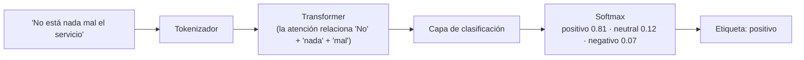
- Un modelo de bolsa de palabras vería "mal" y diría negativo. Un modelo con **atención** entiende la doble negación porque relaciona las palabras entre sí.
- **A nivel documento** se agregan los puntajes de cada oración: si hay oraciones positivas y negativas, el resultado es **mixed** (mixto).

---

## 6. ¿Cómo se mide si un modelo de NLP es bueno?

### Para clasificación (sentimiento, spam, temas): matriz de confusión

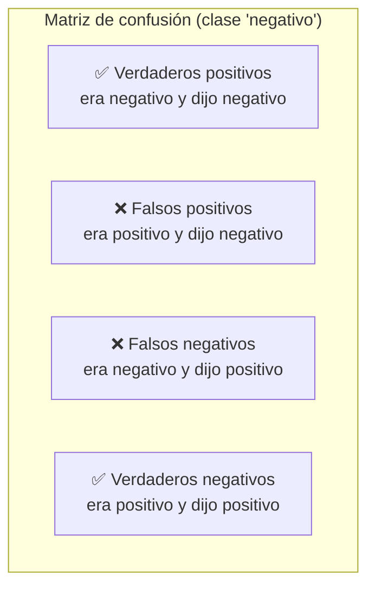

| Métrica | Fórmula | Pregunta que responde |
|---|---|---|
| **Exactitud (accuracy)** | (VP + VN) / total | ¿Qué porcentaje acertó en general? |
| **Precisión** | VP / (VP + FP) | De lo que marcó como negativo, ¿cuánto lo era? |
| **Recall (exhaustividad)** | VP / (VP + FN) | De todo lo negativo, ¿cuánto encontró? |
| **F1** | 2 × (P × R) / (P + R) | Balance entre precisión y recall |

```python
from sklearn.metrics import classification_report

reales      = ["neg", "neg", "pos", "pos", "neg", "pos", "neg", "pos"]
predicciones = ["neg", "pos", "pos", "pos", "neg", "neg", "neg", "pos"]
print(classification_report(reales, predicciones, digits=2))
```
- **¿Cuál importa más?** En detección de PII o de quejas legales importa el **recall** (no se te puede escapar ninguna). En un filtro de spam importa la **precisión** (no quieres mandar a spam un correo legítimo).

### Para generación (resumen, traducción)
- **BLEU** (traducción) y **ROUGE** (resumen): comparan las palabras generadas contra una referencia humana.
- **Métricas asistidas por IA** (las de Foundry): fluidez, coherencia, relevancia, groundedness, usando un LLM como juez.

---

## 7. ¿LLM o servicio especializado?

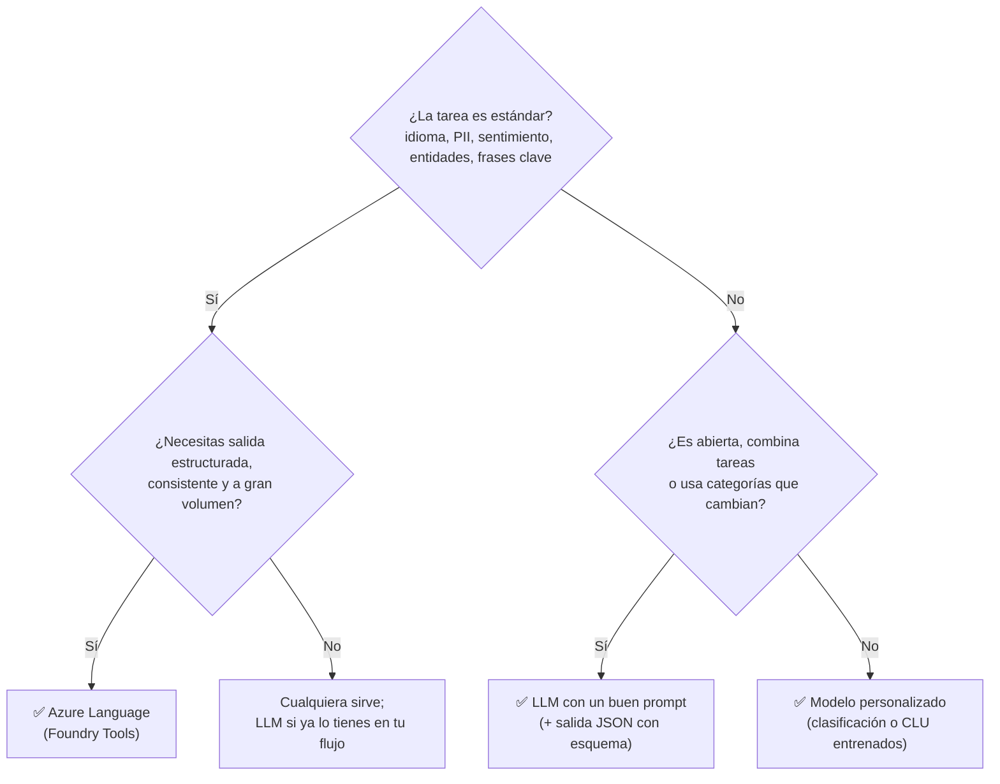

| | LLM (GPT, Claude...) | Azure Language |
|---|---|---|
| Configuración | Un prompt | Ninguna (o entrenar un modelo personalizado) |
| Salida | Varía entre llamadas (mejora con JSON schema) | **Estructurada y determinista** |
| Puntaje de confianza calibrado | No | Sí |
| Combinar tareas en una llamada | ✅ "Traduce, resume y clasifica" | Una tarea por operación (o varias acciones en lote) |
| Ideal para | Flexibilidad, tareas abiertas | **Pipelines automatizados** y cumplimiento |

---

## 8. Arquitectura real: analizar miles de reseñas

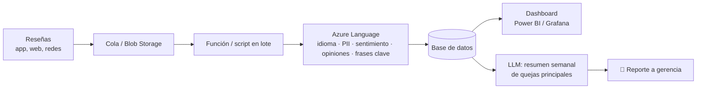

```python
# pip install azure-ai-textanalytics python-dotenv
import os
from dotenv import load_dotenv
from azure.core.credentials import AzureKeyCredential
from azure.ai.textanalytics import TextAnalyticsClient

load_dotenv()
client = TextAnalyticsClient(endpoint=os.getenv("AZURE_LANGUAGE_ENDPOINT"),
                             credential=AzureKeyCredential(os.getenv("API_KEY")))

resenas = [
    "La habitación estaba impecable pero el desayuno fue carísimo.",
    "Excelente atención de Carlos en recepción, volveré a Cancún.",
]

# Sentimiento + minería de opiniones (aspecto → opinión)
for doc in client.analyze_sentiment(resenas, language="es", show_opinion_mining=True):
    print(f"\nSentimiento global: {doc.sentiment}  {doc.confidence_scores}")
    for oracion in doc.sentences:
        for opinion in oracion.mined_opinions:
            objetivo = opinion.target
            evaluaciones = ", ".join(f"{a.text} ({a.sentiment})" for a in opinion.assessments)
            print(f"  • {objetivo.text} [{objetivo.sentiment}] ← {evaluaciones}")

# Frases clave y entidades
for frases in client.extract_key_phrases(resenas, language="es"):
    print("Frases clave:", frases.key_phrases)
for ents in client.recognize_entities(resenas, language="es"):
    print("Entidades:", [(e.text, e.category) for e in ents.entities])
```
- **Explicación:**
  - `show_opinion_mining=True` activa la **minería de opiniones**: además del sentimiento global, obtienes cada **aspecto** (*target*: "habitación", "desayuno") con sus **evaluaciones** ("impecable", "carísimo").
  - Cada método recibe una **lista** de documentos: así procesas en lote y ahorras llamadas.
  - Todo regresa estructurado y con la misma forma siempre: ideal para guardarlo en una base de datos.

---

## 9. Retos específicos del español
- **Morfología rica:** un verbo tiene decenas de conjugaciones ("estudiar", "estudiaríamos") → la lematización es más importante que en inglés.
- **Acentos:** "esta" vs "está", "si" vs "sí" cambian el significado; no los elimines a ciegas.
- **Variantes regionales:** español de México, España, Argentina... Elige el código de idioma correcto cuando el servicio lo permita (`es`, `es-MX` en voz).
- **Más tokens por palabra** en LLMs → más costo y menos texto por ventana de contexto.
- **Menos datos de entrenamiento** que el inglés en muchos modelos → prueba siempre con tus propios textos.

## 10. IA responsable en NLP
- **Sesgo:** modelos de sentimiento que califican peor ciertos dialectos o nombres.
- **Privacidad:** el texto libre está lleno de PII; detecta y oculta antes de guardar o enviar a otros sistemas.
- **Transparencia:** informa cuando un texto fue analizado o generado por IA.
- **Inclusión:** soporta los idiomas y variantes de tus usuarios.

### Para el examen
- "Determinar si las reseñas son positivas o negativas" → **análisis de sentimiento**.
- "Saber qué aspecto del producto le gustó o no al cliente" → **minería de opiniones**.
- "Identificar los temas principales de un documento" → **extracción de frases clave**.
- "Identificar personas, lugares, organizaciones y fechas" → **reconocimiento de entidades (NER)**.
- "Desambiguar una entidad y enlazarla a una fuente de conocimiento" → **vinculación de entidades**.
- "Ocultar teléfonos y direcciones" → **detección de PII** (redacción).
- "Seleccionar oraciones del texto original" → resumen **extractivo**; "generar texto nuevo" → **abstractivo**.
- "Resultados consistentes en un pipeline" → **Azure Language**; "flexibilidad y combinar tareas" → **LLM**.

### Recursos
- [Introducción a los conceptos de procesamiento de lenguaje natural – Microsoft Learn](https://learn.microsoft.com/es-es/training/modules/introduction-language/)
- [¿Qué es Azure Language? – Microsoft Learn](https://learn.microsoft.com/es-es/azure/ai-services/language-service/overview)
- [Curso de NLP / LLMs – Hugging Face](https://huggingface.co/learn/llm-course)
- [Tokenizador interactivo de OpenAI](https://platform.openai.com/tokenizer)
