# Tema 5: Bases técnicas de cómo funciona speech to text y text to speech

### Descripción
La IA de voz tiene dos direcciones:
- **Reconocimiento de voz (speech recognition / speech-to-text / STT):** audio → texto.
- **Síntesis de voz (speech synthesis / text-to-speech / TTS):** texto → audio.

Analogía: STT es un **taquígrafo** que escucha y escribe; TTS es un **locutor** que lee un guion en voz alta cuidando entonación y pausas. Juntos permiten conversar con una máquina.

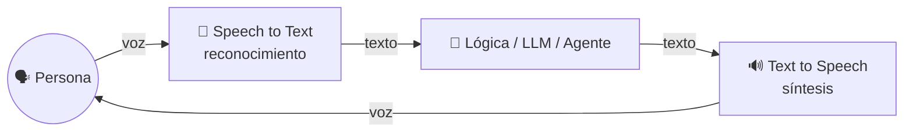

---

## 1. Física básica del sonido (lo mínimo que necesitas)

El sonido es una **onda de presión** en el aire. Tres propiedades importan:

| Propiedad | Qué es | Cómo se percibe | Unidad |
|---|---|---|---|
| **Frecuencia** | Cuántas veces vibra por segundo | Tono: grave o agudo | Hertz (Hz) |
| **Amplitud** | Qué tan fuerte es la vibración | Volumen | Decibeles (dB) |
| **Timbre** | La mezcla de frecuencias | Lo que distingue una "a" de una "e", o tu voz de la mía | — |

- La voz humana tiene su energía principal entre ~**85 Hz y 4 kHz**, con detalles útiles hasta ~8 kHz.
- El oído humano escucha de ~20 Hz a ~20 kHz.

### De onda analógica a números (digitalización)

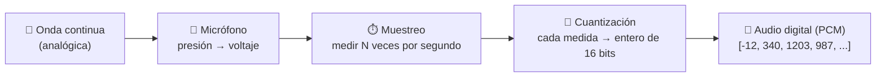

- **Frecuencia de muestreo:** 8 kHz (teléfono), **16 kHz (estándar para reconocimiento de voz)**, 44.1 kHz (música/CD), 48 kHz (video).
- **Teorema de Nyquist:** para capturar una frecuencia `f` necesitas muestrear al menos a `2f`. A 16 kHz capturas hasta 8 kHz: suficiente para la voz.
- **Profundidad de bits:** 16 bits = 65,536 niveles de amplitud (formato **PCM16**).

```python
import numpy as np

frecuencia_muestreo = 16_000          # 16 kHz
duracion = 0.01                        # 10 ms
t = np.arange(0, duracion, 1 / frecuencia_muestreo)

tono_440 = np.sin(2 * np.pi * 440 * t)            # nota La (440 Hz)
pcm16 = (tono_440 * 32767).astype(np.int16)       # cuantizar a 16 bits

print(f"Muestras en 10 ms: {len(pcm16)}")         # 160
print(f"Primeras muestras: {pcm16[:6]}")
print(f"Bytes por segundo (mono, 16 bits): {frecuencia_muestreo * 2:,}")   # 32,000
```
- **Explicación:** 10 ms de audio a 16 kHz son 160 números. Un minuto de voz son ~1.9 MB sin comprimir. Eso es lo que "ve" un modelo de reconocimiento.

---

## 2. Speech to Text: cómo funciona por dentro

### 2.1 El pipeline clásico en 6 etapas

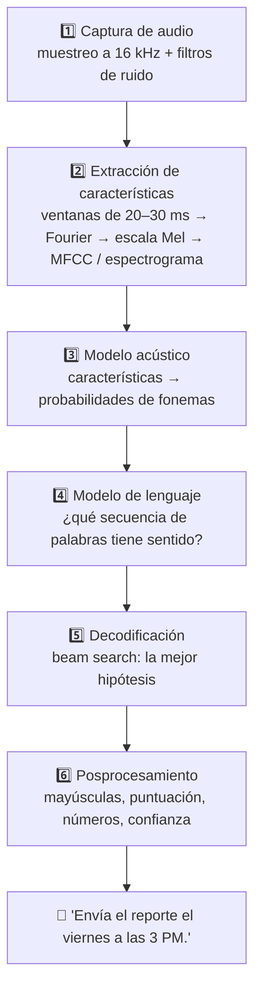

| Etapa | Qué resuelve | Dato clave |
|---|---|---|
| 1. Captura | Digitalizar la onda | 16 kHz; el ruido y el micrófono afectan todo lo demás |
| 2. Características | Compactar el audio y quitar detalles irrelevantes (volumen absoluto) | Ventanas de 20–30 ms, ~13 MFCC por ventana |
| 3. Modelo acústico | ¿Qué sonidos se escucharon? | ~44 fonemas en inglés; hoy se usan Transformers |
| 4. Modelo de lenguaje | ¿Qué palabras tienen sentido? | "haya", "halla", "aya" suenan casi igual |
| 5. Decodificación | Elegir la mejor transcripción entre miles | Beam search |
| 6. Posprocesamiento | Texto legible | Marcas de tiempo y confianza por palabra |

### 2.2 Del audio a los fonemas
Un **fonema** es la unidad mínima de sonido que distingue palabras ("**p**ata" vs "**b**ata"). El modelo acústico entrega, por cada ventana de audio, una **distribución de probabilidad** sobre fonemas:

```
Ventana 42:  /a/ 0.80   /e/ 0.15   otros 0.05
Ventana 43:  /a/ 0.62   /t/ 0.30   otros 0.08
Ventana 44:  /t/ 0.88   /d/ 0.09   otros 0.03
```

Los Transformers usan **atención** sobre ventanas vecinas para resolver ambigüedades: la /t/ suena distinto al inicio de "tapa" que al final de "robot".

### 2.3 El modelo de lenguaje: el contexto decide

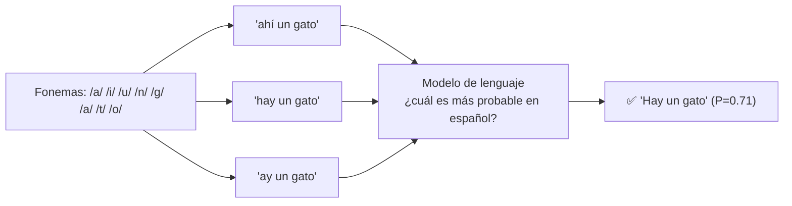

- **Patrones estadísticos:** "hay un gato" aparece mucho más que "ay un gato".
- **Contexto:** después de "Necesito que me..." se esperan verbos.
- **Adaptación de dominio:** un modelo personalizado con vocabulario médico o legal reconoce "colecistectomía" o "amparo indirecto".

### 2.4 Decodificación con beam search
Probar todas las combinaciones posibles es imposible; **beam search** se queda solo con las *k* mejores hipótesis en cada paso:

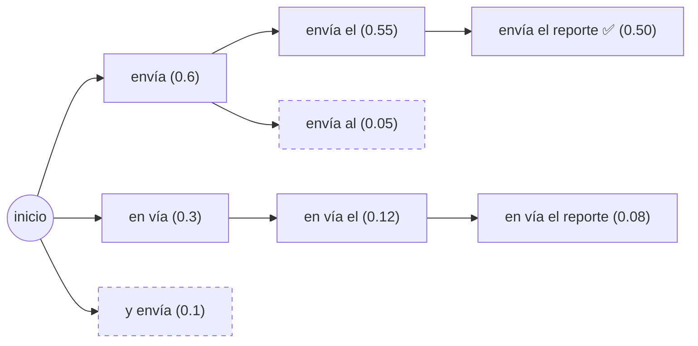
*Las ramas punteadas se descartan (fuera del "haz" de tamaño 2).*

```python
import math

# Probabilidades simplificadas de la siguiente palabra (modelo acústico + lenguaje combinados)
siguiente = {
    "<s>":      {"envía": 0.6, "en": 0.3, "y": 0.1},
    "envía":    {"el": 0.9, "al": 0.1},
    "en":       {"vía": 0.8, "el": 0.2},
    "y":        {"envía": 1.0},
    "vía":      {"el": 1.0},
    "el":       {"reporte": 0.9, "viernes": 0.1},
    "al":       {"reporte": 1.0},
    "reporte":  {"</s>": 1.0},
    "viernes":  {"</s>": 1.0},
}

def beam_search(k=2, pasos=4):
    haces = [(["<s>"], 0.0)]                                  # (secuencia, log-probabilidad)
    for _ in range(pasos):
        candidatos = []
        for seq, lp in haces:
            for palabra, p in siguiente.get(seq[-1], {}).items():
                candidatos.append((seq + [palabra], lp + math.log(p)))
        haces = sorted(candidatos, key=lambda x: x[1], reverse=True)[:k]   # quedarse con los k mejores
        print([(" ".join(s[1:]), round(math.exp(l), 3)) for s, l in haces])
    return haces[0]

mejor = beam_search()
print("Transcripción elegida:", " ".join(w for w in mejor[0][1:] if w != "</s>"))
```
- **Explicación:** en cada paso se expanden las hipótesis y solo sobreviven las `k` más probables. Un `k` más grande mejora la precisión pero aumenta la **latencia**; por eso en tiempo real se limita el ancho del haz.

### 2.5 Clásico vs. de extremo a extremo (*end-to-end*)

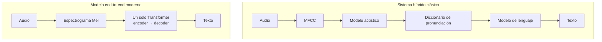

- Los sistemas modernos (por ejemplo Whisper de OpenAI o los modelos actuales de Azure Speech) entrenan **un solo modelo** que va de audio a texto, aprendiendo internamente lo que antes eran piezas separadas.
- Ventajas: más robustos al ruido y acentos, multilingües, menos ingeniería manual.

### 2.6 Capacidades que ofrecen los servicios de STT

| Capacidad | Para qué |
|---|---|
| **Tiempo real (streaming)** | Subtítulos en vivo, asistentes de voz |
| **Transcripción por lotes (batch)** | Miles de grabaciones de call center |
| **Marcas de tiempo por palabra** | Subtítulos sincronizados, buscar en grabaciones |
| **Diarización** | Saber **quién** habló (Hablante 1, Hablante 2) |
| **Puntaje de confianza** | Marcar palabras dudosas para revisión humana |
| **Modelos personalizados** | Vocabulario de tu industria, nombres de productos |
| **Identificación de idioma** | Detectar automáticamente si hablan español o inglés |
| **Traducción de voz** | Hablar en español y obtener texto en inglés |
| **Reconocimiento de palabra clave** | Activación tipo "Hey Cortana" en el dispositivo |
| **Filtro de groserías** | Enmascarar palabras según la política |

---

## 3. Text to Speech: cómo funciona por dentro

### 3.1 El pipeline en 4 etapas

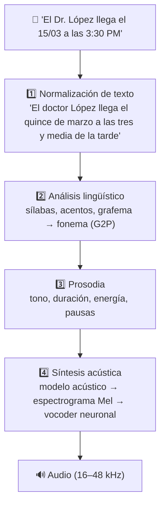

### 3.2 Normalización: el texto escrito no es texto hablado

| Escrito | Hablado | Regla |
|---|---|---|
| `Dr.` | doctor | Abreviaturas |
| `$1,250.50` | mil doscientos cincuenta pesos con cincuenta centavos | Moneda |
| `15/03/2026` | quince de marzo de dos mil veintiséis | Fechas (¡en EE. UU. sería 3 de abril si fuera 03/15!) |
| `3:30 PM` | tres y media de la tarde | Horas |
| `Carlos V` | Carlos quinto | Números romanos |
| `CDMX` | ce de eme equis / Ciudad de México | Siglas |
| `@brujeriatech` | arroba brujería tech | Símbolos |

Sin normalización el sistema intentaría pronunciar símbolos o dígitos y sonaría incomprensible.

### 3.3 De letras a sonidos (G2P) y homógrafos
- **G2P (grafema a fonema):** convierte letras en fonemas. En español es bastante regular, pero hay casos: "**x**" en México (/x/ de "jota") vs. "ta**x**i" (/ks/); préstamos como "**pizza**" o "**software**".
- **Homógrafos y siglas:** misma escritura, distinta lectura según el contexto: "**PAN**" (partido, se deletrea o se lee como sigla) vs. "**pan**" (alimento); "**I**" en "Carlos I" (primero) vs. "Juan I. Pérez"; en inglés "I *read* books" vs. "I *read* it yesterday". Un Transformer usa el contexto para decidir.

### 3.4 Prosodia: lo que separa una voz natural de una robótica

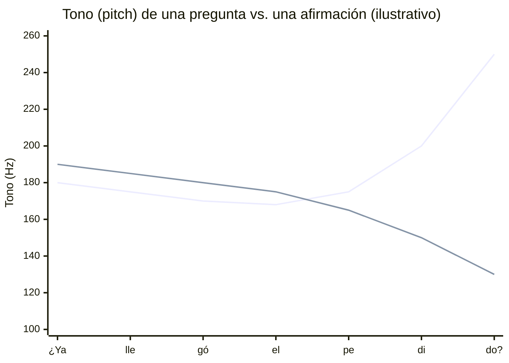
*La línea que sube al final es la pregunta; la que baja, la afirmación "Ya llegó el pedido".*

- **Elementos:** tono (sube en preguntas), duración (las palabras enfatizadas duran más), intensidad, pausas (comas, puntos) y acento.
- **El énfasis cambia el significado:** "*Yo* no dije que él robó el dinero" vs. "Yo no dije que él robó el *dinero*".
- **Importante:** la voz robótica casi siempre se debe a una **prosodia plana**, no a errores de pronunciación.

### 3.5 Síntesis acústica y vocoders neuronales

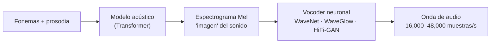

| Generación | Técnica | Calidad |
|---|---|---|
| Años 80–90 | Síntesis por reglas / formantes | Muy robótica |
| 2000s | Concatenación de fragmentos grabados | Natural en frases comunes, saltos raros |
| 2010s | Paramétrica estadística (HMM) | Suave pero "zumbante" |
| 2016+ | **Neuronal** (WaveNet y sucesores) | Casi indistinguible de una persona |
| Hoy | Voces HD / multilingües / con emociones | Expresiva, cambia de idioma y estilo |

### 3.6 Controlar la voz: SSML
**SSML** (*Speech Synthesis Markup Language*) es XML para indicar exactamente cómo leer el texto:

```xml
<speak version="1.0" xmlns="http://www.w3.org/2001/10/synthesis" xml:lang="es-MX">
  <voice name="es-MX-DaliaNeural">
    Tu vuelo sale a las <say-as interpret-as="time" format="hms12">7:45pm</say-as>.
    <break time="400ms"/>
    <prosody rate="-10%" pitch="+5%">Te recomendamos llegar dos horas antes.</prosody>
    <emphasis level="strong">No olvides tu identificación.</emphasis>
  </voice>
</speak>
```
- `<say-as>` controla cómo se leen horas, fechas o números; `<break>` agrega pausas; `<prosody>` ajusta velocidad, tono y volumen; `<emphasis>` da énfasis.

---

## 4. STT vs. TTS lado a lado

| Aspecto | Speech to text | Text to speech |
|---|---|---|
| Entrada → salida | Audio → texto | Texto → audio |
| Problema central | **Ambigüedad** (ruido, acentos, homófonos) | **Naturalidad** (entonación, ritmo, emoción) |
| Normalización | *Inversa*: "tres p m" → "3 PM" | *Directa*: "3 PM" → "tres p m" |
| Representación intermedia | Espectrograma → fonemas | Fonemas + prosodia → espectrograma |
| Pieza clave | Modelo acústico + modelo de lenguaje + decodificador | Modelo acústico + **vocoder** |
| Métrica principal | **WER** (tasa de error de palabras) | **MOS** (calificación humana 1–5) |
| Personalización | Vocabulario del dominio | Voz personalizada, estilos, SSML |

---

## 5. Voz a voz: cascada vs. modelos nativos en tiempo real

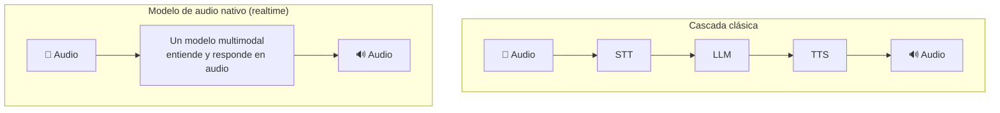

| | Cascada (STT → LLM → TTS) | Nativo en tiempo real |
|---|---|---|
| Control | Alto: puedes revisar, filtrar o guardar el texto intermedio | Menor |
| Latencia | Mayor (se suman tres pasos) | Menor, más natural |
| Interrupciones | Hay que programarlas | Integradas |
| Matices (tono, emoción del usuario) | Se pierden al pasar a texto | Se conservan |
| En Foundry | Azure Speech + modelo + Azure Speech | **Voice Live API** / modelos realtime |

**¿Por qué importa la latencia?** En una conversación humana la pausa entre turnos es de unos pocos cientos de milisegundos; si el sistema tarda más de uno o dos segundos, la conversación se siente artificial.

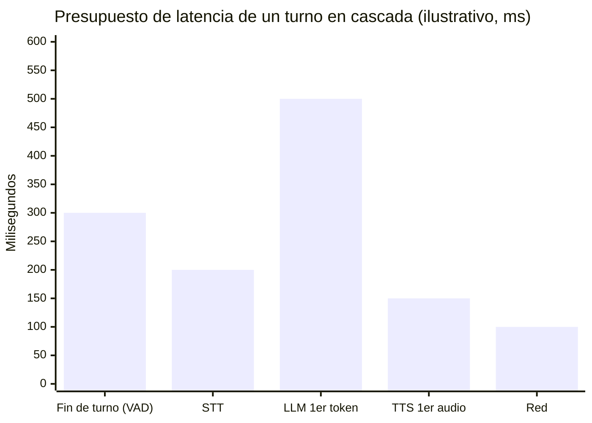
Técnicas para reducirla: **streaming** en cada etapa (empezar a hablar antes de terminar de generar), modelos más pequeños, detección de fin de turno inteligente y servicios en la región más cercana.

---

## 6. ¿Cómo se mide la calidad?

### WER (Word Error Rate) para STT
`WER = (Sustituciones + Eliminaciones + Inserciones) / Palabras de referencia`

```python
# pip install jiwer
from jiwer import wer

referencia = "envía el reporte el viernes por la tarde"
pruebas = {
    "perfecta":       "envía el reporte el viernes por la tarde",
    "1 sustitución":  "envía el reporte del viernes por la tarde",
    "1 eliminación":  "envía el reporte el viernes por tarde",
    "ruido fuerte":   "en vía el reporte de viernes la tarde",
}
for nombre, hipotesis in pruebas.items():
    print(f"{nombre:15s} WER = {wer(referencia, hipotesis):.1%}")
```
- **Explicación:** 0% es perfecto. Como referencia general, por debajo de ~10% suele ser útil para dictado; en audio telefónico ruidoso es común ver valores más altos. **Siempre mide con audio real de tu caso de uso.**

### MOS (Mean Opinion Score) para TTS
Personas escuchan muestras y califican la naturalidad de 1 (mala) a 5 (excelente). Las voces neuronales modernas se acercan a las calificaciones de grabaciones humanas.

### Otras métricas
- **Latencia** (tiempo al primer resultado parcial / primer audio).
- **RTF (Real-Time Factor):** tiempo de procesamiento ÷ duración del audio. RTF < 1 = más rápido que el tiempo real.

---

## 7. Escenarios y cómo elegir

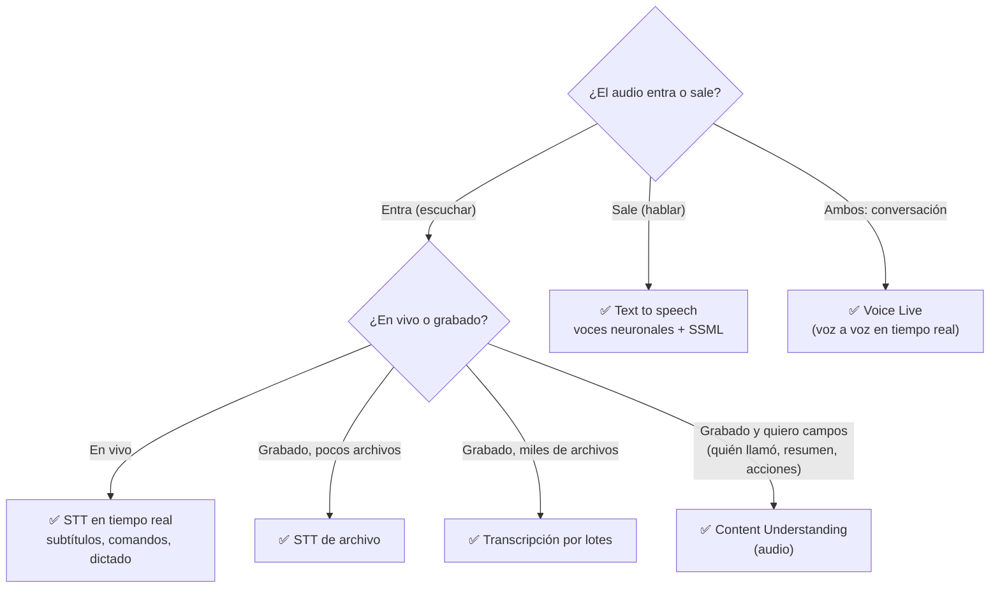

| Escenario | Capacidad |
|---|---|
| Transcribir llamadas para calidad y cumplimiento | STT por lotes + diarización |
| Subtítulos en vivo para personas sordas | STT en tiempo real |
| Dictado de notas médicas | STT + modelo personalizado de vocabulario |
| Leer artículos en voz alta (accesibilidad, dislexia) | TTS |
| Avisos en aeropuertos o GPS | TTS |
| Cursos narrados en varios idiomas | TTS multilingüe |
| IVR: "diga en qué le podemos ayudar" | STT + lógica + TTS |
| Agente de voz que atiende clientes y se deja interrumpir | Voice Live |

### Consideraciones antes de implementar
- **Calidad de audio:** ruido, micrófono, distancia, eco y compresión.
- **Idioma y dialecto:** confirma soporte para `es-MX` u otras variantes.
- **Privacidad:** la voz es un dato biométrico y suele contener datos personales; define retención y consentimiento.
- **Latencia:** en vivo necesitas respuesta casi inmediata; por lotes puede esperar.
- **Accesibilidad:** ofrece siempre una alternativa de texto.
- **Costo:** STT y TTS suelen cobrarse por hora de audio o por caracteres.

---

## 8. Voz en Microsoft Foundry

| Necesidad | Servicio / modelo | Dónde lo programas |
|---|---|---|
| Transcribir | Azure Speech – Speech to text | [Parte 2, Módulo 4 – Tema 1](../../parte2/modulo4/tema1.md) |
| Hablar | Azure Speech – Text to speech | [Parte 2, Módulo 4 – Tema 2](../../parte2/modulo4/tema2.md) |
| Conversación en tiempo real | Voice Live API | [Parte 2, Módulo 4 – Tema 2](../../parte2/modulo4/tema2.md) |
| Extraer campos de grabaciones | Content Understanding | [Parte 2, Módulo 6](../../parte2/modulo6/tema1.md) |
| Responder a prompts hablados | Modelo multimodal con entrada de audio | Catálogo de modelos |

```python
# Vista previa del SDK (lo verás a detalle en la Parte 2)
import azure.cognitiveservices.speech as speechsdk

config = speechsdk.SpeechConfig(subscription="<FOUNDRY_KEY>", endpoint="<ENDPOINT>")
config.speech_recognition_language = "es-MX"
config.speech_synthesis_voice_name = "es-MX-DaliaNeural"

# STT: micrófono → texto
texto = speechsdk.SpeechRecognizer(speech_config=config).recognize_once_async().get().text
print("Dijiste:", texto)

# TTS: texto → bocinas
speechsdk.SpeechSynthesizer(speech_config=config).speak_text_async(f"Entendí: {texto}").get()
```
- **Explicación:** el mismo `SpeechConfig` sirve para reconocer (`SpeechRecognizer`) y sintetizar (`SpeechSynthesizer`). Sin `AudioConfig`, usan el micrófono y las bocinas predeterminados.

---

## 9. IA responsable en voz
- **Voces sintéticas y suplantación (deepfakes de voz):** las voces personalizadas que imitan a una persona real requieren **consentimiento** explícito; Microsoft las ofrece bajo acceso limitado.
- **Transparencia:** informa a los usuarios cuando hablan con una voz sintética.
- **Privacidad:** la voz identifica a las personas; minimiza lo que guardas y cifra las grabaciones.
- **Equidad e inclusión:** el reconocimiento puede funcionar peor con ciertos acentos, edades o personas con dificultades del habla; prueba con usuarios diversos.

### Para el examen
- "Convertir grabaciones de llamadas a texto para analizarlas" → **speech recognition** (por lotes si son muchas).
- "Leer en voz alta las respuestas del chatbot" → **speech synthesis**.
- "Un asistente con el que hablas, te responde hablando y puedes interrumpir" → **Voice Live**.
- "Saber quién dijo qué en una reunión" → **diarización**.
- "Controlar pausas, velocidad y pronunciación de la voz" → **SSML**.
- "La voz suena robótica" → problema de **prosodia**.
- "Mejorar el reconocimiento de términos médicos" → **modelo personalizado** / adaptación del modelo de lenguaje.
- "¿Qué componente convierte el espectrograma en audio?" → **vocoder neuronal**.

### Recursos
- [Introducción a los conceptos de voz de IA – Microsoft Learn](https://learn.microsoft.com/es-es/training/modules/introduction-ai-speech/)
- [Azure Speech en Foundry Tools – documentación](https://learn.microsoft.com/es-es/azure/ai-services/speech-service/overview)
- [Galería de voces de Azure Speech](https://speech.microsoft.com/portal/voicegallery)
- [Audio Deep Learning Made Simple: ASR](https://medium.com/towards-data-science/audio-deep-learning-made-simple-automatic-speech-recognition-asr-how-it-works-716cfce4c706)
- Profundiza en audio y espectrogramas en el [Módulo 4](../modulo4/tema1.md).
