# Tema 6: Bases técnicas de cómo funciona computer vision

### Descripción
La **visión por computadora** es el conjunto de técnicas con las que el software procesa entrada visual (imágenes, video o cámaras en vivo) para **extraer información** o **generar contenido visual**. Para la computadora, una foto es solo una **matriz de números**: cada píxel vale de 0 (negro) a 255 (blanco), y una imagen a color tiene tres capas (canales Rojo, Verde y Azul).

Analogía: imagina una hoja cuadriculada gigante donde cada cuadrito tiene un número que indica qué tan brillante es. La visión por computadora es aprender a reconocer formas buscando patrones en esa cuadrícula.

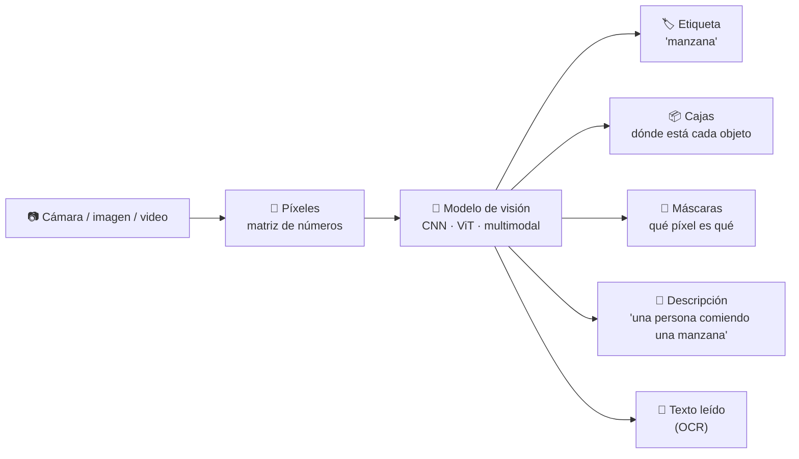

---

## 1. Cómo "ve" una computadora

### 1.1 Píxeles, canales y resolución

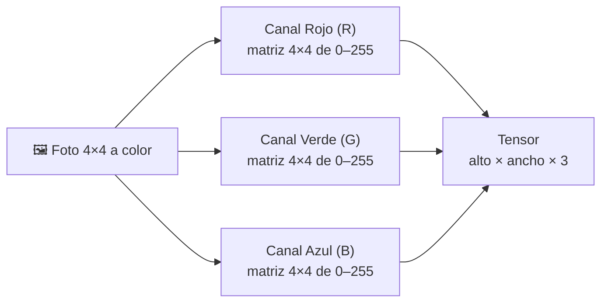

| Concepto | Qué es | Ejemplo |
|---|---|---|
| **Píxel** | El punto más pequeño de la imagen | Un valor (gris) o tres valores (RGB) |
| **Resolución** | Filas × columnas | 1920 × 1080 (Full HD) |
| **Canal** | Una capa de color | R, G, B (a veces un 4.º canal alfa de transparencia) |
| **Profundidad** | Bits por canal | 8 bits = valores de 0 a 255 |
| **Tensor** | Arreglo de N dimensiones | `(1080, 1920, 3)` |

| Color | R | G | B |
|---|---|---|---|
| Negro | 0 | 0 | 0 |
| Blanco | 255 | 255 | 255 |
| Rojo | 255 | 0 | 0 |
| Amarillo | 255 | 255 | 0 |
| Morado | 150 | 0 | 255 |

```python
import numpy as np

# Imagen de 4x4 a color: fondo morado con un cuadro amarillo al centro
img = np.zeros((4, 4, 3), dtype=np.uint8)
img[:, :] = [150, 0, 255]          # morado
img[1:3, 1:3] = [255, 255, 0]      # amarillo

print("Forma (alto, ancho, canales):", img.shape)        # (4, 4, 3)
print("Canal rojo:\n", img[:, :, 0])
print("Números en una foto Full HD:", 1920 * 1080 * 3)   # 6,220,800
```
- **Explicación:** una imagen es un arreglo de 3 dimensiones. Antes de entrar a un modelo, los valores suelen **normalizarse** a 0–1 (dividiendo entre 255) y la imagen se **redimensiona** al tamaño que espera el modelo (por ejemplo 224×224).

### 1.2 Por qué es difícil
Una persona reconoce un gato al instante, pero para la computadora el mismo gato puede verse con números completamente distintos:

| Reto | Ejemplo |
|---|---|
| **Iluminación** | El mismo producto de día y de noche |
| **Punto de vista** | Un auto de frente vs. de lado |
| **Escala** | Una persona cerca vs. lejos |
| **Oclusión** | Un objeto tapado parcialmente |
| **Deformación** | Un gato estirado vs. hecho bolita |
| **Fondo confuso** | Un camaleón |
| **Variación dentro de la clase** | Cientos de razas de perro |

### 1.3 Procesamiento de imágenes con filtros
Un **filtro (kernel)** es una pequeña matriz de pesos que se desliza sobre la imagen (**convolución**) para resaltar bordes, suavizar o enfocar. Es la base de las CNN. Lo ves a detalle con código en el [Módulo 5 – Tema 2](../modulo5/tema2.md).

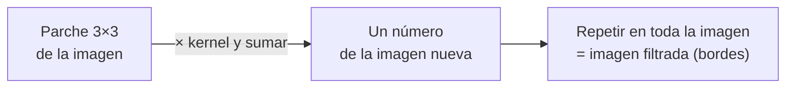

---

## 2. Las tareas de visión por computadora

### 2.1 Cuatro niveles de detalle

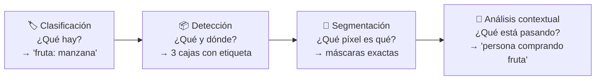

| Tarea | Pregunta | Salida | Ejemplo (supermercado) |
|---|---|---|---|
| **Clasificación de imágenes** | ¿Qué hay en la imagen? | Una etiqueta para toda la imagen | Báscula que reconoce "manzana" |
| **Detección de objetos** | ¿Qué objetos hay y dónde? | Etiquetas + *bounding boxes* | Caja de autocobro con varios productos |
| **Segmentación semántica** | ¿A qué objeto pertenece cada píxel? | Máscara por píxel | Separar exactamente la fruta del fondo |
| **Análisis contextual (multimodal)** | ¿Qué está pasando? | Descripción o etiquetas en lenguaje natural | "Una persona comiendo una manzana" |

### 2.2 Variantes de segmentación

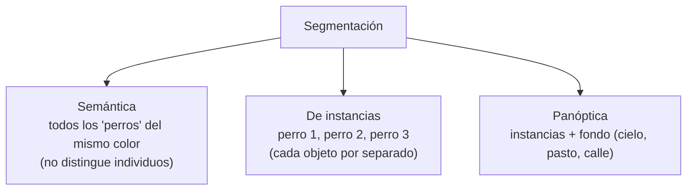

### 2.3 Otras tareas comunes

| Tarea | Qué hace | Ejemplo |
|---|---|---|
| **OCR** | Lee texto en imágenes | Digitalizar recibos, leer placas |
| **Detección facial** | Encuentra rostros (no identifica a la persona) | Difuminar caras en video |
| **Reconocimiento / verificación facial** | ¿Quién es? / ¿es la misma persona? | Acceso biométrico (**uso restringido**) |
| **Estimación de pose** | Ubica articulaciones del cuerpo | Apps de ejercicio, ergonomía |
| **Seguimiento (tracking)** | Sigue objetos entre cuadros de video | Contar personas que entran a una tienda |
| **Detección de anomalías visuales** | Encuentra lo que se ve "raro" | Defectos en una línea de producción |
| **Búsqueda por imagen** | Encuentra imágenes similares | "Busca productos parecidos a esta foto" |
| **Generación de imágenes y video** | Crea contenido visual nuevo | Imágenes de marketing, storyboards |

---

## 3. Evolución de los modelos de visión

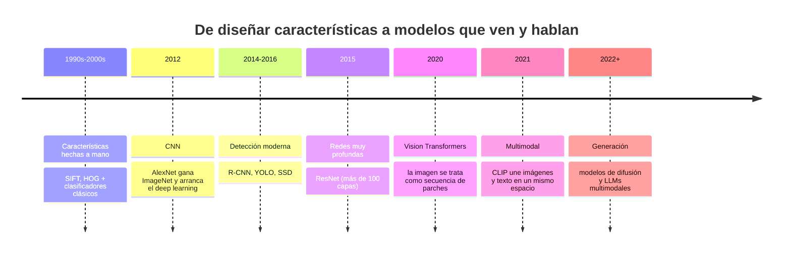

### 3.1 Redes neuronales convolucionales (CNN)

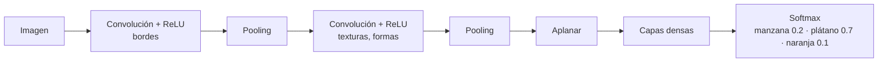
- Los kernels empiezan con pesos **aleatorios** y se aprenden durante el entrenamiento.
- Las primeras capas detectan bordes; las siguientes, formas; las últimas, objetos completos.
- Detalle en el [Módulo 5 – Tema 3](../modulo5/tema3.md).

### 3.2 Vision Transformers (ViT)

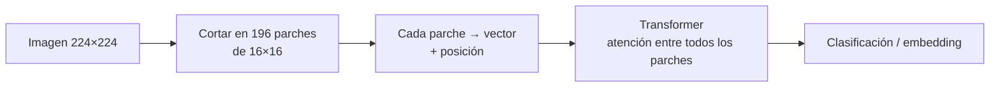
- Tratan la imagen como una "oración" de parches.
- La atención relaciona **cualquier parte con cualquier otra** desde la primera capa (una CNN solo ve vecindarios pequeños).

### 3.3 Modelos multimodales (visión + lenguaje)

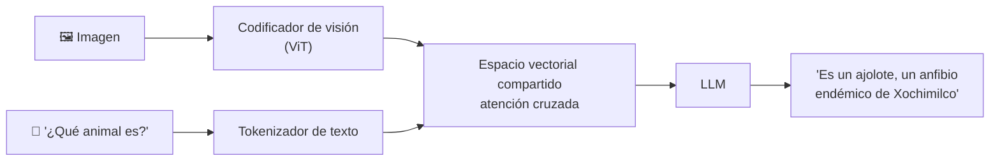
- Entrenados con millones de pares imagen–texto, aprenden a **relacionar características visuales con lenguaje**.
- Por eso pueden describir imágenes que nunca vieron, leer gráficas, analizar capturas de pantalla y responder preguntas abiertas.
- En Foundry: **GPT-4.1 / 4.1-mini / 4.1-nano**, **serie GPT-5**, **Phi-4-multimodal**.

### 3.4 Generación de imágenes (difusión)

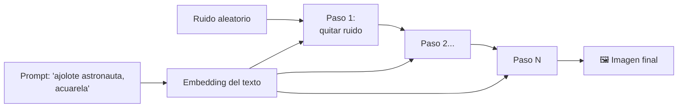
- El modelo aprendió a **quitar ruido** guiado por el texto; partiendo de ruido puro, en varios pasos aparece una imagen que coincide con el prompt.
- En Foundry: **GPT-Image-1.5 / 1 / 1-Mini**, **FLUX**; para video, **Sora** y **Sora 2**.

---

## 4. Detección de objetos a fondo

### 4.1 Bounding boxes e IoU
Un detector devuelve, por cada objeto: **clase**, **confianza** y **caja** (x, y, ancho, alto). Para saber si una caja predicha es correcta se usa **IoU (Intersection over Union)**:

`IoU = área de la intersección / área de la unión`

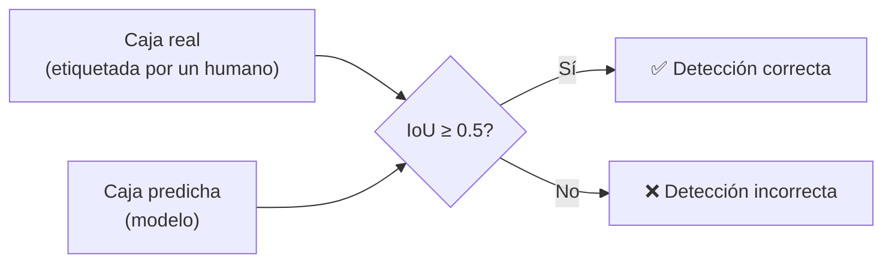

### 4.2 Supresión de no máximos (NMS)
Un detector suele proponer **varias cajas para el mismo objeto**. NMS se queda con la de mayor confianza y elimina las que se traslapan mucho con ella.

```python
def iou(a, b):
    """Cajas en formato (x1, y1, x2, y2)."""
    ix1, iy1 = max(a[0], b[0]), max(a[1], b[1])
    ix2, iy2 = min(a[2], b[2]), min(a[3], b[3])
    inter = max(0, ix2 - ix1) * max(0, iy2 - iy1)
    area = lambda c: (c[2] - c[0]) * (c[3] - c[1])
    return inter / (area(a) + area(b) - inter)

def nms(detecciones, umbral_iou=0.5):
    detecciones = sorted(detecciones, key=lambda d: d["confianza"], reverse=True)
    finales = []
    for d in detecciones:
        if all(iou(d["caja"], f["caja"]) < umbral_iou for f in finales):
            finales.append(d)
    return finales

propuestas = [
    {"clase": "manzana", "confianza": 0.92, "caja": (30, 40, 130, 150)},
    {"clase": "manzana", "confianza": 0.85, "caja": (35, 45, 135, 155)},   # duplicada
    {"clase": "plátano", "confianza": 0.88, "caja": (200, 40, 380, 130)},
]
print(f"IoU entre las dos manzanas: {iou(propuestas[0]['caja'], propuestas[1]['caja']):.2f}")
for d in nms(propuestas):
    print(d["clase"], d["confianza"], d["caja"])
```
- **Explicación:** las dos cajas de "manzana" se traslapan mucho (IoU alto), así que NMS conserva solo la de 0.92. El plátano no se traslapa con nada y se queda.

### 4.3 Detectores de una y dos etapas

| Tipo | Cómo funciona | Ejemplos | Ventaja |
|---|---|---|---|
| **Dos etapas** | 1) Propone regiones candidatas 2) Clasifica cada región | R-CNN, Faster R-CNN | Más precisos |
| **Una etapa** | Predice cajas y clases en una sola pasada | YOLO, SSD | Muy rápidos (tiempo real) |

---

## 5. ¿Cómo se mide la calidad?

| Tarea | Métrica | Qué mide |
|---|---|---|
| Clasificación | **Exactitud**, top-5, precisión, recall, F1 | % de etiquetas correctas |
| Detección | **IoU**, **mAP** (mean Average Precision) | Qué tan bien ubica y clasifica cajas |
| Segmentación | **IoU por clase**, **Dice** | Traslape entre máscara real y predicha |
| OCR | Tasa de error por carácter (CER) / palabra (WER) | Errores de lectura |
| Generación | Evaluación humana, similitud con el prompt | Calidad y fidelidad al prompt |

---

## 6. Video: imágenes en el tiempo

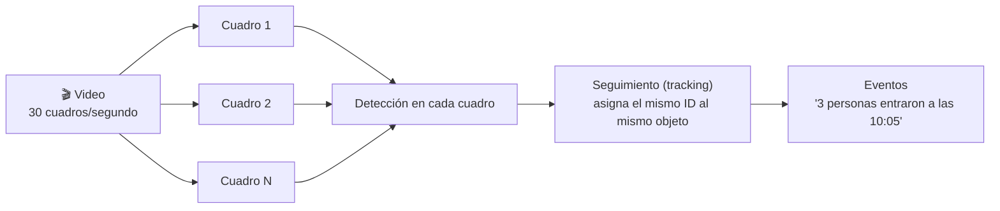
- Un video es una **secuencia de imágenes** (cuadros). Un minuto a 30 fps son 1,800 imágenes: por eso suele analizarse **muestreando** cuadros clave.
- Para video también se usan **modelos multimodales** y **Content Understanding** (resúmenes, asistencia, quién habló).

---

## 7. ¿Qué enfoque usar?

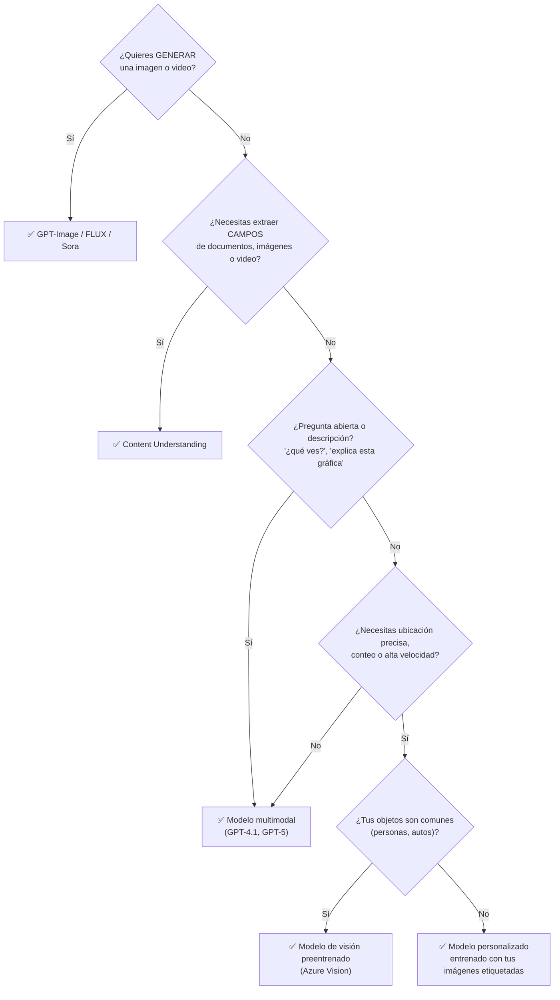

| Enfoque | Ventaja | Desventaja |
|---|---|---|
| **Modelo multimodal** | Sin entrenamiento; responde cualquier pregunta | No da coordenadas precisas; costo por token; puede alucinar |
| **Servicio preentrenado** | Rápido, estructurado, barato | Solo objetos y tareas comunes |
| **Modelo personalizado** | Reconoce *tus* productos o defectos | Requiere imágenes etiquetadas y entrenamiento |
| **Content Understanding** | Campos estructurados de documentos e imágenes con esquema | Enfocado en extracción, no en detección en tiempo real |

**Costo de etiquetar datos** (si entrenas tu propio modelo): una etiqueta por imagen (clasificación) < dibujar cajas (detección) < pintar cada píxel (segmentación).

---

## 8. Visión en Microsoft Foundry

| Necesidad | En Foundry | Dónde lo programas |
|---|---|---|
| Describir imágenes o responder preguntas sobre ellas | Modelos multimodales (GPT-4.1, GPT-5.x) | [Parte 2, Módulo 5 – Tema 2](../../parte2/modulo5/tema2.md) |
| Generar imágenes | GPT-Image-1.5 / 1 / 1-Mini, FLUX | [Parte 2, Módulo 5 – Tema 3](../../parte2/modulo5/tema3.md) |
| Generar video | Sora, Sora 2 | [Parte 2, Módulo 5 – Tema 4](../../parte2/modulo5/tema4.md) |
| Extraer información de imágenes, documentos y video | Content Understanding | [Parte 2, Módulo 6](../../parte2/modulo6/tema1.md) |
| Análisis de imágenes y OCR especializados | Azure Vision (Foundry Tools) | Catálogo de AI services |

```python
# Vista previa: preguntarle algo a una imagen con un modelo multimodal (Parte 2 a detalle)
import os
from openai import OpenAI

client = OpenAI(base_url=os.environ["AZURE_OPENAI_ENDPOINT"], api_key=os.environ["FOUNDRY_KEY"])
r = client.responses.create(
    model="gpt-4.1-mini",   # nombre de tu deployment
    input=[{"role": "user", "content": [
        {"type": "input_text", "text": "¿Cuántas personas hay y alguna no usa casco?"},
        {"type": "input_image", "image_url": "https://<tu-storage>/obra.jpg"},
    ]}],
)
print(r.output_text)
```

---

## 9. IA responsable en visión
- **Reconocimiento facial:** Microsoft restringe la identificación y verificación facial (acceso limitado con aprobación) y retiró capacidades como inferir emociones, género o edad a partir del rostro, por riesgos de privacidad y discriminación.
- **Privacidad:** las imágenes pueden contener rostros, placas o documentos; difumina o elimina lo que no necesites (principio de minimización).
- **Equidad:** los modelos pueden funcionar peor con tonos de piel, edades o contextos poco representados en los datos de entrenamiento.
- **Confiabilidad y seguridad:** en sistemas físicos (robots, autos) actúa solo cuando la confianza supera un umbral.
- **Transparencia:** etiqueta las imágenes y videos generados con IA (credenciales de contenido).

### Para el examen
- "Identificar la **ubicación** de cada objeto" → **detección de objetos**.
- "Determinar si una foto contiene un perro o un gato" → **clasificación de imágenes**.
- "Delimitar el contorno exacto de cada objeto" → **segmentación**.
- "Generar una descripción o responder preguntas sobre una imagen" → **modelo multimodal**.
- "Leer el texto de una foto" → **OCR**.
- "Crear una imagen a partir de un texto" → **modelo de generación de imágenes** (difusión / GPT-Image).
- "¿Qué arquitectura usa filtros convolucionales?" → **CNN**; "¿cuál divide la imagen en parches y usa atención?" → **ViT**.

### Recursos
- [Introducción a los conceptos de computer vision – Microsoft Learn](https://learn.microsoft.com/es-es/training/modules/introduction-computer-vision/)
- [CNN Explainer (visualización interactiva)](https://poloclub.github.io/cnn-explainer/)
- [Image Kernels explained visually – Setosa](https://setosa.io/ev/image-kernels/)
- Profundiza en visión en el [Módulo 5](../modulo5/tema1.md).
