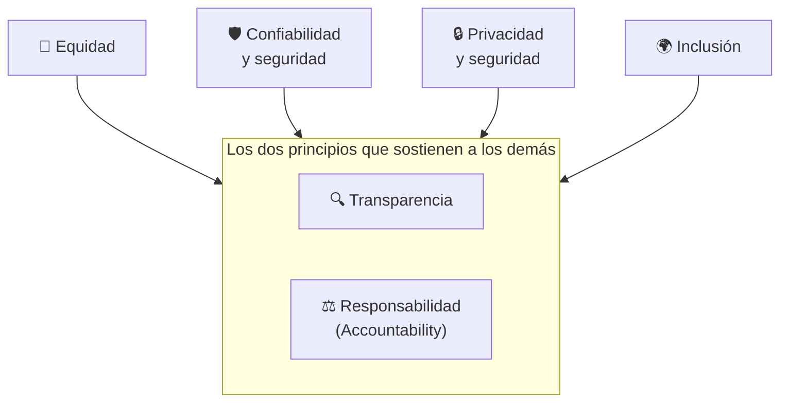
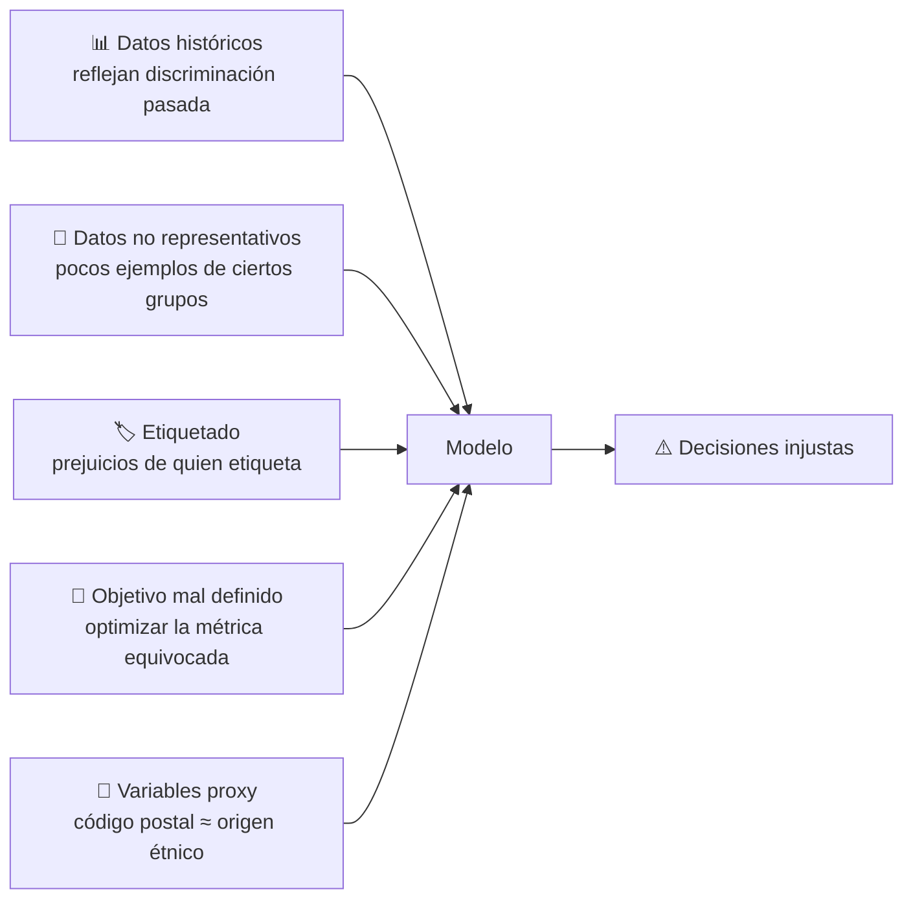
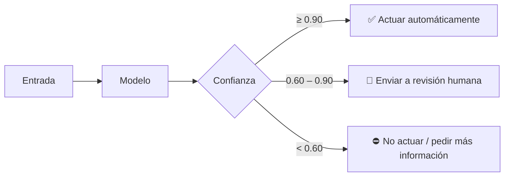
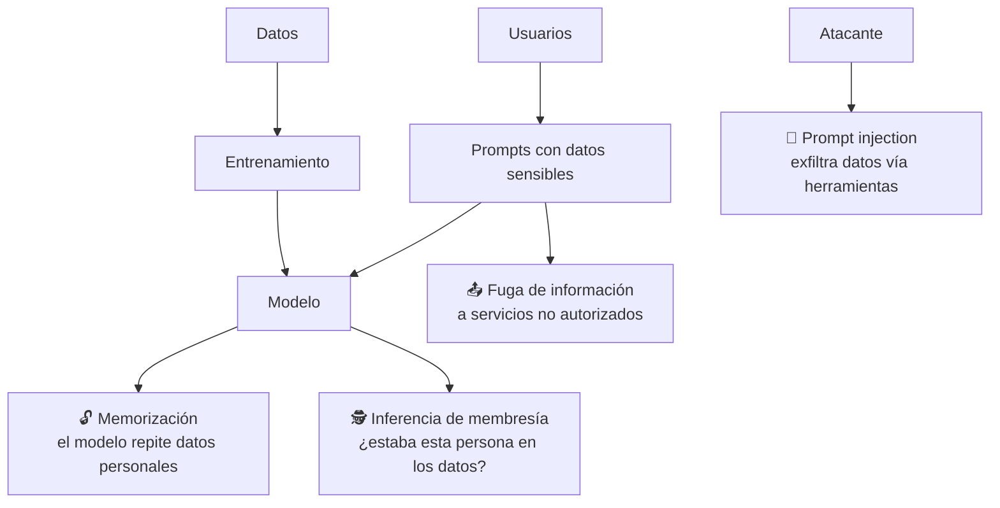
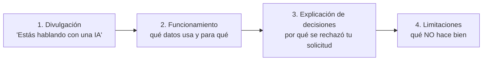
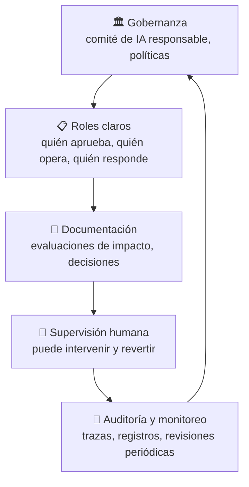
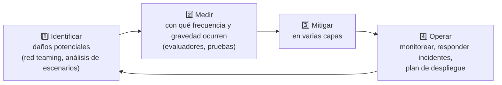
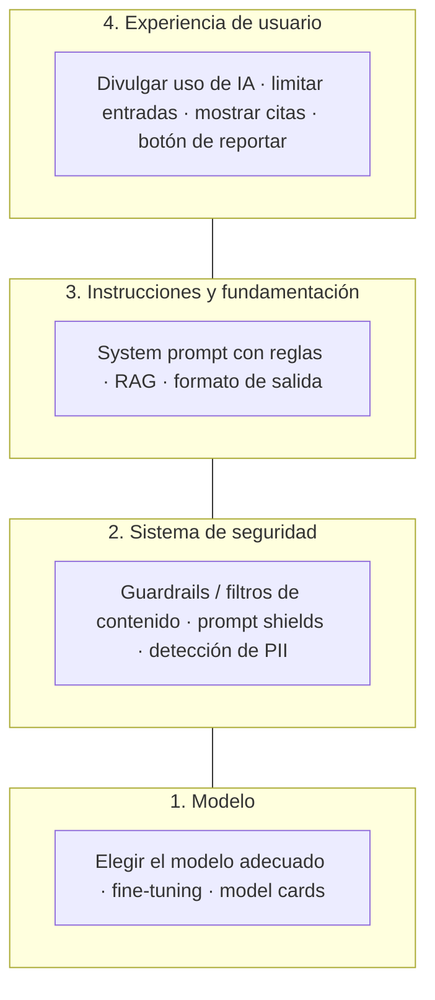

# Tema 7: Principios de IA responsable

### Descripción
Microsoft define **seis principios de IA responsable**. En la AI-901 hay un bloque completo del examen dedicado a ellos (una habilidad por principio), así que debes saber **reconocerlos en un escenario** y saber **qué hacer** para cumplirlos. La IA es poderosa, pero también es probabilística, aprende de datos hechos por humanos (con sus sesgos), maneja información sensible y cada vez **toma acciones** por su cuenta (agentes).

Analogía: los principios son como el **reglamento de tránsito** de la IA. Un coche (el modelo) puede ser muy rápido, pero sin reglas pone en riesgo a todos. Y no basta con conocer el reglamento: hay cinturones, frenos, semáforos y seguros (las **herramientas y procesos** para cumplirlo).



> [!NOTE]
> Microsoft describe **transparencia** y **responsabilidad** como la base sobre la que descansan los otros cuatro: sin saber cómo funciona el sistema ni quién responde por él, no puedes garantizar equidad, seguridad, privacidad o inclusión.

---

## 1. Equidad (Fairness)

**Definición:** los sistemas de IA deben tratar a todas las personas de forma justa y no afectar de manera distinta a grupos en situaciones similares.

### ¿De dónde viene el sesgo?



| Tipo de daño | Qué es | Ejemplo |
|---|---|---|
| **Daño de asignación** | Se niega una oportunidad o recurso | Un modelo de crédito rechaza más a un grupo con el mismo perfil financiero |
| **Daño de calidad de servicio** | Funciona peor para un grupo | Reconocimiento de voz con más errores para ciertos acentos |
| **Estereotipos** | Refuerza ideas preconcebidas | "Genera la imagen de un ingeniero" → siempre el mismo perfil |
| **Sobre o subrepresentación** | Un grupo aparece de más o de menos | Resultados de búsqueda de imágenes sesgados |

### Casos reales
- **Herramienta de reclutamiento de Amazon (reportado en 2018):** aprendió de currículums históricos mayoritariamente masculinos y penalizaba términos asociados a mujeres; la empresa la abandonó.
- **COMPAS (ProPublica, 2016):** un sistema de riesgo de reincidencia mostró tasas de falsos positivos distintas entre grupos raciales.
- **Gender Shades (2018):** sistemas comerciales de análisis facial tenían errores mucho mayores en mujeres de piel oscura que en hombres de piel clara.

### Cómo medirla
| Métrica | Pregunta |
|---|---|
| **Paridad demográfica** | ¿Todos los grupos reciben resultados positivos en proporción similar? |
| **Igualdad de oportunidades** | Entre quienes *sí* califican, ¿todos los grupos tienen la misma tasa de aprobación? |
| **Diferencia de error** | ¿El modelo se equivoca más con algún grupo? |

```python
import pandas as pd

# Resultados de un modelo de aprobación de crédito (datos de ejemplo)
df = pd.DataFrame({
    "grupo":      ["A"] * 6 + ["B"] * 6,
    "califica":   [1, 1, 1, 0, 0, 1,   1, 1, 1, 0, 0, 1],   # realidad
    "aprobado":   [1, 1, 1, 0, 1, 1,   1, 0, 0, 0, 0, 1],   # decisión del modelo
})

# Paridad demográfica: tasa de aprobación por grupo
print(df.groupby("grupo")["aprobado"].mean())

# Igualdad de oportunidades: tasa de aprobación SOLO entre quienes califican
print(df[df.califica == 1].groupby("grupo")["aprobado"].mean())
```
- **Explicación:** ambos grupos tienen la misma proporción de personas que califican, pero el modelo aprueba al 100% de los calificados del grupo A y solo al 50% del grupo B. Ahí hay un problema de equidad que hay que investigar antes de desplegar.
- Para producción usa **Fairlearn** (open source de Microsoft) o el **Responsible AI dashboard** de Azure Machine Learning.

### Mitigaciones
- Datos representativos y balanceados; auditar las etiquetas.
- Quitar variables sensibles **y** sus proxies.
- Medir métricas por subgrupo antes de desplegar.
- Revisión humana en decisiones de alto impacto.

**Ejemplo de Microsoft Learn:** un sistema de admisión universitaria debe evaluar con criterios académicos relevantes, sin discriminar por factores demográficos irrelevantes.
**Pistas en el examen:** "trato igualitario", "discriminación", "grupos demográficos", "sesgo".

---

## 2. Confiabilidad y seguridad (Reliability and safety)

**Definición:** los sistemas de IA deben funcionar de forma consistente, como se diseñaron, y responder de forma segura ante situaciones inesperadas o intentos de manipulación.

### Riesgos
- La IA es **probabilística**: se equivoca y no siempre avisa.
- **Alucinaciones** en modelos generativos.
- **Casos extremos** no vistos en el entrenamiento (nieve para un auto autónomo entrenado en California).
- **Deriva de datos:** el mundo cambia y el modelo se vuelve obsoleto.
- **Ataques:** *jailbreaks*, *prompt injection*, imágenes manipuladas.
- **Agentes con acciones irreversibles** (borrar, pagar, enviar).

### Umbrales de confianza



### Mitigaciones
- Pruebas exhaustivas, incluidos casos límite y pruebas adversariales (**red teaming**).
- Umbrales de confianza y **humano en el ciclo**.
- **Fundamentación (RAG)** y citas para reducir alucinaciones.
- **Guardrails** (filtros de contenido, *prompt shields*) en Foundry.
- **Monitoreo** continuo y plan de respuesta a incidentes.
- Aprobación humana antes de acciones irreversibles de un agente.

**Ejemplo de Microsoft Learn:** un robot con visión solo manipula un objeto si la confianza de la detección supera un umbral.
**Pistas:** "fallas", "daño físico", "comportamiento consistente", "umbral", "condiciones inesperadas".

---

## 3. Privacidad y seguridad (Privacy and security)

**Definición:** los sistemas de IA deben proteger los datos personales y organizacionales y resistir ataques.

### Riesgos específicos de la IA



### Mitigaciones
- **Minimización:** recolecta y conserva solo lo necesario; define cuánto tiempo.
- **Detección y redacción de PII** antes de guardar o enviar texto (Azure Language).
- **Control de acceso** con Microsoft Entra ID y RBAC; respetar permisos en el RAG (Foundry IQ solo devuelve lo que el usuario puede ver).
- **Cifrado** en tránsito y en reposo; llaves en **Key Vault**.
- **Etiquetas de sensibilidad** (Microsoft Purview).
- Consentimiento informado y avisos de privacidad.
- En Azure OpenAI / Foundry, Microsoft indica que tus prompts y respuestas **no se usan para entrenar** los modelos base.

**Ejemplo de Microsoft Learn:** un sistema de identificación facial en un aeropuerto borra las imágenes temporales en cuanto ya no se necesitan y restringe quién puede verlas.
**Pistas:** "datos personales", "consentimiento", "acceso no autorizado", "retención de datos".

---

## 4. Inclusión (Inclusiveness)

**Definición:** los sistemas de IA deben empoderar a todas las personas y no excluir a nadie.

### Dimensiones de la inclusión
| Dimensión | Ejemplo de exclusión | Solución |
|---|---|---|
| Discapacidad visual | App que solo muestra gráficas | Texto alternativo generado por IA, lector de pantalla |
| Discapacidad auditiva | Agente solo por voz | Subtítulos y canal de texto |
| Discapacidad motriz | Interfaz que exige precisión con el mouse | Control por voz |
| Idioma | Solo en inglés | Soporte multilingüe y de variantes regionales |
| Alfabetización / edad | Lenguaje técnico | Lenguaje sencillo, opciones de voz |
| Conectividad | Requiere internet rápido | Modelos pequeños (SLM) en el dispositivo |

### Mitigaciones
- Diseñar **con** personas diversas, no solo **para** ellas.
- Cumplir estándares de accesibilidad (**WCAG**).
- Ofrecer siempre **canales alternativos** (texto, voz, humano).
- Probar con usuarios de distintos idiomas, edades y capacidades.

**Ejemplo de Microsoft Learn:** un agente de voz que también genera subtítulos para personas con discapacidad auditiva.
**Pistas:** "accesibilidad", "personas con discapacidad", "todos los usuarios", "idiomas".

---

## 5. Transparencia (Transparency)

**Definición:** las personas deben saber **que** están usando IA, **cómo** funciona en términos generales y **cuáles son sus limitaciones**.

### Niveles de transparencia


### Herramientas
- **Transparency Notes** de Microsoft: documentan capacidades, usos previstos y limitaciones de cada servicio.
- **Model cards** en el catálogo de Foundry.
- **Citas** en respuestas con RAG (el usuario puede verificar la fuente).
- **Interpretabilidad:** técnicas como SHAP o LIME (InterpretML, Responsible AI dashboard) que muestran qué variables influyeron en una predicción.
- **Credenciales de contenido** en imágenes y videos generados por IA.

**Ejemplo de Microsoft Learn:** un banco que usa IA para aprobar préstamos informa que la usa y describe las características de los datos de entrenamiento, sin revelar información confidencial.
**Pistas:** "explicar", "informar al usuario", "limitaciones", "cómo se tomó la decisión", "divulgar el uso de IA".

---

## 6. Responsabilidad / Rendición de cuentas (Accountability)

**Definición:** las personas y organizaciones que diseñan, despliegan y operan IA **responden por ella**. La IA no es responsable: lo son quienes la construyen y la usan.

### Cómo se aterriza


- **Evaluaciones de impacto** antes de lanzar (¿a quién puede dañar?).
- **Supervisión humana significativa** en decisiones de alto impacto.
- **Trazabilidad:** registros de qué modelo, versión, prompt y datos produjeron cada resultado.
- **Canales de reclamo** para las personas afectadas.
- Cumplimiento de **regulaciones** aplicables (por ejemplo la Ley de IA de la Unión Europea, que clasifica sistemas por nivel de riesgo).

**Ejemplo:** un comité revisa y aprueba los casos de uso de IA y define quién responde ante un incidente.
**Pistas:** "gobernanza", "supervisión humana", "quién es responsable", "marco de cumplimiento".

---

## 7. De los principios a la práctica: el ciclo de IA responsable

Microsoft propone un proceso para soluciones de IA generativa:



### Las cuatro capas de mitigación



| Capa | Herramientas en Microsoft |
|---|---|
| Modelo | Catálogo de Foundry, model cards, benchmarks de seguridad |
| Sistema de seguridad | **Guardrails de Foundry**, Azure AI Content Safety |
| Instrucciones y fundamentación | System prompt del agente, **Foundry IQ** |
| Experiencia de usuario | Diseño de tu app, Transparency Notes, avisos |

---

## 8. IA responsable en Microsoft Foundry

| Principio | Herramienta en Foundry / Azure |
|---|---|
| Equidad | Evaluadores de seguridad (sesgo, daños a grupos protegidos); Fairlearn y Responsible AI dashboard en Azure ML |
| Confiabilidad y seguridad | **Guardrails** (odio, sexual, violencia, autolesiones, jailbreak, ataques indirectos, groundedness, adherencia a la tarea), evaluadores, red teaming |
| Privacidad y seguridad | Detección de PII, Microsoft Entra ID, RBAC, Key Vault, redes privadas, Purview |
| Inclusión | Azure Speech (subtítulos, voz), Translator, modelos multimodales para texto alternativo |
| Transparencia | Model cards, Transparency Notes, citas en respuestas, trazas |
| Responsabilidad | Observabilidad, versionado de agentes, Foundry Control Plane, registros de auditoría |

---

## 9. Retos especiales de la IA generativa y agéntica

| Riesgo | Principio afectado | Mitigación |
|---|---|---|
| Alucinaciones | Confiabilidad | RAG, citas, evaluador de groundedness |
| Contenido dañino | Confiabilidad y seguridad | Guardrails |
| *Jailbreak* y *prompt injection* | Seguridad | Prompt shields, tratar contenido recuperado como datos |
| Material con derechos de autor | Responsabilidad | Detección de material protegido |
| *Deepfakes* de voz e imagen | Transparencia, privacidad | Consentimiento, credenciales de contenido, acceso limitado |
| Agente que actúa sin control | Responsabilidad, seguridad | Aprobación humana, mínimo privilegio, guardrails en llamadas a herramientas |
| Sobreconfianza del usuario | Transparencia | Avisos de limitaciones, mostrar incertidumbre |

---

## Truco para memorizar
**"Es Confiable, Privado, Incluyente, Transparente y Responsable"** → **E**quidad, **C**onfiabilidad, **P**rivacidad, **I**nclusión, **T**ransparencia, **R**esponsabilidad.

## Tabla de escenarios para el examen

| Escenario | Principio |
|---|---|
| Un modelo de contratación rechaza más a mujeres con el mismo perfil | **Equidad** |
| Un auto autónomo debe detenerse si no está seguro de lo que ve | **Confiabilidad y seguridad** |
| Una app de salud cifra los datos y borra grabaciones tras 30 días | **Privacidad y seguridad** |
| Un chatbot ofrece versión por voz y por texto, en varios idiomas | **Inclusión** |
| Una aseguradora explica a sus clientes qué factores usó la IA para calcular la prima | **Transparencia** |
| Una empresa crea un comité que aprueba y audita sus sistemas de IA | **Responsabilidad** |
| Un chatbot indica "Soy un asistente virtual y puedo equivocarme" | **Transparencia** |
| Un sistema de voz funciona igual de bien con distintos acentos | **Equidad** (calidad de servicio) / **Inclusión** |
| Se bloquean respuestas violentas de un agente | **Confiabilidad y seguridad** |
| Se definen personas que pueden revertir decisiones automatizadas | **Responsabilidad** |

> [!TIP]
> Si dudas entre **equidad** e **inclusión**: equidad trata de que el sistema **no trate distinto** a grupos similares; inclusión trata de que el sistema **pueda ser usado** por todas las personas. Si dudas entre **transparencia** y **responsabilidad**: transparencia es **informar y explicar**; responsabilidad es **quién responde y gobierna**.

### Recursos
- [Microsoft Responsible AI](https://www.microsoft.com/es-mx/ai/responsible-ai)
- [Guardrails en Microsoft Foundry](https://learn.microsoft.com/es-es/azure/foundry/guardrails/guardrails-overview)
- [Fairlearn (equidad en ML)](https://fairlearn.org/)
- [Ética, sesgos y responsabilidad en la IA (acordeón AI-900)](https://github.com/josejesusguzman/acordeon-ia-900/blob/main/docs/unidad1/comp1.md)
