# Tema 1: Las bases de cómo funciona la IA — Espacio vectorial, tokenización y embeddings

### Descripción
Un LLM es, en el fondo, una máquina que **predice el siguiente token**. Para hacerlo necesita convertir el lenguaje en matemáticas. Este tema recorre ese viaje completo: de texto a tokens, de tokens a vectores, de vectores a embeddings con contexto (gracias a la **atención**) y, finalmente, a una predicción.

Analogía: piensa en un mapa de la Ciudad de México donde cada palabra es un lugar. "Tacos" y "taquería" están en la misma colonia; "aeropuerto" está en otra zona. Los embeddings son las **coordenadas** de cada palabra en ese mapa, pero con miles de dimensiones en lugar de dos. Y la atención es como un GPS que ajusta las coordenadas según el contexto: "banco" se mueve hacia la zona financiera o hacia el parque dependiendo de la oración.

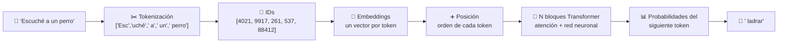
*Los cortes y los IDs de este diagrama son ilustrativos.*

---

## 1. LLMs: predicción del siguiente token

- Los LLMs (y los SLMs, sus versiones pequeñas) codifican relaciones **lingüísticas y semánticas** entre palabras.
- Se entrenan para generar **completions** (continuaciones) a partir de **prompts**, como un "texto predictivo" del celular, pero muchísimo más potente.
- Ejemplo de Microsoft Learn: si escuchas "Escuché a un perro...", puedes adivinar "ladrar" porque:
  - Tienes un **vocabulario** grande.
  - Conoces **estructuras** comunes del idioma.
  - Entiendes **semántica**: algo que se "escucha" es un sonido, y los perros hacen sonidos específicos.
  - "Escuché" y "perro" son las pistas que más **reducen las probabilidades**.

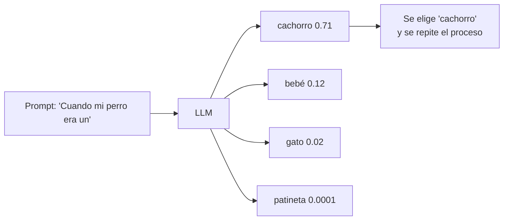

---

## 2. Tokenización

### 2.1 ¿Qué es un token?
La unidad mínima que procesa el modelo. **No siempre es una palabra**:
- Palabras completas: `perro`, `ladrar`
- Subpalabras: el "des" de "deshacer" y "desconocer"
- Signos de puntuación: `,` `?` `¡`
- Otras secuencias comunes: espacios + palabra (`" el"`)

Cada token distinto tiene un **ID entero** en el vocabulario. Si un token se repite, reutiliza su ID. Los LLMs actuales tienen vocabularios de **cientos de miles** de tokens.

| Token | ID (ejemplo de Microsoft Learn) |
|---|---|
| I | 1 |
| heard | 2 |
| a | 3 |
| dog | 4 |
| bark | 5 |
| loudly | 6 |
| at | 7 |
| cat | 8 |

### 2.2 ¿Cómo se construye el vocabulario? BPE
La mayoría de los LLMs usa **BPE (Byte-Pair Encoding)** o variantes:

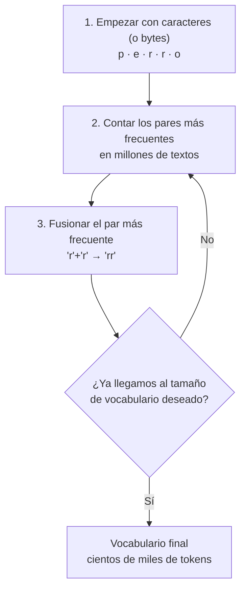

- Las palabras **frecuentes** quedan como un solo token; las **raras** se parten en pedazos.
- Así el modelo nunca se topa con una palabra "desconocida": siempre puede armarla con subpalabras.

### 2.3 Pruébalo con un tokenizador real
```python
# pip install tiktoken   (descarga el vocabulario la primera vez)
import tiktoken

enc = tiktoken.get_encoding("o200k_base")    # tokenizador de modelos GPT-4o / GPT-4.1
for texto in ["Escuché a un perro ladrar muy fuerte",
              "I heard a dog bark very loudly",
              "Desafortunadamente, el ajolote xochimilca está en peligro"]:
    ids = enc.encode(texto)
    piezas = [enc.decode([i]) for i in ids]
    print(f"{len(ids):2d} tokens | {piezas}")
```
- **Explicación:** verás que algunas palabras en español se parten en varios tokens y que la misma oración en inglés suele usar **menos tokens**. Los vocabularios se construyeron con más texto en inglés.
- También puedes probar en el [tokenizador interactivo de OpenAI](https://platform.openai.com/tokenizer).

### 2.4 Por qué los tokens te importan como desarrollador

| Concepto | Qué significa | Impacto |
|---|---|---|
| **Costo** | Se cobra por tokens de entrada y de salida | Prompts largos = facturas altas |
| **TPM** (tokens por minuto) | Límite de tu deployment en Foundry | Si lo superas: error **429** (throttling) |
| **Ventana de contexto** | Máximo de tokens que el modelo ve a la vez (prompt + historial + documentos + respuesta) | Si te pasas, se trunca o falla |
| **`max_output_tokens`** | Tope de la respuesta | Controla costo y latencia |
| **Idioma** | Español ≈ más tokens que inglés | Más costo por la misma idea |

**Regla aproximada:** en inglés, 1 token ≈ ¾ de palabra (unas 750 palabras ≈ 1,000 tokens). En español suele ser algo más.

### 2.5 Tokens especiales
Además de palabras, los modelos usan tokens de control invisibles para ti: inicio y fin de texto, separadores de rol (`system`, `user`, `assistant`), llamadas a herramientas... Por eso un mensaje "vacío" en un chat igual consume algunos tokens.

---

## 3. De IDs a vectores: la tabla de embeddings

Un ID (por ejemplo `4`) no tiene significado por sí mismo. El modelo tiene una **tabla de embeddings**: una matriz con una fila por token del vocabulario y una columna por dimensión.

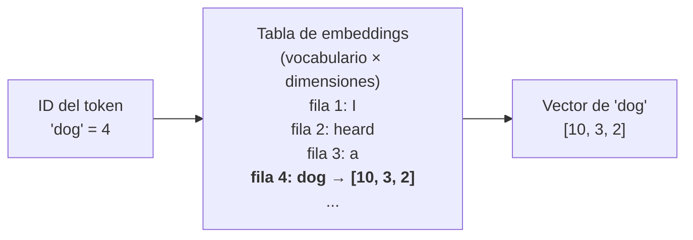

- Cada fila es un **vector** (arreglo de números). Cada posición es una **dimensión** que codifica algún atributo lingüístico o semántico.
- Al inicio del entrenamiento los valores son **aleatorios**; el entrenamiento los ajusta.
- Los ejemplos usan 3 dimensiones; los modelos reales usan **miles** (por ejemplo, `text-embedding-3-small` produce vectores de 1,536 dimensiones).

```python
import numpy as np

vocabulario = {"I": 0, "heard": 1, "a": 2, "dog": 3, "bark": 4, "cat": 5}
rng = np.random.default_rng(42)
tabla_embeddings = rng.normal(size=(len(vocabulario), 4))   # 6 tokens × 4 dimensiones (aleatorio al inicio)

oracion = ["I", "heard", "a", "dog"]
ids = [vocabulario[t] for t in oracion]
vectores = tabla_embeddings[ids]            # "lookup": tomar las filas correspondientes
print("IDs:", ids)
print("Forma de la matriz de entrada:", vectores.shape)   # (4 tokens, 4 dimensiones)
```
- **Explicación:** buscar el embedding de un token es simplemente **tomar una fila** de la tabla. La oración se convierte en una matriz `tokens × dimensiones`, que es lo que entra al Transformer.

---

## 4. Codificación posicional: el orden importa

"El perro mordió al hombre" ≠ "El hombre mordió al perro". Pero la atención, por sí sola, no sabe en qué orden llegaron los tokens. Por eso se **suma** a cada embedding un vector que representa su **posición**.

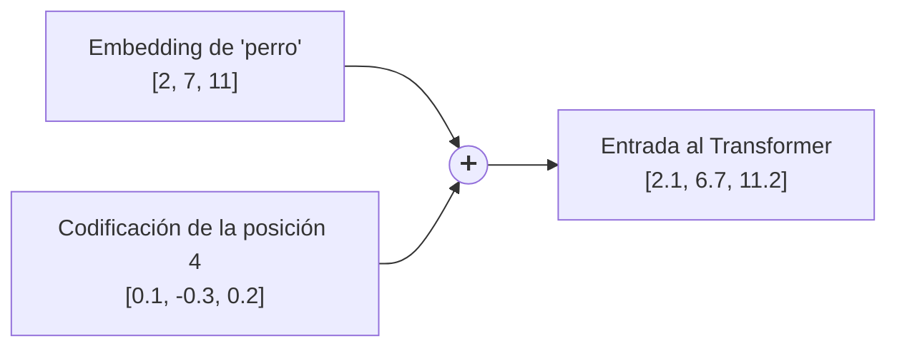

El Transformer original usa funciones seno y coseno de distintas frecuencias:

`PE(pos, 2i) = sin(pos / 10000^(2i/d))` y `PE(pos, 2i+1) = cos(pos / 10000^(2i/d))`

```python
import numpy as np

def codificacion_posicional(num_posiciones, d_modelo):
    pos = np.arange(num_posiciones)[:, None]
    i = np.arange(d_modelo)[None, :]
    angulos = pos / np.power(10000, (2 * (i // 2)) / d_modelo)
    pe = np.zeros((num_posiciones, d_modelo))
    pe[:, 0::2] = np.sin(angulos[:, 0::2])
    pe[:, 1::2] = np.cos(angulos[:, 1::2])
    return pe

pe = codificacion_posicional(num_posiciones=5, d_modelo=4)
print(pe.round(3))   # cada fila es una posición distinta y única
```
- **Explicación:** cada posición recibe un patrón único de valores. Los modelos modernos usan variantes (como *RoPE*, que rota los vectores según la posición), pero la idea es la misma: **inyectar el orden**.

---

## 5. Atención: el corazón del Transformer

### 5.1 La intuición
La atención examina cada token y calcula **cuánto influyen los demás tokens** en su significado. En "Escuché a un perro **ladrar**", para entender "ladrar" pesan mucho "escuché" y "perro", y casi nada "a" o "un".

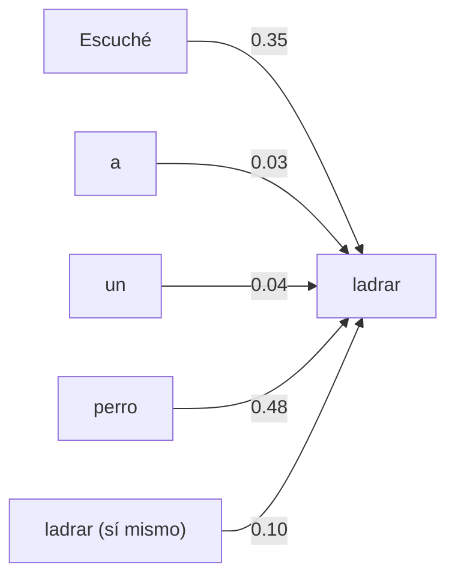
*Pesos de atención ilustrativos: suman 1.*

### 5.2 Query, Key y Value
Cada token genera tres vectores (multiplicando su embedding por tres matrices aprendidas):

| Vector | Pregunta que representa | Analogía (biblioteca) |
|---|---|---|
| **Query (Q)** | "¿Qué información estoy buscando?" | Lo que escribes en el buscador |
| **Key (K)** | "¿Qué información ofrezco?" | El título/etiqueta de cada libro |
| **Value (V)** | "Este es mi contenido" | El contenido del libro |

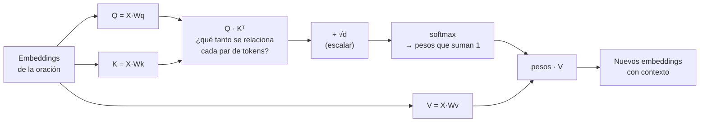

**Fórmula (scaled dot-product attention):** `Atención(Q, K, V) = softmax(Q·Kᵀ / √d) · V`

### 5.3 Atención paso a paso con números
```python
import numpy as np

np.random.seed(0)
tokens = ["Escuché", "a", "un", "perro", "ladrar"]
d = 4
X = np.random.randn(len(tokens), d)               # embeddings (5 tokens × 4 dims)

# Matrices aprendidas (aquí aleatorias para el ejemplo)
Wq, Wk, Wv = (np.random.randn(d, d) for _ in range(3))
Q, K, V = X @ Wq, X @ Wk, X @ Wv

def softmax(x):
    e = np.exp(x - x.max(axis=-1, keepdims=True))
    return e / e.sum(axis=-1, keepdims=True)

puntajes = Q @ K.T / np.sqrt(d)                   # relación entre cada par de tokens
pesos = softmax(puntajes)                         # cada fila suma 1
salida = pesos @ V                                # embeddings contextualizados

print("Pesos de atención de 'ladrar' hacia cada token:")
for t, w in zip(tokens, pesos[-1]):
    print(f"  {t:8s} {w:.2f}")
print("Forma de la salida:", salida.shape)        # (5, 4): un vector nuevo por token
```
- **Explicación:**
  - `Q @ K.T` compara la "pregunta" de cada token con la "etiqueta" de todos los demás.
  - Se divide entre `√d` para que los números no crezcan demasiado y el softmax no se sature.
  - `softmax` convierte puntajes en **pesos** que suman 1.
  - La salida es una **mezcla ponderada** de los Values: cada token "absorbe" información de los tokens que más le importan.
  - Aquí las matrices son aleatorias, así que los pesos no tienen sentido lingüístico; en un modelo entrenado, "ladrar" pondría más peso en "perro" y "Escuché".

### 5.4 Atención multi-cabeza
En lugar de una sola atención, el modelo calcula **varias en paralelo** ("cabezas"), cada una con sus propias matrices Wq, Wk, Wv. Cada cabeza puede especializarse en un tipo de relación:

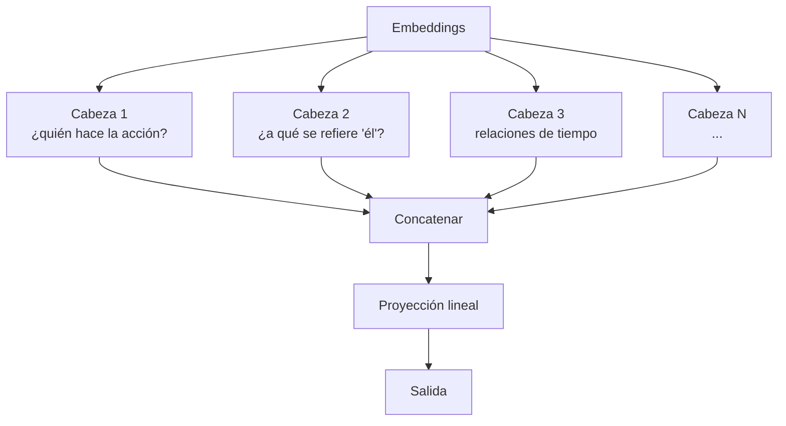

### 5.5 Atención enmascarada (en el decoder)
Al generar texto, el modelo **no puede ver el futuro**: cada token solo atiende a los anteriores. Se logra con una máscara triangular:

| | Escuché | a | un | perro | ladrar |
|---|---|---|---|---|---|
| **Escuché** | ✅ | ❌ | ❌ | ❌ | ❌ |
| **a** | ✅ | ✅ | ❌ | ❌ | ❌ |
| **un** | ✅ | ✅ | ✅ | ❌ | ❌ |
| **perro** | ✅ | ✅ | ✅ | ✅ | ❌ |
| **ladrar** | ✅ | ✅ | ✅ | ✅ | ✅ |

Durante el **entrenamiento**, como el siguiente token ya se conoce, el modelo compara su predicción con el real y ajusta los pesos para reducir el error.

---

## 6. El bloque Transformer completo

Un LLM apila decenas de bloques iguales. Cada bloque refina los embeddings un poco más:

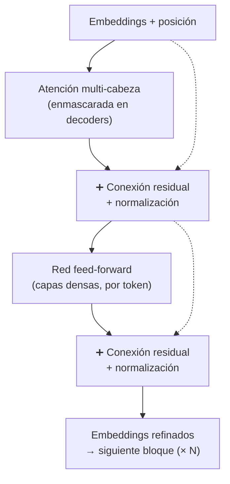

| Componente | Para qué sirve |
|---|---|
| **Atención multi-cabeza** | Mezclar información entre tokens según el contexto |
| **Red feed-forward** | Procesar cada token por separado; se cree que almacena buena parte del "conocimiento" |
| **Conexión residual** | Sumar la entrada a la salida para que la información y el aprendizaje fluyan en redes muy profundas |
| **Normalización** | Mantener los valores en rangos estables durante el entrenamiento |

---

## 7. Encoder, decoder y encoder–decoder

El paper original (*"Attention is all you need"*, 2017) tenía dos bloques. Hoy se usan tres familias:

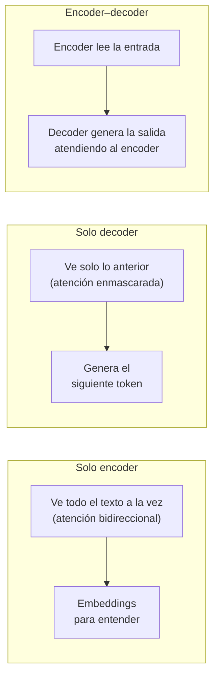

| Familia | Ejemplos | Ideal para |
|---|---|---|
| **Solo encoder** | BERT, modelos de embeddings | Clasificar, buscar, extraer entidades, **embeddings para RAG** |
| **Solo decoder** | GPT, Claude, Llama, Phi, Mistral | **Generar texto**, chat, agentes (la mayoría de LLMs actuales) |
| **Encoder–decoder** | T5, modelos de traducción y voz | Traducción, resumen, voz a texto |

---

## 8. Generación: cómo se elige el siguiente token

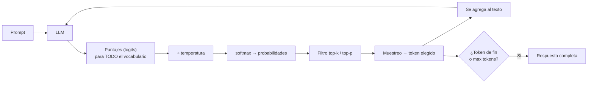

| Estrategia | Cómo elige | Resultado |
|---|---|---|
| **Greedy** | Siempre el más probable | Predecible, a veces repetitivo |
| **Temperatura** | Divide los puntajes antes del softmax | Baja = conservador; alta = creativo |
| **Top-k** | Solo considera los k más probables | Evita tokens absurdos |
| **Top-p (nucleus)** | Solo los tokens que suman probabilidad p (ej. 0.9) | Flexible según la confianza |

```python
import numpy as np

rng = np.random.default_rng(7)
vocab = ["cachorro", "bebé", "niño", "gato", "patineta"]
logits = np.array([4.0, 2.2, 1.5, 0.3, -2.0])

def probabilidades(logits, temperatura):
    z = logits / temperatura
    e = np.exp(z - z.max())
    return e / e.sum()

def top_p(probs, p=0.9):
    orden = np.argsort(probs)[::-1]
    acumulada = np.cumsum(probs[orden])
    corte = orden[: np.searchsorted(acumulada, p) + 1]
    filtradas = np.zeros_like(probs); filtradas[corte] = probs[corte]
    return filtradas / filtradas.sum()

for temp in (0.2, 1.0, 2.0):
    pr = probabilidades(logits, temp)
    muestras = [vocab[rng.choice(len(vocab), p=top_p(pr))] for _ in range(10)]
    print(f"temperatura {temp}: { {v: round(float(x), 2) for v, x in zip(vocab, pr)} }\n   10 muestras: {muestras}")
```
- **Explicación:** con temperatura 0.2 casi siempre sale "cachorro"; con 2.0 aparecen más opciones. El filtro **top-p** elimina tokens muy improbables (como "patineta") aunque la temperatura sea alta. Estos son los parámetros `temperature` y `top_p` del Playground de Foundry.

### Por qué existen las alucinaciones
El modelo elige tokens **lingüísticamente probables**, no **verificados**. Si en el contexto no hay información, generará la continuación que "suena" correcta. Por eso el **RAG** (darle la información) y el **grounding** son tan importantes.

### Ventana de contexto y caché KV
- Cada token nuevo atiende a **todos** los anteriores, así que textos más largos cuestan más cómputo y memoria.
- Los modelos guardan los Keys y Values ya calculados (**caché KV**) para no recalcularlos en cada token; por eso el primer token tarda más y los siguientes salen rápido (*streaming*).

---

## 9. Espacio vectorial y similitud

### 9.1 Embeddings como flechas en el espacio
Si imaginas cada embedding como una flecha, los tokens con significado parecido **apuntan en la misma dirección**:

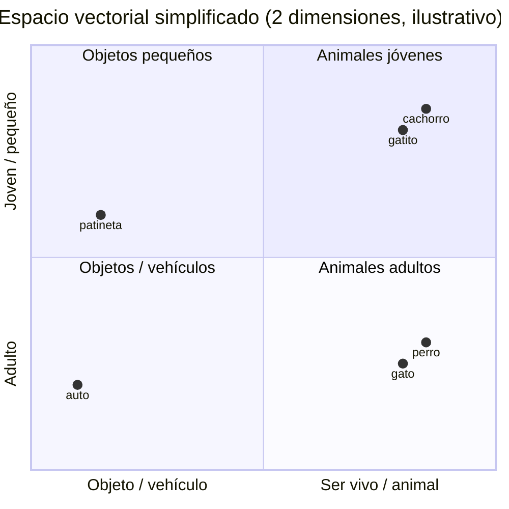

### 9.2 Similitud coseno
`cos(A, B) = (A · B) / (‖A‖ × ‖B‖)` → 1 = misma dirección, 0 = sin relación, −1 = opuestos.

```python
import numpy as np

def similitud_coseno(a, b):
    return np.dot(a, b) / (np.linalg.norm(a) * np.linalg.norm(b))

# Embeddings simplificados de Microsoft Learn (ya con contexto)
emb = {
    "dog":        np.array([10, 3, 2]),
    "puppy":      np.array([5, 3, 2]),
    "cat":        np.array([10, 3, 1]),
    "car":        np.array([-2, -2, 1]),
    "skateboard": np.array([-3, -2, 2]),
}
for a, b in [("dog", "puppy"), ("dog", "cat"), ("dog", "skateboard"), ("car", "skateboard")]:
    print(f"{a:10s} vs {b:10s}: {similitud_coseno(emb[a], emb[b]):+.2f}")
```
- **Explicación:** "dog" está muy cerca de "puppy" y "cat"; "skateboard" apunta casi en sentido contrario; "car" y "skateboard" (vehículos) son parecidos entre sí.

### 9.3 Embeddings de palabras vs. de oraciones
- **Embeddings de tokens:** viven dentro del LLM y cambian en cada capa.
- **Embeddings de oraciones/documentos:** un modelo de embeddings (como `text-embedding-3-small`) produce **un solo vector** para todo un texto. Son los que se guardan en un índice vectorial para **búsqueda semántica** y **RAG**.

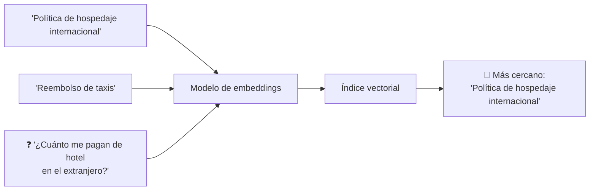

---

## 10. Resumen del viaje completo

| Paso | Qué ocurre | Concepto clave |
|---|---|---|
| 1 | El texto se parte en piezas | **Tokenización** (BPE) |
| 2 | Cada pieza recibe un número | **ID de token** |
| 3 | Cada ID se convierte en vector | **Tabla de embeddings** |
| 4 | Se agrega el orden | **Codificación posicional** |
| 5 | Los tokens se "miran" entre sí | **Atención** (Q, K, V; multi-cabeza; enmascarada) |
| 6 | Se repite en muchos bloques | **Transformer** (residuales, feed-forward) |
| 7 | Se calculan probabilidades | **Softmax**, temperatura, top-p |
| 8 | Se elige y agrega un token, y se repite | **Generación autorregresiva** |

### Para el examen
- "La unidad mínima de texto que procesa un modelo" → **token**.
- "Vector que representa el significado de un token en contexto" → **embedding**.
- "Mecanismo que pondera la influencia de los tokens cercanos" → **atención**.
- "Medida de similitud entre dos embeddings" → **similitud coseno**.
- "Bloque que predice el siguiente token" → **decoder**.
- "Parámetro que controla qué tan creativa es la respuesta" → **temperatura**.
- "Límite de tokens que el modelo puede considerar a la vez" → **ventana de contexto**.

### Recursos
- [Introducción a la IA generativa y los agentes – Microsoft Learn](https://learn.microsoft.com/es-es/training/modules/fundamentals-generative-ai/)
- [Attention Is All You Need (paper original)](https://arxiv.org/abs/1706.03762)
- [The Illustrated Transformer – Jay Alammar](https://jalammar.github.io/illustrated-transformer/)
- [Transformers explicados visualmente – 3Blue1Brown](https://www.youtube.com/watch?v=wjZofJX0v4M)
- [Tokenizador interactivo de OpenAI](https://platform.openai.com/tokenizer)
