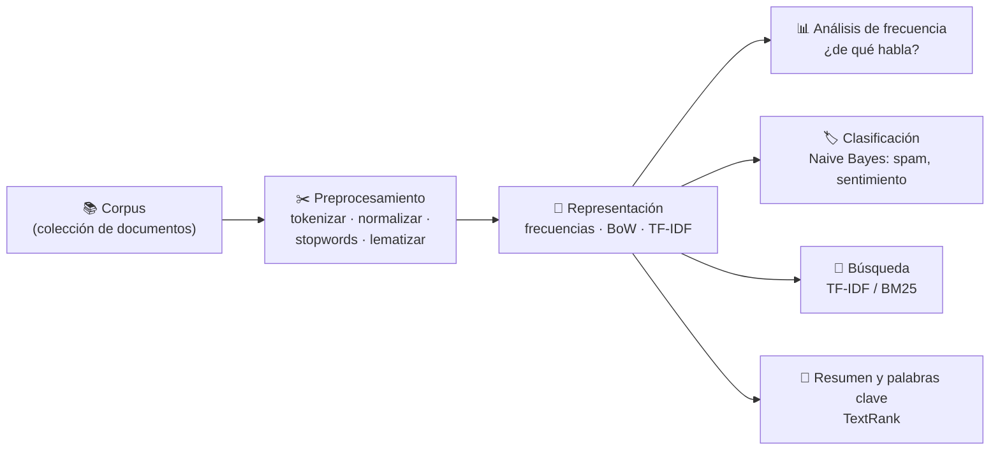
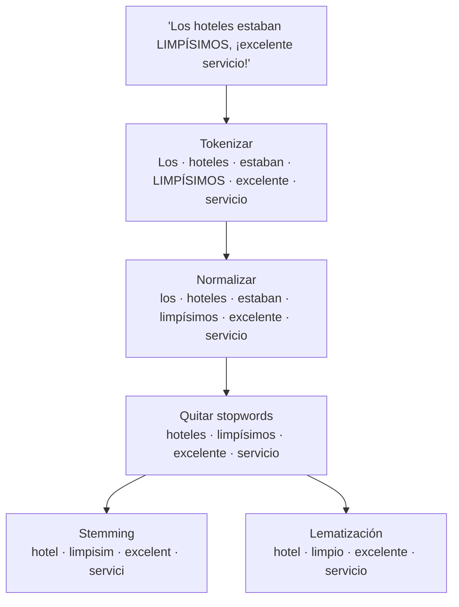
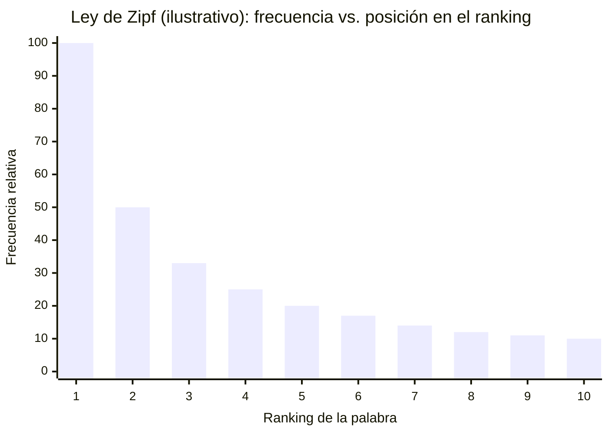
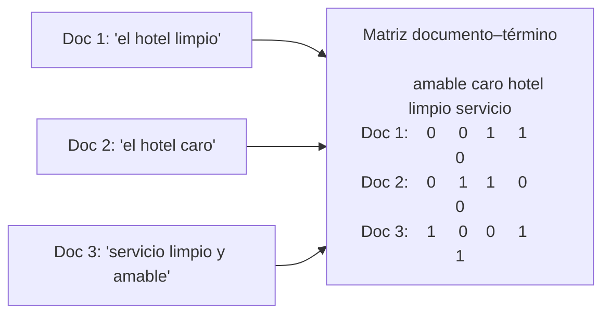
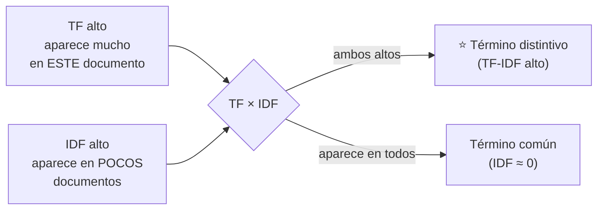
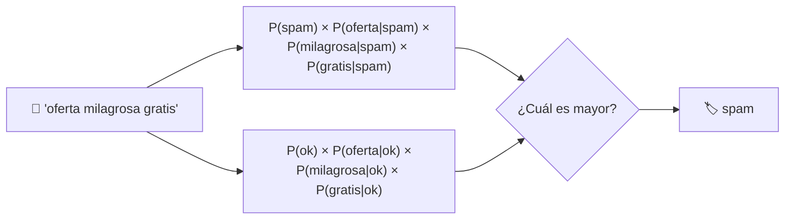
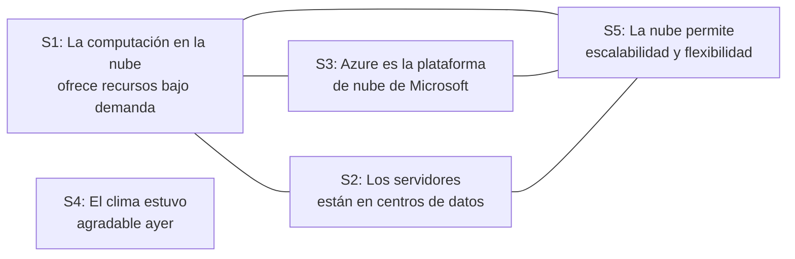

# Tema 1: Análisis estadístico de texto — Fundamentos técnicos

### Descripción
Antes de los LLMs, el NLP se hacía **contando**. La idea central es sencilla: si una palabra aparece mucho en un documento, probablemente indica de qué trata; si aparece mucho en *este* documento pero poco en los demás, probablemente es lo que lo **distingue**. Estas técnicas siguen vigentes en 2026 porque son rápidas, baratas, explicables y funcionan sin GPU. Además, siguen vivas en producción:
- La **búsqueda por palabras clave (BM25)**, descendiente de TF-IDF, es la mitad de la **búsqueda híbrida** que usan Azure AI Search y Foundry IQ en el RAG.
- Los clasificadores de **bolsa de palabras + Naive Bayes** siguen siendo un excelente punto de comparación (*baseline*) antes de gastar en un LLM.
- **TextRank** se sigue usando para resumen extractivo y extracción de palabras clave.

Analogía: es como adivinar de qué trata una plática escuchando solo las palabras que más se repiten. Si oyes "gol", "portero" y "penal" muchas veces, es fútbol. Y si en una plática de deportes escuchas "VAR" mucho más que en las demás, sabes que el tema específico es una jugada polémica.



---

## 1. Vocabulario básico

| Término | Significado | Ejemplo |
|---|---|---|
| **Corpus** | Colección de documentos que se analiza | Todas las reseñas de un hotel |
| **Documento** | Cada unidad de texto | Una reseña |
| **Token** | Unidad mínima tras tokenizar | "hotel", "limpio" |
| **Vocabulario** | Conjunto de tokens distintos del corpus | {hotel, limpio, caro, ...} |
| **Término** | Token (o n-grama) ya normalizado que se cuenta | "limpi" tras stemming |
| **Frecuencia** | Cuántas veces aparece un término | "hotel": 4 |

---

## 2. Preprocesamiento: preparar el texto para contar



| Técnica | Qué hace | Pros | Contras |
|---|---|---|---|
| **Tokenización** | Partir el texto en tokens | Paso obligatorio | Contracciones, URLs, emojis requieren reglas |
| **Normalización** | Minúsculas, quitar puntuación | Unifica variantes | Se pierde "Mr Banks" vs "banks", ironía en MAYÚSCULAS |
| **Stopwords** | Quitar palabras muy frecuentes y poco informativas | Resalta lo importante | A veces sí importan ("no" en sentimiento) |
| **Stemming** | Recortar sufijos mecánicamente | Rápido, sin diccionario | Puede producir no-palabras ("limpisim") |
| **Lematización** | Forma de diccionario con reglas lingüísticas | Palabras válidas | Más lento, requiere modelo del idioma |
| **N-gramas** | Agrupar palabras consecutivas | Captura frases ("no recomiendo") | El vocabulario crece mucho |

> [!WARNING]
> En análisis de sentimiento **no quites "no"** como stopword: "no me gustó" y "me gustó" quedarían idénticos.

```python
# pip install nltk
import re
from nltk.stem.snowball import SnowballStemmer

STOPWORDS = {"el", "la", "los", "las", "un", "una", "de", "del", "y", "a", "en", "que",
             "es", "por", "con", "para", "estaban", "fue", "muy", "me", "lo", "al", "su"}
stemmer = SnowballStemmer("spanish")

def preprocesar(texto, usar_stemming=True):
    tokens = re.findall(r"\w+", texto.lower())                 # tokenizar + normalizar
    tokens = [t for t in tokens if t not in STOPWORDS]         # quitar stopwords
    return [stemmer.stem(t) for t in tokens] if usar_stemming else tokens

print(preprocesar("Los hoteles estaban LIMPÍSIMOS, ¡excelente servicio!", usar_stemming=False))
print(preprocesar("Los hoteles estaban LIMPÍSIMOS, ¡excelente servicio!"))
print(preprocesar("Recomiendo el hotel; lo recomendaría y lo recomendé a todos"))
```
- **Explicación:** el stemmer Snowball para español no necesita descargas. "recomendaría" y "recomendé" quedan en la misma raíz (`recomend`) y se cuentan juntas, pero "recomiendo" queda como `recom`: el stemming es mecánico y no siempre une todas las formas de un verbo irregular. Eso es justo lo que resuelve la **lematización** (todas → "recomendar"). Para lematización en español se usa, por ejemplo, spaCy con el modelo `es_core_news_sm`.

---

## 3. Análisis de frecuencia

**Idea (Microsoft Learn):** si identificas los términos más usados en un documento, normalmente puedes darte una buena idea de qué trata.

Ejemplo de Microsoft Learn (párrafo sobre IA en los negocios, tras tokenizar, normalizar y lematizar):

| Término | Frecuencia |
|---|---|
| ai | 4 |
| business | 3 |
| benefit | 2 |
| customer | 2 |
| decision | 2 |
| market | 2 |

→ Conclusión: el texto habla de **IA y sus beneficios para los negocios**.

### La ley de Zipf
En cualquier idioma, unas pocas palabras aparecen muchísimo y la mayoría aparece muy poco: la palabra #2 aparece aproximadamente la mitad de veces que la #1, la #3 un tercio, etc.


- Las primeras posiciones suelen ser **stopwords** ("de", "la", "que"): por eso se eliminan.
- Las palabras raras de la "cola larga" suelen ser las más **informativas** de un documento específico. Esta intuición lleva directo a TF-IDF.

```python
from collections import Counter

texto = """La IA está transformando los negocios. Las empresas usan IA para mejorar
decisiones, anticipar al mercado y atender mejor al cliente. La IA da ventajas al negocio
y los clientes perciben beneficios. Las decisiones basadas en datos mejoran el mercado."""

terminos = preprocesar(texto)
for termino, n in Counter(terminos).most_common(6):
    print(f"{termino:12s} {'█' * n} {n}")
```
- **Explicación:** gracias al stemming, "negocios"/"negocio", "decisiones" y "mercado" se cuentan juntos. El tema salta a la vista.

### Limitación
En una **colección** de documentos sobre IA, términos como "IA", "Microsoft" o "agente" aparecen en todos; contar frecuencias no ayuda a **distinguir** un documento de otro.

---

## 4. Bolsa de palabras (Bag of Words) y la matriz documento–término

**Definición (Microsoft Learn):** técnica de extracción de características que representa los tokens de un texto como un **vector de frecuencias u ocurrencias**, ignorando la gramática y el orden de las palabras.



- Cada **fila** es un documento (un vector); cada **columna**, un término del vocabulario.
- La matriz suele ser **dispersa** (*sparse*): la mayoría de valores son 0.
- **Se pierde el orden:** "el perro mordió al hombre" = "el hombre mordió al perro".

```python
from sklearn.feature_extraction.text import CountVectorizer

docs = ["el hotel limpio", "el hotel caro", "servicio limpio y amable"]
bow = CountVectorizer(stop_words=["el", "y"])
matriz = bow.fit_transform(docs)

print("Vocabulario:", list(bow.get_feature_names_out()))
print(matriz.toarray())
print(f"Dispersión: {1 - matriz.nnz / (matriz.shape[0] * matriz.shape[1]):.0%} de ceros")
```

---

## 5. TF-IDF: frecuencia de término × frecuencia inversa de documento

**Idea (Microsoft Learn):** se asume alta relevancia para palabras que aparecen **mucho en un documento** pero **relativamente poco en el resto** de la colección.

### 5.1 Las fórmulas

| Componente | Fórmula | Qué mide |
|---|---|---|
| **TF** | `tf(t, d)` = veces que aparece `t` en el documento `d` | Importancia local |
| **IDF** | `idf(t) = log(N / df(t))` | Rareza en la colección (`N` = total de documentos, `df(t)` = documentos que contienen `t`) |
| **TF-IDF** | `tfidf(t, d) = tf(t, d) × idf(t)` | Importancia local × rareza global |



### 5.2 Ejemplo resuelto (de Microsoft Learn)
Dos documentos sobre agentes de IA (`N = 2`):
- "AI", "Microsoft" y "agent" aparecen en **ambos** → `df = 2` → `idf = log(2/2) = 0` → **TF-IDF = 0** (no distinguen).
- "copilot" aparece 3 veces solo en el documento A → `3 × ln(2/1) = 3 × 0.6931 ≈ 2.0794`.
- "declarative" aparece 2 veces solo en A → `2 × 0.6931 ≈ 1.3863`.

| Documento A | TF-IDF | Documento B | TF-IDF |
|---|---|---|---|
| copilot | 2.0794 | code | 2.0794 |
| studio | 2.0794 | develop | 2.0794 |
| declarative | 1.3863 | foundry | 2.0794 |

→ **Interpretación:** A trata de crear agentes declarativos con **Copilot Studio**; B, de desarrollar agentes con código en **Microsoft Foundry**.

### 5.3 TF-IDF desde cero
```python
import math
from collections import Counter

docs = {
    "A": "copilot studio copilot declarative agent ai microsoft copilot studio declarative studio",
    "B": "code develop foundry agent ai microsoft code foundry develop code foundry develop",
}
tokens = {k: v.split() for k, v in docs.items()}
N = len(docs)
df = Counter(t for toks in tokens.values() for t in set(toks))     # en cuántos docs aparece

def tfidf(doc):
    tf = Counter(tokens[doc])
    return {t: tf[t] * math.log(N / df[t]) for t in tf}

for doc in docs:
    top = sorted(tfidf(doc).items(), key=lambda x: -x[1])[:4]
    print(doc, [(t, round(v, 4)) for t, v in top])
```
- **Explicación:** "agent", "ai" y "microsoft" obtienen 0 porque están en ambos documentos. Los términos exclusivos de cada uno quedan arriba.

### 5.4 Variantes que usan las librerías
| Variante | Para qué |
|---|---|
| **IDF suavizado:** `log((1 + N) / (1 + df)) + 1` | Evita divisiones entre cero y que términos comunes valgan exactamente 0 (lo usa scikit-learn) |
| **TF sublineal:** `1 + log(tf)` | Que 20 repeticiones no valgan 20 veces más que una |
| **Normalización L2** | Que documentos largos no tengan ventaja |
| **BM25** | Evolución de TF-IDF con saturación de TF y ajuste por longitud del documento; es el algoritmo de **búsqueda por palabras clave** de Azure AI Search |

### 5.5 TF-IDF para búsqueda: el "Google" más simple
```python
from sklearn.feature_extraction.text import TfidfVectorizer
from sklearn.metrics.pairwise import cosine_similarity

politicas = [
    "Hospedaje internacional: hasta 180 USD por noche en viajes al extranjero.",
    "Taxis y apps de transporte: máximo 450 pesos por trayecto con factura.",
    "Comidas: hasta 600 pesos diarios en viajes nacionales.",
    "Vuelos: siempre en clase turista salvo vuelos de más de 8 horas.",
]
stopwords = ["de", "en", "el", "la", "los", "las", "y", "a", "me", "por", "con", "que",
             "cuánto", "hasta", "salvo", "más", "siempre"]
vectorizador = TfidfVectorizer(stop_words=stopwords)
matriz = vectorizador.fit_transform(politicas)

def buscar(consulta):
    similitud = cosine_similarity(vectorizador.transform([consulta]), matriz)[0]
    mejor = similitud.argmax()
    if similitud[mejor] == 0:
        return 0.0, "(sin coincidencias)"
    return round(float(similitud[mejor]), 2), politicas[mejor]

for consulta in ["¿cuánto me pagan de taxis?",                    # coincide "taxis"
                 "¿cuánto me pagan de taxi?",                     # "taxi" ≠ "taxis" → 0
                 "¿cuánto me pagan de hotel en el extranjero?",   # coincide "extranjero"
                 "¿cuánto me dan de hospedaje fuera del país?"]:  # coincide "hospedaje"
    print(f"{consulta:48s} → {buscar(consulta)}")
```
- **Explicación:** la consulta se convierte en un vector TF-IDF con el mismo vocabulario y se compara con cada documento usando **similitud coseno**. Funciona cuando hay **palabras exactas en común** ("taxis", "extranjero", "hospedaje"), pero con "taxi" (singular) el puntaje es **0**: para la búsqueda estadística "taxi" y "taxis" son palabras distintas, y tampoco sabe que "hotel" ≈ "hospedaje". Por eso se aplican stemming/lematización y, sobre todo, por eso existen los **embeddings semánticos** (siguiente tema) y la **búsqueda híbrida** en RAG.

---

## 6. N-gramas: capturar frases

| Tipo | Ejemplo de "no me gustó el servicio" |
|---|---|
| Unigramas | no · me · gustó · el · servicio |
| Bigramas | no me · me gustó · gustó el · el servicio |
| Trigramas | no me gustó · me gustó el · gustó el servicio |

- Los bigramas capturan **negaciones** ("no recomiendo") y **expresiones** ("inteligencia artificial", "Ciudad de México").
- Costo: el vocabulario crece mucho; se suele limitar con frecuencia mínima.

```python
from sklearn.feature_extraction.text import CountVectorizer

resenas = ["no me gustó el servicio", "me gustó mucho el servicio"]
for rango in [(1, 1), (1, 2)]:
    cv = CountVectorizer(ngram_range=rango).fit(resenas)
    print(rango, list(cv.get_feature_names_out()))
```
- **Explicación:** con unigramas ambas reseñas comparten "gustó" y "servicio"; con bigramas aparece "no me", la pista que distingue la negativa.

---

## 7. Clasificación de texto con Naive Bayes

**Definición (Microsoft Learn):** clasificador probabilístico que aplica el **teorema de Bayes** para predecir la clase probable de un documento a partir de la frecuencia de sus palabras.

### 7.1 El teorema de Bayes aplicado a texto
`P(clase | palabras) ∝ P(clase) × P(palabra₁ | clase) × P(palabra₂ | clase) × ...`

- **P(clase):** qué tan común es la clase (*prior*). Ej.: 40% de los correos son spam.
- **P(palabra | clase):** qué tan común es la palabra dentro de esa clase.
- **"Naive" (ingenuo):** asume que las palabras son **independientes** entre sí (no es cierto, pero funciona sorprendentemente bien).



### 7.2 Ejemplo a mano
Supón 10 correos de entrenamiento: 4 spam y 6 legítimos.

| Palabra | Aparece en spam | Aparece en legítimos |
|---|---|---|
| "oferta" | 3 de 4 | 1 de 6 |
| "reunión" | 0 de 4 | 4 de 6 |

Para el correo "oferta" (simplificando a una palabra):
- `P(spam) × P(oferta|spam) = 0.4 × 0.75 = 0.30`
- `P(ok) × P(oferta|ok) = 0.6 × 0.17 ≈ 0.10`
- → **spam** (0.30 > 0.10).

**Suavizado de Laplace:** "reunión" nunca apareció en spam → `P(reunión|spam) = 0` anularía todo el producto. Se suma 1 a todos los conteos para evitar ceros.

### 7.3 Naive Bayes desde cero
```python
import math
from collections import Counter, defaultdict

entrenamiento = [
    ("cura milagrosa baja de peso rápido", "spam"),
    ("oferta milagrosa anti edad gratis", "spam"),
    ("gana dinero rápido oferta exclusiva", "spam"),
    ("reunión de equipo mañana a las 10", "ok"),
    ("te comparto la minuta de la reunión", "ok"),
    ("revisemos el presupuesto del proyecto", "ok"),
]

conteo_clase = Counter(c for _, c in entrenamiento)
conteo_palabras = defaultdict(Counter)
for texto, clase in entrenamiento:
    conteo_palabras[clase].update(texto.split())
vocabulario = {p for c in conteo_palabras.values() for p in c}

def log_prob(texto, clase):
    total = sum(conteo_palabras[clase].values())
    lp = math.log(conteo_clase[clase] / len(entrenamiento))                    # prior
    for p in texto.split():
        lp += math.log((conteo_palabras[clase][p] + 1) / (total + len(vocabulario)))   # Laplace
    return lp

for correo in ["oferta gratis para bajar de peso", "minuta de la reunión del proyecto"]:
    puntajes = {c: log_prob(correo, c) for c in conteo_clase}
    print(f"{correo!r:40s} → {max(puntajes, key=puntajes.get)}  {puntajes}")
```
- **Explicación:** se usan **logaritmos** para sumar en lugar de multiplicar probabilidades muy pequeñas (evita que el resultado se vuelva 0 por redondeo). El `+ 1` es el suavizado de Laplace.

### 7.4 Con scikit-learn y evaluación
```python
from sklearn.feature_extraction.text import TfidfVectorizer
from sklearn.naive_bayes import MultinomialNB
from sklearn.pipeline import make_pipeline
from sklearn.metrics import classification_report

resenas = ["excelente servicio muy limpio", "pésima atención y sucio", "me encantó la alberca",
           "nunca vuelvo, carísimo", "personal amable y buena comida", "cuarto sucio y ruidoso",
           "todo perfecto, volveré", "no me gustó la comida, pésima", "excelente vista y trato amable",
           "cuarto sucio, no lo recomiendo"]
etiquetas = ["pos", "neg", "pos", "neg", "pos", "neg", "pos", "neg", "pos", "neg"]

modelo = make_pipeline(TfidfVectorizer(ngram_range=(1, 2)), MultinomialNB())
modelo.fit(resenas[:8], etiquetas[:8])                                  # entrenar
predicciones = modelo.predict(resenas[8:])                              # probar con datos nuevos
print(list(zip(resenas[8:], predicciones)))
print(classification_report(etiquetas[8:], predicciones, zero_division=0))
```
- **Explicación:** el mismo método sirve para **análisis de sentimiento**: la bolsa de palabras aporta las características y el modelo estima probabilidades para asignar "positivo" o "negativo". Con tan pocos ejemplos el resultado es solo ilustrativo; en la práctica se entrena con miles de reseñas.

### 7.5 Fortalezas y debilidades de Naive Bayes
| Fortalezas | Debilidades |
|---|---|
| Muy rápido de entrenar y predecir | Asume independencia entre palabras |
| Funciona con pocos datos | No entiende negación ni ironía si no hay n-gramas |
| Explicable (ves qué palabras pesan) | Sensible a palabras nunca vistas |
| Excelente baseline | Superado por modelos semánticos en tareas complejas |

---

## 8. TextRank: resumen extractivo y palabras clave

**Definición (Microsoft Learn):** algoritmo **no supervisado basado en grafos** que modela el texto como una red de **nodos** conectados; se basa en el mismo principio que **PageRank** de Google: *una oración es importante si se parece a muchas otras oraciones importantes*.

### 8.1 Cómo funciona


*Las aristas unen oraciones parecidas. S4 no se parece a nada: tendrá un puntaje bajo.*

1. **Construir el grafo:** oraciones = nodos; aristas ponderadas por **similitud** (palabras en común o similitud coseno).
2. **Calcular el rango iterativamente:**
   `TR(Sᵢ) = (1 − d) + d × Σⱼ [ wⱼᵢ / Σₖ wⱼₖ ] × TR(Sⱼ)`, con `d ≈ 0.85` (factor de amortiguamiento).
3. **Extraer** las oraciones con mayor puntaje cuando los valores convergen → **resumen extractivo**.

### 8.2 TextRank desde cero
```python
import re
import numpy as np
from sklearn.feature_extraction.text import TfidfVectorizer
from sklearn.metrics.pairwise import cosine_similarity

documento = """La computación en la nube ofrece acceso bajo demanda a recursos de cómputo.
Los servidores físicos se ubican en grandes centros de datos.
Azure es la plataforma de computación en la nube de Microsoft.
El clima estuvo agradable durante el fin de semana.
La computación en la nube permite escalabilidad y flexibilidad a las empresas."""

oraciones = [o.strip() for o in documento.split("\n") if o.strip()]
tfidf = TfidfVectorizer().fit_transform(oraciones)
W = cosine_similarity(tfidf)                         # 1) grafo: similitud entre oraciones
np.fill_diagonal(W, 0)                               # sin aristas de una oración consigo misma

d, puntajes = 0.85, np.ones(len(oraciones))
pesos_salida = W.sum(axis=1)
pesos_salida[pesos_salida == 0] = 1                  # evita dividir entre cero
for _ in range(50):                                  # 2) iterar hasta converger
    puntajes = (1 - d) + d * (W / pesos_salida[:, None]).T @ puntajes

ranking = sorted(zip(puntajes, range(len(oraciones)), oraciones), reverse=True)
for p, i, o in ranking:
    print(f"S{i+1}  {p:.3f}  {o}")

resumen = [o for _, i, o in sorted(ranking[:3], key=lambda x: x[1])]   # 3) top 3 en orden original
print("\nResumen extractivo:\n" + " ".join(resumen))
```
- **Explicación:** la oración del clima casi no comparte palabras con las demás y queda al final; las oraciones sobre la nube se "recomiendan" entre sí y suben. Igual que en el ejemplo de Microsoft Learn, el resumen se arma con las oraciones sobre computación en la nube y Azure.

### 8.3 Palabras clave con TextRank
- A nivel **palabra**: las palabras son nodos y las aristas representan **co-ocurrencia** dentro de una ventana (por ejemplo, 2–5 palabras).
- Las palabras conectadas con muchas otras palabras importantes obtienen el mayor puntaje → **palabras clave**.

### 8.4 Resumen extractivo vs. abstractivo

| | Extractivo (TextRank) | Abstractivo (LLMs) |
|---|---|---|
| Qué hace | Copia las oraciones más relevantes | Genera texto nuevo que resume |
| Fidelidad | Alta: el texto es del original | Puede alucinar |
| Fluidez | Puede quedar "cortado" | Natural |
| Costo | Muy bajo, sin GPU | Tokens de un LLM |
| En Azure | Azure Language – resumen extractivo | Azure Language – resumen abstractivo / LLM |

---

## 9. Bonus: modelado de temas (LDA)
Otra técnica estadística clásica: **LDA (Latent Dirichlet Allocation)** descubre **temas** en una colección sin etiquetas, suponiendo que cada documento es una mezcla de temas y cada tema una mezcla de palabras.

```python
from sklearn.feature_extraction.text import CountVectorizer
from sklearn.decomposition import LatentDirichletAllocation

docs = ["vuelo aeropuerto maleta avión", "hotel habitación alberca desayuno",
        "avión vuelo retraso aeropuerto", "desayuno hotel limpio habitación",
        "maleta perdida aeropuerto vuelo", "alberca hotel vista habitación"]
cv = CountVectorizer()
X = cv.fit_transform(docs)
lda = LatentDirichletAllocation(n_components=2, random_state=0).fit(X)

palabras = cv.get_feature_names_out()
for i, tema in enumerate(lda.components_):
    print(f"Tema {i + 1}:", [palabras[j] for j in tema.argsort()[-4:][::-1]])
```
- **Explicación:** sin decirle nada, LDA separa un tema de **vuelos** y otro de **hoteles**. Útil para explorar miles de reseñas o tickets.

---

## 10. Estadístico vs. semántico: ¿cuándo usar cada uno?

| Criterio | Técnicas estadísticas (BoW, TF-IDF, Naive Bayes, TextRank) | Modelos semánticos (embeddings, Transformers, LLMs) |
|---|---|---|
| Entiende sinónimos ("hotel" ≈ "hospedaje") | ❌ | ✅ |
| Entiende contexto y negación | Limitado (n-gramas) | ✅ |
| Costo y velocidad | Muy barato y rápido (CPU) | Más caro (GPU / tokens) |
| Explicabilidad | Alta | Baja |
| Datos necesarios | Pocos | Modelos preentrenados con enormes cantidades de datos |
| Coincidencia exacta (códigos, SKU, nombres) | ✅ Excelente | A veces falla |

**Casos en los que lo estadístico sigue ganando:**
- Buscar **códigos de producto, números de póliza o nombres propios** exactos → BM25.
- **Baseline** rápido para saber si vale la pena un modelo más caro.
- Clasificación sencilla con **muy poco presupuesto** o en dispositivos sin GPU.
- **Explicar** a un auditor por qué el modelo decidió algo.

**Y por eso en RAG se combinan:** la **búsqueda híbrida** de Azure AI Search mezcla **BM25 (estadístico)** + **vectorial (semántico)** y suele dar mejores resultados que cualquiera por separado.

---

## 11. Dónde aparece esto en Azure

| Técnica | Dónde la encuentras |
|---|---|
| BM25 (TF-IDF mejorado) | Búsqueda por palabras clave en **Azure AI Search** y Foundry IQ |
| Búsqueda híbrida | Azure AI Search: palabras clave + vectores + re-ranking semántico |
| Frases clave | **Azure Language** – extracción de frases clave |
| Resumen extractivo | **Azure Language** – resumen extractivo |
| Clasificación de texto | **Azure Language** – clasificación personalizada |

### Para el examen
- "Las palabras más frecuentes indican el tema del documento" → **análisis de frecuencia**.
- "Palabras frecuentes en un documento pero raras en la colección" → **TF-IDF**.
- "Representar texto como vector de frecuencias ignorando el orden" → **bolsa de palabras**.
- "Clasificador probabilístico basado en el teorema de Bayes" → **Naive Bayes** (spam, sentimiento).
- "Algoritmo de grafos inspirado en PageRank para resumir" → **TextRank**.
- "Resumen que selecciona oraciones del texto original" → **extractivo**; "que genera texto nuevo" → **abstractivo**.
- "Reducir palabras a su raíz recortando terminaciones" → **stemming**; "a su forma de diccionario" → **lematización**.

### Recursos
- [Análisis estadístico de texto – Microsoft Learn](https://learn.microsoft.com/es-es/training/modules/introduction-language/3-statistical-techniques)
- [Tokenización – Microsoft Learn](https://learn.microsoft.com/es-es/training/modules/introduction-language/2-how-it-works)
- [Documentación de scikit-learn: extracción de características de texto](https://scikit-learn.org/stable/modules/feature_extraction.html#text-feature-extraction)
- [TextRank: Bringing Order into Texts (paper original)](https://aclanthology.org/W04-3252/)
