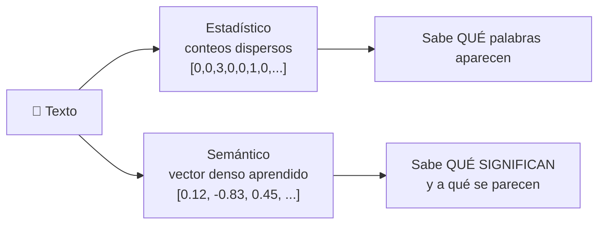
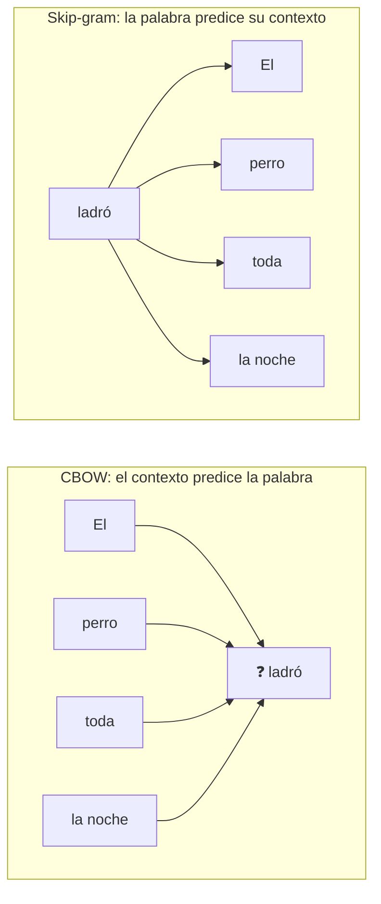
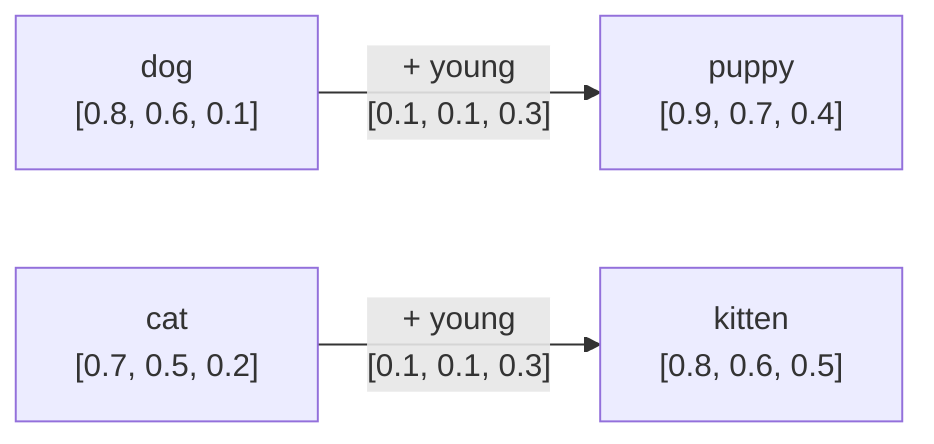
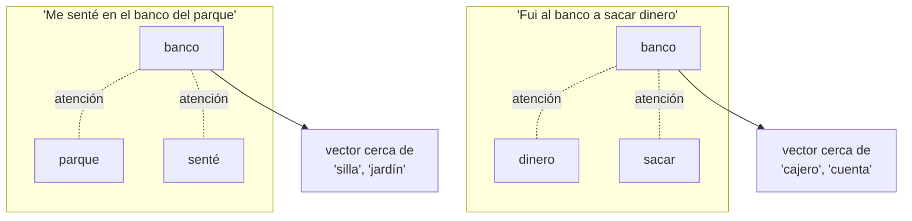
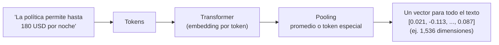
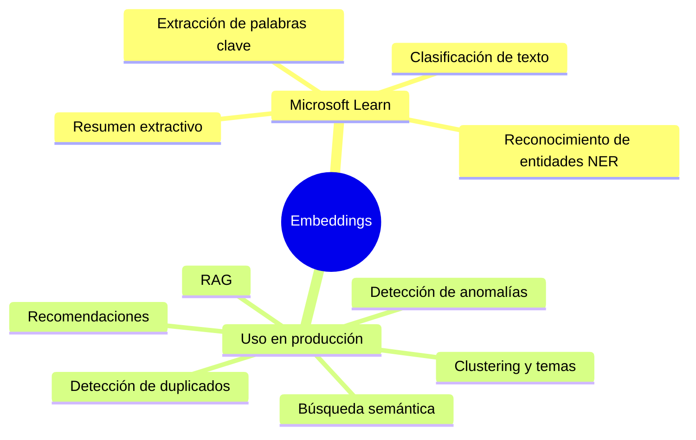
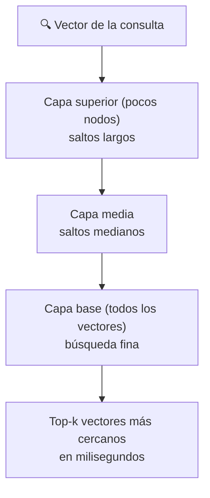

# Tema 2: Modelos de lenguaje semántico — Explicación técnica

### Descripción
El análisis estadístico no sabe que "carro" y "auto" significan lo mismo, ni que "taxi" y "taxis" son casi idénticos. Los **modelos semánticos** resuelven esto representando cada palabra (o texto completo) como un **vector denso** cuyos valores se aprenden según **cómo se usa** la palabra. Si dos palabras aparecen en contextos parecidos, sus vectores terminan apuntando en direcciones parecidas.

Analogía: "Dime con quién andas y te diré quién eres". Una palabra se define por las palabras que la rodean. "Café" suele aparecer cerca de "taza", "caliente" y "desayuno"; "té" también. Aunque nunca nadie le diga al modelo que son bebidas parecidas, lo **deduce** porque viven en los mismos contextos.



---

## 1. La hipótesis distribucional

> *"You shall know a word by the company it keeps"* — J. R. Firth (1957)

Las palabras que aparecen en **contextos similares** tienden a tener **significados similares**. Esta idea es la base de todos los embeddings.

| Contexto | Palabra oculta |
|---|---|
| "Me tomé una taza de ___ caliente en el desayuno" | café / té / chocolate |
| "El ___ ladró toda la noche" | perro / cachorro |
| "Fui al ___ a retirar efectivo" | banco / cajero |

Un modelo que aprende a **predecir la palabra oculta** termina, como efecto secundario, aprendiendo qué palabras son intercambiables: esas palabras obtienen vectores parecidos.

---

## 2. Del vector disperso al vector denso

### 2.1 El problema del one-hot
En la representación más ingenua cada palabra es un vector del tamaño del vocabulario con un solo 1:

| Palabra | Vector one-hot (vocabulario de 5) |
|---|---|
| perro | [1, 0, 0, 0, 0] |
| cachorro | [0, 1, 0, 0, 0] |
| auto | [0, 0, 1, 0, 0] |

- Todos los vectores son **perpendiculares**: la similitud entre "perro" y "cachorro" es **0**, igual que entre "perro" y "auto".
- Con un vocabulario de 100,000 palabras, cada vector tiene 100,000 posiciones casi todas en cero.

```python
import numpy as np

def coseno(a, b):
    return np.dot(a, b) / (np.linalg.norm(a) * np.linalg.norm(b))

one_hot = {"perro": np.array([1, 0, 0]), "cachorro": np.array([0, 1, 0]), "auto": np.array([0, 0, 1])}
denso   = {"perro": np.array([0.8, 0.6, 0.1]), "cachorro": np.array([0.9, 0.7, 0.4]), "auto": np.array([0.1, -0.5, 0.9])}

for nombre, emb in [("one-hot", one_hot), ("denso", denso)]:
    print(f"{nombre:8s} perro~cachorro={coseno(emb['perro'], emb['cachorro']):.2f}  "
          f"perro~auto={coseno(emb['perro'], emb['auto']):.2f}")
```
- **Explicación:** con one-hot ningún par se parece; con vectores densos aprendidos, "perro" y "cachorro" quedan cerca y "auto" lejos.

### 2.2 Vectores densos (embeddings)
- Pocas dimensiones (de 50 a unos miles) y **todos los valores llenos**.
- Cada dimensión es un "rasgo" aprendido; normalmente **no** tiene una interpretación humana directa ("dimensión 17 = animal"), pero en conjunto codifican significado.

---

## 3. Primera generación: embeddings estáticos

### 3.1 Word2Vec (Google, 2013)
Entrena una red neuronal pequeña con una tarea "falsa" de predicción; lo que importa al final son los **pesos** aprendidos, que son los embeddings.



| Variante | Tarea | Mejor para |
|---|---|---|
| **CBOW** | Predecir la palabra central a partir de las vecinas | Rápido, palabras frecuentes |
| **Skip-gram** | Predecir las vecinas a partir de la palabra central | Palabras raras, corpus pequeños |

- **Ventana de contexto:** cuántas palabras a cada lado se consideran (típicamente 2–10).
- **Negative sampling:** en lugar de calcular probabilidades sobre todo el vocabulario, compara contra unas pocas palabras "negativas" al azar: mucho más eficiente.

### 3.2 GloVe (Stanford, 2014)
Construye una **matriz de co-ocurrencia** global (cuántas veces aparece cada palabra cerca de cada otra en todo el corpus) y la factoriza para obtener vectores.

### 3.3 FastText (Facebook, 2016)
Representa cada palabra como suma de **n-gramas de caracteres** ("perro" = `<pe`, `per`, `err`, `rro`, `ro>`). Así puede generar vectores para palabras **nunca vistas** o con errores ("perrito", "perrro").

### 3.4 Construye embeddings desde cero (co-ocurrencia + SVD)
```python
import numpy as np
from itertools import combinations

corpus = [
    "el perro ladra fuerte", "el cachorro ladra fuerte", "el perro come croquetas", "el cachorro come croquetas",
    "el gato maúlla bajito", "el gatito maúlla bajito", "el gato come pescado", "el gatito come pescado",
    "el auto corre rápido", "el camión corre rápido", "el auto usa gasolina", "el camión usa gasolina",
]
oraciones = [[w for w in o.split() if w != "el"] for o in corpus]
vocab = sorted({w for o in oraciones for w in o})
idx = {w: i for i, w in enumerate(vocab)}

# 1) Matriz de co-ocurrencia: cuántas veces aparecen dos palabras en la misma oración
M = np.zeros((len(vocab), len(vocab)))
for o in oraciones:
    for a, b in combinations(o, 2):
        M[idx[a], idx[b]] += 1
        M[idx[b], idx[a]] += 1

# 2) Comprimir a 4 dimensiones densas con SVD (la idea detrás de LSA y GloVe)
U, S, _ = np.linalg.svd(M)
embeddings = U[:, :4] * S[:4]

def similares(palabra, k=3):
    v = embeddings[idx[palabra]]
    sims = embeddings @ v / (np.linalg.norm(embeddings, axis=1) * np.linalg.norm(v) + 1e-9)
    return [(vocab[i], round(float(sims[i]), 2)) for i in np.argsort(-sims) if vocab[i] != palabra][:k]

for p in ["perro", "gato", "auto"]:
    print(p, "→", similares(p))
```
- **Explicación:** nadie le dijo al programa que "perro" y "cachorro" se parecen; lo dedujo porque **comparten contextos** ("ladra", "croquetas"), aunque nunca aparecen juntos en la misma oración. Lo mismo con "gato"/"gatito" y "auto"/"camión". Es la hipótesis distribucional en acción, en unas cuantas líneas. Con un corpus tan pequeño también salen muy cerca las palabras de contexto ("croquetas", "gasolina"); con millones de oraciones, como en Word2Vec o GloVe, los grupos se vuelven mucho más finos.

---

## 4. Propiedades del espacio vectorial

### 4.1 Similitud coseno (ejemplo de Microsoft Learn)
`cos(A, B) = (A · B) / (‖A‖ × ‖B‖)`

| Palabra | Vector |
|---|---|
| dog | [0.8, 0.6, 0.1] |
| puppy | [0.9, 0.7, 0.4] |
| cat | [0.7, 0.5, 0.2] |
| kitten | [0.8, 0.6, 0.5] |
| young | [0.1, 0.1, 0.3] |
| ball | [0.3, 0.9, 0.1] |
| tree | [0.2, 0.1, 0.9] |

```python
import numpy as np

v = {
    "dog": [0.8, 0.6, 0.1], "puppy": [0.9, 0.7, 0.4], "cat": [0.7, 0.5, 0.2],
    "kitten": [0.8, 0.6, 0.5], "young": [0.1, 0.1, 0.3], "ball": [0.3, 0.9, 0.1],
    "tree": [0.2, 0.1, 0.9],
}
v = {k: np.array(x) for k, x in v.items()}

def cos(a, b):
    return np.dot(a, b) / (np.linalg.norm(a) * np.linalg.norm(b))

print(f"dog-cat:  {cos(v['dog'], v['cat']):.3f}")    # 0.991 (Learn lo redondea a ≈0.992) → muy similares
print(f"dog-tree: {cos(v['dog'], v['tree']):.3f}")   # 0.333 → poco similares
print(f"cat-tree: {cos(v['cat'], v['tree']):.3f}")   # 0.452 → poco similares
```
- **Explicación:** "tree" es el intruso entre dog, cat y tree.

### 4.2 Aritmética de vectores y analogías



- `dog + young = puppy` y `cat + young = kitten`: la **misma dirección** ("joven") convierte adulto en cría.
- Analogía: "*puppy* es a *dog* como *kitten* es a ?" → `kitten − puppy + dog = [0.7, 0.5, 0.2] = cat`.
- El ejemplo clásico de Word2Vec: `rey − hombre + mujer ≈ reina`.

```python
def mas_cercano(vector, excluir=()):
    candidatos = {k: cos(vector, x) for k, x in v.items() if k not in excluir}
    return max(candidatos, key=candidatos.get)

print(mas_cercano(v["dog"] + v["young"], excluir=("dog", "young")))                          # puppy
print(mas_cercano(v["kitten"] - v["puppy"] + v["dog"], excluir=("kitten", "puppy", "dog")))  # cat
```
- **Explicación:** en la práctica el resultado casi nunca coincide exacto con un vector existente, por eso se busca el **más cercano**.

### 4.3 Visualizar el espacio
```python
# Proyección a 2D con PCA para "ver" el espacio (pip install scikit-learn)
from sklearn.decomposition import PCA

palabras = list(v)
coords = PCA(n_components=2).fit_transform(np.array([v[p] for p in palabras]))
for p, (x, y) in zip(palabras, coords):
    print(f"{p:7s} ({x:+.2f}, {y:+.2f})")
```
- **Explicación:** PCA reduce las dimensiones conservando la mayor variación posible. Verás animales agrupados y "tree" separado. Herramientas como el [Embedding Projector de TensorFlow](https://projector.tensorflow.org/) hacen esto con miles de palabras en 3D.

### 4.4 Métricas de distancia

| Métrica | Fórmula | Qué mide | Uso típico |
|---|---|---|---|
| **Similitud coseno** | `A·B / (‖A‖‖B‖)` | Ángulo (dirección) | La más usada en texto |
| **Producto punto** | `A·B` | Dirección × magnitud | Igual al coseno si los vectores están normalizados (muchos modelos de embeddings los entregan así) |
| **Distancia euclidiana** | `‖A − B‖` | Distancia en línea recta | Clustering (k-means) |

---

## 5. El gran problema de los embeddings estáticos: la polisemia

En Word2Vec o GloVe cada palabra tiene **un solo vector**, sin importar el contexto:

| Oración | Significado de "banco" |
|---|---|
| "Fui al **banco** a sacar dinero" | Institución financiera |
| "Me senté en el **banco** del parque" | Asiento |
| "Vimos un **banco** de peces" | Grupo de peces |

Con un solo vector, "banco" queda en un punto intermedio que no representa bien ningún significado.

**Otro problema: sesgos.** Como aprenden de textos humanos, los embeddings estáticos reproducían estereotipos (el famoso caso `hombre : programador :: mujer : ama de casa`). Esto conecta directo con el principio de **equidad**.

---

## 6. Segunda generación: embeddings contextualizados

Los modelos basados en **atención** (Transformers) calculan un vector **distinto para cada aparición** de la palabra, según las palabras que la rodean.



| Año | Modelo | Novedad |
|---|---|---|
| 2018 | ELMo | Embeddings contextuales con redes recurrentes (LSTM) |
| 2018 | **BERT** (Google) | Transformer **encoder** bidireccional: lee la oración completa en ambos sentidos |
| 2018–hoy | **Familia GPT** (OpenAI) | Transformer **decoder**: embeddings contextuales que son la base de la IA generativa moderna |
| 2019+ | Sentence-BERT, modelos de embeddings | Un vector por oración/documento para búsqueda semántica |

Microsoft Learn lo resume: los embeddings **contextualizados**, como los de la familia GPT, son **la base de la IA generativa moderna**.

---

## 7. Embeddings de oraciones y documentos

Para búsqueda y RAG no necesitas un vector por palabra, sino **uno por texto completo**.



- **Pooling:** combinar los vectores de todos los tokens (promedio, máximo o un token especial) en uno solo.
- Los **modelos de embeddings** se entrenan específicamente para que textos con el mismo significado queden cerca, aunque usen palabras distintas.

| Modelo (Microsoft Foundry) | Dimensiones por defecto | Nota |
|---|---|---|
| `text-embedding-3-small` | 1,536 | Buen balance costo/calidad |
| `text-embedding-3-large` | 3,072 | Mayor calidad; lo requiere, por ejemplo, Content Understanding |
| `text-embedding-ada-002` | 1,536 | Generación anterior |

> [!TIP]
> Los modelos `text-embedding-3` permiten pedir **menos dimensiones** (parámetro `dimensions`) para ahorrar almacenamiento y acelerar búsquedas, con una pérdida de calidad pequeña.

### 7.1 Embeddings reales con Microsoft Foundry
```python
import os
import numpy as np
from openai import OpenAI

client = OpenAI(base_url=os.environ["AZURE_OPENAI_ENDPOINT"],   # https://<recurso>.openai.azure.com/openai/v1/
                api_key=os.environ["FOUNDRY_KEY"])
MODELO_EMB = "text-embedding-3-small"                             # nombre de tu deployment

textos = [
    "¿Cuánto me pagan de hotel en el extranjero?",
    "Hospedaje internacional: hasta 180 USD por noche.",
    "Taxis: máximo 450 pesos por trayecto.",
    "Me senté en el banco del parque.",
    "Fui al banco a retirar efectivo.",
    "La sucursal bancaria abre a las 9.",
]
resp = client.embeddings.create(model=MODELO_EMB, input=textos)
E = np.array([d.embedding for d in resp.data])
print("Forma:", E.shape)                                           # (6, 1536)

E = E / np.linalg.norm(E, axis=1, keepdims=True)                   # normalizar → producto punto = coseno
S = E @ E.T
print(f"pregunta hotel ~ política hospedaje: {S[0, 1]:.2f}")       # alta, sin palabras en común
print(f"pregunta hotel ~ política taxis:     {S[0, 2]:.2f}")       # más baja
print(f"banco (parque) ~ banco (dinero):     {S[3, 4]:.2f}")
print(f"banco (dinero) ~ sucursal bancaria:  {S[4, 5]:.2f}")       # más alta que la anterior
```
- **Explicación:**
  - La pregunta sobre "hotel en el extranjero" queda cerca de "hospedaje internacional" **aunque no comparten palabras**: justo lo que la búsqueda TF-IDF del tema anterior no lograba.
  - Las dos oraciones con "banco" quedan más lejos entre sí que "banco (dinero)" y "sucursal bancaria": el modelo captó el **contexto**.
  - Los valores exactos dependen del modelo; lo importante es la comparación relativa.

---

## 8. Aplicaciones de análisis de texto con vectores

Microsoft Learn menciona cuatro aplicaciones; en la práctica hay muchas más:



| Aplicación | Cómo usa los vectores | Ejemplo |
|---|---|---|
| **Resumen extractivo** | Elige oraciones cuyo vector se parece más al vector promedio del documento | Resumir un contrato |
| **Palabras clave** | Palabras cuyo vector es más central o parecido al del documento | Etiquetar artículos |
| **NER** | Modelos ajustados usan el embedding y su contexto para decidir si un token es persona, lugar u organización | "Ana viajó a Oaxaca" |
| **Clasificación** | Vector del documento (por ejemplo, el promedio de sus palabras) como entrada de un clasificador, o comparación con vectores "prototipo" de cada clase | Sentimiento, temas |
| **Búsqueda semántica** | Vectorizar la consulta y buscar los documentos más cercanos | "hotel en el extranjero" → "hospedaje internacional" |
| **RAG** | Búsqueda semántica + LLM | Asistente de políticas |
| **Clustering** | Agrupar vectores cercanos (k-means) | Descubrir temas en miles de tickets |
| **Recomendaciones** | "Productos cuyo vector se parece al que viste" | Catálogo de viajes |
| **Duplicados** | Similitud muy alta = probablemente lo mismo | Tickets repetidos |

### 8.1 Clasificación por prototipos (sin entrenar)
```python
import numpy as np

# Vectores simplificados de palabras (en la práctica: embeddings reales de un modelo)
emb = {
    "excelente": [0.9, 0.1], "increíble": [0.85, 0.2], "amable": [0.8, 0.3], "limpio": [0.7, 0.2],
    "pésimo": [-0.9, 0.1], "sucio": [-0.8, 0.2], "lento": [-0.6, 0.3], "grosero": [-0.85, 0.15],
    "hotel": [0.0, 0.9], "servicio": [0.05, 0.8], "cuarto": [0.0, 0.85],
}
emb = {k: np.array(x) for k, x in emb.items()}

def vector_texto(texto):
    vectores = [emb[w] for w in texto.lower().split() if w in emb]
    return np.mean(vectores, axis=0)                                   # pooling por promedio

prototipos = {"positivo": vector_texto("excelente increíble amable"),
              "negativo": vector_texto("pésimo sucio grosero")}

def clasificar(texto):
    v = vector_texto(texto)
    sims = {c: float(np.dot(v, p) / (np.linalg.norm(v) * np.linalg.norm(p))) for c, p in prototipos.items()}
    return max(sims, key=sims.get), {c: round(s, 2) for c, s in sims.items()}

print(clasificar("hotel limpio servicio amable"))
print(clasificar("cuarto sucio servicio lento"))
```
- **Explicación:** cada clase tiene un vector "prototipo"; un texto nuevo se asigna a la clase cuyo prototipo es más parecido. "limpio" y "lento" nunca estuvieron en los prototipos, pero sus vectores están cerca de las palabras correctas: eso es generalizar por **significado**, no por coincidencia exacta.

---

## 9. Búsqueda vectorial a escala

Comparar una consulta contra **millones** de vectores uno por uno es lento. Las bases de datos vectoriales usan índices de **vecinos más cercanos aproximados (ANN)**:



- **HNSW** (Hierarchical Navigable Small World): grafo de varias capas; se "salta" rápido hacia la zona correcta y luego se refina. Lo usa **Azure AI Search**.
- **Trade-off:** las búsquedas aproximadas sacrifican un poquito de exactitud a cambio de mucha velocidad.
- **Opciones en Azure:** Azure AI Search (base de **Foundry IQ**), Azure Cosmos DB, Azure Database for PostgreSQL con `pgvector`, Azure SQL.

---

## 10. Limitaciones y cuidados

| Limitación | Ejemplo | Mitigación |
|---|---|---|
| **Coincidencias exactas** | Buscar "SKU-48213" o un número de póliza | Búsqueda **híbrida** (vector + palabras clave) |
| **Dominio especializado** | Jerga médica o legal mal representada | Modelos de embeddings de dominio o ajuste |
| **Idioma** | Calidad menor en idiomas con menos datos | Probar con tus textos en español |
| **Sesgos** | Asociaciones estereotipadas | Evaluar y mitigar (principio de equidad) |
| **Negación sutil** | "Es caro" vs. "no es caro" pueden quedar cerca | Re-ranking, modelos más capaces |
| **Cambiar de modelo** | Vectores de modelos distintos no son comparables | Re-vectorizar todo el índice al cambiar de modelo |
| **Costo y almacenamiento** | Millones de vectores de 3,072 dimensiones | Menos dimensiones, cuantización |

---

## 11. Estadístico vs. semántico

| | Estadístico (BoW, TF-IDF) | Embeddings estáticos (Word2Vec, GloVe) | Embeddings contextuales (Transformers) |
|---|---|---|---|
| Representación | Conteos dispersos | Vector denso por palabra | Vector denso por palabra **en contexto** / por texto |
| Sinónimos | ❌ | ✅ | ✅ |
| Polisemia ("banco") | ❌ | ❌ | ✅ |
| Orden y contexto | ❌ | Ventana local | ✅ Toda la oración |
| Costo | Muy bajo | Bajo | Mayor (GPU / API) |
| Uso actual | Palabras clave, BM25, baselines | Casos ligeros, históricos | **Búsqueda semántica, RAG, LLMs** |

### Para el examen
- "Representación numérica que captura el significado de una palabra" → **embedding** (vector).
- "Palabras con significado similar tienen vectores con orientación similar" → **espacio vectorial semántico**.
- "Medida de similitud entre vectores" → **similitud coseno**.
- "dog + young ≈ puppy" → **aritmética de vectores**.
- "Modelos como Word2Vec y GloVe" → embeddings **densos** (estáticos).
- "Embeddings que consideran el contexto mediante atención (familia GPT)" → **contextualizados**, base de la IA generativa.
- "Encontrar documentos relevantes aunque no compartan palabras con la consulta" → **búsqueda semántica / vectorial**.
- Aplicaciones de Microsoft Learn: **resumen, palabras clave, NER, clasificación**.

### Recursos
- [Modelos de lenguaje semántico – Microsoft Learn](https://learn.microsoft.com/es-es/training/modules/introduction-language/4-semantic-models)
- [Word2Vec explicado visualmente – Jay Alammar](https://jalammar.github.io/illustrated-word2vec/)
- [The Illustrated BERT – Jay Alammar](https://jalammar.github.io/illustrated-bert/)
- [TensorFlow Embedding Projector (explora embeddings en 3D)](https://projector.tensorflow.org/)
- [Búsqueda vectorial en Azure AI Search](https://learn.microsoft.com/es-es/azure/search/vector-search-overview)
