# Tema 1: Captura de audio — Convertir audio analógico en digital (fundamentos técnicos desde el espectrograma)

### Descripción
El sonido es una **onda continua** de presión en el aire. Una computadora solo maneja números discretos, así que el primer paso de cualquier sistema de voz es convertir esa onda analógica en una secuencia de números (digitalizarla) y luego transformarla en una representación que el modelo pueda "ver": el **espectrograma**.

Analogía: grabar audio es como filmar una pelota en movimiento con una cámara de fotos en ráfaga. Cada foto es una **muestra**. Si tomas pocas fotos por segundo, te pierdes movimientos rápidos (sonidos agudos); si tomas muchas, el archivo es enorme.

Lectura oficial: [Reconocimiento de voz – Microsoft Learn](https://learn.microsoft.com/es-es/training/modules/introduction-ai-speech/3-speech-recognition?pivots=text)

> 🎧 **Audio de ejemplo de todo este tema:** casi todas las imágenes y el código usan [`whatstheweatherlike.wav`](https://github.com/Azure-Samples/cognitive-services-speech-sdk/blob/master/samples/csharp/sharedcontent/console/whatstheweatherlike.wav), un archivo **oficial de los samples de Azure Speech SDK** donde una persona dice *"What's the weather like?"*. Está en el formato que Azure Speech espera: **16 kHz, 16 bits, mono, PCM**. Las imágenes se generaron con Python a partir de ese archivo (el código está en este mismo documento), así que puedes reproducirlas.

---

### Mapa del tema: del aire al vector de números

Todo el tema es un solo pipeline. Cada sección explica una caja:

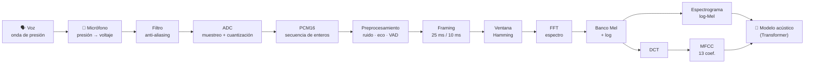

| Etapa | Pregunta que responde | Resultado |
|---|---|---|
| Micrófono | ¿Cómo convierto aire en electricidad? | Voltaje continuo |
| ADC (muestreo) | ¿Cada cuánto mido? | 16,000 mediciones/s |
| ADC (cuantización) | ¿Con cuánta precisión mido? | Enteros de 16 bits |
| Framing + FFT | ¿Qué frecuencias hay en cada instante? | Espectro por ventana |
| Mel + log | ¿Cómo lo oiría un humano? | Espectrograma log-Mel |
| DCT | ¿Cómo lo resumo en pocos números? | MFCC |

---

### 1. El sonido: lo que vamos a capturar

Cuando hablas, tus cuerdas vocales vibran y empujan el aire, creando zonas de **compresión** y **rarefacción** que viajan a ~343 m/s. Lo que llega al micrófono es una variación de presión en el tiempo.

| Propiedad física | Qué es | Cómo se percibe | Rango en voz humana |
|---|---|---|---|
| **Frecuencia** (Hz) | Ciclos por segundo | Tono (grave/agudo) | Fundamental ~85–255 Hz; armónicos y consonantes hasta ~8 kHz |
| **Amplitud** | Tamaño de la variación de presión | Volumen | Susurro ~30 dB SPL, conversación ~60 dB SPL |
| **Timbre** | Mezcla de armónicos | "Color" de la voz, qué vocal es | Formantes F1, F2, F3 |

- **Frecuencia fundamental (F0):** la vibración base de las cuerdas vocales. Voces masculinas ~85–180 Hz, femeninas ~165–255 Hz.
- **Armónicos:** múltiplos de F0 (si F0 = 120 Hz → 240, 360, 480 Hz…). En el espectrograma se ven como **rayas horizontales paralelas**.
- **Formantes:** la boca y la garganta funcionan como un filtro que **amplifica algunas bandas** de armónicos. La posición de los formantes es lo que distingue una "a" de una "i", sin importar quién hable.
- **Fricativas** (s, f, z, sh): ruido de aire turbulento con energía en **frecuencias altas (4–8 kHz)**. Son las primeras víctimas de un muestreo bajo.

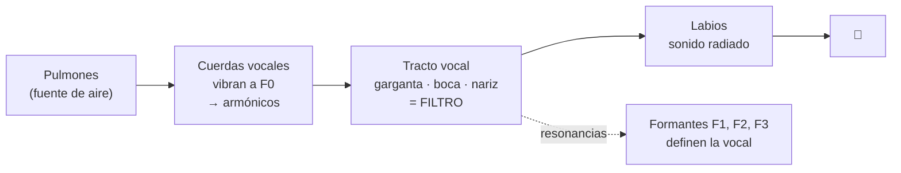

> **Modelo fuente-filtro:** la voz = **fuente** (vibración de cuerdas vocales) × **filtro** (forma del tracto vocal). Los MFCC están diseñados justamente para capturar el **filtro** (qué vocal/consonante) y descartar en buena medida la **fuente** (el tono exacto de la persona). Por eso un sistema STT entiende "hola" igual dicho por un niño o un adulto.

---

### 2. El micrófono: de presión a voltaje

Un micrófono es un **transductor**: convierte energía acústica en energía eléctrica. Una membrana (diafragma) se mueve con la presión del aire y ese movimiento genera un voltaje proporcional.

| Tipo | Principio | Dónde lo encuentras | Ventaja / desventaja |
|---|---|---|---|
| **Dinámico** | Bobina que se mueve en un campo magnético (inducción) | Escenarios, karaoke | Robusto, poco sensible al ruido lejano / menos detalle |
| **Condensador** | La membrana es una placa de un capacitor; cambia la capacitancia | Estudios, podcasts | Muy detallado / requiere alimentación |
| **MEMS** | Condensador microscópico en un chip de silicio | Celulares, laptops, bocinas inteligentes, audífonos | Diminuto y barato, suele traer ADC integrado (salida digital) |
| **Arreglo de micrófonos** | Varios MEMS separados | Smart speakers, salas de juntas, Teams Rooms | Permite **beamforming** (enfocar a quien habla) |

**Patrón polar** (desde dónde capta):
- **Omnidireccional:** todas direcciones (bueno para salas, malo con ruido).
- **Cardioide:** principalmente de frente (ideal para un orador).
- **Arreglo + beamforming:** se "apunta" por software combinando las señales con pequeños retrasos.

> 💡 **Para el examen y la vida real:** la **calidad y distancia del micrófono** son factores de precisión documentados por Microsoft. Un micrófono de diadema a 3 cm da mucho mejor WER que la laptop a 1 m en una sala con eco.

---

### 3. Muestreo (sampling): ¿cada cuánto medimos?

El **ADC** (*Analog-to-Digital Converter*) mide el voltaje del micrófono a intervalos regulares. Cada medición es una **muestra**. La cantidad de muestras por segundo es la **frecuencia de muestreo** (`fs`, *sample rate*).

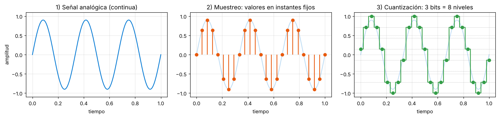

*De izquierda a derecha: la onda continua; el muestreo toma su valor en instantes fijos; la cuantización redondea cada valor al nivel permitido más cercano (aquí, con solo 3 bits para que se note el "escalón").*

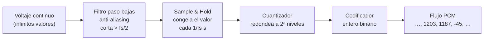

#### Frecuencias de muestreo comunes

| fs | Nyquist (máx. frecuencia capturable) | Uso típico | Comentario |
|---|---|---|---|
| **8 kHz** | 4 kHz | Telefonía clásica (PSTN), call centers | Se pierden las fricativas; Azure Speech lo acepta |
| **16 kHz** | 8 kHz | **Estándar para reconocimiento de voz** | Equilibrio claridad/costo. Formato por defecto de Azure Speech SDK |
| **24 kHz** | 12 kHz | Voz sintetizada (TTS) y **Voice Live** (valor por defecto) | Voz más natural |
| **44.1 kHz** | 22.05 kHz | Música (calidad CD) | Cubre todo el oído humano (20 Hz–20 kHz) |
| **48 kHz** | 24 kHz | Video, videollamadas, audio profesional | Estándar de la industria audiovisual |

#### Teorema de Nyquist-Shannon

> Para reconstruir una señal sin pérdida, debes muestrear **al menos al doble** de su frecuencia más alta: `fs ≥ 2 · f_max`.

La mitad de `fs` se llama **frecuencia de Nyquist**. Con 16 kHz capturas hasta 8 kHz: suficiente para entender voz (inteligibilidad), aunque no para música de alta fidelidad.

#### ¿Qué pasa si violas Nyquist? Aliasing

Si llega una frecuencia **mayor** que `fs/2`, el ADC no la pierde: la **confunde** con una frecuencia más baja que no existía. Es el mismo efecto que hace que en video las ruedas de un auto parezcan girar hacia atrás.

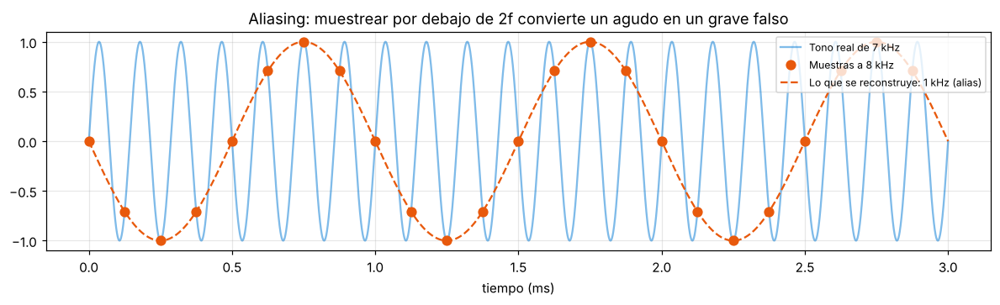

*Un tono real de 7 kHz (azul) muestreado a 8 kHz: los puntos naranjas son exactamente los mismos que tendría un tono de **1 kHz** (línea punteada). Después de muestrear es imposible distinguirlos: `alias = |f − k·fs|` → `|7000 − 8000| = 1000 Hz`.*

Por eso **antes** del ADC siempre hay un **filtro anti-aliasing** que elimina todo lo que esté arriba de `fs/2`. Y por eso cuando tú **re-muestreas** un audio por software (de 44.1 kHz a 16 kHz) debes usar una función que filtre (como `librosa.load(sr=16000)` o `ffmpeg -ar 16000`), no simplemente "tirar muestras".

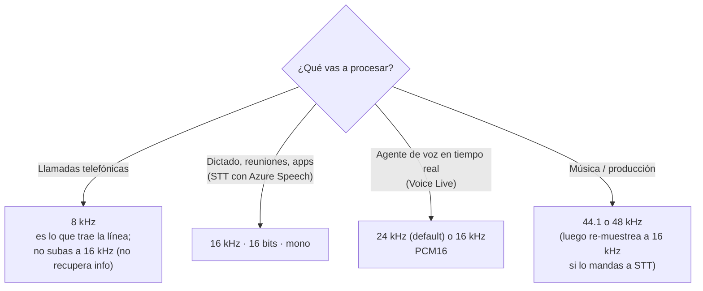

> ⚠️ **Subir la frecuencia no recupera información.** Si una grabación de teléfono (8 kHz) la conviertes a 16 kHz, el archivo pesa el doble pero sigue sin tener nada arriba de 4 kHz.

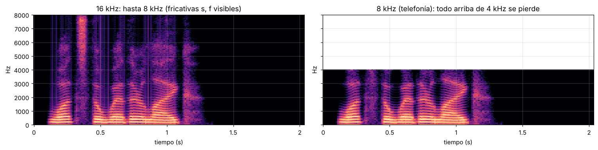

*La misma frase a 16 kHz (izquierda) y a 8 kHz (derecha). Observa la columna brillante cerca de 0.35 s que llega hasta 8 kHz: es la **"s"** de *"what's"*. A 8 kHz, todo lo que estaba arriba de 4 kHz desaparece: por eso al teléfono confundimos "s" con "f" y deletreamos "S de Sonora".*

---

### 4. Cuantización: ¿con cuánta precisión medimos?

Cada muestra se guarda como un número entero con un número fijo de **bits** (profundidad de bits, *bit depth*). Con `n` bits hay `2ⁿ` niveles posibles. La diferencia entre el valor real y el nivel elegido es el **error de cuantización**, que se escucha como un siseo de fondo.

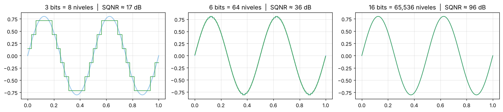

| Bits | Niveles | Rango dinámico teórico (≈ 6.02·n + 1.76 dB) | Uso |
|---|---|---|---|
| 8 | 256 | ~50 dB | Telefonía antigua (con compresión µ-law / A-law) |
| **16** | **65,536** | **~98 dB** | **PCM16: CD, Azure Speech, Voice Live** |
| 24 | 16,777,216 | ~146 dB | Grabación de estudio |
| 32 float | — | enorme | Procesamiento interno (librosa, numpy) |

- **Regla práctica:** cada bit extra ≈ **+6 dB** de rango dinámico (distancia entre el sonido más fuerte y el ruido de cuantización).
- **Clipping:** si la señal supera el máximo representable (+32,767 en 16 bits), se "corta" la cresta de la onda. Suena distorsionado y **arruina** el reconocimiento. Es peor grabar demasiado fuerte que un poco bajo.
- **dBFS** (*decibels relative to Full Scale*): 0 dBFS es el máximo valor posible; todo lo demás es negativo (−14 dBFS, −40 dBFS…).

#### Cálculo de tamaño (pregunta típica)

```
Bytes por segundo = fs × (bits / 8) × canales
16 kHz, 16 bits, mono  → 16,000 × 2 × 1 = 32,000 B/s  = 32 KB/s  = 256 kbps
8 kHz,  16 bits, mono  →  8,000 × 2 × 1 = 16,000 B/s  = 16 KB/s
44.1 kHz, 16 bits, estéreo → 44,100 × 2 × 2 = 176,400 B/s ≈ 1.4 Mbps
1 hora a 16 kHz/16 bits/mono → 32,000 × 3,600 ≈ 115 MB
```

---

### 5. Formatos y contenedores: PCM, WAV, MP3…

**PCM** (*Pulse-Code Modulation*) es la lista cruda de muestras, sin comprimir. **WAV** es un **contenedor**: 44 bytes de encabezado (RIFF) que dicen "esto es PCM, 16 kHz, 16 bits, mono" + los datos PCM.

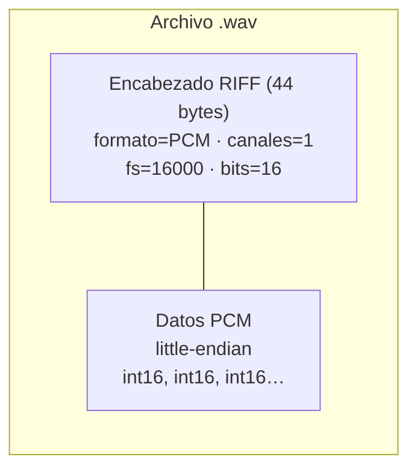

| Formato | Compresión | Pérdida | Comentario para STT |
|---|---|---|---|
| **WAV / PCM** | No | No | ✅ Formato nativo de Azure Speech (16 o 8 kHz, 16 bits, mono) |
| **FLAC** | Sí (≈50%) | **Sin pérdida** | ✅ Ideal para archivar sin perder calidad |
| **MP3** | Sí (≈90%) | Con pérdida | ⚠️ Aceptado, pero elimina detalles que el modelo aprovecha |
| **OPUS/OGG** | Sí | Con pérdida | ✅ Diseñado para voz en tiempo real (WebRTC, WhatsApp) |
| **A-law / µ-law** | Logarítmica 8 bits | Con pérdida | Telefonía; Azure lo acepta dentro de WAV |
| **MP4/M4A** | Contenedor | Depende | Azure SDK lo acepta como `ANY` vía GStreamer |

> 📌 **Dato oficial (Microsoft Learn):** *"The default audio streaming format is WAV (16 kHz or 8 kHz, 16-bit, and mono PCM)"*. Para MP3, OPUS/OGG, FLAC, ALAW, MULAW o MP4 el Speech SDK usa **GStreamer**, que **descomprime a PCM** antes de enviarlo. Los SDK de JavaScript, Objective-C y Swift **no** soportan audio comprimido: hay que convertirlo antes a WAV. Para streams de entrada se requiere PCM int-16 con signo, un canal, 8,000 o 16,000 muestras por segundo, en **little-endian**. ([Fuente](https://learn.microsoft.com/en-us/azure/ai-services/speech-service/how-to-use-codec-compressed-audio-input-streams), [streams](https://learn.microsoft.com/en-us/azure/ai-services/speech-service/how-to-use-audio-input-streams))

#### La forma de onda real

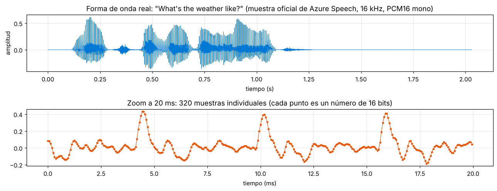

*Arriba: las 32,480 muestras del archivo (2.03 s). Se ve **cuándo** hay voz y qué tan fuerte, y que después de ~1.3 s solo hay silencio. Abajo: 20 ms ampliados, donde ya se distinguen las 320 muestras individuales y la periodicidad de la voz (cada pico es un pulso de las cuerdas vocales).*

La **forma de onda (waveform)** es amplitud contra tiempo. Su limitación: **no dice qué frecuencias** componen el sonido, y las frecuencias son las que distinguen una "a" de una "e". Para eso necesitamos Fourier.

---

### 6. Preprocesamiento: limpiar antes de analizar

Antes de extraer características, los sistemas profesionales "limpian" el audio. En Azure muchas de estas etapas ya las hace el servicio o el SDK.

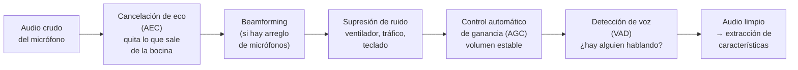

| Técnica | Problema que resuelve | Dónde aparece en Azure |
|---|---|---|
| **AEC** (Acoustic Echo Cancellation) | El agente se escucha a sí mismo por la bocina y se interrumpe | Voice Live: `input_audio_echo_cancellation` tipo `server_echo_cancellation` |
| **Supresión de ruido** | Ruido de fondo sube el WER | Voice Live: `input_audio_noise_reduction` tipo `azure_deep_noise_suppression` |
| **Beamforming** | Varias personas/ruido en la sala | Speech SDK: Microsoft Audio Stack (MAS) con arreglos de micrófonos |
| **AGC** | Persona que habla muy bajo o muy alto | Microsoft Audio Stack |
| **VAD** | Saber cuándo empieza/termina el turno, no procesar silencio | Speech SDK (segmentación por silencio), Voice Live (`server_vad` / `azure_semantic_vad`) |
| **Normalización de volumen** | Archivos grabados muy bajos | Tú, antes de enviar (ver código) |

> 💡 En la imagen de la forma de onda, ~44% del audio es silencio. Un **VAD** evita procesar (y en algunos escenarios pagar) ese silencio, y es lo que permite a un agente de voz saber que **terminaste de hablar** para responder.

#### Efecto del ruido en el espectrograma

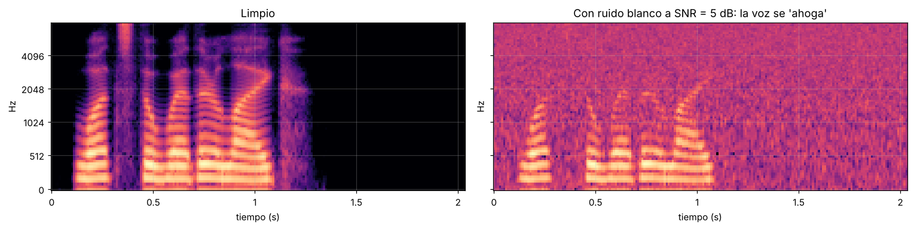

*Izquierda: audio limpio. Derecha: el mismo audio con ruido blanco a **SNR = 5 dB** (la voz solo es ~3 veces más potente que el ruido). Los armónicos y formantes se pierden en el "granizo"; el modelo acústico tiene mucha menos información para decidir qué fonema escuchó.*

**SNR** (*Signal-to-Noise Ratio*) = `10 · log10(potencia_voz / potencia_ruido)`. Como referencia: > 30 dB es muy limpio, 10–20 dB es una oficina, < 5 dB es un restaurante ruidoso.

---

### 7. Del tiempo a la frecuencia: transformada de Fourier

**Idea central:** cualquier sonido complejo es la **suma de ondas senoidales** simples de distintas frecuencias, amplitudes y fases. La **transformada de Fourier** hace el camino inverso: recibe la mezcla y dice **cuánto hay de cada frecuencia**.

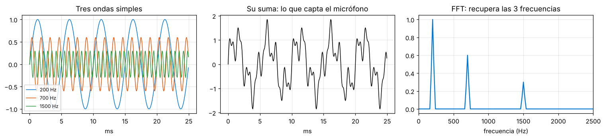

*Izquierda: tres ondas puras (200, 700 y 1500 Hz). Centro: su suma, que es lo que realmente capta el micrófono (difícil de interpretar a simple vista). Derecha: la FFT separa la mezcla y recupera los tres picos, con alturas proporcionales a su amplitud.*

Analogía: la transformada de Fourier es como un **prisma** para el sonido: entra "luz blanca" (la mezcla) y sale el "arcoíris" (cada frecuencia por separado). O como alguien que prueba un licuado y te dice "70% plátano, 20% fresa, 10% leche".

- **DFT** (*Discrete Fourier Transform*): la versión para señales muestreadas.
- **FFT** (*Fast Fourier Transform*): algoritmo que calcula la DFT en `O(N log N)` en lugar de `O(N²)`. Con N = 512, son ~4,600 operaciones vs ~262,000.
- **Resolución en frecuencia** = `fs / N_FFT`. A 16 kHz con N_FFT = 512 → cada "bin" mide **31.25 Hz**.

#### Framing y ventaneo: Fourier por pedacitos (STFT)

La voz **cambia constantemente** (cada fonema dura 50–200 ms). Si aplicas Fourier a los 2 segundos completos, obtienes el "promedio" de todos los sonidos y pierdes el orden. Solución: la **STFT** (*Short-Time Fourier Transform*): partir el audio en ventanas cortas donde la voz es **casi estable** (*cuasi-estacionaria*).

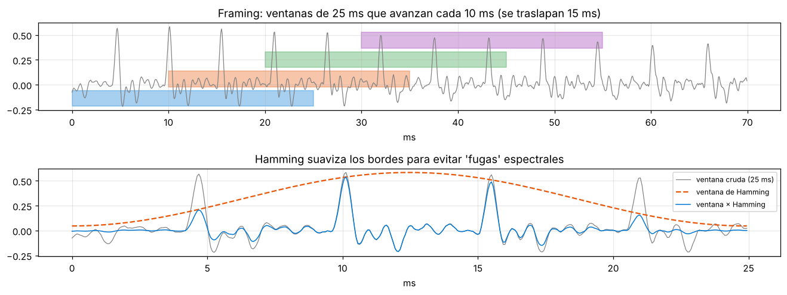

*Arriba: cuatro ventanas de 25 ms que avanzan cada 10 ms (se traslapan 15 ms, así ningún sonido queda "partido" en un borde). Abajo: una ventana cruda (gris) multiplicada por la **ventana de Hamming** (naranja) da la señal azul, que se desvanece suavemente en los extremos.*

| Parámetro | Valor típico | A 16 kHz | Por qué |
|---|---|---|---|
| Longitud de ventana | 20–30 ms (25 ms) | 400 muestras | Suficiente para ver 2–3 periodos de F0, corto para que la voz sea estable |
| Salto (*hop*) | 10 ms | 160 muestras | 100 ventanas por segundo; captura transiciones rápidas |
| N_FFT | 512 | — | Potencia de 2 ≥ 400 (se rellena con ceros) |
| Ventana | Hamming / Hann | — | Evita "fugas espectrales" por cortes bruscos |

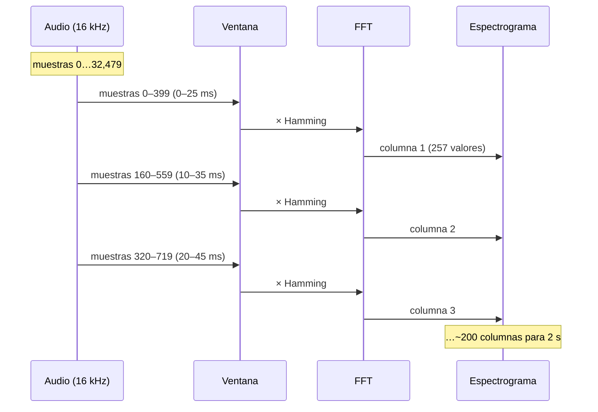

**¿Por qué la ventana de Hamming?** Cortar la señal abruptamente crea un "escalón" artificial en los bordes, y Fourier interpreta ese escalón como frecuencias que no existen (**fuga espectral**, *spectral leakage*). Multiplicar por una campana que llega casi a cero en los bordes elimina el escalón.

**Compromiso tiempo-frecuencia (principio de incertidumbre):** ventana **larga** → buena resolución en frecuencia pero borrosa en tiempo; ventana **corta** → precisa en tiempo pero borrosa en frecuencia. 25 ms es el punto dulce para voz.

---

### 8. El espectrograma: una imagen del sonido

Apilar el resultado de la FFT de cada ventana da el **espectrograma**:
- **Eje X:** tiempo (una columna por ventana).
- **Eje Y:** frecuencia.
- **Color:** energía (en dB, escala logarítmica).

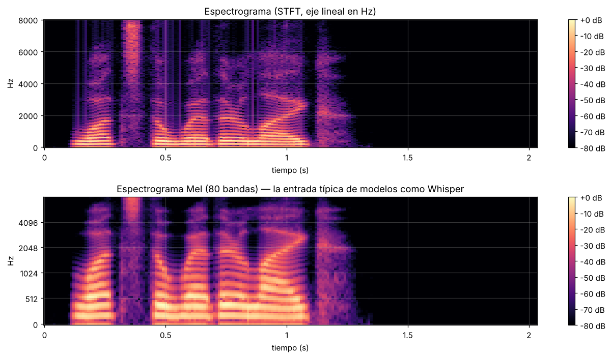

**Cómo leer este espectrograma de *"What's the weather like?"*:**
- **Rayas horizontales paralelas** abajo (0–2 kHz): los **armónicos** de la voz durante las vocales. La separación entre rayas es F0.
- **Bandas más brillantes que suben o bajan** (ej. ~0.9–1.1 s): **formantes** moviéndose, transiciones entre vocales (*"weather"*, *"like"*).
- **Columna vertical brillante hasta 8 kHz** (~0.35 s): la fricativa **"s"** de *"what's"*: ruido de alta frecuencia sin armónicos.
- **Líneas verticales delgadas:** consonantes oclusivas (t, k), explosiones breves de energía en todas las frecuencias.
- **Zona negra** después de ~1.35 s: silencio.

> Es literalmente una **imagen del sonido**; por eso técnicas de visión (CNN) y Transformers funcionan tan bien con audio. Los fonetistas entrenados pueden "leer" palabras directamente en un espectrograma.

#### Escala Mel: frecuencias como las oye un humano

El oído humano no es lineal: distinguimos fácilmente 100 Hz de 200 Hz, pero 7,000 Hz y 7,100 Hz nos suenan casi igual. La **escala Mel** reescala las frecuencias para imitar esa percepción:

```
m = 2595 · log10(1 + f / 700)        (fórmula HTK)
```

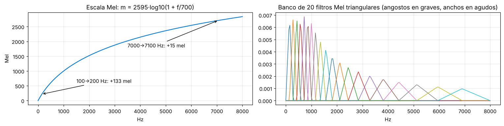

*Izquierda: la curva Mel. Subir de 100 a 200 Hz son +133 mel; subir de 7,000 a 7,100 Hz son solo +15 mel. Derecha: el **banco de filtros Mel**, triángulos angostos y juntos en graves (mucho detalle) y anchos y separados en agudos (poco detalle). En esta versión (normalización Slaney de librosa) cada triángulo tiene la misma área, por eso los anchos se ven más bajos.*

El espectrograma de 257 frecuencias lineales se multiplica por ~40–128 filtros triangulares → **espectrograma Mel**. Comparado con el lineal (imagen anterior, abajo), el Mel **dedica más filas** a la zona de 0–2 kHz, donde está la información de las vocales.

| Modelo | Entrada de audio |
|---|---|
| Whisper (OpenAI, disponible en Foundry) | Log-Mel de 80 bandas (128 en large-v3), ventana 25 ms, salto 10 ms, 16 kHz, segmentos de 30 s |
| Wav2Vec 2.0 / HuBERT | Forma de onda cruda (una CNN aprende sus propios "filtros") |
| Sistemas clásicos HMM-GMM | MFCC (13) + deltas + delta-deltas = 39 valores por ventana |

---

### 9. MFCC (Mel-Frequency Cepstral Coefficients)

Los MFCC comprimen cada ventana a ~**13 números** que describen la **forma del espectro** (el filtro del tracto vocal → qué fonema es), descartando detalles como el tono exacto.

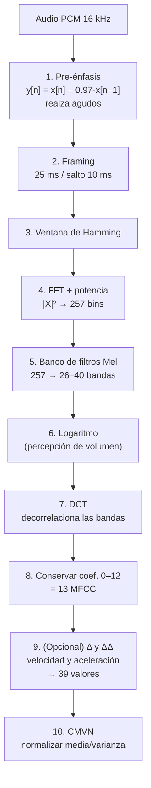

**¿Por qué cada paso?**

| Paso | Intuición |
|---|---|
| Pre-énfasis | La voz pierde energía en agudos (~−6 dB/octava); esto la compensa para que las consonantes "cuenten" |
| Logaritmo | Percibimos volumen logarítmicamente; además convierte la multiplicación fuente × filtro en una **suma**, separable |
| DCT | Las bandas Mel vecinas están muy correlacionadas; la DCT las "comprime" como JPEG comprime una imagen. Los primeros coeficientes = forma general del espectro (formantes); los últimos = detalle fino (armónicos/tono) que se descarta |
| c0 | Representa la energía total (volumen) de la ventana |
| Deltas | Capturan **cómo cambia** el espectro: clave para transiciones entre fonemas |
| CMVN | Elimina el "color" del micrófono/canal y diferencias de volumen entre grabaciones |

**Cepstrum** viene de invertir las letras de *spectrum*: es "el espectro del espectro". Sus términos tienen la misma broma: *quefrency* (frecuencia), *liftering* (filtrado).

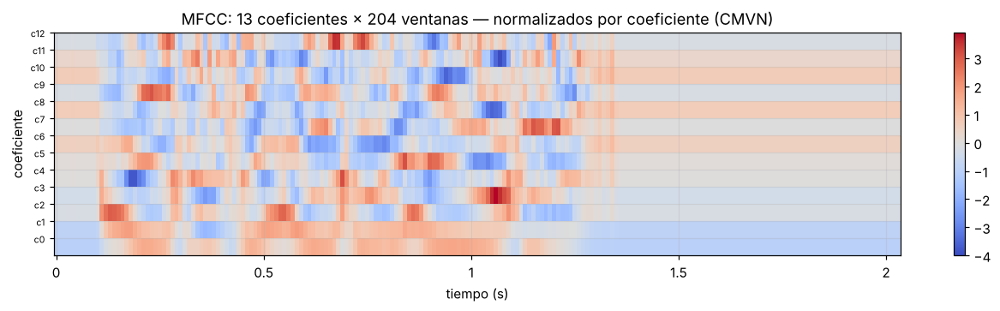

*13 coeficientes × 204 ventanas para los 2.03 s de audio. Cada columna es el vector que recibe el modelo acústico por cada 10 ms. En la zona de silencio (> 1.35 s) los valores quedan planos.*

Valores reales de dos ventanas consecutivas (ventanas 100 y 101 del archivo, ~1.0 s, primeros 5 de 13 coeficientes con `librosa`):

```
Ventana 100: [-310.9, 142.8, -16.5, 28.2,  0.2, ...]
Ventana 101: [-324.9, 152.5, -10.8, 41.3, -4.9, ...]
```

Ventanas consecutivas se parecen (la voz cambia poco en 10 ms), pero no son idénticas. **Esta secuencia de vectores es la entrada del modelo acústico**, que calcula para cada ventana la probabilidad de cada fonema (por ejemplo, 80% /æ/, 15% /ɛ/).

#### Espectrograma Mel vs MFCC: ¿cuál se usa hoy?

| | MFCC | Log-Mel |
|---|---|---|
| Dimensión por ventana | 13 (o 39 con deltas) | 40–128 |
| Información | Comprimida, decorrelacionada | Más completa |
| Ideal para | Modelos clásicos (GMM-HMM), dispositivos con poca memoria, verificación de hablante | **Redes neuronales profundas y Transformers** (Whisper, Azure Speech moderno) |
| Analogía | Resumen de 1 página | Capítulo completo |

> 🧠 Los modelos neuronales modernos prefieren el **log-Mel** porque aprenden por sí mismos qué combinaciones importan; la DCT de los MFCC tiraba información que una red sí puede aprovechar. Aun así, los MFCC siguen siendo el ejemplo didáctico que usa Microsoft Learn y aparecen en el examen.

---

### 10. Cómo encaja todo con el reconocimiento de voz (STT)

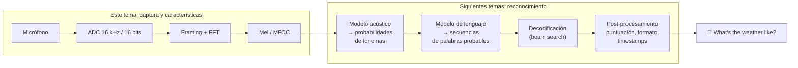

> Si una transcripción sale mal, muchas veces el problema empezó **aquí**: audio a 8 kHz, clipping, ruido, eco o un MP3 muy comprimido. Ningún modelo de lenguaje puede recuperar información que el micrófono nunca capturó.

---

### Práctica en Python

Todo el código siguiente funciona **sin cuenta de Azure** (excepto el último bloque) y usa el audio oficial de ejemplo.

```bash
pip install numpy scipy soundfile librosa matplotlib
```

#### 1) Inspeccionar un WAV (solo librería estándar)

```python
import wave, urllib.request, os

URL = ("https://raw.githubusercontent.com/Azure-Samples/cognitive-services-speech-sdk/"
       "master/samples/csharp/sharedcontent/console/whatstheweatherlike.wav")
ARCHIVO = "whatstheweatherlike.wav"
if not os.path.exists(ARCHIVO):
    urllib.request.urlretrieve(URL, ARCHIVO)

with wave.open(ARCHIVO, "rb") as w:
    canales = w.getnchannels()
    sr      = w.getframerate()
    bytes_m = w.getsampwidth()
    n       = w.getnframes()

print(f"Canales:              {canales}")
print(f"Frecuencia muestreo:  {sr} Hz")
print(f"Profundidad:          {bytes_m*8} bits")
print(f"Muestras:             {n}")
print(f"Duración:             {n/sr:.2f} s")
print(f"Bitrate:              {sr*bytes_m*8*canales/1000:.0f} kbps")
print(f"Tamaño de datos:      {n*bytes_m*canales:,} bytes  (+44 de encabezado WAV)")
print(f"Tamaño en disco:      {os.path.getsize(ARCHIVO):,} bytes")
```

Salida:
```
Canales:              1
Frecuencia muestreo:  16000 Hz
Profundidad:          16 bits
Muestras:             32480
Duración:             2.03 s
Bitrate:              256 kbps
Tamaño de datos:      64,960 bytes  (+44 de encabezado WAV)
Tamaño en disco:      65,004 bytes
```
- **Explicación:** comprueba la fórmula: 32,480 muestras × 2 bytes = 64,960 bytes de datos + 44 bytes de encabezado RIFF = 65,004 bytes exactos.

#### 2) Ver el aliasing con números

```python
import numpy as np

def frecuencia_dominante(f_tono, fs, dur=0.5):
    t = np.arange(0, dur, 1/fs)                  # instantes de muestreo
    x = np.sin(2*np.pi*f_tono*t)                 # tono puro muestreado
    espectro = np.abs(np.fft.rfft(x))
    freqs = np.fft.rfftfreq(len(x), 1/fs)
    return freqs[np.argmax(espectro)]

for fs in (8000, 16000, 44100):
    for f in (3000, 7000, 12000):
        f_det = frecuencia_dominante(f, fs)
        estado = "OK" if abs(f_det - f) < 5 else f"ALIAS -> se 'oye' {f_det:.0f} Hz"
        print(f"fs={fs:>5} Hz | Nyquist={fs//2:>5} Hz | tono={f:>5} Hz | {estado}")
```

Salida:
```
fs= 8000 Hz | Nyquist= 4000 Hz | tono= 3000 Hz | OK
fs= 8000 Hz | Nyquist= 4000 Hz | tono= 7000 Hz | ALIAS -> se 'oye' 1000 Hz
fs= 8000 Hz | Nyquist= 4000 Hz | tono=12000 Hz | ALIAS -> se 'oye' 4000 Hz
fs=16000 Hz | Nyquist= 8000 Hz | tono= 3000 Hz | OK
fs=16000 Hz | Nyquist= 8000 Hz | tono= 7000 Hz | OK
fs=16000 Hz | Nyquist= 8000 Hz | tono=12000 Hz | ALIAS -> se 'oye' 4000 Hz
fs=44100 Hz | Nyquist=22050 Hz | tono= 3000 Hz | OK
fs=44100 Hz | Nyquist=22050 Hz | tono= 7000 Hz | OK
fs=44100 Hz | Nyquist=22050 Hz | tono=12000 Hz | OK
```
- **Explicación:** todo tono por debajo de Nyquist se detecta bien; los de arriba "se doblan" hacia frecuencias falsas (`|f − k·fs|`). Esto es exactamente lo que evita el filtro anti-aliasing.

#### 3) Cuantización: la regla de los 6 dB por bit

```python
import numpy as np

t = np.linspace(0, 1, 48000, endpoint=False)
senal = 0.99 * np.sin(2*np.pi*440*t)            # tono La 440 Hz casi a escala completa

for bits in (4, 8, 12, 16, 24):
    niveles = 2**bits
    paso = 2 / niveles                           # rango [-1, 1)
    cuantizada = np.clip(np.round(senal / paso) * paso, -1, 1 - paso)
    error = senal - cuantizada
    sqnr = 10*np.log10(np.mean(senal**2) / np.mean(error**2))
    teorico = 6.02*bits + 1.76
    print(f"{bits:>2} bits | {niveles:>10,} niveles | SQNR medido {sqnr:6.1f} dB | teórico {teorico:6.1f} dB")
```

Salida:
```
 4 bits |         16 niveles | SQNR medido   23.6 dB | teórico   25.8 dB
 8 bits |        256 niveles | SQNR medido   49.8 dB | teórico   49.9 dB
12 bits |      4,096 niveles | SQNR medido   73.8 dB | teórico   74.0 dB
16 bits |     65,536 niveles | SQNR medido   98.3 dB | teórico   98.1 dB
24 bits | 16,777,216 niveles | SQNR medido  146.4 dB | teórico  146.2 dB
```
- **Explicación:** **SQNR** (*Signal-to-Quantization-Noise Ratio*) mide qué tan por encima del ruido de cuantización está la señal. La fórmula `6.02·n + 1.76` coincide con la medición; con pocos bits se desvía porque el error deja de parecer ruido aleatorio.

#### 4) MFCC desde cero con numpy (paso a paso)

```python
import numpy as np
import soundfile as sf
from scipy.fft import dct

audio, sr = sf.read("whatstheweatherlike.wav", dtype="float32")   # 16 kHz mono

# 1) Pre-énfasis: realza agudos (las consonantes tienen poca energía)
audio = np.append(audio[0], audio[1:] - 0.97 * audio[:-1])

# 2) Framing: ventanas de 25 ms (400 muestras) cada 10 ms (160 muestras)
win, hop = int(0.025*sr), int(0.010*sr)
n_frames = 1 + (len(audio) - win) // hop
idx = np.arange(win)[None, :] + hop*np.arange(n_frames)[:, None]
frames = audio[idx]                                    # (n_frames, 400)

# 3) Ventana de Hamming
frames = frames * np.hamming(win)

# 4) FFT -> espectro de potencia
NFFT = 512
potencia = (np.abs(np.fft.rfft(frames, NFFT))**2) / NFFT    # (n_frames, 257)

# 5) Banco de filtros Mel (26 triángulos entre 0 y 8 kHz)
def hz2mel(f): return 2595*np.log10(1 + f/700)
def mel2hz(m): return 700*(10**(m/2595) - 1)
n_mels = 26
puntos_mel = np.linspace(hz2mel(0), hz2mel(sr/2), n_mels + 2)
bins = np.floor((NFFT + 1) * mel2hz(puntos_mel) / sr).astype(int)
fbank = np.zeros((n_mels, NFFT//2 + 1))
for m in range(1, n_mels + 1):
    izq, centro, der = bins[m-1], bins[m], bins[m+1]
    fbank[m-1, izq:centro] = (np.arange(izq, centro) - izq) / (centro - izq)
    fbank[m-1, centro:der] = (der - np.arange(centro, der)) / (der - centro)
energias_mel = potencia @ fbank.T                      # (n_frames, 26)

# 6) Logaritmo (el oído percibe volumen en escala logarítmica)
log_mel = np.log(energias_mel + 1e-10)

# 7) DCT -> nos quedamos con los primeros 13 coeficientes
mfcc = dct(log_mel, type=2, axis=1, norm="ortho")[:, :13]

# 8) CMVN: normalizar cada coeficiente (media 0, varianza 1)
mfcc_norm = (mfcc - mfcc.mean(axis=0)) / (mfcc.std(axis=0) + 1e-8)

print("Ventanas:", n_frames, "| espectro:", potencia.shape, "| log-Mel:", log_mel.shape, "| MFCC:", mfcc.shape)
np.set_printoptions(precision=1, suppress=True)
print("Ventana 100:", mfcc[100, :6], "...")
print("Ventana 101:", mfcc[101, :6], "...")
```

Salida:
```
Ventanas: 201 | espectro: (201, 257) | log-Mel: (201, 26) | MFCC: (201, 13)
Ventana 100: [-38.5   3.7  -4.4  -0.1  -2.5  -5.5] ...
Ventana 101: [-39.1   3.9  -3.4   0.8  -2.9  -6. ] ...
```
- **Explicación:**
  - `idx` construye de un jalón una matriz de índices: fila *i* = muestras de la ventana *i*. Es el *framing* sin bucles.
  - `rfft(frames, 512)` rellena cada ventana de 400 a 512 muestras y devuelve 257 bins (0 a 8 kHz cada 31.25 Hz).
  - `potencia @ fbank.T` aplica los 26 triángulos a la vez: cada banda Mel es una suma ponderada de bins.
  - Los números difieren de los de `librosa` (que usa log en dB, normalización Slaney y padding centrado), pero la **forma** del proceso es idéntica. Lo importante: 2 s de audio → 201 vectores de 13 números.

#### 5) Espectrograma, Mel y MFCC con librosa (genera las figuras de este tema)

```python
import numpy as np, soundfile as sf, librosa, librosa.display
import matplotlib.pyplot as plt

audio, sr = sf.read("whatstheweatherlike.wav", dtype="float32")

# Espectrograma (STFT): ventanas de 25 ms, salto de 10 ms, Hamming
S_db = librosa.amplitude_to_db(
    np.abs(librosa.stft(audio, n_fft=400, hop_length=160, window="hamming")), ref=np.max)

# Espectrograma Mel de 80 bandas (como Whisper)
mel_db = librosa.power_to_db(
    librosa.feature.melspectrogram(y=audio, sr=sr, n_fft=400, hop_length=160, n_mels=80), ref=np.max)

# 13 MFCC + deltas (velocidad) y delta-deltas (aceleración) = 39 características
mfcc   = librosa.feature.mfcc(y=audio, sr=sr, n_mfcc=13, n_fft=400, hop_length=160)
delta  = librosa.feature.delta(mfcc)
delta2 = librosa.feature.delta(mfcc, order=2)
caracteristicas = np.vstack([mfcc, delta, delta2])
print("MFCC:", mfcc.shape, "| con deltas:", caracteristicas.shape)

fig, ax = plt.subplots(4, 1, figsize=(11, 11))
librosa.display.waveshow(audio, sr=sr, ax=ax[0]); ax[0].set_title("Forma de onda")
librosa.display.specshow(S_db, sr=sr, hop_length=160, x_axis="time", y_axis="hz", ax=ax[1], cmap="magma")
ax[1].set_title("Espectrograma lineal")
librosa.display.specshow(mel_db, sr=sr, hop_length=160, x_axis="time", y_axis="mel", ax=ax[2], cmap="magma")
ax[2].set_title("Espectrograma Mel (80 bandas)")
librosa.display.specshow(mfcc, sr=sr, hop_length=160, x_axis="time", ax=ax[3], cmap="coolwarm")
ax[3].set_title("MFCC (13)")
plt.tight_layout(); plt.show()
```

Salida en consola:
```
MFCC: (13, 204) | con deltas: (39, 204)
```
- **Explicación:** librosa centra las ventanas (agrega relleno al inicio y final), por eso da 204 ventanas en lugar de 201. `n_fft=400` a 16 kHz = 25 ms; `hop_length=160` = 10 ms. Cambia `whatstheweatherlike.wav` por tu propio archivo para comparar tu voz.

#### 6) Preparar cualquier audio para Azure Speech (16 kHz, 16 bits, mono)

```python
import numpy as np, soundfile as sf, librosa

def preparar_para_azure(entrada, salida="listo_para_azure.wav"):
    # mono=True mezcla canales; sr=16000 re-muestrea con filtro anti-aliasing
    audio, sr = librosa.load(entrada, sr=16000, mono=True)
    # Normalización de pico a -1 dBFS (evita clipping sin exagerar volumen)
    pico = np.max(np.abs(audio))
    if pico > 0:
        audio = audio / pico * 10**(-1/20)
    sf.write(salida, audio, 16000, subtype="PCM_16")   # WAV RIFF PCM 16 bits
    info = sf.info(salida)
    print(f"{salida}: {info.samplerate} Hz | {info.channels} canal | {info.subtype} | {info.duration:.2f} s")
    return salida

# Simula un archivo "de celular": 44.1 kHz estéreo float
voz, _ = librosa.load("whatstheweatherlike.wav", sr=44100)
sf.write("celular_44k_estereo.wav", np.stack([voz, voz*0.9], axis=1), 44100, subtype="FLOAT")
print(sf.info("celular_44k_estereo.wav").samplerate, "Hz,", sf.info("celular_44k_estereo.wav").channels, "canales")
preparar_para_azure("celular_44k_estereo.wav")
```

Salida:
```
44100 Hz, 2 canales
listo_para_azure.wav: 16000 Hz | 1 canal | PCM_16 | 2.03 s
```

Equivalente con **ffmpeg** en terminal (útil para MP3, M4A o video):
```bash
ffmpeg -i entrada.mp3 -ac 1 -ar 16000 -sample_fmt s16 salida.wav
#        -ac 1 = mono   -ar 16000 = 16 kHz   -sample_fmt s16 = PCM 16 bits
```

#### 7) Detector de voz (VAD) por energía: recortar silencios

```python
import numpy as np, soundfile as sf

audio, sr = sf.read("whatstheweatherlike.wav", dtype="float32")
win, hop = int(0.025*sr), int(0.010*sr)

# Energía (RMS) por ventana en dBFS
n = 1 + (len(audio) - win)//hop
rms = np.array([np.sqrt(np.mean(audio[i*hop:i*hop+win]**2)) for i in range(n)])
db = 20*np.log10(rms + 1e-10)

umbral = db.max() - 40            # todo lo que esté 40 dB por debajo del pico = silencio
voz = db > umbral

inicio = np.argmax(voz); fin = len(voz) - np.argmax(voz[::-1]) - 1
print(f"Pico: {db.max():.1f} dBFS | umbral: {umbral:.1f} dBFS")
print(f"Voz detectada de {inicio*hop/sr:.2f} s a {(fin*hop+win)/sr:.2f} s "
      f"(de {len(audio)/sr:.2f} s totales)")
print(f"Silencio recortable: {100*(1 - (fin-inicio+1)/n):.0f}% del audio")
recortado = audio[inicio*hop : fin*hop + win]
sf.write("recortado.wav", recortado, sr, subtype="PCM_16")
```

Salida:
```
Pico: -14.2 dBFS | umbral: -54.2 dBFS
Voz detectada de 0.10 s a 1.25 s (de 2.03 s totales)
Silencio recortable: 44% del audio
```
- **Explicación:** es el VAD más simple posible (umbral de energía). Los VAD de producción (como el `server_vad` o el `azure_semantic_vad` de Voice Live) usan redes neuronales y además consideran si la frase **suena terminada**, para no cortarte a media idea. Observa también que el pico está a −14.2 dBFS: el audio tiene margen y **no hay clipping**.

#### 8) Enviar PCM crudo a Azure Speech con el formato correcto (requiere recurso de Foundry/Speech)

```python
# pip install azure-cognitiveservices-speech soundfile
import os, soundfile as sf
import azure.cognitiveservices.speech as speechsdk

speech_config = speechsdk.SpeechConfig(subscription=os.environ["SPEECH_KEY"],
                                       endpoint=os.environ["SPEECH_ENDPOINT"])
speech_config.speech_recognition_language = "en-US"

# Declarar EXACTAMENTE el formato de las muestras que vamos a empujar
formato = speechsdk.audio.AudioStreamFormat(samples_per_second=16000,
                                            bits_per_sample=16, channels=1)
stream = speechsdk.audio.PushAudioInputStream(stream_format=formato)
audio_config = speechsdk.audio.AudioConfig(stream=stream)
recognizer = speechsdk.SpeechRecognizer(speech_config=speech_config, audio_config=audio_config)

# Leer el WAV como enteros de 16 bits y empujarlo en trozos de 100 ms (3,200 bytes)
pcm, sr = sf.read("whatstheweatherlike.wav", dtype="int16")
datos = pcm.tobytes()                       # little-endian en x86/ARM
for i in range(0, len(datos), 3200):
    stream.write(datos[i:i+3200])
stream.close()

resultado = recognizer.recognize_once()
print(resultado.reason, "→", resultado.text)    # ResultReason.RecognizedSpeech → What's the weather like?
```
- **Explicación:**
  - Un **push stream** se usa cuando el audio no viene de un archivo ni del micrófono local (ej. llega por WebSocket desde un navegador o de un sistema de telefonía).
  - Si declaras 16 kHz pero envías 44.1 kHz, el servicio interpretará el audio "en cámara lenta" y la transcripción será basura: **el formato declarado debe coincidir con el real**.
  - 100 ms a 16 kHz/16 bits = 1,600 muestras × 2 bytes = **3,200 bytes**.

---

### Factores que afectan la precisión (y en qué etapa se originan)

| Factor | Etapa afectada | Síntoma | Mitigación |
|---|---|---|---|
| Ruido de fondo | Micrófono / SNR | Palabras inventadas u omitidas | Supresión de ruido, micrófono direccional |
| Distancia al micrófono / reverberación | Micrófono | Sonido "de cueva", formantes borrosos | Micrófono cercano, arreglo con beamforming |
| Eco de la bocina | Micrófono | El agente se responde a sí mismo | AEC (`server_echo_cancellation` en Voice Live) |
| Muestreo bajo (8 kHz) | ADC | Confusión s/f/z | Usar 16 kHz cuando la fuente lo permite |
| Clipping (grabar muy fuerte) | Cuantización | Distorsión, errores en vocales | Bajar ganancia, AGC |
| Compresión agresiva (MP3 de bajo bitrate) | Formato | Artefactos "metálicos" | WAV/FLAC, o OPUS para tiempo real |
| Formato declarado ≠ real | Envío al servicio | Transcripción sin sentido | Verificar `fs`, bits y canales (código 1 y 6) |
| Varias personas hablando a la vez | Todo el pipeline | Mezcla de frases | Diarización, micrófonos individuales |

---

### 📝 Para el examen AI-901

- La voz se digitaliza **muestreando** (típico **16 kHz** para voz, 8 kHz telefonía, 44.1 kHz música) y **cuantizando** (16 bits, PCM).
- **Nyquist:** `fs ≥ 2·f_max`; con 16 kHz capturas hasta 8 kHz.
- El audio se divide en **ventanas de 20–30 ms** que se traslapan; a cada una se le aplica la **transformada de Fourier**.
- Apilar los espectros da el **espectrograma** (tiempo × frecuencia × energía).
- La **escala Mel** imita al oído humano (más detalle en graves).
- **MFCC:** ~**13 coeficientes por ventana** que resumen el espectro; son la entrada del **modelo acústico**, que predice **fonemas**.
- Factores de precisión: **ruido de fondo, calidad del micrófono, distancia, acentos, eco, compresión**.

**Preguntas rápidas:**
1. *¿Qué frecuencia de muestreo es estándar para reconocimiento de voz?* → **16 kHz**.
2. *¿Cuántos MFCC por ventana se extraen típicamente?* → **~13**.
3. *¿Qué representación muestra tiempo, frecuencia y energía a la vez?* → **Espectrograma**.
4. *¿Qué componente convierte las características acústicas en probabilidades de fonemas?* → **Modelo acústico**.
5. *Un audio de 10 s a 16 kHz, 16 bits, mono, ¿cuánto pesa sin comprimir?* → 16,000 × 2 × 10 = **320 KB**.

---

### 🖼️ Créditos de imágenes
Todas las figuras de este tema fueron generadas con Python (numpy, librosa, matplotlib) para este acordeón, a partir de señales sintéticas y del audio de ejemplo [`whatstheweatherlike.wav`](https://github.com/Azure-Samples/cognitive-services-speech-sdk) del repositorio oficial **Azure-Samples/cognitive-services-speech-sdk** (licencia MIT).

### Recursos
- [Reconocimiento de voz – Microsoft Learn](https://learn.microsoft.com/es-es/training/modules/introduction-ai-speech/3-speech-recognition?pivots=text)
- [Codec compressed audio input (MP3, OPUS, FLAC…) – Azure Speech](https://learn.microsoft.com/en-us/azure/ai-services/speech-service/how-to-use-codec-compressed-audio-input-streams)
- [Audio input streams – Azure Speech](https://learn.microsoft.com/en-us/azure/ai-services/speech-service/how-to-use-audio-input-streams)
- [Voice Live: configuración de audio (VAD, ruido, eco)](https://learn.microsoft.com/en-us/azure/ai-services/speech-service/voice-live-how-to)
- [Understanding the Mel Spectrogram](https://medium.com/analytics-vidhya/understanding-the-mel-spectrogram-fca2afa2ce53)
- [But what is the Fourier Transform? – 3Blue1Brown](https://www.youtube.com/watch?v=spUNpyF58BY)
- [Speech Processing for Machine Learning: Filter banks, MFCCs – Haytham Fayek](https://haythamfayek.com/2016/04/21/speech-processing-for-machine-learning.html)
- [librosa: documentación de feature extraction](https://librosa.org/doc/latest/feature.html)
