# Tema 2: Diferencia técnica entre speech to text y text to speech

### Descripción
Aunque suelen mencionarse juntos, el reconocimiento (STT) y la síntesis (TTS) son **problemas inversos** con retos distintos. STT tiene que **reducir** una señal enorme y ruidosa a unas cuantas palabras; TTS tiene que **expandir** unas cuantas palabras a una señal rica y natural. Microsoft Learn lo resume así: el vocoder hace lo inverso al reconocimiento de voz.

Analogía: STT es como escuchar una canción y escribir la letra; TTS es como leer la letra y cantarla con la entonación correcta. Escribir la letra es "fácil" de verificar (o la palabra es correcta o no); cantarla bien es subjetivo: dos cantantes pueden interpretar la misma letra de formas muy distintas y ambas ser "correctas".

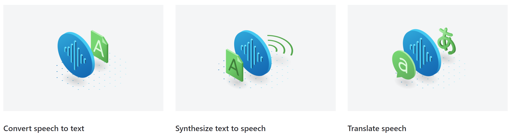

*Las tres capacidades principales de Azure Speech (en Microsoft Foundry Tools). Imagen: documentación oficial de Microsoft (CC BY 4.0).*

Lecturas oficiales:
- [Reconocimiento de voz – Microsoft Learn](https://learn.microsoft.com/es-es/training/modules/introduction-ai-speech/3-speech-recognition?pivots=text)
- [Síntesis de voz – Microsoft Learn](https://learn.microsoft.com/es-es/training/modules/introduction-ai-speech/4-speech-synthesis?pivots=text)

---

### 1. Problemas espejo: reducir vs expandir

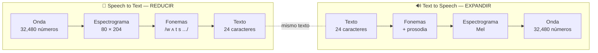

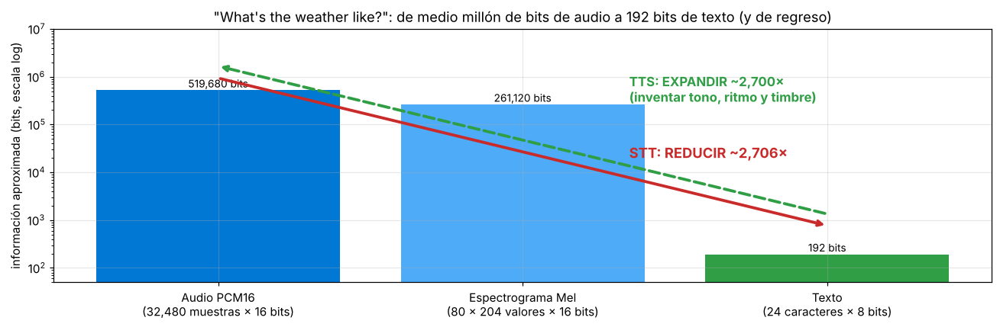

*La misma frase del tema anterior ("What's the weather like?", audio oficial de Azure Speech): el audio PCM16 ocupa ~520,000 bits; el texto, 192. STT tiene que **descartar** el 99.96% de la información (quién habla, su tono, el ruido) y quedarse con lo esencial. TTS hace el viaje contrario: de 192 bits tiene que **inventar** los otros ~520,000 de forma que suenen naturales.*

Esto explica casi todas las diferencias técnicas entre ambos:

| Consecuencia | STT (reducir) | TTS (expandir) |
|---|---|---|
| Tipo de problema | **Clasificación / reconocimiento**: elegir entre opciones conocidas (palabras) | **Generación**: crear una señal nueva |
| Respuesta "correcta" | Una sola (lo que realmente se dijo) | Muchas (hay mil formas válidas de decir una frase) |
| Qué ignora | Tono, timbre, emoción, ruido | — (nada: debe producirlo todo) |
| Qué debe adivinar | Palabras ambiguas (homófonos) | Pronunciación, entonación, pausas, énfasis |
| Cómo se evalúa | **Objetivamente**: WER contra una transcripción de referencia | **Subjetivamente**: personas calificando (MOS) |
| Analogía | Resumir un libro en un tweet | Escribir un libro a partir de un tweet |

---

### 2. Comparación técnica lado a lado

| Aspecto | Speech to text (reconocimiento) | Text to speech (síntesis) |
|---|---|---|
| Entrada | Audio (onda) | Texto (o SSML) |
| Salida | Texto + marcas de tiempo + confianza | Audio (onda) + eventos (límites de palabra, visemas) |
| Representación intermedia | MFCC / espectrograma → fonemas | Fonemas + prosodia → espectrograma Mel |
| Modelos clave | Modelo acústico + modelo de lenguaje + decodificador | Análisis de texto + modelo acústico + **vocoder neuronal** |
| Problema central | **Ambigüedad**: "hay", "ahí", "ay" suenan igual | **Naturalidad**: entonación, ritmo, emoción |
| Normalización | *Inversa (ITN)*: "tres p m" → "3 PM" | *Directa*: "3 PM" → "tres p m" |
| Algoritmo de búsqueda | *Beam search* sobre hipótesis de palabras | No hay búsqueda: se genera la onda |
| Dirección de la información | Muchos datos → pocos datos | Pocos datos → muchos datos |
| Latencia típica que importa | Tiempo hasta el primer resultado parcial | Tiempo hasta el primer byte de audio |
| Fuente típica de error | Ruido, acentos, vocabulario técnico, varias personas hablando | Prosodia plana (voz robótica), homógrafos, siglas, números |
| Personalización en Azure | **Custom Speech** (vocabulario de dominio: médico, legal), *phrase lists* | **Custom Voice** (voz propia), estilos, **SSML**, léxicos |
| Riesgo de IA responsable | Privacidad (grabar a personas) | **Suplantación** (deepfakes de voz) → acceso limitado a voces personalizadas |

---

### 3. Pipeline STT en detalle

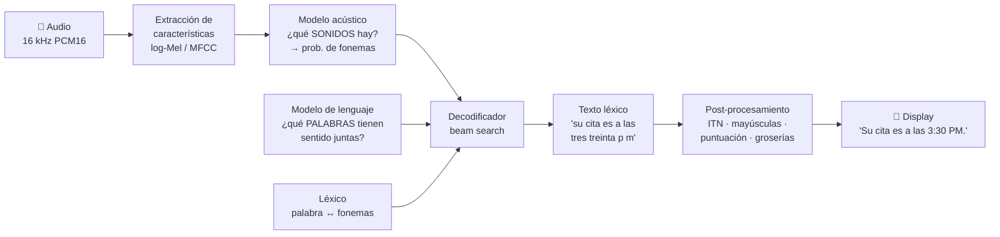

- El **modelo acústico** dice qué sonidos escuchó: /e/ /n/ /b/ /i/ /a/... (cada 10 ms, una distribución de probabilidad sobre fonemas).
- El **léxico** (diccionario de pronunciación) dice qué secuencias de fonemas forman palabras.
- El **modelo de lenguaje** decide qué palabras tienen sentido: "envía el reporte" y no "en vía el re porte".
- El **decodificador** combina ambos y elige la transcripción más probable.

> En los modelos modernos *end-to-end* (como Whisper o los modelos Transformer de Azure), acústico, léxico y lenguaje están fusionados en una sola red neuronal, pero **conceptualmente** siguen existiendo estas tres preguntas, y así lo explica Microsoft Learn.

#### El problema central de STT: ambigüedad

El modelo acústico **no puede** distinguir palabras que suenan igual. Solo el contexto (modelo de lenguaje) resuelve:

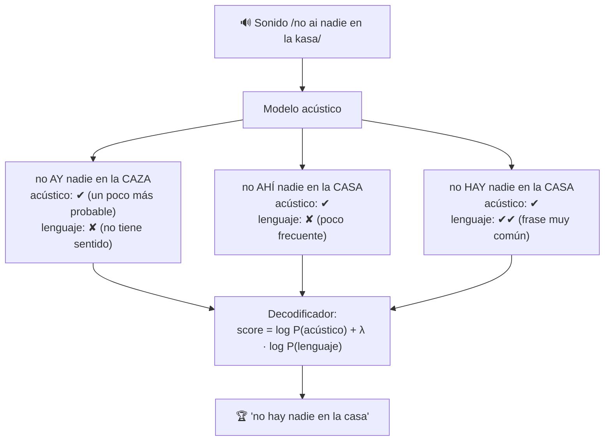

| Tipo de ambigüedad | Ejemplo en español | Ejemplo en inglés |
|---|---|---|
| Homófonos | hay / ahí / ay · vaca / baca · tubo / tuvo | their / there / they're |
| Seseo (Latinoamérica) | casa / caza · cien / sien · abrasar / abrazar | — |
| Segmentación | "sin tierra" / "sinti erra" · "a ver" / "haber" | "recognize speech" / "wreck a nice beach" |
| Nombres propios y jerga | "Kubernetes", "Xóchitl" | "Azure", "Foundry" |

> 💡 Por eso en Azure existen las **phrase lists** (listas de frases que "empujan" al decodificador hacia palabras específicas, como nombres de productos) y **Custom Speech** (entrenar el modelo con texto y audio de tu dominio).

#### Post-procesamiento: de "texto léxico" a "texto display"

Lo que sale del decodificador es el **texto léxico**: palabras tal como se pronunciaron, sin números, mayúsculas ni puntuación. Una cadena de post-procesamiento lo convierte en texto legible:

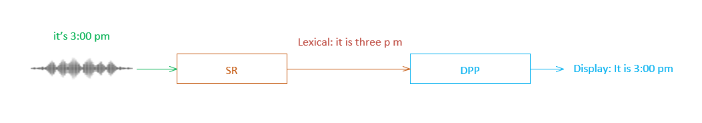

*El reconocedor (SR) produce el texto léxico "it is three p m"; el post-procesamiento de display (DPP) lo convierte en "It is 3:00 pm". Imagen: documentación oficial de Microsoft (CC BY 4.0).*

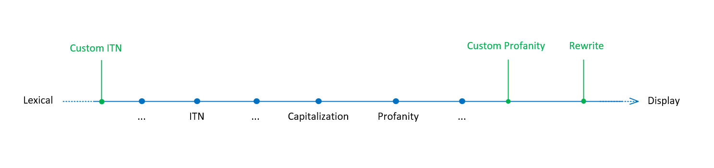

*Las etapas del post-procesamiento: ITN, mayúsculas, filtro de groserías… En verde, los puntos que se pueden personalizar con Custom Speech (ITN personalizado, groserías personalizadas y reescrituras). Imagen: documentación oficial de Microsoft (CC BY 4.0).*

| Etapa | Antes (léxico) | Después (display) |
|---|---|---|
| **ITN** (Inverse Text Normalization) | that will cost nine hundred dollars | That will cost $900. |
| ITN (hora) | the time is six forty five p m | The time is 6:45 PM. |
| ITN (correo) | send it to support at help dot com | Send it to support@help.com. |
| Mayúsculas | i want to visit new york city | I want to visit New York City. |
| Eliminación de muletillas | i uh said that we can go to the uhmm movies | I said that we can go to the movies. |
| Puntuación | how are you | How are you? |
| Groserías | (palabra ofensiva) | `****` (modo *Masked*, por defecto), eliminada (*Removed*) o tal cual (*Raw*) |

*Ejemplos tomados de la documentación oficial de [formato de texto display](https://learn.microsoft.com/en-us/azure/ai-services/speech-service/display-text-format).*

En la salida **detallada** de Azure Speech recibes varias versiones de la misma transcripción: `Lexical`, `ITN`, `MaskedITN` y `Display`, además de `Confidence` y, si los pides, los tiempos de cada palabra.

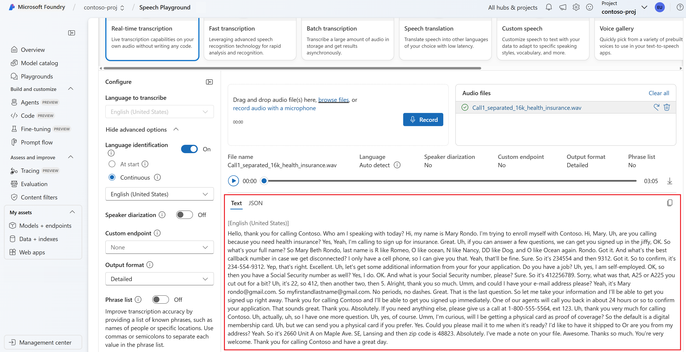

*STT en el Speech Playground de Microsoft Foundry: transcripción en tiempo real de una llamada, con opciones de identificación de idioma, diarización (quién habla), formato de salida y phrase list. Observa cómo el texto ya trae números ("234-554-9312"), correos y puntuación: eso es el post-procesamiento. Imagen: documentación oficial de Microsoft (CC BY 4.0).*

---

### 4. Pipeline TTS en detalle

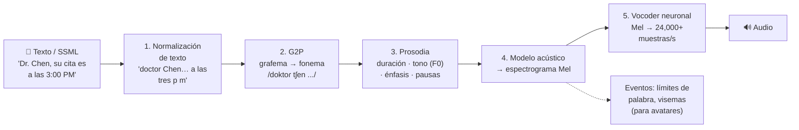

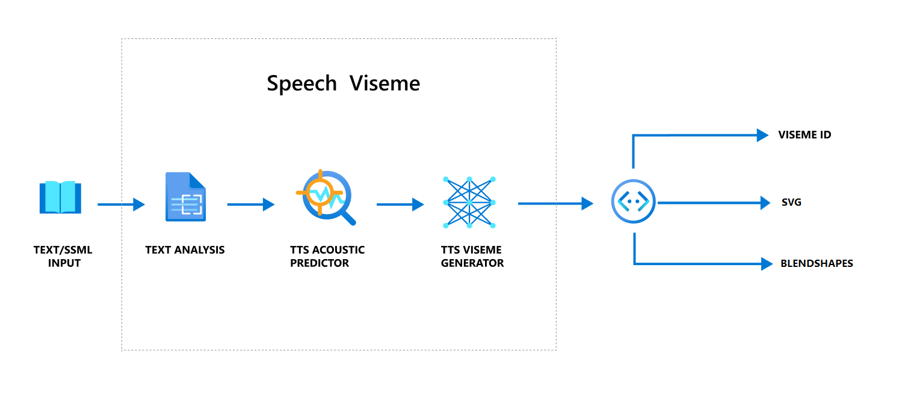

*Pipeline oficial de Azure TTS: el texto o SSML pasa por **análisis de texto** (normalización + G2P), luego por el **predictor acústico** y, en paralelo, un generador de **visemas** (posiciones de la boca) que permite sincronizar avatares 2D/3D con la voz. Imagen: documentación oficial de Microsoft (CC BY 4.0).*

#### 4.1 Normalización de texto (la inversa de ITN)

El modelo no sabe pronunciar "$", "Dr.", "3/10" ni "15:30": primero hay que convertir todo a palabras. Es el problema **opuesto** al ITN de STT.

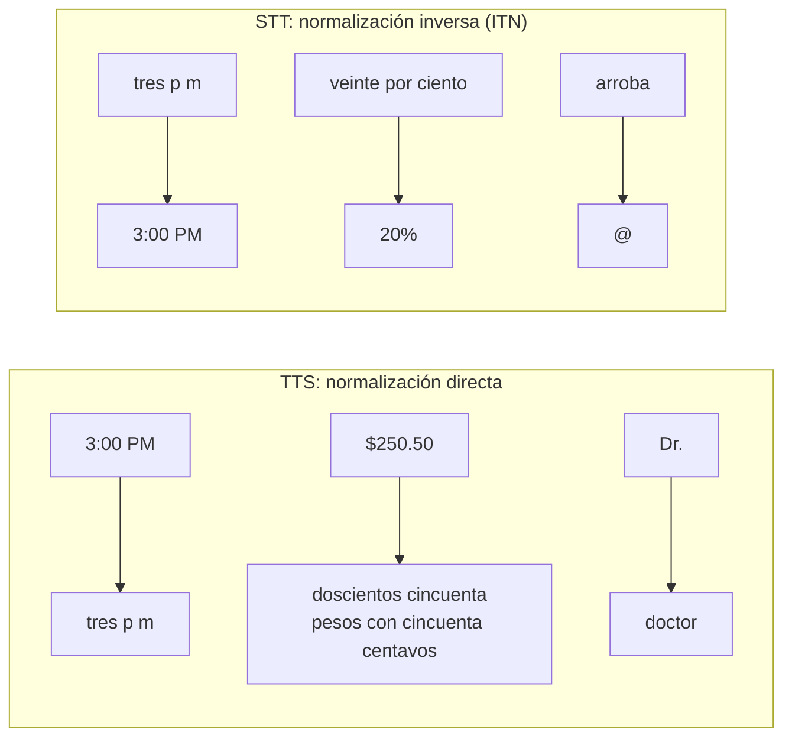

**Retos de la normalización en TTS** (dependen del contexto):

| Texto | Lecturas posibles | ¿Cómo decide? |
|---|---|---|
| `1/2` | "un medio" · "uno de febrero" · "dos de enero" | Contexto + idioma/región (`es-MX` vs `en-US`) |
| `Dr.` | "doctor" · "drive" (en inglés, "Elm Dr.") | Contexto |
| `IV` | "cuatro" (Enrique IV) · "i ve" (suero intravenoso) | Contexto |
| `2026` | "dos mil veintiséis" (año) · "dos mil veintiséis" (cantidad) · "veinte veintiséis" (año en inglés) | Tipo de número |
| `ONU`, `SAT`, `IMSS` | Se lee como palabra ("o-nu") o letra por letra ("ese-a-te") | Diccionario de siglas |

> 💡 Cuando el modelo se equivoca, en Azure lo corriges con **SSML**: `<say-as interpret-as="date">`, `<sub alias="...">` o un **léxico personalizado**.

#### 4.2 G2P (grafema a fonema)

Convierte letras en sonidos. En inglés es muy difícil: "though", "through" y "cough" comparten "ough" y se pronuncian distinto. En español es **mucho más regular** (casi siempre se lee como se escribe), aunque hay excepciones: la "x" de México, Oaxaca o Xochimilco, la "h" muda, la "c" y la "g" que cambian antes de "e/i".

**Homógrafos** (se escriben igual, se pronuncian distinto) son el equivalente en TTS de los homófonos en STT:
- Inglés: *read* (presente /riːd/ vs pasado /rɛd/), *lead* (guiar vs plomo), *live* (vivir vs en vivo).
- Español (por acento o contexto): *récord* vs *record*; siglas como "PAN" (partido) vs "pan".

#### 4.3 Prosodia: lo que STT ignora y TTS debe inventar

La **prosodia** es la "música" del habla: **tono** (frecuencia fundamental F0), **intensidad**, **duración** de cada sonido y **pausas**. STT la descarta casi toda (solo la usa para puntuación); TTS tiene que generarla desde cero.

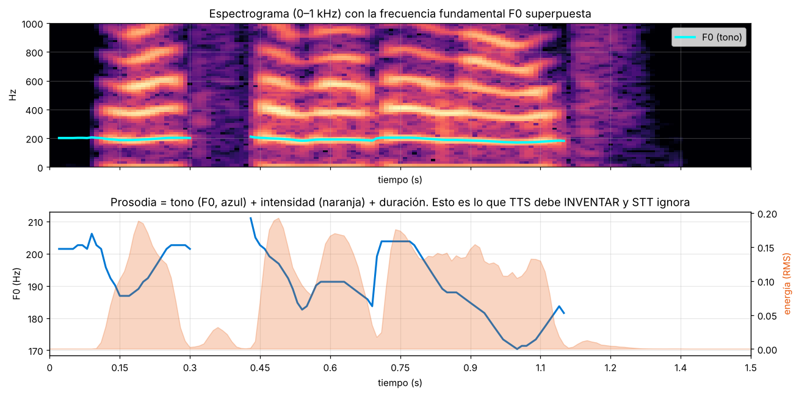

*Arriba: los armónicos del espectrograma y, en cian, la frecuencia fundamental (F0) extraída con el algoritmo pYIN. Abajo: el tono (azul) se mueve entre ~170 y ~210 Hz con tendencia descendente, y la energía (naranja) marca las sílabas acentuadas. Nada de esto aparece en el texto "What's the weather like?": un TTS tiene que **predecirlo**. Si lo genera plano, suena a robot.*

- **El énfasis cambia el significado:** "*Yo* nunca dije que él se comió el pastel" (fue otra persona) vs "Yo nunca dije que él se comió el *pastel*" (se comió otra cosa).
- **Preguntas vs afirmaciones:** "¿Ya llegaste?" sube al final; "Ya llegaste." baja. En el texto solo cambian los signos.
- **Emoción y estilo:** una voz de noticiero, de cuento infantil o de servicio al cliente difieren en velocidad y rango de tono. Las voces neuronales de Azure ofrecen **estilos** (`cheerful`, `sad`, `customerservice`…) y control fino con SSML (`<prosody rate pitch volume>`).

#### 4.4 El vocoder: del espectrograma a la onda

El modelo acústico de un TTS produce un **espectrograma Mel**, pero un espectrograma no se puede reproducir en una bocina: le falta la **fase** (en qué momento exacto sube y baja cada onda). El **vocoder** reconstruye una forma de onda completa a partir del Mel. Es exactamente el paso inverso a la extracción de características de STT.

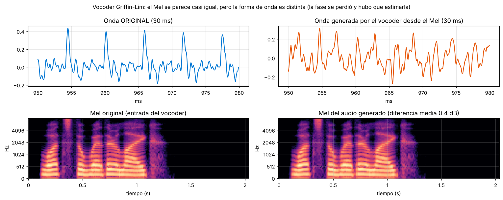

*Experimento con el audio de ejemplo: se tomó su espectrograma Mel y se le pidió a un vocoder clásico (Griffin-Lim) que generara la onda. Los espectrogramas Mel (abajo) son casi idénticos, pero la forma de onda (arriba) es distinta porque la fase se estimó. Griffin-Lim suena entendible pero "metálico"; los **vocoders neuronales** (WaveNet, WaveGlow, HiFi-GAN) aprendieron de miles de horas de voz real cómo debe ser esa fase, y por eso suenan humanos.*

| Generación | Técnica | Cómo suena |
|---|---|---|
| Concatenativa (1990s–2010s) | Pegar fragmentos grabados de un actor de voz | Natural en frases comunes, saltos raros en las uniones |
| Paramétrica (HMM) | Modelo estadístico + vocoder de señal | Robótica, "zumbido" |
| Neuronal (2016+) | WaveNet, Tacotron 2 + vocoder neuronal | Casi indistinguible de humano |
| Neural HD / LLM-based (actual) | Modelos grandes con contexto y emoción | Expresiva, ajusta el tono al contenido |

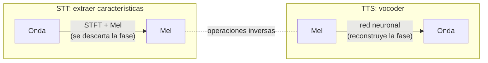

---

### 5. Métricas para evaluarlos

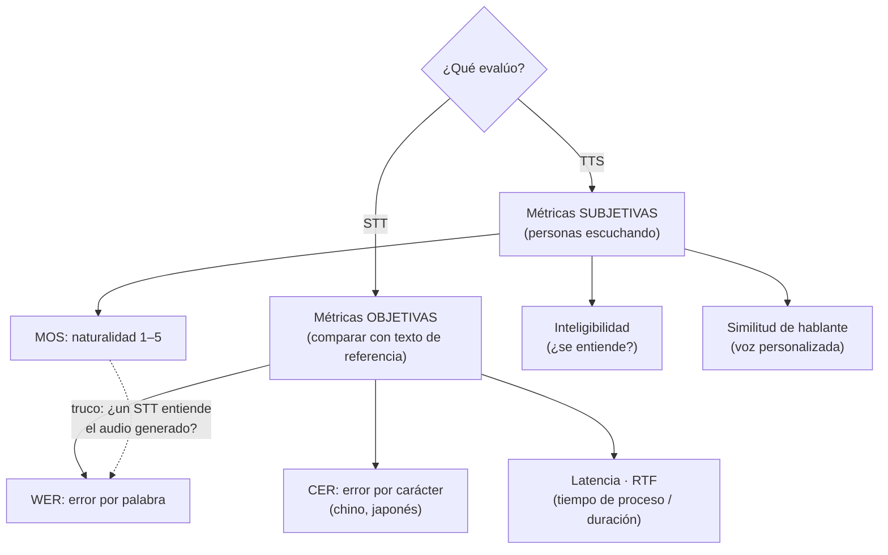

#### STT → WER (Word Error Rate)

`WER = (S + D + I) / N`, donde **S** = sustituciones, **D** = eliminaciones, **I** = inserciones y **N** = palabras de la referencia. **Menor es mejor.** Puede ser mayor a 100% si el sistema inventa muchas palabras.

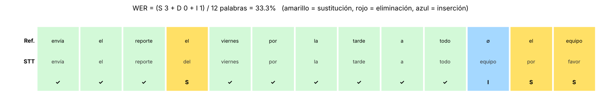

*El algoritmo alinea la referencia con la transcripción (distancia de Levenshtein a nivel palabra) y cuenta cada tipo de error. Aquí: 3 sustituciones + 1 inserción sobre 12 palabras = 33.3%. Puede haber varias alineaciones con el mismo costo mínimo; el WER siempre es el mismo.*

| WER | Interpretación práctica |
|---|---|
| < 5% | Nivel de transcriptor humano profesional |
| 5–10% | Muy bueno; listo para subtítulos y búsqueda |
| 10–20% | Útil para resumen y análisis, requiere revisión |
| > 20% | Revisa calidad de audio, idioma o vocabulario (Custom Speech) |

#### TTS → MOS (Mean Opinion Score)

Un grupo de personas escucha audios y califica la naturalidad de 1 (malo) a 5 (excelente). **Mayor es mejor.** El MOS de una grabación humana real no es 5, sino ~4.5: es el "techo" práctico.

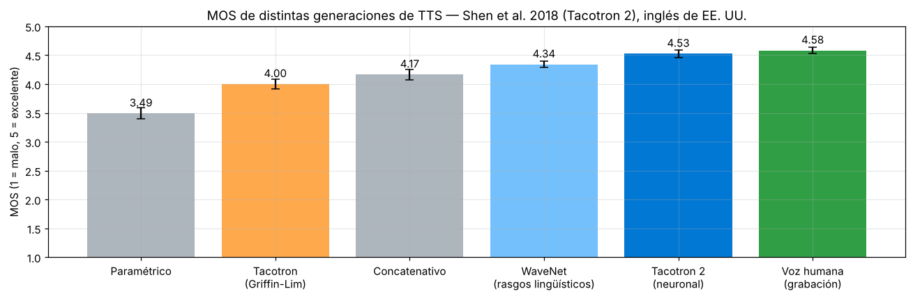

*Resultados del artículo de Tacotron 2 (Shen et al., 2018, Tabla 1): los sistemas neuronales alcanzaron 4.53 frente a 4.58 de la voz humana grabada, una diferencia pequeña en esta prueba.*

> 💡 **Truco usado en la industria:** para medir la **inteligibilidad** de un TTS de forma automática, se pasa su audio por un STT y se calcula el WER contra el texto original. Si el STT no lo entiende, una persona probablemente tampoco. Lo verás en el código de Azure al final.

---

### 6. Cómo se ven en Azure Speech (Parte 2)

| | STT | TTS |
|---|---|---|
| Clase principal | `SpeechRecognizer` | `SpeechSynthesizer` |
| Configuración de audio | `AudioConfig` (micrófono, archivo, stream) | `AudioOutputConfig` (bocina, archivo, stream) |
| Método | `recognize_once_async()` / `start_continuous_recognition()` | `speak_text_async()` / `speak_ssml_async()` |
| Idioma/voz | `speech_recognition_language = "es-MX"` | `speech_synthesis_voice_name = "es-MX-DaliaNeural"` |
| Eventos | `recognizing` (parciales), `recognized` (finales), `canceled` | `synthesis_word_boundary`, `viseme_received`, `synthesis_completed` |
| Formato | `OutputFormat.Simple` / `Detailed` (Lexical, ITN, Display, confianza) | `set_speech_synthesis_output_format(...)` (WAV, MP3, OPUS; 16/24/48 kHz) |
| Modos | Tiempo real, **fast transcription** o **batch** (lotes) | Tiempo real o generación de archivos (incluye audio largo por lotes) |
| Personalización | Custom Speech, phrase lists | Custom Voice, SSML, léxicos |

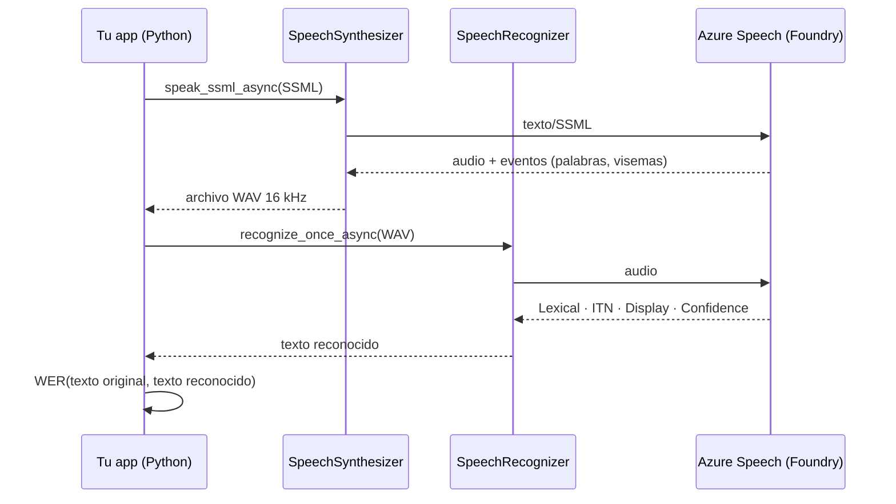

#### ¿Cuál necesito? Guía rápida de escenarios

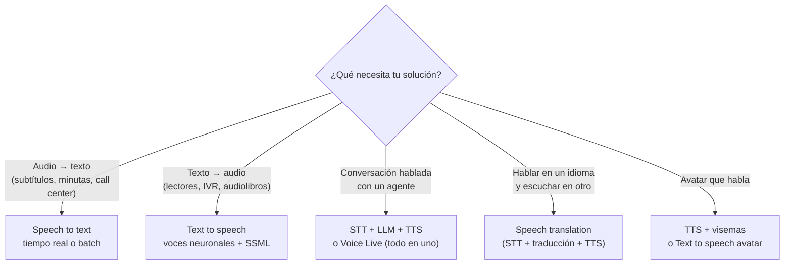

---

### Práctica en Python

Todo el código funciona **sin cuenta de Azure** salvo el último bloque.

```bash
pip install numpy soundfile librosa jiwer num2words
```

#### 1) Normalización directa (TTS) vs inversa (STT)

```python
import re
from num2words import num2words

# ---------- TTS: normalización DIRECTA (símbolos -> palabras que se pueden pronunciar) ----------
ABREV = {"Dr.": "doctor", "Sra.": "señora", "Av.": "avenida", "km": "kilómetros", "%": " por ciento"}

def normalizar_tts(texto):
    for k, v in ABREV.items():
        texto = texto.replace(k, v)
    # $250.50 -> doscientos cincuenta pesos con cincuenta centavos
    texto = re.sub(r"\$(\d+)\.(\d{2})",
                   lambda m: f"{num2words(int(m[1]), lang='es')} pesos con {num2words(int(m[2]), lang='es')} centavos", texto)
    # 15:30 -> quince treinta
    texto = re.sub(r"(\d{1,2}):(\d{2})",
                   lambda m: f"{num2words(int(m[1]), lang='es')} {num2words(int(m[2]), lang='es')}", texto)
    # cualquier otro número
    texto = re.sub(r"\d+", lambda m: num2words(int(m[0]), lang="es"), texto)
    return texto

# ---------- STT: normalización INVERSA (palabras -> símbolos legibles) ----------
NUM = {"uno": 1, "dos": 2, "tres": 3, "cuatro": 4, "cinco": 5, "seis": 6, "siete": 7, "ocho": 8,
       "nueve": 9, "diez": 10, "quince": 15, "veinte": 20, "treinta": 30, "cuarenta": 40, "cincuenta": 50}

def itn_stt(lexico):
    # "a las tres treinta de la tarde" -> "a las 15:30"
    def hora(m):
        h, mi, periodo = NUM[m[1]], NUM.get(m[2], 0), m[3]
        if periodo in ("tarde", "noche") and h < 12:
            h += 12
        return f"a las {h}:{mi:02d}"
    texto = re.sub(r"a las (\w+)(?: (\w+))? de la (mañana|tarde|noche)", hora, lexico)
    texto = re.sub(r"\b(" + "|".join(NUM) + r") por ciento\b", lambda m: f"{NUM[m[1]]}%", texto)
    return texto[0].upper() + texto[1:] + "."     # mayúscula + puntuación

entrada = "Dr. Chen, su cita es a las 15:30 en Av. Reforma 222; el copago es $250.50 (20% menos)"
print("TTS  entrada :", entrada)
print("TTS  normal. :", normalizar_tts(entrada))
print()
lexico = "su cita es a las tres treinta de la tarde con veinte por ciento de descuento"
print("STT  léxico  :", lexico)
print("STT  display :", itn_stt(lexico))
```

Salida:
```
TTS  entrada : Dr. Chen, su cita es a las 15:30 en Av. Reforma 222; el copago es $250.50 (20% menos)
TTS  normal. : doctor Chen, su cita es a las quince treinta en avenida Reforma doscientos veintidós; el copago es doscientos cincuenta pesos con cincuenta centavos (veinte por ciento menos)

STT  léxico  : su cita es a las tres treinta de la tarde con veinte por ciento de descuento
STT  display : Su cita es a las 15:30 con 20% de descuento.
```
- **Explicación:**
  - Las dos funciones hacen trabajos **opuestos**: una expande símbolos a palabras, la otra comprime palabras a símbolos.
  - El orden de las reglas importa: si `\d+` se aplicara antes que `$(\d+).(\d{2})`, el precio se leería como "doscientos cincuenta punto cincuenta".
  - Los sistemas reales usan miles de reglas o modelos neuronales (por ejemplo, para decidir si "1/2" es fecha o fracción), pero la idea es la misma.

#### 2) G2P por reglas para español

```python
import re

# Excepciones: palabras que NO siguen las reglas (el "diccionario" de un G2P real)
EXCEPCIONES = {"méxico": "méxiko", "oaxaca": "oaxaka", "xochimilco": "sotʃimilko"}

# G2P por reglas para español (muy simplificado, alfabeto tipo AFI)
REGLAS = [                       # el ORDEN importa: primero los grupos de 2-3 letras
    (r"x", "ks"),                                            # antes de crear /x/ con j y g
    (r"qu(?=[eiéí])", "k"), (r"gu(?=[eiéí])", "G"), (r"gü", "Gw"),   # G = g dura (temporal)
    (r"ch", "tʃ"), (r"ll", "ʝ"), (r"rr", "R"), (r"^r", "R"),  # R = r fuerte (temporal)
    (r"c(?=[eiéí])", "s"), (r"z", "s"), (r"c", "k"),          # seseo latinoamericano
    (r"g(?=[eiéí])", "x"), (r"j", "x"), (r"h", ""),            # la h es muda
    (r"ñ", "ɲ"), (r"v", "b"), (r"y$", "i"), (r"y", "ʝ"),
    (r"r", "ɾ"), (r"R", "r"), (r"G", "g"),                   # r simple = vibrante suave /ɾ/
]

def g2p(palabra):
    p = palabra.lower()
    if p in EXCEPCIONES:
        return EXCEPCIONES[p]
    for patron, fonema in REGLAS:
        p = re.sub(patron, fonema, p)
    return p

for w in ["queso", "guitarra", "pingüino", "chocolate", "llave", "cielo", "zapato", "casa",
          "gente", "jamón", "hola", "niño", "vaca", "hoy", "pero", "perro", "ratón", "taxi", "México"]:
    print(f"{w:<10} -> /{g2p(w)}/")
```

Salida:
```
queso      -> /keso/
guitarra   -> /gitara/
pingüino   -> /pingwino/
chocolate  -> /tʃokolate/
llave      -> /ʝabe/
cielo      -> /sielo/
zapato     -> /sapato/
casa       -> /kasa/
gente      -> /xente/
jamón      -> /xamón/
hola       -> /ola/
niño       -> /niɲo/
vaca       -> /baka/
hoy        -> /oi/
pero       -> /peɾo/
perro      -> /pero/
ratón      -> /ratón/
taxi       -> /taksi/
México     -> /méxiko/
```
- **Explicación:**
  - Con ~20 reglas se cubre la mayor parte del español; en inglés harían falta miles y aun así fallaría, por eso los G2P en inglés dependen de diccionarios enormes y modelos neuronales.
  - **"casa" y "caza" dan /kasa/, "vaca" y "baca" dan /baka/**: esos son los homófonos que después confunden a STT. El mismo fenómeno que **ayuda** a TTS (la escritura regular se pronuncia de forma predecible) **complica** a STT (sonidos iguales con escrituras distintas).
  - Los marcadores temporales `R` y `G` evitan que una regla posterior "rompa" lo que hizo una anterior: sin ellos, "guitarra" terminaba como /xitaɾa/.
  - "México" necesita una **excepción**: aplicando las reglas daría /méksiko/. En Azure esto se resuelve con un **léxico personalizado** o con `<phoneme>` en SSML.

#### 3) Por qué STT necesita un modelo de lenguaje: beam search con homófonos

```python
import math

# El modelo ACÚSTICO solo oye sonidos: /ai/ puede ser "hay", "ahí" o "ay" (homófonos)
# Cada posición tiene candidatos con su probabilidad acústica (todas suenan casi igual)
acustico = [
    {"no": 0.9, "nos": 0.1},
    {"ay": 0.36, "hay": 0.32, "ahí": 0.32},
    {"nadie": 0.8, "nada": 0.2},
    {"en": 0.6, "y": 0.4},
    {"la": 0.7, "las": 0.3},
    {"caza": 0.52, "casa": 0.48},          # seseo: suenan idéntico en Latinoamérica
]

# Modelo de LENGUAJE: probabilidades de bigramas aprendidas de mucho texto (valores ilustrativos)
bigramas = {
    ("<s>", "no"): 0.20, ("<s>", "nos"): 0.05,
    ("no", "hay"): 0.30, ("no", "ahí"): 0.01, ("no", "ay"): 0.001,
    ("nos", "hay"): 0.001, ("nos", "ahí"): 0.001, ("nos", "ay"): 0.001,
    ("hay", "nadie"): 0.25, ("hay", "nada"): 0.20, ("ahí", "nadie"): 0.02, ("ahí", "nada"): 0.01,
    ("ay", "nadie"): 0.001, ("ay", "nada"): 0.001,
    ("nadie", "en"): 0.15, ("nada", "en"): 0.10, ("nadie", "y"): 0.05, ("nada", "y"): 0.05,
    ("en", "la"): 0.40, ("en", "las"): 0.10, ("y", "la"): 0.10, ("y", "las"): 0.05,
    ("la", "casa"): 0.05, ("la", "caza"): 0.002, ("las", "casa"): 0.0001, ("las", "caza"): 0.0001,
}
def p_lm(prev, w):
    return bigramas.get((prev, w), 1e-5)     # suavizado: nada tiene probabilidad 0

def beam_search(acustico, ancho=3, peso_lm=1.0):
    haces = [(0.0, ["<s>"])]                  # (log-probabilidad, palabras)
    for paso, candidatos in enumerate(acustico, 1):
        nuevos = []
        for score, frase in haces:
            for palabra, p_ac in candidatos.items():
                s = score + math.log(p_ac) + peso_lm * math.log(p_lm(frase[-1], palabra))
                nuevos.append((s, frase + [palabra]))
        haces = sorted(nuevos, reverse=True)[:ancho]     # solo sobreviven los mejores
        print(f"Paso {paso}: " + " | ".join(f"{' '.join(f[1:])} ({s:.1f})" for s, f in haces))
    return " ".join(haces[0][1][1:])

print("SOLO acústico (peso_lm=0):")
print("  ->", beam_search(acustico, peso_lm=0.0), "\n")
print("Acústico + modelo de lenguaje:")
print("  ->", beam_search(acustico, peso_lm=1.0))
```

Salida:
```
SOLO acústico (peso_lm=0):
Paso 1: no (-0.1) | nos (-2.3)
Paso 2: no ay (-1.1) | no hay (-1.2) | no ahí (-1.2)
Paso 3: no ay nadie (-1.4) | no hay nadie (-1.5) | no ahí nadie (-1.5)
Paso 4: no ay nadie en (-1.9) | no hay nadie en (-2.0) | no ahí nadie en (-2.0)
Paso 5: no ay nadie en la (-2.2) | no hay nadie en la (-2.3) | no ahí nadie en la (-2.3)
Paso 6: no ay nadie en la caza (-2.9) | no ay nadie en la casa (-3.0) | no hay nadie en la caza (-3.0)
  -> no ay nadie en la caza 

Acústico + modelo de lenguaje:
Paso 1: no (-1.7) | nos (-5.3)
Paso 2: no hay (-4.1) | no ahí (-7.5) | no ay (-9.6)
Paso 3: no hay nadie (-5.7) | no hay nada (-7.3) | no ahí nadie (-11.6)
Paso 4: no hay nadie en (-8.1) | no hay nadie y (-9.6) | no hay nada en (-10.1)
Paso 5: no hay nadie en la (-9.3) | no hay nada en la (-11.4) | no hay nadie en las (-11.6)
Paso 6: no hay nadie en la casa (-13.1) | no hay nada en la casa (-15.1) | no hay nadie en la caza (-16.2)
  -> no hay nadie en la casa
```
- **Explicación:**
  - Solo con el oído (acústico), el sistema escribe **"no ay nadie en la caza"**: cada palabra "suena bien", pero la frase no tiene sentido.
  - Al sumar el modelo de lenguaje, "no hay" y "la casa" ganan por mucho, porque son combinaciones frecuentes en español.
  - **Beam search** con `ancho=3` solo conserva las 3 mejores hipótesis en cada paso en lugar de explorar las 2×3×2×2×2×2 = 96 combinaciones posibles (en una frase real serían millones).
  - `peso_lm` (λ) equilibra "lo que oí" contra "lo que tiene sentido": muy alto y el sistema "corrige" palabras que sí se dijeron; muy bajo y aparecen homófonos absurdos.
  - TTS **no necesita** nada de esto: no hay ambigüedad que resolver al ir del texto al sonido (el texto ya dice qué palabra es).

#### 4) WER con alineación y normalización

```python
import jiwer

referencia    = "envía el reporte el viernes por la tarde a todo el equipo"
transcripcion = "envía el reporte del viernes por la tarde a todo equipo por favor"

r = jiwer.process_words(referencia, transcripcion)
N = len(referencia.split())
print(f"Sustituciones: {r.substitutions} | Eliminaciones: {r.deletions} | Inserciones: {r.insertions} | Correctas: {r.hits}")
print(f"WER = ({r.substitutions} + {r.deletions} + {r.insertions}) / {N} = {r.wer:.1%}")
print(jiwer.visualize_alignment(r, show_measures=False))

# Normalizar ANTES de medir: mayúsculas y puntuación no deberían contar como error
transform = jiwer.Compose([jiwer.ToLowerCase(), jiwer.RemovePunctuation(),
                           jiwer.RemoveMultipleSpaces(), jiwer.Strip(), jiwer.ReduceToListOfListOfWords()])
display = "Envía el reporte el viernes por la tarde a todo el equipo."
print(f"Sin normalizar: {jiwer.wer(referencia, display):.1%}  |  normalizado: "
      f"{jiwer.wer(referencia, display, reference_transform=transform, hypothesis_transform=transform):.1%}")

# CER: tasa de error por CARACTER (útil en idiomas sin espacios: chino, japonés)
print(f"CER: {jiwer.cer(referencia, transcripcion):.1%}")
```

Salida:
```
Sustituciones: 3 | Eliminaciones: 0 | Inserciones: 1 | Correctas: 9
WER = (3 + 0 + 1) / 12 = 33.3%
=== SENTENCE 1 ===

REF: envía el reporte  el viernes por la tarde a todo ******  el equipo
HYP: envía el reporte del viernes por la tarde a todo equipo por  favor
                        S                                  I   S      S

Sin normalizar: 16.7%  |  normalizado: 0.0%
CER: 24.6%
```
- **Explicación:**
  - Un solo "del" en lugar de "el" ya es una sustitución; agregar "por favor" al final cuesta una inserción y una sustitución.
  - **Trampa común:** comparar el texto *display* de Azure ("Envía… equipo.") contra una referencia en minúsculas da 16.7% de WER por la mayúscula y el punto, aunque la transcripción es perfecta. Siempre normaliza ambos textos antes de medir (Azure hace algo equivalente en sus evaluaciones de Custom Speech).

#### 5) Vocoder: del espectrograma Mel a la onda

```python
import numpy as np, soundfile as sf, librosa
# Audio de ejemplo (descárgalo como en el Tema 1):
# https://github.com/Azure-Samples/cognitive-services-speech-sdk/blob/master/samples/csharp/sharedcontent/console/whatstheweatherlike.wav
audio, sr = sf.read("whatstheweatherlike.wav", dtype="float32")

# 1) Lo que produciría el "modelo acústico" de un TTS: un espectrograma Mel
mel = librosa.feature.melspectrogram(y=audio, sr=sr, n_fft=400, hop_length=160, n_mels=80)
print(f"Mel: {mel.shape}  ->  {mel.size:,} números para {len(audio)/sr:.2f} s")

# 2) VOCODER clásico (Griffin-Lim): Mel -> forma de onda, estimando la fase iterativamente
generado = librosa.feature.inverse.mel_to_audio(mel, sr=sr, n_fft=400, hop_length=160, n_iter=64)
print(f"Audio generado: {len(generado):,} muestras ({len(generado)/sr:.2f} s a {sr} Hz)")
print(f"Expansión: {mel.size:,} -> {len(generado):,} valores (cada columna Mel se convierte en ~160 muestras = 10 ms)")

# 3) ¿Se parece? Comparar magnitudes (lo que oímos) vs forma de onda (incluye la fase)
n = min(len(audio), len(generado))
corr_onda = np.corrcoef(audio[:n], generado[:n])[0, 1]
mel2 = librosa.feature.melspectrogram(y=generado, sr=sr, n_fft=400, hop_length=160, n_mels=80)
m = min(mel.shape[1], mel2.shape[1])
corr_mel = np.corrcoef(librosa.power_to_db(mel[:, :m]).ravel(), librosa.power_to_db(mel2[:, :m]).ravel())[0, 1]
print(f"Correlación de la forma de onda: {corr_onda:.2f}   |   correlación del espectrograma Mel: {corr_mel:.3f}")

sf.write("vocoder_griffinlim.wav", generado, sr, subtype="PCM_16")   # escúchalo: entendible pero "metálico"
```

Salida (la correlación de la onda **cambia en cada ejecución**):
```
Mel: (80, 204)  ->  16,320 números para 2.03 s
Audio generado: 32,480 muestras (2.03 s a 16000 Hz)
Expansión: 16,320 -> 32,480 valores (cada columna Mel se convierte en ~160 muestras = 10 ms)
Correlación de la forma de onda: 0.28   |   correlación del espectrograma Mel: 0.998
```
- **Explicación:**
  - El espectrograma Mel generado coincide casi perfecto con el original (0.998), pero la forma de onda casi no se parece (en distintas corridas obtuvimos 0.48, −0.07 y 0.28): Griffin-Lim arranca con una **fase aleatoria** y la ajusta, así que cada vez sale una onda distinta con el mismo "sonido".
  - Tu oído es poco sensible a la fase y muy sensible a la magnitud; por eso el audio se entiende. Pero los pequeños errores de fase producen el timbre "metálico" típico de los TTS antiguos.
  - Un vocoder **neuronal** sustituye `mel_to_audio` por una red entrenada; el resto del pipeline es igual.

#### 6) Ida y vuelta con Azure Speech: TTS → audio → STT → WER (requiere recurso de Foundry/Speech)

```python
# pip install azure-cognitiveservices-speech jiwer
import os, json, jiwer
import azure.cognitiveservices.speech as speechsdk

speech_config = speechsdk.SpeechConfig(subscription=os.environ["SPEECH_KEY"],
                                       endpoint=os.environ["SPEECH_ENDPOINT"])

# ---------- TTS: texto (SSML) -> archivo WAV 16 kHz ----------
texto = "Su cita con el doctor Chen es el 3 de octubre a las 15:30."
ssml = f"""
<speak version="1.0" xmlns="http://www.w3.org/2001/10/synthesis" xml:lang="es-MX">
  <voice name="es-MX-DaliaNeural">
    <prosody rate="-5%" pitch="+2%">{texto}</prosody>
  </voice>
</speak>"""
speech_config.set_speech_synthesis_output_format(
    speechsdk.SpeechSynthesisOutputFormat.Riff16Khz16BitMonoPcm)       # el formato ideal para STT
sintetizador = speechsdk.SpeechSynthesizer(
    speech_config=speech_config,
    audio_config=speechsdk.audio.AudioOutputConfig(filename="cita.wav"))

# Evento de TTS: cuándo empieza cada palabra (útil para resaltar texto o karaoke)
sintetizador.synthesis_word_boundary.connect(
    lambda e: print(f"  [TTS] {e.audio_offset/10_000:7.0f} ms  {e.text}"))
r_tts = sintetizador.speak_ssml_async(ssml).get()
print("TTS:", r_tts.reason)                 # ResultReason.SynthesizingAudioCompleted

# ---------- STT: archivo WAV -> texto (formato detallado) ----------
speech_config.speech_recognition_language = "es-MX"
speech_config.output_format = speechsdk.OutputFormat.Detailed
reconocedor = speechsdk.SpeechRecognizer(
    speech_config=speech_config,
    audio_config=speechsdk.audio.AudioConfig(filename="cita.wav"))
r_stt = reconocedor.recognize_once_async().get()

mejor = json.loads(r_stt.json)["NBest"][0]
print("Lexical :", mejor["Lexical"])        # palabras tal cual: "... tres de octubre a las quince treinta"
print("ITN     :", mejor["ITN"])            # con números
print("Display :", mejor["Display"])        # con números, mayúsculas y puntuación
print("Confianza:", round(mejor["Confidence"], 3))

# ---------- Inteligibilidad del TTS medida con STT ----------
t = jiwer.Compose([jiwer.ToLowerCase(), jiwer.RemovePunctuation(), jiwer.Strip(),
                   jiwer.ReduceToListOfListOfWords()])
print(f"WER (texto original vs lo que entendió STT): "
      f"{jiwer.wer(texto, r_stt.text, reference_transform=t, hypothesis_transform=t):.1%}")
```
- **Explicación:**
  - Es el ciclo completo de este tema: **normalización** (TTS lee "3" y "15:30" en palabras) → **síntesis** → **reconocimiento** → **ITN** (STT vuelve a escribir "3" y "15:30").
  - `Riff16Khz16BitMonoPcm` genera el audio directamente en el formato que STT prefiere (Tema 1).
  - `OutputFormat.Detailed` devuelve el JSON con `NBest`: varias hipótesis ordenadas, cada una con `Lexical`, `ITN`, `MaskedITN`, `Display` y `Confidence`.
  - Si el WER no es 0%, puede deberse a la normalización ("15:30" vs "3:30 p. m.") y no a un error real: es la misma trampa del código 4.
  - `audio_offset` viene en *ticks* de 100 ns; dividir entre 10,000 da milisegundos.

---

### Para el examen
- STT = audio → texto (**reconocimiento**); TTS = texto → audio (**síntesis**). Son procesos inversos.
- STT usa **modelo acústico** (sonidos → fonemas) + **modelo de lenguaje** (palabras probables) + decodificador (**beam search**).
- TTS usa **normalización de texto** → **G2P / fonemas** → **prosodia** → espectrograma Mel → **vocoder**.
- El problema típico de STT es la **ambigüedad** (homófonos, ruido, acentos); el de TTS es la **naturalidad** (prosodia).
- STT se mide con **WER** (menor es mejor); TTS con **MOS** (mayor es mejor).
- En el SDK: `SpeechRecognizer` + `AudioConfig` para STT; `SpeechSynthesizer` + `AudioOutputConfig` para TTS. **SSML** solo aplica a TTS.

---

### 🖼️ Créditos de imágenes
- Imágenes con prefijo `ms-`: documentación oficial de Azure Speech, repositorio [MicrosoftDocs/azure-ai-docs](https://github.com/MicrosoftDocs/azure-ai-docs) (licencia **CC BY 4.0**, © Microsoft).
- Las demás figuras fueron generadas con Python (librosa, jiwer, matplotlib) para este acordeón a partir del audio oficial [`whatstheweatherlike.wav`](https://github.com/Azure-Samples/cognitive-services-speech-sdk) (Azure-Samples, licencia MIT). Los valores de MOS provienen de Shen et al. (2018).

### Recursos
- [Formato de texto display (ITN, puntuación, groserías) – Azure Speech](https://learn.microsoft.com/en-us/azure/ai-services/speech-service/display-text-format)
- [Visemas para sincronizar avatares – Azure Speech](https://learn.microsoft.com/en-us/azure/ai-services/speech-service/how-to-speech-synthesis-viseme)
- [SSML: estructura y prosodia – Azure Speech](https://learn.microsoft.com/en-us/azure/ai-services/speech-service/speech-synthesis-markup)
- [Evaluar la precisión de Custom Speech (WER) – Azure Speech](https://learn.microsoft.com/en-us/azure/ai-services/speech-service/how-to-custom-speech-evaluate-data)
- [Shen et al. (2018) – Natural TTS Synthesis by Conditioning WaveNet on Mel Spectrogram Predictions (Tacotron 2)](https://arxiv.org/abs/1712.05884)
- [van den Oord et al. (2016) – WaveNet: A Generative Model for Raw Audio](https://arxiv.org/abs/1609.03499)
- [jiwer – documentación](https://jitsi.github.io/jiwer/)
