# Tema 3: Así funciona Alexa internamente

### Descripción
Alexa (y en general cualquier asistente de voz: Siri, Google Assistant o un agente de voz hecho con Foundry) es el ejemplo perfecto de cómo se **encadenan** todas las piezas de IA de voz: captura y limpieza del audio, detección de palabra de activación, reconocimiento, comprensión, razonamiento/acción y síntesis. Entender este flujo te ayuda a diseñar tus propios agentes de voz y a responder preguntas del examen donde te piden **elegir el servicio correcto para cada etapa**.

> [!NOTE]
> Amazon no publica todos los detalles internos de Alexa. Este tema se basa en lo que Amazon documenta para desarrolladores (**Alexa Voice Service** para fabricantes de dispositivos y **Alexa Skills Kit** para crear skills), en los artículos de **Amazon Science** y en lo que Amazon ha contado sobre **Alexa+**. Donde algo es una simplificación didáctica, se indica.

Analogía: es como un restaurante. El mesero (bocina) solo pone atención cuando dices "¡joven!" (*wake word*), anota tu pedido (STT), la cocina entiende qué quieres (NLU), prepara el platillo (skill / herramienta) y el mesero te lo entrega con una sonrisa (TTS). En la versión con IA generativa (Alexa+), además hay un **jefe de cocina** (LLM) que decide qué cocineros participan y puede improvisar platillos que no estaban en el menú.

<p align="center">
  
</p>

*Un Echo con el anillo azul encendido: detectó "Alexa" y está enviando tu voz a la nube. Foto: [Smart Home Perfected](https://commons.wikimedia.org/wiki/File:Alexa_Amazon_Echo_Smart_Speaker_-_Flashing_Blue_Ring_(Creative_Commons)_(51048329823).jpg), CC BY 2.0.*

---

### Mapa del tema: de "Alexa…" a la respuesta

Todo el tema es un solo pipeline repartido entre **el dispositivo** (barato, siempre encendido, privado) y **la nube** (potente, cara, con acceso a servicios). Cada sección explica una caja:

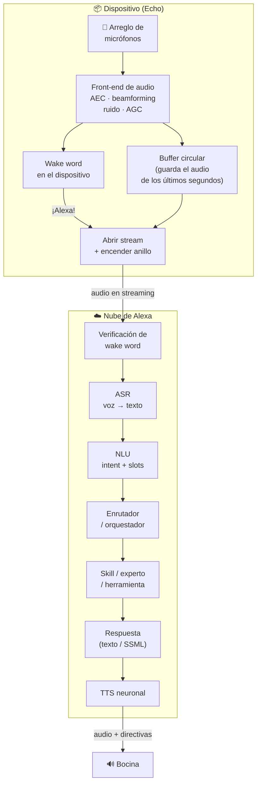

| Etapa | Dónde corre | Pregunta que responde | Resultado |
|---|---|---|---|
| Front-end de audio | Dispositivo (DSP) | ¿Cómo separo tu voz de la música, el eco y el ruido? | Un solo canal "limpio" |
| Wake word | Dispositivo | ¿Me están hablando a mí? | Sí / no (+ instante en que empezó) |
| Verificación de wake word | Nube | ¿De verdad dijo "Alexa" o fue la tele? | Aceptar / cancelar |
| ASR | Nube | ¿Qué palabras dijo? | Texto + confianza (+ N mejores hipótesis) |
| Endpointing | Nube (y dispositivo) | ¿Ya terminó de hablar? | Cierre del micrófono |
| NLU | Nube | ¿Qué quiere hacer y con qué datos? | `intent` + `slots` |
| Enrutamiento | Nube | ¿Quién atiende esto? | Skill / dominio / experto |
| Skill / herramientas | Nube (Lambda o tu servidor) + APIs | ¿Cómo lo hago? | Acción + texto de respuesta |
| TTS | Nube | ¿Cómo lo digo con voz natural? | Audio |
| Directivas | Dispositivo | ¿Qué hace la bocina ahora? | Reproducir, bajar volumen, abrir micrófono… |

---

### 1. El hardware: un dispositivo diseñado para escuchar de lejos

Una bocina inteligente tiene un problema que tu celular no tiene: le hablas desde **el otro lado del cuarto** (*far-field*), con música sonando **desde la misma bocina**, la tele prendida y eco de las paredes. Por eso el hardware importa tanto como el modelo.

<p align="center">
  
</p>

*Parte superior de un Echo Dot: botones de volumen, de acción y de **silenciar micrófonos**, y los pequeños orificios del arreglo de micrófonos. Foto: [DiscoA340](https://commons.wikimedia.org/wiki/File:Red_Echo_Dot_(Top).jpg), CC0.*

| Componente | Para qué sirve | Analogía |
|---|---|---|
| **Arreglo de micrófonos** (el Echo original tenía 7: seis en círculo y uno al centro) | Saber **de qué dirección** viene la voz y enfocarse en ella | Varias orejas que comparan quién oyó primero |
| **DSP / acelerador neuronal** | Correr el front-end de audio y el detector de wake word con muy poco consumo | Un guardia que nunca duerme pero gasta poca energía |
| **Anillo de luz** | Avisar qué está haciendo (escuchando, pensando, micrófono apagado) | El letrero de "grabando" de un estudio |
| **Botón de micrófono** | Corta los micrófonos **por hardware** | Desconectar el cable en vez de confiar en un software |
| **Bocina** | Reproducir la respuesta… y generar el eco que luego hay que cancelar | El mesero que habla y se escucha a sí mismo |

> 🧠 En 2020 Amazon presentó el **AZ1 Neural Edge**, un procesador hecho con MediaTek para correr redes neuronales en el Echo. Con él, algunos modelos (Echo Dot 4.ª gen, Echo Show 10 y 15) podían hacer reconocimiento de voz **en el dispositivo** para inglés de EE. UU., con modelos *end-to-end* reducidos de gigabytes a menos de 100 MB. Ojo con la sección 11: esa opción se eliminó en 2025.

#### Estados del dispositivo (lo que te dice el anillo de luz)

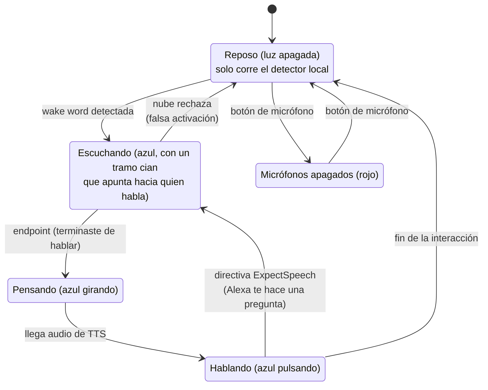

> El tramo cian que "apunta" hacia ti no es decoración: es el resultado del **beamforming** de la siguiente sección, que estimó de qué dirección vino tu voz.

---

### 2. El front-end de audio: limpiar antes de escuchar

Antes de que cualquier modelo de IA vea tu voz, un procesador de señales (en el AVS Device SDK se llama **Audio Signal Processor**) convierte las señales de todos los micrófonos en **un solo canal limpio**. Si este paso falla, todo lo demás falla: ningún modelo puede recuperar información que se perdió aquí (lo mismo que viste en el Tema 1).

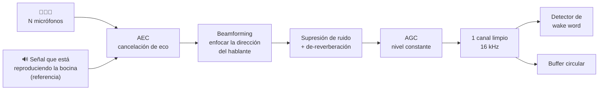

| Técnica | Problema que resuelve | Cómo funciona (idea) |
|---|---|---|
| **AEC** (*Acoustic Echo Cancellation*) | "Alexa, para" mientras suena música **a todo volumen** desde la misma bocina | El dispositivo **sabe** qué está reproduciendo; aprende cómo suena eso después de rebotar en el cuarto y lo **resta** de lo que oyen los micrófonos |
| **Beamforming** | Ruido y voces que vienen de otras direcciones | Retrasa y suma las señales de los micrófonos para que la voz de una dirección se sume "en fase" y lo demás se cancele parcialmente |
| **Supresión de ruido** | Ventilador, aire acondicionado, tráfico | Estima el ruido estacionario y lo atenúa por frecuencia |
| **De-reverberación** | Eco de cuartos grandes o vacíos | Reduce las "colas" de la voz que rebotan en paredes |
| **AGC** (*Automatic Gain Control*) | Le hablas bajito desde lejos o gritando de cerca | Normaliza el volumen para que el modelo vea niveles parecidos |

#### Cancelación de eco (AEC) en acción

La clave del AEC es que el ruido más fuerte (la música de la propia bocina) **es conocido**. Un filtro adaptativo (por ejemplo **NLMS**, *Normalized Least Mean Squares*) aprende la "respuesta del cuarto" y genera una copia del eco para restarla:

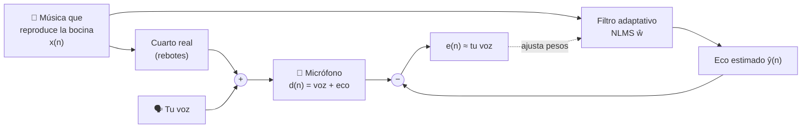

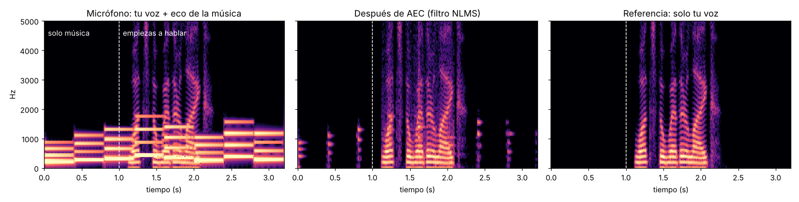

*Simulación con Python: tu voz ("What's the weather like?", el audio de ejemplo del Tema 1) mezclada con el eco de una música sintética que suena desde la bocina. El filtro NLMS aprende el eco durante el primer segundo (solo música) y luego lo resta: la música prácticamente desaparece (~36 dB menos en la zona de solo música) y la voz queda casi intacta. Los pequeños restos al inicio de cada nota son instantes en que el filtro todavía se está ajustando. En equipos reales se suma un "detector de doble habla" para no desajustar el filtro cuando hablan los dos al mismo tiempo.*

> 💡 Esto es lo que permite el **barge-in**: interrumpir a Alexa mientras habla o pone música. Sin AEC, el detector de wake word se "ahogaría" con el audio de la propia bocina.

#### Beamforming: orejas que se ponen de acuerdo

El sonido llega a cada micrófono con microsegundos de diferencia según la dirección. Si **retrasas** cada canal para compensar esa diferencia y luego **sumas**, la voz que viene de la dirección elegida se refuerza y lo demás se atenúa. Es el método más simple (*delay-and-sum*):

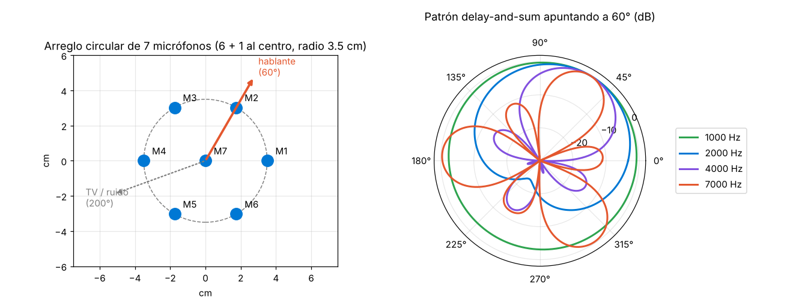

*Arreglo tipo Echo (6 micrófonos en círculo + 1 al centro, radio 3.5 cm) apuntando a 60°. Observa que a 1 kHz el patrón es casi un círculo (no distingue direcciones) y a 4–7 kHz aparece un lóbulo claro hacia 60°, pero también **lóbulos laterales**. Con un arreglo tan pequeño el delay-and-sum se queda corto en graves; por eso los equipos reales usan beamformers **adaptativos** (p. ej. MVDR) y modelos neuronales que estiman la dirección.*

> 🧠 Regla útil: un arreglo "ve" direcciones cuando la distancia entre micrófonos es comparable a la longitud de onda (λ = c / f). A 1 kHz, λ ≈ 34 cm, mucho mayor que los 7 cm del arreglo; a 7 kHz, λ ≈ 5 cm.

> **En Microsoft:** el **Microsoft Audio Stack (MAS)** del Speech SDK hace este mismo trabajo (beamforming, de-reverberación, AEC, AGC y supresión de ruido) **localmente**, sin mandar audio a la nube. Se activa con `AudioProcessingOptions`.

---

### 3. Wake word: el guardia que nunca duerme

Un modelo **pequeño y de bajo consumo** escucha continuamente **dentro del dispositivo** buscando "Alexa" (o "Amazon", "Echo", "Computer", según lo que configures). **Nada se envía a la nube hasta que lo detecta**: por privacidad, por latencia y por costo (imagina transmitir 24/7 el audio de millones de casas).

#### El problema central: dos errores que se pelean

| Error | Qué pasa | Cómo lo vive el usuario |
|---|---|---|
| **Falso rechazo** (*false reject*) | Dijiste "Alexa" y no reaccionó | "¡No me hace caso!" |
| **Falsa aceptación** (*false accept / false wake*) | Se activó con la tele, con "Alexis" o con "¿a la exa…?" | "¡Me está espiando!" |

Ambos dependen del **umbral**: si lo bajas, se activa más fácil (menos rechazos, más falsas activaciones); si lo subes, al revés.

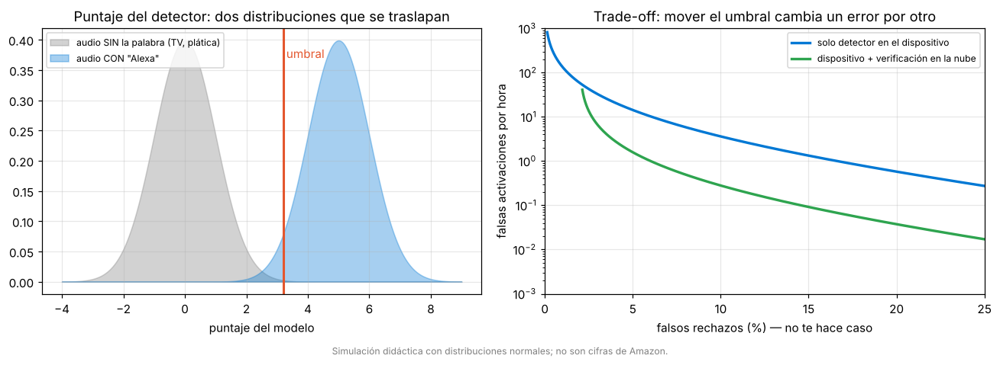

*Simulación didáctica: el detector asigna un puntaje a cada fragmento de audio. Como las distribuciones de "sin Alexa" y "con Alexa" se traslapan, ningún umbral elimina ambos errores. Agregar una **segunda etapa en la nube** baja la curva: menos falsas activaciones por hora para el mismo porcentaje de rechazos.*

#### La solución de Amazon: detección en cascada

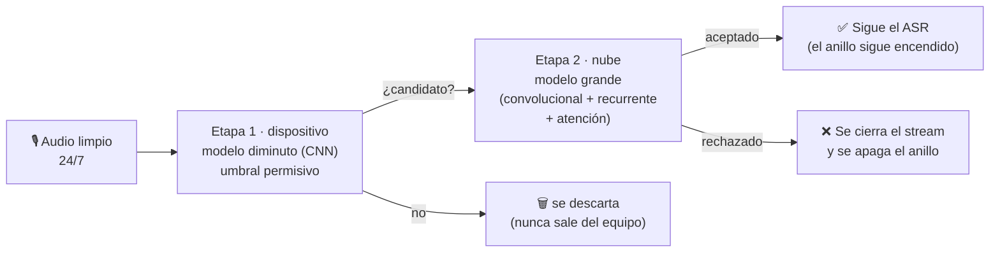

- **Etapa 1 (dispositivo):** redes convolucionales sobre **energías de bancos de filtros logarítmicos** (LFBE, el mismo "espectrograma log-Mel" del Tema 1). Deben ocupar muy poca memoria, así que son menos precisas. Amazon incluso le agrega **metadatos del dispositivo** (qué modelo es, si está sonando música o una alarma) para ajustar la detección según el contexto.
- **Etapa 2 (nube):** cuando la etapa 1 dispara, el equipo manda el audio incluyendo **~medio segundo antes** del inicio estimado de la palabra (por eso existe el **buffer circular**: el dispositivo siempre guarda los últimos instantes). Un modelo mucho más grande confirma o cancela. En sus experimentos publicados, Amazon reportó que este tipo de verificadores reducía las falsas aceptaciones en más de 50% frente a su sistema anterior.
- Esto ocurre **en paralelo** con el ASR: no agrega latencia si la palabra era real.

> [!TIP]
> En el examen, si te preguntan **por qué la detección de la palabra de activación se hace en el dispositivo**, la respuesta gira en torno a **privacidad** (no mandar audio continuamente), **latencia** y **costo/ancho de banda**.

**El mismo patrón en Azure:** el Speech SDK tiene *Keyword recognition* con un modelo en el dispositivo (lo creas en Speech Studio → *Custom Keyword*) y **Keyword Verification** en la nube, que corre en paralelo con speech to text:

<p align="center">
  
</p>

*Fuente: [Microsoft Learn – Keyword recognition](https://learn.microsoft.com/es-es/azure/ai-services/speech-service/keyword-recognition-overview). La verificación procesa como máximo ~2 s de audio; si rechaza la palabra, se termina el speech to text. No tiene costo adicional al de speech to text.*

| Modelo de *custom keyword* | Listo en | Para qué |
|---|---|---|
| **Basic** | Hasta 15 min | Demos y prototipos |
| **Advanced** | Hasta 48 h | Productos (se entrena con datos simulados; no subes audio) |

---

### 4. Del dispositivo a la nube: Alexa Voice Service (AVS)

Cuando la wake word se confirma, el dispositivo no "llama a una API" cada vez: mantiene una **conexión HTTP/2 persistente** con Alexa Voice Service. Por ella fluyen dos tipos de mensajes:

- **Eventos** (dispositivo → nube): "el usuario está hablando, aquí va el audio" (`SpeechRecognizer.Recognize`), "terminé de reproducir", "se disparó una alarma".
- **Directivas** (nube → dispositivo): "deja de grabar" (`StopCapture`), "reproduce este audio" (`SpeechSynthesizer.Speak`), "abre el micrófono otra vez" (`ExpectSpeech`), "reproduce esta canción" (`AudioPlayer.Play`).

Además existe un **downchannel**: un flujo que la nube mantiene abierto para mandar directivas **sin que el usuario haya hablado** (por ejemplo, una notificación o un temporizador que pusiste desde la app).


*Arquitectura del **AVS Device SDK** (el software que usan los fabricantes para meter Alexa en sus equipos). Fuente: [Amazon – AVS Device SDK](https://github.com/alexa/avs-device-sdk).*

| Pieza del SDK | Qué hace | En términos de este tema |
|---|---|---|
| **Audio Signal Processor (ASP)** | AEC, beamforming, VAD, compresión | Sección 2 |
| **Shared Data Stream (SDS)** | Buffer circular: un productor (micrófono), varios lectores | El "buffer" del que sale el medio segundo previo |
| **Wake Word Engine (WWE)** | Detecta la palabra (en el SoC o en un DSP) | Sección 3 |
| **Audio Input Processor (AIP)** | Decide qué fuente de audio se manda a AVS | La "puerta" que se abre al detectar "Alexa" |
| **Alexa Communications Library (ACL)** | Conexión HTTP/2 persistente; JSON + audio binario | El "cable" con la nube |
| **Directive Sequencer** | Ordena y ejecuta las directivas que llegan | El "despachador" |
| **Activity Focus Manager** | Decide qué canal de audio tiene prioridad | Ver abajo |
| **Capability Agents** | Un módulo por interfaz: `SpeechRecognizer`, `SpeechSynthesizer`, `Alerts`, `AudioPlayer`… | Los "brazos" del dispositivo |

#### Una interacción completa, mensaje por mensaje

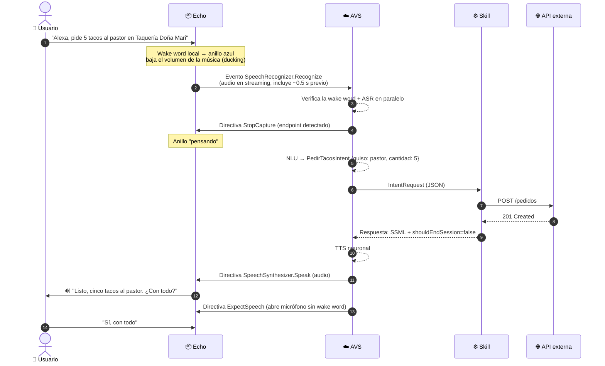

#### Focus management: ¿quién habla primero?

Si estás escuchando música y preguntas algo, la música **no se detiene**: baja de volumen (*ducking*) y se reanuda al terminar. Lo decide el **Activity Focus Manager** con canales de prioridad:

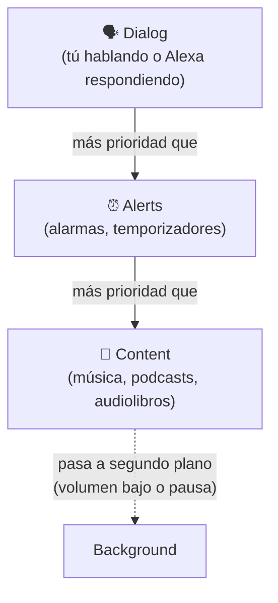

> En términos de agentes: este es el **gestor de turnos** de un sistema de voz. Voice Live de Azure resuelve lo equivalente con su **detección de interrupciones** y **fin de turno**.

---

### 5. ASR y endpointing: ¿qué dijiste y cuándo terminaste?

El audio llega por streaming y pasa por el pipeline que ya conoces (características → modelo acústico → modelo de lenguaje → decodificación). Amazon migró de componentes separados (modelo acústico + modelo de lenguaje) a modelos **end-to-end** que van directo de audio a texto, entrenados con un modelo "maestro" sobre millones de horas y afinados por región, acento y condiciones acústicas.

El ASR no entrega solo "la" transcripción, sino:
- La mejor hipótesis + **confianza**.
- Las **N mejores hipótesis** (*N-best*), porque el NLU puede escoger otra si tiene más sentido: "pon música de **café tacvba**" vs "pon música de **café ta' bueno**".

#### Endpointing: el problema de saber cuándo callarse

Si Alexa cierra el micrófono muy pronto, te corta ("pon música de…"). Si lo cierra muy tarde, se siente lenta. El enfoque básico es un **VAD** (*Voice Activity Detection*) + un **tiempo de espera de silencio** (*hangover*):

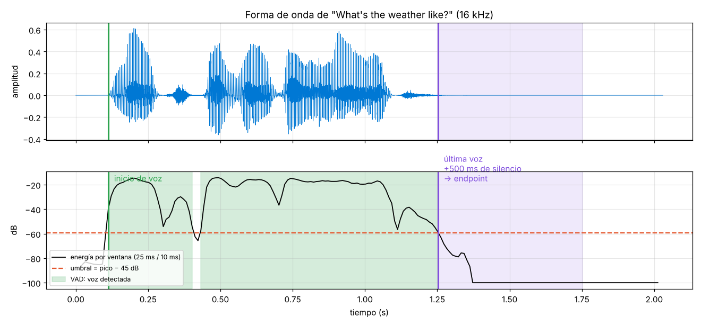

*Energía por ventana del audio "What's the weather like?". El VAD marca voz cuando la energía supera el umbral, pero fíjate en el **hueco cerca de 0.42 s** (una pausa entre palabras): si el sistema cerrara el micrófono ahí, te cortaría. Por eso se espera un tiempo de silencio (aquí 500 ms) antes de declarar el **endpoint**. Esos 500 ms son latencia pura que el usuario percibe.*

| Tipo de endpointing | Cómo decide | Ventaja | Desventaja |
|---|---|---|---|
| Por silencio (VAD + tiempo fijo) | X ms sin voz | Simple, barato | Corta a quien hace pausas; lento con quien habla rápido |
| **Semántico / acústico** | Un modelo evalúa si la frase "suena terminada" (entonación, gramática) | Más rápido y natural | Más cómputo |

> "Pon una alarma a las…" (pausa) → un endpointing semántico sabe que la frase está **incompleta** y espera; uno por silencio la corta. Voice Live de Azure ofrece **detección avanzada de fin de turno** justo para esto.

---

### 6. NLU: de texto a una estructura que un programa entiende

Convierte el texto en una estructura:
- **Intención (intent):** qué quiere hacer → `PedirTacosIntent`
- **Ranuras / entidades (slots):** con qué datos → `guiso = pastor`, `cantidad = 5`, `restaurante = Taquería Doña Mari`

Este es el mismo concepto que el **Conversational Language Understanding (CLU)** de Azure Language: *utterances* de ejemplo, *intents* y *entities*.

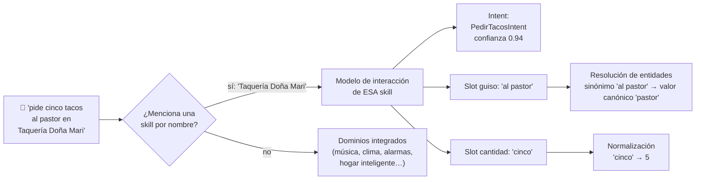

#### El modelo de interacción de una skill (Alexa Skills Kit)

Quien crea una skill define:

| Concepto ASK | Qué es | Ejemplo |
|---|---|---|
| **Invocation name** | Cómo se llama la skill para abrirla | "Taquería Doña Mari" |
| **Intents** | Acciones que soporta | `PedirTacosIntent`, `EstadoPedidoIntent` |
| **Sample utterances** | Frases de ejemplo por intent | "pide {cantidad} tacos de {guiso}", "quiero {cantidad} de {guiso}" |
| **Slots y slot types** | Variables dentro de las frases y su tipo | `{guiso}` de tipo `TipoGuiso`; `{cantidad}` de tipo `AMAZON.NUMBER` |
| **Sinónimos** | Variantes que se resuelven a un valor canónico | "al pastor", "pastorcito" → `pastor` |
| **Built-in intents** | Intents que Amazon ya trae | `AMAZON.StopIntent`, `AMAZON.HelpIntent`, `AMAZON.CancelIntent` |
| **Dialog management** | Pedir datos que faltan, confirmar | "¿De qué guiso los quieres?" |

> Con las frases de ejemplo, Amazon **entrena un modelo** que generaliza: no necesitas escribir todas las formas posibles de pedir tacos, pero sí suficientes variantes. Igual que en CLU.

#### Diálogo multi-turno: cuando falta un slot

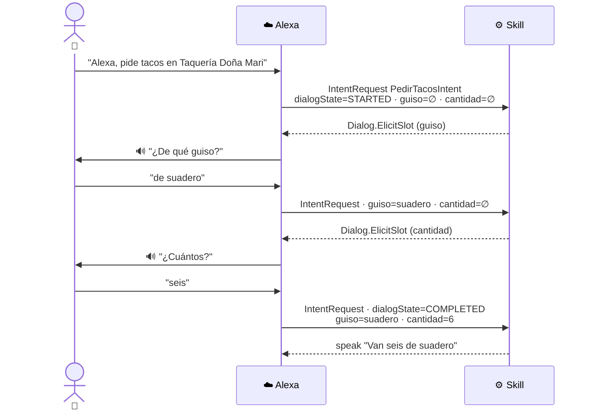

Esto es exactamente lo que en agentes llamamos **slot filling** y lo que un LLM hace "gratis" cuando le das una herramienta con parámetros obligatorios: si falta un dato, pregunta.

---

### 7. Enrutamiento y ejecución: skills = herramientas

El intent se envía a la **skill** correspondiente (música, clima, domótica o una skill de un tercero). La skill corre en **AWS Lambda** o en tu propio servidor HTTPS, llama APIs externas y arma una respuesta.


*Flujo de una custom skill según la documentación de Amazon: (1) el usuario habla, (2) Alexa identifica la skill y manda una representación estructurada de la petición, (3) tu servicio la procesa y responde texto (y opcionalmente una tarjeta visual), (4) Alexa convierte el texto en voz. Fuente: [Alexa Skills Kit](https://developer.amazon.com/en-US/docs/alexa/custom-skills/understanding-custom-skills.html).*

#### Lo que recibe tu skill (request JSON, simplificado)

```json
{
  "version": "1.0",
  "session": {
    "new": true,
    "sessionId": "amzn1.echo-api.session.abc123",
    "application": { "applicationId": "amzn1.ask.skill.xyz" },
    "user": { "userId": "amzn1.ask.account.def456" }
  },
  "context": {
    "System": { "device": { "deviceId": "amzn1.ask.device.ghi789" } }
  },
  "request": {
    "type": "IntentRequest",
    "locale": "es-MX",
    "timestamp": "2026-10-12T22:10:00Z",
    "dialogState": "COMPLETED",
    "intent": {
      "name": "PedirTacosIntent",
      "slots": {
        "guiso":    { "name": "guiso",    "value": "al pastor" },
        "cantidad": { "name": "cantidad", "value": "5" }
      }
    }
  }
}
```

| Tipo de request | Cuándo llega |
|---|---|
| `LaunchRequest` | "Alexa, abre Taquería Doña Mari" (sin pedir nada concreto) |
| `IntentRequest` | Cuando el NLU reconoce un intent de tu skill |
| `SessionEndedRequest` | La sesión terminó (el usuario se fue, error, silencio) |
| `CanFulfillIntentRequest` | Alexa pregunta "¿podrías atender esto?" para enrutar peticiones que no mencionan tu skill por nombre |

#### Lo que responde tu skill (response JSON)

```json
{
  "version": "1.0",
  "response": {
    "outputSpeech": {
      "type": "SSML",
      "ssml": "<speak>Listo, <say-as interpret-as=\"cardinal\">5</say-as> tacos al pastor. <break time=\"300ms\"/> ¿Con todo?</speak>"
    },
    "reprompt": {
      "outputSpeech": { "type": "PlainText", "text": "¿Los quieres con cebolla y cilantro?" }
    },
    "shouldEndSession": false
  }
}
```

- `outputSpeech` puede ser `PlainText` o **SSML** (máx. 8,000 caracteres). La respuesta completa no puede pasar de 120 KB.
- `reprompt` se usa si el usuario no contesta.
- `shouldEndSession: false` → Alexa manda la directiva `ExpectSpeech` y abre el micrófono **sin** que digas "Alexa" otra vez.
- `directives` (opcional): acciones en el dispositivo, como reproducir audio.

> En términos de agentes: **las skills son herramientas**, el JSON del request es la **llamada a la herramienta con sus argumentos**, y el enrutador es el **orquestador**. Cuando ves `tool_call(name="pedir_tacos", args={"guiso":"pastor","cantidad":5})` en un agente de Foundry, es la misma idea.

---

### 8. Respuesta y síntesis de voz (TTS)

1. **Generación del texto (NLG):** la skill (o el LLM) produce el texto, a menudo en **SSML** para controlar pausas, énfasis, cómo leer números o fechas, y hasta cambiar de voz.
2. **TTS neuronal:** el pipeline que viste en el Tema 2: normalización de texto → fonemas → prosodia → espectrograma Mel → **vocoder neuronal** → audio.
3. **Streaming:** el audio empieza a mandarse a la bocina **antes** de que esté completo, para reducir la latencia percibida.

| Etiqueta SSML | Para qué | Ejemplo |
|---|---|---|
| `<break>` | Pausa | `<break time="300ms"/>` |
| `<say-as>` | Cómo leer un dato | `<say-as interpret-as="date">2026-10-12</say-as>` |
| `<emphasis>` | Énfasis | `<emphasis level="strong">ya</emphasis>` |
| `<prosody>` | Velocidad, tono, volumen | `<prosody rate="slow">despacito</prosody>` |
| `<audio>` | Insertar un clip | Un sonido de "ding" |

> El SSML es un **estándar del W3C**, así que lo que aprendas aquí aplica casi igual en Azure Speech (que además agrega etiquetas propias como estilos emocionales de voz).

---

### 9. Latencia: el enemigo número uno de la voz

En un chat esperas 5 segundos sin problema; en una conversación de voz, **un silencio de 2 segundos se siente eterno**. Cada etapa suma:

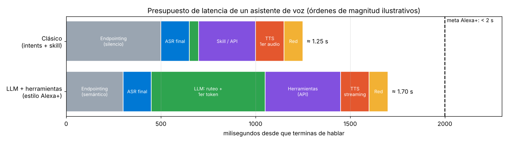

*Órdenes de magnitud ilustrativos (no son mediciones de Amazon). Lo importante es la forma: el **endpointing** y, en la versión con LLM, la **inferencia del modelo** son los bloques más grandes. El equipo de Alexa+ ha dicho públicamente que su meta es responder en menos de 2 segundos.*

Trucos que se usan para recortar latencia:
- **Streaming en todo:** el ASR transcribe mientras hablas; el TTS empieza a sonar con la primera frase.
- **Prefetch:** desde que se detecta la wake word se empieza a cargar el contexto del usuario (dispositivos, preferencias).
- **Llamadas a APIs en paralelo** cuando no dependen una de otra.
- **Menos rondas de inferencia del LLM** (la ganancia más grande según Amazon): APIs más "gruesas" para que una sola llamada resuelva lo que antes eran varias.
- **Salida corta:** generar tokens es mucho más lento que leerlos; las respuestas habladas deben ser breves.

---

### 10. La evolución: de intents a LLMs (Alexa+)

El modelo clásico (intents + slots) es **preciso pero rígido**: si dices algo fuera de lo previsto, falla ("Lo siento, no sé eso"). Además, cada skill es una isla: no puedes pedir "busca un restaurante italiano para el sábado, reserva para cuatro y avísale a mi hermana" porque son tres skills distintas.

En **febrero de 2025** Amazon presentó **Alexa+**, reconstruida "desde cero" sobre **modelos de lenguaje grandes** disponibles en **Amazon Bedrock**. Se volvió un **agente**:

| | Alexa clásica | Alexa+ |
|---|---|---|
| Comprensión | Intents + slots predefinidos | LLM: entiende lenguaje libre y contexto |
| Contexto | Casi nulo entre peticiones | Recuerda la conversación y preferencias ("soy vegetariano") |
| Acciones | Una skill por petición | Encadena varias APIs en una sola petición |
| Sin API disponible | No puede | **Navega sitios web** por su cuenta para completar la tarea |
| Modelos | Modelos propios especializados | Varios LLMs (Amazon **Nova** y Anthropic **Claude**, vía Bedrock) + modelos no-LLM, elegidos por un **enrutador** |
| Precio | Incluida | US$19.99/mes o incluida con Prime |

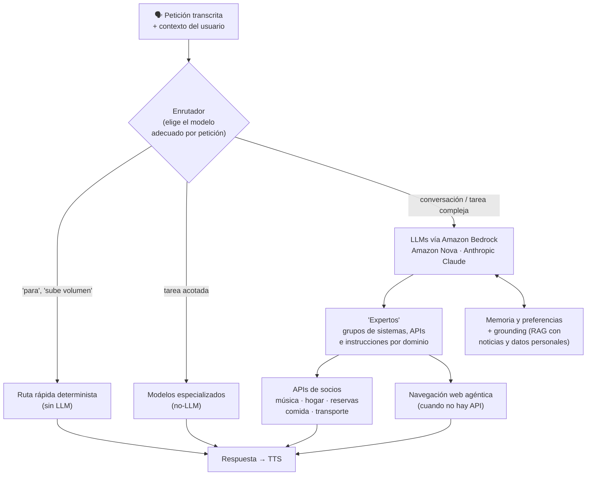

Lo que Amazon ha compartido de cómo lo hicieron (lecciones útiles para **cualquier** agente de voz):

1. **No todo necesita un LLM.** "Para" o "apaga la luz" deben funcionar el 100% de las veces y al instante: van por una ruta determinista. Las respuestas conversacionales sí pueden variar.
2. **El enrutamiento es lo más difícil.** Si mandas la petición al experto equivocado, es muy difícil recuperarse.
3. **Ejecución especulativa:** corren en paralelo un modelo rápido y uno preciso; si coinciden, ganas tiempo; si no, se usa el preciso. Las acciones especulativas deben ser **idempotentes** o reversibles.
4. **Prompt caching:** lo estable (identidad, capacidades, herramientas) va al inicio del prompt y lo variable al final, para aprovechar la caché.
5. **Menos es más en el prompt:** demasiados ejemplos y contexto irrelevante **bajaban** la precisión.
6. **Sin chain-of-thought en producción:** útil en desarrollo, demasiado lento para voz.

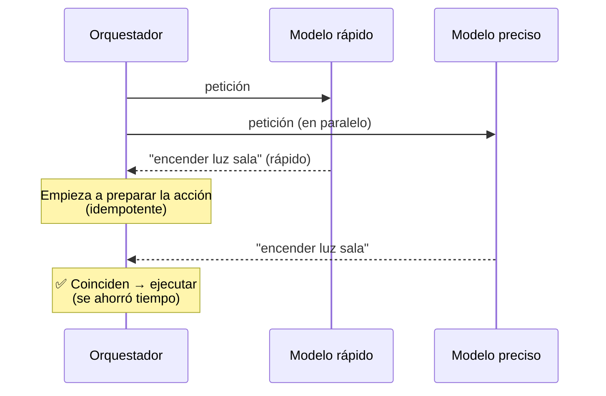

#### Cronología

| Fecha | Hito |
|---|---|
| Nov 2014 | Amazon presenta el Echo y Alexa |
| Nov 2018 | Alexa llega a México en español |
| Sep 2020 | Procesador **AZ1 Neural Edge**: ASR en el dispositivo para algunos modelos (inglés EE. UU.) |
| 26 feb 2025 | Se anuncia **Alexa+** (LLMs, agentes, Nova + Claude vía Bedrock) |
| 28 mar 2025 | Amazon elimina la opción "No enviar grabaciones de voz": **todas** las peticiones se procesan en la nube |
| Ene 2026 | Alexa+ disponible desde el navegador en Alexa.com |
| Feb 2026 | Alexa+ disponible para todos en EE. UU. Hoy también en Canadá, y en acceso anticipado en otros países (incluido México) |

---

### 11. Privacidad: ¿me está escuchando todo el tiempo?

Técnicamente **sí escucha** todo el tiempo, pero **solo localmente** y solo para buscar la wake word. Lo que se manda a la nube empieza en la activación (más el fragmento previo de ~0.5 s para verificarla).

<p align="center">
  
</p>

*Anillo rojo: los micrófonos están desconectados por hardware y Alexa no puede escuchar. Foto: [Tony Webster](https://commons.wikimedia.org/wiki/File:Amazon_Echo_Dot_Not_Listening_Mode_(Microphone_Disabled)_(45718825084).jpg), CC BY 2.0.*

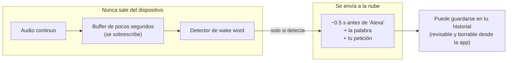

> [!WARNING]
> Las **falsas activaciones** son el principal riesgo de privacidad: si la tele dice algo parecido a "Alexa", un fragmento de tu conversación puede llegar a la nube. Por eso existe la verificación en la nube y por eso el anillo de luz siempre indica cuándo transmite.

El caso de 2025 es un buen ejemplo del **trade-off** entre capacidad y privacidad: para habilitar las funciones de IA generativa de Alexa+, Amazon quitó la opción de procesar las peticiones en el dispositivo (que solo existía en tres modelos de Echo y en inglés).

---

### El mismo flujo con Microsoft Foundry

| Etapa de Alexa | Equivalente en Azure / Foundry |
|---|---|
| Front-end (AEC, beamforming, ruido) | **Microsoft Audio Stack** del Speech SDK (local) · supresión de ruido y cancelación de eco de **Voice Live** |
| Wake word en dispositivo | **Keyword recognition** del Speech SDK (*custom keyword* Basic/Advanced) |
| Verificación de wake word en la nube | **Keyword verification** (en paralelo con STT) |
| ASR | **Azure Speech – Speech to text** (en tiempo real o por lotes; *custom speech* y *phrase lists* para vocabulario propio) |
| Endpointing | Segmentación por silencio del Speech SDK · **detección de fin de turno** de Voice Live |
| NLU (intents y slots) | **LLM del agente** con herramientas (o **Azure Language CLU** si quieres intents explícitos) |
| Skills | **Tools** del agente (funciones, OpenAPI, MCP) en **Foundry Agent Service** |
| Memoria y grounding | Hilos/conversaciones del agente + **RAG** (Azure AI Search) |
| TTS | **Azure Speech – Text to speech** (voces neuronales, SSML, estilos) |
| Barge-in / interrupciones | **Voice Live API**: detección de interrupciones |
| Todo integrado en tiempo real | **Voice Live API** (speech-to-speech por WebSocket, con modelos como la familia gpt-realtime, avatares opcionales) |

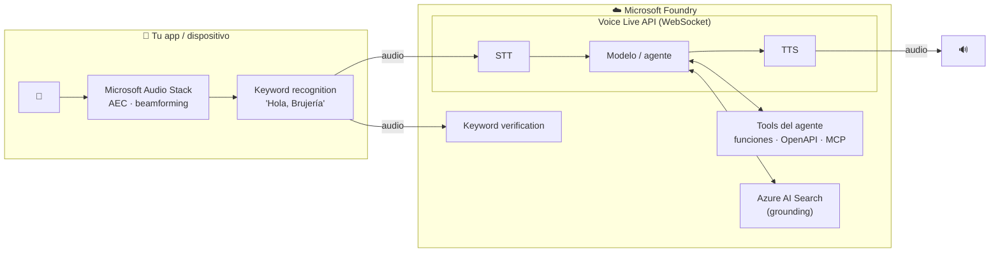

```
🎤 "Alexa..." → [Front-end + wake word local] → ☁️ [Verificación] → [STT] → [NLU / LLM] → [Skill / Tool] → [TTS] → 🔊
                                                                     ↑__________ Voice Live integra este tramo __________↑
```

---

### Práctica en Python

Todo funciona **sin cuenta de Azure** salvo el último bloque. Usa el mismo audio oficial del Tema 1.

```bash
pip install numpy scipy matplotlib
```

#### 1) Patrón de un beamformer delay-and-sum

```python
import numpy as np

c, r = 343.0, 0.035                                   # velocidad del sonido, radio del arreglo
ang = np.deg2rad(np.arange(6) * 60)
mics = np.vstack([np.c_[r*np.cos(ang), r*np.sin(ang)], [0, 0]])   # 6 en anillo + 1 centro

def ganancia_db(f, apunta_a, viene_de):
    k = 2*np.pi*f/c
    u = lambda g: np.array([np.cos(np.deg2rad(g)), np.sin(np.deg2rad(g))])
    w = np.exp(-1j*k*mics @ u(apunta_a))              # pesos: compensan los retrasos
    a = np.exp(-1j*k*mics @ u(viene_de))              # cómo llega una onda desde esa dirección
    return 20*np.log10(abs(np.vdot(w, a))/len(mics))

for f in (1000, 4000, 7000):
    print(f"{f:>5} Hz | voz a 60°: {ganancia_db(f, 60, 60):5.1f} dB | TV a 200°: {ganancia_db(f, 60, 200):6.1f} dB")
```

Salida:
```
 1000 Hz | voz a 60°:   0.0 dB | TV a 200°:   -2.9 dB
 4000 Hz | voz a 60°:   0.0 dB | TV a 200°:  -28.3 dB
 7000 Hz | voz a 60°:   0.0 dB | TV a 200°:   -7.3 dB
```
- **Explicación:** la voz en la dirección apuntada siempre queda en 0 dB. La TV a 200° casi no se atenúa a 1 kHz (el arreglo es demasiado pequeño para esa longitud de onda), se atenúa mucho a 4 kHz y menos a 7 kHz porque ahí cae en un **lóbulo lateral**. Prueba con `r = 0.10` (un arreglo más grande) y verás que mejora la atenuación en graves.

#### 2) Cancelación de eco con NLMS

```python
import numpy as np
from scipy import signal

fs = 16000
rng = np.random.default_rng(0)
musica = rng.standard_normal(fs*3) * 0.5              # "música" que sale de la bocina (3 s)
h = rng.standard_normal(400) * np.exp(-np.arange(400)/60)   # respuesta del cuarto (25 ms)
eco = signal.lfilter(h/np.linalg.norm(h), 1, musica)
voz = np.zeros_like(musica)
voz[fs*2:] = np.sin(2*np.pi*200*np.arange(fs)/fs) * 0.3     # "voz" en el último segundo
mic = voz + eco + rng.standard_normal(len(eco)) * 0.003   # + ruido del micrófono

N, mu = 512, 0.4
w, buf, e = np.zeros(N), np.zeros(N), np.zeros_like(mic)
for n in range(len(mic)):
    buf = np.roll(buf, 1); buf[0] = musica[n]
    e[n] = mic[n] - w @ buf                           # micrófono − eco estimado
    if n < fs*2:                                      # solo adapta mientras no hablas
        w += mu * e[n] * buf / (buf @ buf + 1e-6)

zona = slice(fs, fs*2)
print(f"Reducción de eco (ERLE): {10*np.log10(np.mean(mic[zona]**2)/np.mean(e[zona]**2)):.1f} dB")
```

Salida:
```
Reducción de eco (ERLE): 43.4 dB
```
- **Explicación:** el filtro aprende la respuesta del cuarto a partir de la música (que el dispositivo conoce) y la resta. Cada 10 dB de ERLE equivalen a 10 veces menos potencia de eco: 40 dB = 10,000 veces menos. En cuartos reales (eco más largo, ruido, doble habla) se obtienen valores bastante menores.

#### 3) VAD + endpointing sobre el audio de ejemplo

```python
import numpy as np, urllib.request, os
from scipy.io import wavfile

URL = ("https://raw.githubusercontent.com/Azure-Samples/cognitive-services-speech-sdk/"
       "master/samples/csharp/sharedcontent/console/whatstheweatherlike.wav")
if not os.path.exists("whatstheweatherlike.wav"):
    urllib.request.urlretrieve(URL, "whatstheweatherlike.wav")

sr, x = wavfile.read("whatstheweatherlike.wav")
x = x.astype(np.float32) / 32768
win, hop = int(.025*sr), int(.010*sr)
e = np.array([10*np.log10(np.mean(x[i:i+win]**2) + 1e-10) for i in range(0, len(x)-win, hop)])
voz = e > e.max() - 45

HANGOVER = 50                                          # 50 ventanas × 10 ms = 500 ms
silencio = 0
for i, v in enumerate(voz):
    silencio = 0 if v else silencio + 1
    if i > 0 and voz[:i].any() and silencio == HANGOVER:
        print(f"Endpoint a {i*hop/sr:.2f} s (última voz a {(i-HANGOVER)*hop/sr:.2f} s)")
        break
```

Salida:
```
Endpoint a 1.74 s (última voz a 1.24 s)
```
- **Explicación:** el endpoint llega 500 ms después de la última ventana con voz. Cambia `HANGOVER` a 10 (100 ms) y verás que el endpoint se dispara en la pausa entre palabras: Alexa te habría cortado.

#### 4) Una skill mínima con el SDK de Alexa (ASK SDK para Python)

```python
# pip install ask-sdk-core
from ask_sdk_core.skill_builder import SkillBuilder
from ask_sdk_core.utils import is_intent_name, get_slot_value

sb = SkillBuilder()

@sb.request_handler(can_handle_func=is_intent_name("PedirTacosIntent"))
def pedir_tacos(handler_input):
    guiso = get_slot_value(handler_input, "guiso")
    cantidad = get_slot_value(handler_input, "cantidad")
    texto = f"<speak>Listo, {cantidad} tacos de {guiso}. <break time='300ms'/> ¿Con todo?</speak>"
    return (handler_input.response_builder
            .speak(texto)
            .ask("¿Los quieres con cebolla y cilantro?")   # reprompt → shouldEndSession=false
            .response)

lambda_handler = sb.lambda_handler()                    # punto de entrada en AWS Lambda
```

- **Explicación:** compara con una herramienta de un agente de Foundry: el decorador dice **qué intent atiende** (como el nombre de la función-herramienta) y los slots son **sus parámetros**.

#### 5) Palabra de activación con Azure Speech (requiere un modelo `.table`)

```python
# pip install azure-cognitiveservices-speech
import azure.cognitiveservices.speech as speechsdk

# Modelo creado en Speech Studio → Custom Keyword (descargas un archivo .table)
modelo = speechsdk.KeywordRecognitionModel("hola_brujeria.table")
reconocedor = speechsdk.KeywordRecognizer()            # usa el micrófono por defecto

print("Di la palabra de activación...")
resultado = reconocedor.recognize_once_async(modelo).get()
if resultado.reason == speechsdk.ResultReason.RecognizedKeyword:
    print(f"¡Detectada! → {resultado.text}")
```

- **Explicación:** este reconocimiento corre **en tu equipo**, sin enviar audio. Para la verificación en la nube se usa la palabra clave junto con un `SpeechRecognizer` (`start_keyword_recognition_async`), y a partir de ahí el audio sí va a Azure.

---

### Para reflexionar (IA responsable)
- **Privacidad:** el dispositivo escucha siempre; por eso la detección es local, el envío empieza con la wake word y hay botón físico para silenciar micrófonos. Pregunta clave para tu diseño: ¿qué se procesa en el borde y qué en la nube?
- **Transparencia:** el usuario debe saber cuándo está grabando (luz), qué se guarda y poder borrar sus grabaciones. En voz sintética, también debe saber que habla con una IA.
- **Inclusión:** acentos, dialectos, niños, adultos mayores y personas con dificultades del habla deben poder usarlo. Un umbral de wake word calibrado solo con un tipo de voz genera **más falsos rechazos** para los demás.
- **Confiabilidad y seguridad:** con un agente que **ejecuta acciones** (comprar, abrir la puerta, reservar), un error de reconocimiento ya no es solo una respuesta equivocada. Confirmaciones explícitas para acciones sensibles y PIN de voz para compras.
- **Responsabilidad:** con navegación web agéntica, ¿quién responde si el agente reservó mal? Registro de acciones y posibilidad de deshacer.

---

### Recursos
- [Alexa Skills Kit: qué es y conceptos del interaction model (intents, slots)](https://developer.amazon.com/en-US/docs/alexa/ask-overviews/what-is-the-alexa-skills-kit.html)
- [Understand Custom Skills (flujo de una skill)](https://developer.amazon.com/en-US/docs/alexa/custom-skills/understanding-custom-skills.html)
- [Referencia JSON de request y response de ASK](https://developer.amazon.com/en-US/docs/alexa/custom-skills/request-and-response-json-reference.html)
- [AVS Device SDK (arquitectura del lado del dispositivo)](https://github.com/alexa/avs-device-sdk)
- [Amazon Science: investigación de Alexa sobre wake word (Interspeech)](https://www.amazon.science/blog/amazon-alexas-new-wake-word-research-at-interspeech)
- [Verificación de wake word en la nube para productos AVS](https://developer.amazon.com/blogs/alexa/post/b136b3e7-0ba8-4589-aaf9-2a037fc4e9c9/cloud-based-wake-word-verification-improves-alexa-wake-word-accuracy-on-your-avs-products)
- [Presentación de Alexa+ (Amazon)](https://www.aboutamazon.com/news/devices/new-alexa-generative-artificial-intelligence)
- [Cómo funciona la tecnología de Alexa+ (Amazon)](https://www.aboutamazon.com/news/devices/new-alexa-tech-generative-artificial-intelligence)
- [Claude y Alexa+ (Anthropic)](https://www.anthropic.com/news/claude-and-alexa-plus)
- [Lecciones de ingeniería de Alexa+ (resumen de la charla de AWS re:Invent 2025)](https://www.zenml.io/llmops-database/transforming-a-voice-assistant-from-scripted-commands-to-generative-ai-conversation-at-scale)
- [Amazon elimina el procesamiento local de Alexa (The Register, 2025)](https://www.theregister.com/2025/03/17/amazon_kills_on_device_alexa/)
- [Keyword recognition en Azure Speech](https://learn.microsoft.com/es-es/azure/ai-services/speech-service/keyword-recognition-overview)
- [Microsoft Audio Stack (procesamiento de audio)](https://learn.microsoft.com/es-es/azure/ai-services/speech-service/audio-processing-overview)
- [Voice Live API en Microsoft Foundry](https://learn.microsoft.com/es-es/azure/ai-services/speech-service/voice-live)
