# Tema 2: Imágenes y procesamiento de imágenes

### Descripción
Antes de hablar de redes neuronales, hay que entender cómo "ve" la computadora. Una imagen es una **matriz de números** y "procesarla" significa hacer operaciones matemáticas sobre esa matriz. La operación estrella es la **convolución con filtros**, que es exactamente lo que después aprenden a hacer las CNN.

Lectura oficial: [Imágenes y procesamiento de imágenes – Microsoft Learn](https://learn.microsoft.com/es-es/training/modules/introduction-computer-vision/3-understand-image-processing?pivots=text)

Analogía: un filtro es como una **lupa con una regla especial** que pasas por toda la foto, cuadrito por cuadrito. En cada posición hace una cuenta con los píxeles que ve y anota el resultado en una hoja nueva.

> 📷 **Foto de ejemplo de todo el tema:** las imágenes y el código usan [`dog.jpg`](https://github.com/Azure-Samples/cognitive-services-sample-data-files/blob/master/ComputerVision/Images/dog.jpg), una foto de los **samples oficiales de Azure AI Vision** (repositorio Azure-Samples, licencia MIT): 600 × 450 píxeles, a color. Todas las figuras se generaron con Python a partir de ella (el código está en el documento), así que puedes reproducirlas.

---

### 1. De la escena a la matriz: cómo se forma una imagen digital

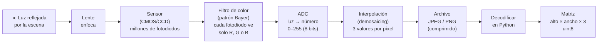

- Es el mismo principio que la **digitalización de audio** (Módulo 4): una señal continua (luz) se **muestrea** en una cuadrícula (píxeles) y se **cuantiza** en niveles (0–255 con 8 bits).
- La **resolución** es la frecuencia de muestreo espacial: más píxeles = más detalle.
- Un archivo JPEG **no** es la matriz: está comprimido. Al abrirlo con Pillow u OpenCV se **decodifica** y entonces sí obtienes los números (la foto de ejemplo pesa 49 KB en JPEG pero ocupa 791 KB como matriz).

---

### 2. Píxeles y resolución

- Cada píxel vale de **0 (negro) a 255 (blanco)**; los valores intermedios son tonos de gris.
- El número de filas y columnas es la **resolución**. Ejemplo de Microsoft Learn: imagen de 7×7 con un cuadro blanco al centro:
  ```
  0   0   0   0   0   0   0
  0   0   0   0   0   0   0
  0   0  255 255 255  0   0
  0   0  255 255 255  0   0
  0   0  255 255 255  0   0
  0   0   0   0   0   0   0
  0   0   0   0   0   0   0
  ```

Con una foto real pasa exactamente lo mismo, solo que con muchos más números:

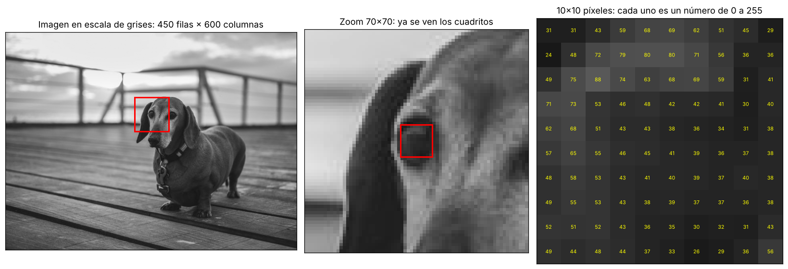

*Izquierda: la foto en escala de grises (450 filas × 600 columnas = 270,000 números). Centro: zoom de 70×70 alrededor del ojo, donde ya se ven los "cuadritos". Derecha: 10×10 píxeles con su valor real. El ojo es oscuro (valores de 30–50) y el pelaje alrededor un poco más claro (60–90).*

| Concepto | Qué es | Ejemplo |
|---|---|---|
| **Píxel** | La unidad mínima de la imagen; un número (gris) o tres (color) | `135` o `(107, 82, 75)` |
| **Resolución** | Filas × columnas | 1920 × 1080 (Full HD) |
| **Profundidad de bits** | Cuántos niveles por canal | 8 bits = 256 niveles (lo normal); 16 bits en imágenes médicas o RAW |
| **Rango dinámico** | Diferencia entre lo más oscuro y lo más claro que se puede representar | Las fotos HDR combinan varias exposiciones |
| **Megapíxeles** | Millones de píxeles | 12 MP ≈ 4000 × 3000 |

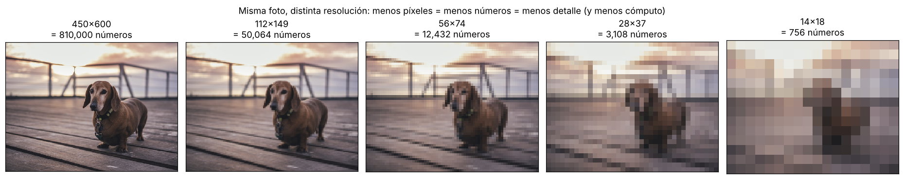

*De 810,000 números (450×600×3) a solo 1,056 (14×25×3). Con 56×75 todavía reconoces un perro; con 14×18 ya no. Los modelos de visión trabajan normalmente a 224×224 o 384×384: suficiente detalle con un costo razonable.*

> 💡 **Compromiso clave:** más resolución = más detalle, pero también más memoria y más cómputo (que crecen con el **cuadrado** del lado: duplicar el ancho y el alto cuadruplica los píxeles). Por eso casi todos los modelos **reducen** las imágenes antes de procesarlas.

---

### 3. Canales de color (RGB)

- Una imagen a color tiene **3 capas** (canales): Rojo, Verde y Azul. Cada píxel es una tripleta `(R, G, B)`.
- Ejemplo de Microsoft Learn: fondo morado = (R 150, G 0, B 255); cuadro amarillo = (R 255, G 255, B 0).
- Una foto de 1920×1080 a color tiene 1920 × 1080 × 3 = **6,220,800 números**.

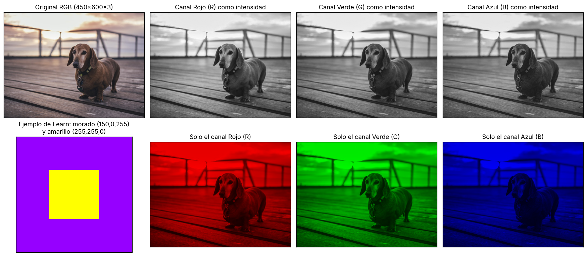

*Arriba: cada canal visto como intensidad. El cielo del atardecer es muy brillante en el canal rojo; el perro café tiene más rojo que azul, por eso se ve más claro en R que en B. Abajo: el ejemplo de Learn y cada canal "pintado" de su color.*

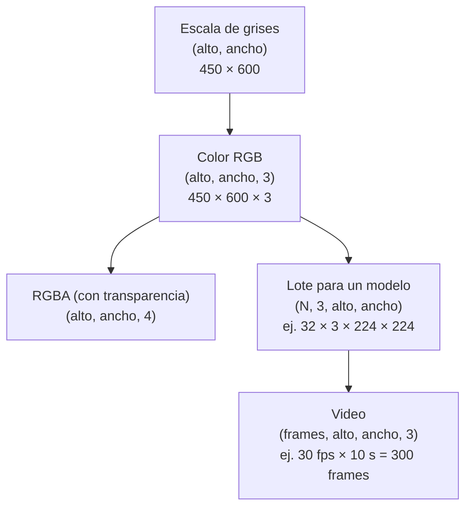

| Espacio de color | Canales | Para qué se usa |
|---|---|---|
| **RGB** | Rojo, Verde, Azul | Pantallas, la mayoría de los modelos de IA |
| **BGR** | Azul, Verde, Rojo (mismo contenido, otro orden) | Formato por defecto de **OpenCV**: causa clásica de "colores raros" |
| **Escala de grises** | 1 canal: `0.299·R + 0.587·G + 0.114·B` | Detección de bordes, OCR, reducir cómputo |
| **HSV** | Tono (H), Saturación (S), Valor (V) | Segmentar por color ("todo lo que sea verde") sin importar la iluminación |
| **CMYK** | Cian, Magenta, Amarillo, Negro | Impresión (no se usa en IA) |

> ⚠️ ¿Por qué la conversión a gris no es el promedio simple `(R+G+B)/3`? Porque el ojo humano es mucho más sensible al **verde** que al azul. La fórmula ponderada (estándar ITU-R BT.601) produce un gris que "se siente" con el mismo brillo que el color original.

---

### 4. Filtros, kernels y convolución

Un **kernel** es una matriz pequeña de pesos. El de Microsoft Learn (filtro **Laplace**) es:
```
-1 -1 -1
-1  8 -1
-1 -1 -1
```

**Convolución:** el kernel se coloca sobre un parche de 3×3, se multiplica cada píxel por su peso, se suman los resultados y el valor se guarda en una imagen nueva. Luego se desplaza un píxel y se repite.

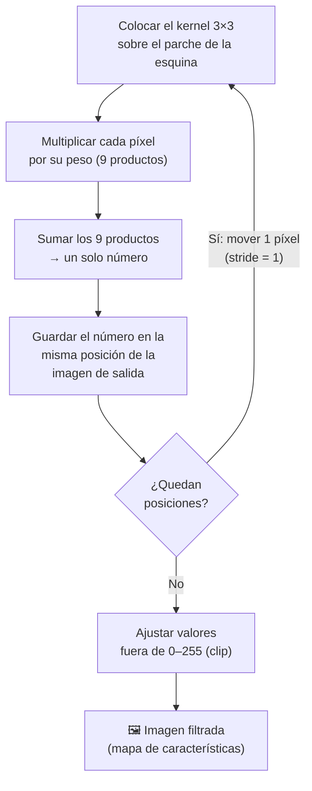

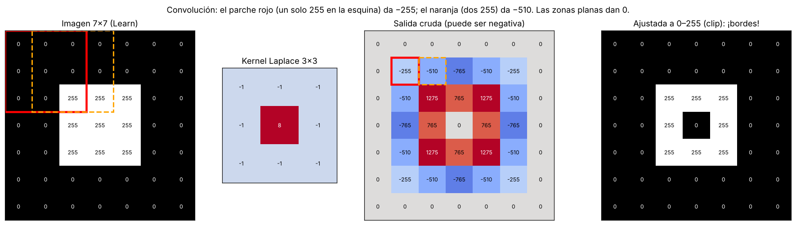

- **Ejemplo paso 1** (parche rojo): la esquina superior izquierda solo tiene un 255 en la posición inferior derecha → `255 × -1 = -255`.
- **Ejemplo paso 2** (parche naranja): al moverse a la derecha hay dos 255 en la fila inferior → `-510`.
- **Zonas planas** (todo 0 o todo 255, como el centro del cuadro): `8·255 − 8·255 = 0`. **Si no hay cambio, no hay borde.**
- Los valores fuera de 0–255 se **ajustan (clip)**: los negativos se vuelven 0 y los mayores a 255 se vuelven 255. El resultado final es un **anillo blanco**: el contorno del cuadro.

> 🧠 **Intuición del Laplace:** compara cada píxel con el promedio de sus 8 vecinos (`8 × centro − suma de vecinos`). Si el píxel es igual a sus vecinos, da 0; si es muy distinto, da un número grande. Es un **detector de "sorpresas"** en la imagen.

#### Padding y stride

- **Padding:** agregar un borde (normalmente de ceros) para que el kernel pueda centrarse también en los píxeles de la orilla. Sin padding, la imagen se encoge en cada filtrado.
- **Stride:** cuántos píxeles avanza el kernel en cada paso. Stride 2 reduce la salida a la mitad (una forma de **reducir resolución**, como el pooling).

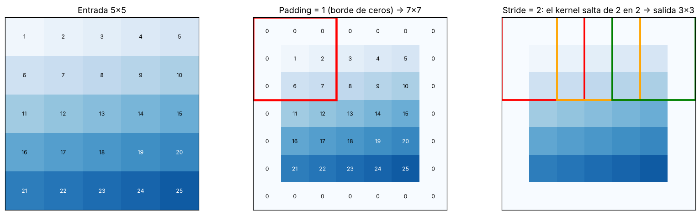

Fórmula del tamaño de salida (pregunta clásica):
```
salida = (entrada − kernel + 2·padding) / stride + 1

7×7, kernel 3, padding 0, stride 1 → (7 − 3 + 0)/1 + 1 = 5×5
7×7, kernel 3, padding 1, stride 1 → (7 − 3 + 2)/1 + 1 = 7×7   ("same": conserva el tamaño)
224×224, kernel 3, padding 1, stride 2 → 112×112
```

---

### 5. Efectos de distintos kernels

| Filtro | Kernel | Suma de pesos | Efecto |
|---|---|---|---|
| Laplace | `[[-1,-1,-1],[-1,8,-1],[-1,-1,-1]]` | 0 | Resalta **bordes** en todas direcciones |
| Desenfoque (blur, caja) | Todos `1/9` | 1 | Suaviza / reduce ruido (promedio de vecinos) |
| Desenfoque gaussiano | Campana: más peso al centro | 1 | Suaviza de forma más natural |
| Enfoque (sharpen) | `[[0,-1,0],[-1,5,-1],[0,-1,0]]` | 1 | Aumenta nitidez (original + bordes) |
| Sobel horizontal (X) | `[[-1,0,1],[-2,0,2],[-1,0,1]]` | 0 | Bordes **verticales** (cambios de izquierda a derecha) |
| Sobel vertical (Y) | `[[-1,-2,-1],[0,0,0],[1,2,1]]` | 0 | Bordes **horizontales** (cambios de arriba a abajo) |
| Relieve (emboss) | `[[-2,-1,0],[-1,1,1],[0,1,2]]` | 1 | Efecto de relieve en 3D |

> 💡 **Truco para leer un kernel:** si sus pesos **suman 1**, conserva el brillo general (desenfoque, enfoque). Si **suman 0**, borra las zonas planas y deja solo los cambios: es un **detector de bordes** (Laplace, Sobel).

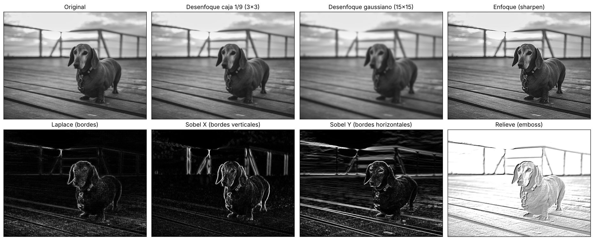

*Mismos 270,000 píxeles, distintos kernels. Observa cómo Sobel X resalta los postes verticales del barandal y Sobel Y las tablas horizontales del muelle: cada kernel es un "especialista" en un tipo de patrón.*

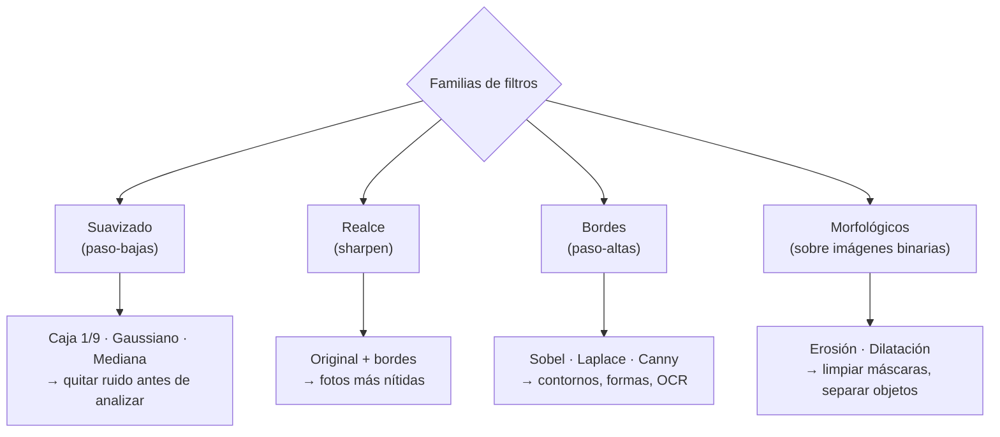

#### Magnitud y dirección del borde

Combinando Sobel X y Sobel Y obtienes, para cada píxel, **qué tan fuerte** es el borde (magnitud = √(Gx² + Gy²)) y **hacia dónde** apunta (dirección = arctan(Gy/Gx)). Así funcionaban los detectores clásicos de bordes (**Canny**) y de formas (**HOG**, usado para detectar personas antes del deep learning).

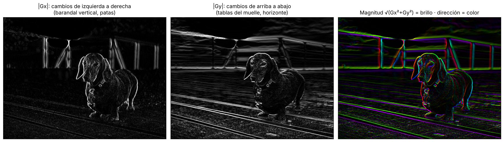

*Derecha: el brillo es la fuerza del borde y el color su orientación. Los postes del barandal (verticales) y las tablas (casi horizontales) quedan de colores distintos: el filtro "sabe" la dirección de cada línea.*

---

### 6. Otras operaciones de procesamiento de imágenes

No todo el procesamiento es convolución. Estas operaciones trabajan **píxel por píxel** (sin vecinos) o sobre la imagen completa:

| Operación | Qué hace | Para qué sirve en IA |
|---|---|---|
| **Redimensionar** (resize) | Cambia la resolución interpolando | Ajustar al tamaño de entrada del modelo (ej. 224×224) |
| **Recortar** (crop) | Se queda con una región | Enfocar el objeto; aumento de datos |
| **Rotar / voltear** | Transformaciones geométricas | Aumento de datos; corregir orientación de documentos |
| **Brillo y contraste** | `nuevo = a·píxel + b` | Normalizar fotos tomadas con distinta luz |
| **Ecualización de histograma** | Reparte los niveles de gris en todo el rango 0–255 | Mejorar fotos oscuras o con poco contraste (rayos X, cámaras de seguridad) |
| **Umbralización** (thresholding) | Píxel > umbral → blanco, si no → negro | Separar texto del fondo antes de un OCR; máscaras simples |
| **Normalización** | `(píxel/255 − media) / desviación` | Paso obligatorio antes de casi cualquier red neuronal |

#### Histograma y ecualización

El **histograma** cuenta cuántos píxeles hay de cada nivel de gris. Una foto oscura tiene el histograma "amontonado" a la izquierda.

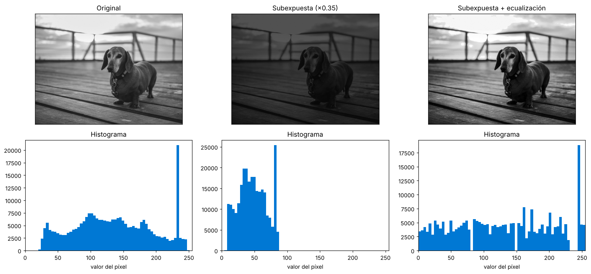

*Centro: la foto subexpuesta solo usa los valores 4–88. Derecha: la ecualización estira el histograma a todo el rango 0–255 y recupera el contraste. El pico alto a la derecha en la original es el cielo casi blanco del atardecer.*

#### Umbralización: de gris a blanco y negro

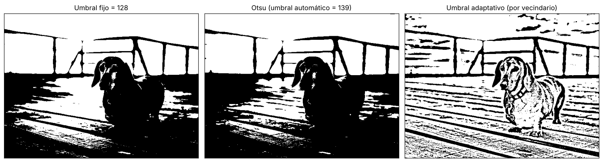

*Un umbral fijo (128) o el automático de **Otsu** (que busca el umbral que mejor separa dos grupos de píxeles; aquí eligió 139) tratan igual toda la imagen. El **adaptativo** calcula un umbral por vecindario y por eso marca texturas como las tablas del muelle. Es la técnica clásica para preparar documentos con sombras antes de un OCR.*

#### Aumento de datos (data augmentation)

Al entrenar un modelo, cada foto se transforma de forma aleatoria para que el modelo aprenda que **un perro sigue siendo un perro** aunque esté volteado, más oscuro o recortado. Así se multiplica el conjunto de entrenamiento sin tomar fotos nuevas.

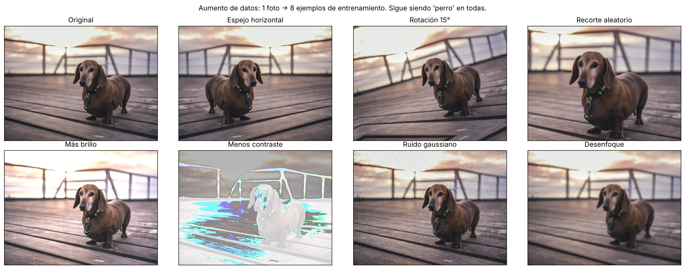

> ⚠️ El aumento debe respetar el problema: voltear horizontalmente un perro está bien, pero voltear un "6" lo convierte en un "9" invertido, y voltear una radiografía puede poner el corazón del lado equivocado.

---

### 7. Del filtro diseñado a mano al filtro aprendido (puente a las CNN)

Durante décadas, los ingenieros **diseñaban** kernels a mano (Sobel en 1968, Canny en 1986) y luego escribían reglas: "si hay muchos bordes verticales paralelos, es un barandal". Las **redes neuronales convolucionales (CNN)** hacen la misma operación de convolución, pero **aprenden** los pesos del kernel a partir de ejemplos.

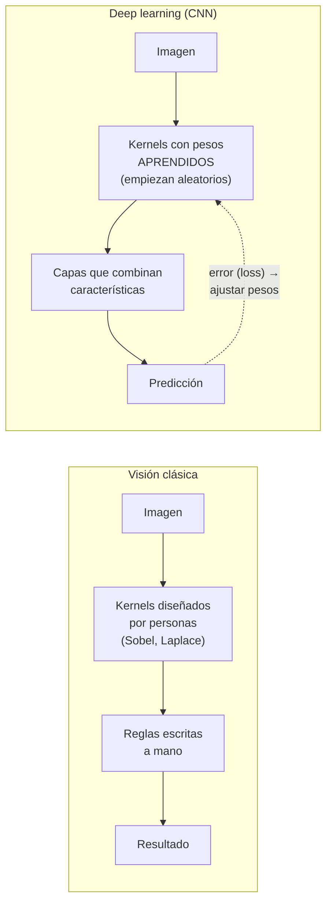

| | Visión clásica | CNN |
|---|---|---|
| Kernels | Diseñados por expertos | Aprendidos con datos |
| Cantidad | Unos cuantos | Miles (ej. 64 kernels en la primera capa, cientos en las siguientes) |
| Qué detectan | Bordes, esquinas, colores | Capa 1: bordes y colores · Capas medias: texturas y partes (ojos, ruedas) · Capas finales: objetos completos |
| Robustez | Frágil ante cambios de luz, ángulo o fondo | Mucho más robusta (si se entrena con datos variados) |

> 🔑 Lo interesante: cuando se visualizan los kernels que aprende la primera capa de una CNN entrenada con millones de fotos, **se parecen mucho a Sobel y a otros detectores de bordes**. La red redescubre por sí sola lo que los ingenieros tardaron décadas en diseñar. Esto se ve en el siguiente tema.

#### Pipeline de preprocesamiento antes de un modelo

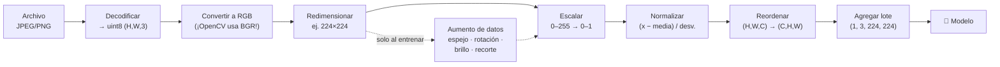

> 💡 Cuando usas un modelo multimodal en Foundry (GPT-4.1, GPT-5.x) o un servicio como Azure Vision, **este preprocesamiento lo hace el servicio**: tú solo envías la imagen. Pero entenderlo te ayuda a decidir qué resolución y formato enviar, y a explicar por qué un objeto diminuto en una foto enorme puede "desaparecer" al reducirla.

---

### 8. Formatos de archivo de imagen

| Formato | Compresión | Transparencia | Úsalo para |
|---|---|---|---|
| **JPEG** | Con pérdida (elimina detalles que el ojo casi no nota) | No | Fotos; la mayoría de los datasets |
| **PNG** | Sin pérdida | Sí | Capturas de pantalla, diagramas, **máscaras de segmentación** (un JPEG alteraría los valores de clase) |
| **WebP / AVIF** | Con o sin pérdida, más eficiente que JPEG | Sí | Web moderna |
| **TIFF** | Sin pérdida, admite 16 bits y varias páginas | Sí | Escaneos de documentos, imágenes satelitales, microscopía |
| **DICOM** | Formato médico con metadatos del paciente y del equipo | — | Radiografías, tomografías, resonancias |
| **RAW** | Datos crudos del sensor (12–14 bits) | — | Fotografía profesional |

> ⚠️ Nunca guardes máscaras de segmentación o etiquetas por píxel en JPEG: la compresión crea valores intermedios en los bordes (una clase "3" puede convertirse en "2" o "4").

---

### Práctica en Python

```bash
pip install numpy scipy pillow opencv-python matplotlib
```

#### 1) Abrir una imagen real e inspeccionar sus números

```python
import io, urllib.request
import numpy as np
from PIL import Image

URL = ("https://raw.githubusercontent.com/Azure-Samples/cognitive-services-sample-data-files/"
       "master/ComputerVision/Images/dog.jpg")
datos = urllib.request.urlopen(URL).read()
img = Image.open(io.BytesIO(datos)).convert("RGB")
arr = np.array(img)

print(f"Archivo JPEG:        {len(datos):,} bytes (comprimido)")
print(f"Forma del arreglo:   {arr.shape}  -> (alto, ancho, canales)")
print(f"Tipo de dato:        {arr.dtype}  (0 a 255)")
print(f"Números en memoria:  {arr.size:,}  = {arr.nbytes/1024:.0f} KB sin comprimir")
print(f"Píxel (fila 200, col 320) = R,G,B {tuple(int(v) for v in arr[200, 320])}")
print(f"Mín / máx / promedio: {arr.min()} / {arr.max()} / {arr.mean():.1f}")

# Escala de grises: promedio PONDERADO (el ojo es más sensible al verde)
gris_manual = (0.299*arr[..., 0] + 0.587*arr[..., 1] + 0.114*arr[..., 2]).round().astype(np.uint8)
gris_pil = np.array(img.convert("L"))
print(f"Gris manual vs Pillow: diferencia máxima = {np.abs(gris_manual.astype(int) - gris_pil).max()} nivel(es)")
print(f"Forma en gris: {gris_pil.shape} -> 1 canal, {gris_pil.size:,} números (3 veces menos)")

open("perro.jpg", "wb").write(datos)      # copia local idéntica para los siguientes ejemplos
```

Salida:
```
Archivo JPEG:        48,873 bytes (comprimido)
Forma del arreglo:   (450, 600, 3)  -> (alto, ancho, canales)
Tipo de dato:        uint8  (0 a 255)
Números en memoria:  810,000  = 791 KB sin comprimir
Píxel (fila 200, col 320) = R,G,B (107, 82, 75)
Mín / máx / promedio: 10 / 255 / 135.1
Gris manual vs Pillow: diferencia máxima = 0 nivel(es)
Forma en gris: (450, 600) -> 1 canal, 270,000 números (3 veces menos)
```
- **Explicación:**
  - La forma es `(alto, ancho, canales)`: **primero filas, luego columnas**. Es una fuente frecuente de errores, porque las herramientas de imagen suelen decir "600×450" (ancho × alto).
  - `uint8` = entero sin signo de 8 bits: exactamente el rango 0–255 de Microsoft Learn.
  - El píxel `(107, 82, 75)` tiene más rojo que verde y azul: es el pelaje café del perro.
  - Pillow usa la misma fórmula ponderada para convertir a gris (diferencia 0).
  - Al final se guardan los bytes originales en `perro.jpg` (sin recomprimir) para usarlos en los siguientes ejemplos; así tus resultados coincidirán exactamente con las salidas mostradas.

#### 2) Convolución desde cero (el ejemplo de Microsoft Learn)

```python
import numpy as np

imagen = np.zeros((7, 7))
imagen[2:5, 2:5] = 255                      # cuadro blanco al centro

kernel = np.array([[-1, -1, -1],
                   [-1,  8, -1],
                   [-1, -1, -1]])

# Padding de 1 píxel con ceros para conservar el tamaño 7x7
con_padding = np.pad(imagen, 1, constant_values=0)
salida = np.zeros_like(imagen)

for fila in range(imagen.shape[0]):
    for col in range(imagen.shape[1]):
        parche = con_padding[fila:fila + 3, col:col + 3]
        salida[fila, col] = np.sum(parche * kernel)    # multiplicar y sumar

print(salida.astype(int))                   # valores crudos (con negativos)
print(np.clip(salida, 0, 255).astype(int))  # ajustados al rango 0-255
```

Salida:
```
[[   0    0    0    0    0    0    0]
 [   0 -255 -510 -765 -510 -255    0]
 [   0 -510 1275  765 1275 -510    0]
 [   0 -765  765    0  765 -765    0]
 [   0 -510 1275  765 1275 -510    0]
 [   0 -255 -510 -765 -510 -255    0]
 [   0    0    0    0    0    0    0]]
[[  0   0   0   0   0   0   0]
 [  0   0   0   0   0   0   0]
 [  0   0 255 255 255   0   0]
 [  0   0 255   0 255   0   0]
 [  0   0 255 255 255   0   0]
 [  0   0   0   0   0   0   0]
 [  0   0   0   0   0   0   0]]
```
- **Explicación:**
  - El doble `for` desliza el kernel por toda la imagen.
  - En las zonas planas (todo 0 o todo 255) el resultado es 0: no hay cambio, no hay borde. El centro del cuadro (`[3,3]`) también da 0, aunque sea blanco.
  - En las orillas del cuadro aparecen valores grandes: **ahí están los bordes**. Las **esquinas** del cuadro dan el valor más alto (1275) porque tienen más vecinos distintos.
  - Nota: como aquí agregamos padding, la esquina `(1,1)` corresponde al primer parche completo del ejemplo de Microsoft Learn y da `-255`; la `(1,2)` da `-510`.
  - Tras el *clip*, los negativos desaparecen y queda un anillo blanco **por dentro** del cuadro: el lado claro del borde.

#### 3) ¿Convolución o correlación? Lo que realmente hacen las CNN

```python
import numpy as np
from scipy.signal import correlate2d, convolve2d

img = np.zeros((7, 7)); img[2:5, 2:5] = 255
sobel_x = np.array([[-1, 0, 1],
                    [-2, 0, 2],
                    [-1, 0, 1]])

def mi_filtro(imagen, kernel):
    """Lo que hacen Microsoft Learn y las CNN: deslizar, multiplicar y sumar (sin voltear)."""
    k = kernel.shape[0]; p = k // 2
    pad = np.pad(imagen, p)
    out = np.zeros_like(imagen)
    for f in range(imagen.shape[0]):
        for c in range(imagen.shape[1]):
            out[f, c] = np.sum(pad[f:f+k, c:c+k] * kernel)
    return out

mio = mi_filtro(img, sobel_x)
corr = correlate2d(img, sobel_x, mode="same")      # correlación cruzada
conv = convolve2d(img, sobel_x, mode="same")       # convolución "matemática" (voltea el kernel 180°)

print("Mi filtro == correlate2d:", np.array_equal(mio, corr))
print("Mi filtro == convolve2d: ", np.array_equal(mio, conv))
print("convolve2d == -correlate2d (Sobel volteado cambia de signo):", np.array_equal(conv, -corr))
print("\nFila central con Sobel X:", mio[3].astype(int))
```

Salida:
```
Mi filtro == correlate2d: True
Mi filtro == convolve2d:  False
convolve2d == -correlate2d (Sobel volteado cambia de signo): True

Fila central con Sobel X: [    0  1020  1020     0 -1020 -1020     0]
```
- **Explicación:**
  - En matemáticas, la convolución "estricta" **voltea el kernel 180°** antes de deslizarlo. Lo que describe Microsoft Learn (y lo que hacen PyTorch, TensorFlow y OpenCV con `filter2D`) es técnicamente una **correlación cruzada**: no se voltea.
  - Para kernels simétricos (Laplace, desenfoque) da exactamente igual. Para Sobel, voltearlo solo cambia el signo.
  - En una CNN da lo mismo, porque los pesos se **aprenden**: si hiciera falta el kernel volteado, la red simplemente aprendería esos pesos.
  - La fila central muestra el borde izquierdo del cuadro como `+1020` (de oscuro a claro) y el derecho como `-1020` (de claro a oscuro): **el signo indica la dirección del cambio**.

#### 4) Calcular el tamaño de salida (padding y stride)

```python
def tam_salida(entrada, kernel, padding=0, stride=1):
    return (entrada - kernel + 2 * padding) // stride + 1

casos = [
    ("7×7, kernel 3, sin padding",              7, 3, 0, 1),
    ("7×7, kernel 3, padding 1 ('same')",       7, 3, 1, 1),
    ("224×224, kernel 3, padding 1, stride 2",  224, 3, 1, 2),
    ("224×224, kernel 7, padding 3, stride 2",  224, 7, 3, 2),   # primera capa de ResNet
    ("224×224, parches de ViT 16×16, stride 16", 224, 16, 0, 16),
]
for nombre, n, k, p, s in casos:
    t = tam_salida(n, k, p, s)
    print(f"{nombre:<42} -> {t}×{t}")
```

Salida:
```
7×7, kernel 3, sin padding                 -> 5×5
7×7, kernel 3, padding 1 ('same')          -> 7×7
224×224, kernel 3, padding 1, stride 2     -> 112×112
224×224, kernel 7, padding 3, stride 2     -> 112×112
224×224, parches de ViT 16×16, stride 16   -> 14×14
```
- **Explicación:** la misma fórmula sirve para las CNN y para los **Vision Transformers**: un ViT corta la imagen en parches de 16×16 sin traslape (kernel = stride = 16), lo que da una cuadrícula de 14×14 = 196 parches (los "tokens" de la imagen que verás en el tema 4).

#### 5) Filtros sobre la foto real

```python
import cv2, numpy as np, matplotlib.pyplot as plt

foto = cv2.imread("perro.jpg", cv2.IMREAD_GRAYSCALE).astype(np.float32)

kernels = {
    "Desenfoque 1/9": np.ones((3, 3), np.float32) / 9,
    "Enfoque":        np.array([[0, -1, 0], [-1, 5, -1], [0, -1, 0]], np.float32),
    "Laplace":        np.array([[-1, -1, -1], [-1, 8, -1], [-1, -1, -1]], np.float32),
    "Sobel X":        np.array([[-1, 0, 1], [-2, 0, 2], [-1, 0, 1]], np.float32),
    "Sobel Y":        np.array([[-1, -2, -1], [0, 0, 0], [1, 2, 1]], np.float32),
}

fig, ax = plt.subplots(2, 3, figsize=(15, 8))
ax = ax.ravel(); ax[0].imshow(foto, cmap="gray"); ax[0].set_title("Original")
for i, (nombre, k) in enumerate(kernels.items(), start=1):
    r = cv2.filter2D(foto, ddepth=-1, kernel=k)          # float32: conserva negativos
    print(f"{nombre:<15} suma del kernel = {k.sum():5.2f} | salida min {r.min():7.1f}  max {r.max():7.1f}")
    ax[i].imshow(np.clip(np.abs(r), 0, 255), cmap="gray"); ax[i].set_title(nombre)
for a in ax: a.axis("off")
plt.tight_layout(); plt.show()

# Magnitud y dirección del borde (base de detectores clásicos como Canny y HOG)
gx = cv2.Sobel(foto, cv2.CV_32F, 1, 0, ksize=3)
gy = cv2.Sobel(foto, cv2.CV_32F, 0, 1, ksize=3)
magnitud = np.hypot(gx, gy)
print(f"\nPíxeles con borde fuerte (magnitud > 100): {100*(magnitud > 100).mean():.1f}% de la imagen")
bordes_canny = cv2.Canny(foto.astype(np.uint8), 100, 200)
print(f"Canny marcó {100*(bordes_canny > 0).mean():.1f}% de píxeles como borde (bordes delgados de 1 píxel)")
```

Salida:
```
Desenfoque 1/9  suma del kernel =  1.00 | salida min    23.1  max   247.8
Enfoque         suma del kernel =  1.00 | salida min  -134.0  max   386.0
Laplace         suma del kernel =  0.00 | salida min  -384.0  max   539.0
Sobel X         suma del kernel =  0.00 | salida min  -534.0  max   553.0
Sobel Y         suma del kernel =  0.00 | salida min  -532.0  max   510.0

Píxeles con borde fuerte (magnitud > 100): 10.8% de la imagen
Canny marcó 3.6% de píxeles como borde (bordes delgados de 1 píxel)
```
- **Explicación:**
  - `filter2D` hace la misma operación del ejemplo 2, optimizada en C++. Se llama **filtrado convolucional** y es la base de las CNN del siguiente tema.
  - Se convierte a `float32` antes de filtrar: si dejaras `uint8`, OpenCV recortaría los negativos y perderías la mitad de los bordes (los de claro a oscuro).
  - Confirma el truco de la tabla: los kernels que suman 1 mantienen valores cerca de 0–255; los que suman 0 producen negativos y positivos alrededor de cero.
  - Solo ~11% de los píxeles son bordes fuertes: **la mayor parte de una imagen es "relleno"**. Por eso los bordes son una representación tan compacta e informativa, y por eso las CNN empiezan por detectarlos.

#### 6) Mejorar contraste y binarizar

```python
import cv2, numpy as np

gris = cv2.imread("perro.jpg", cv2.IMREAD_GRAYSCALE)
oscura = (gris * 0.35).astype(np.uint8)             # simula una foto subexpuesta

def resumen(nombre, im):
    print(f"{nombre:<28} rango {im.min():3d}–{im.max():3d} | promedio {im.mean():6.1f} | desv. estándar {im.std():5.1f}")

resumen("Original", gris)
resumen("Subexpuesta", oscura)
resumen("Subexpuesta + ecualizada", cv2.equalizeHist(oscura))
clahe = cv2.createCLAHE(clipLimit=2.0, tileGridSize=(8, 8))   # ecualización local adaptativa
resumen("Subexpuesta + CLAHE", clahe.apply(oscura))

# Binarización: separar objeto y fondo con un umbral
umbral, binaria = cv2.threshold(gris, 0, 255, cv2.THRESH_BINARY + cv2.THRESH_OTSU)
print(f"\nOtsu eligió el umbral {umbral:.0f}: {100*(binaria == 255).mean():.0f}% de píxeles quedan en blanco")
```

Salida:
```
Original                     rango  13–252 | promedio  135.3 | desv. estándar  60.3
Subexpuesta                  rango   4– 88 | promedio   46.9 | desv. estándar  21.1
Subexpuesta + ecualizada     rango   0–255 | promedio  129.8 | desv. estándar  74.2
Subexpuesta + CLAHE          rango   4–163 | promedio   74.4 | desv. estándar  32.7

Otsu eligió el umbral 139: 46% de píxeles quedan en blanco
```
- **Explicación:**
  - La **desviación estándar** es una medida del contraste: la foto oscura baja de 60 a 21; la ecualización la sube a 74 (incluso más que la original).
  - **CLAHE** ecualiza por regiones de la imagen (8×8 bloques) y limita el realce para no amplificar ruido; es más suave y se usa mucho en imágenes médicas y cámaras de seguridad.
  - **Otsu** elige automáticamente el umbral que mejor separa los píxeles en dos grupos (claros y oscuros); útil para documentos escaneados antes de un OCR.

#### 7) Preparar una imagen para un modelo de deep learning

```python
import numpy as np
from PIL import Image

img = Image.open("perro.jpg").convert("RGB")          # 600×450

# 1) Redimensionar al tamaño que espera el modelo (ej. 224×224 en muchas CNN/ViT)
x = np.array(img.resize((224, 224), Image.BILINEAR), dtype=np.float32)   # (224, 224, 3)

# 2) Escalar a [0, 1]
x = x / 255.0

# 3) Normalizar por canal con la media y desviación de ImageNet
media = np.array([0.485, 0.456, 0.406], dtype=np.float32)
desv  = np.array([0.229, 0.224, 0.225], dtype=np.float32)
x = (x - media) / desv
print("Después de normalizar: media por canal", x.mean(axis=(0, 1)).round(2), "| rango", x.min().round(2), "a", x.max().round(2))

# 4) De (alto, ancho, canales) a (canales, alto, ancho) y agregar dimensión de lote
x = np.transpose(x, (2, 0, 1))[None, ...]
print("Tensor listo para el modelo:", x.shape, "-> (lote, canales, alto, ancho)")
print(f"Números de entrada: {x.size:,}  (vs {600*450*3:,} de la foto original)")

# 5) Aumento de datos: variaciones aleatorias que conservan la etiqueta "perro"
rng = np.random.default_rng(42)
base = np.array(img, dtype=np.float32)
variantes = {
    "espejo":      base[:, ::-1],
    "brillo +30%": np.clip(base * 1.3, 0, 255),
    "recorte":     base[50:400, 100:550],
    "ruido":       np.clip(base + rng.normal(0, 20, base.shape), 0, 255),
}
for nombre, v in variantes.items():
    print(f"  aumento '{nombre:<11}': forma {v.shape}, promedio {v.mean():6.1f}")
```

Salida:
```
Después de normalizar: media por canal [0.37 0.27 0.44] | rango -1.76 a 2.54
Tensor listo para el modelo: (1, 3, 224, 224) -> (lote, canales, alto, ancho)
Números de entrada: 150,528  (vs 810,000 de la foto original)
  aumento 'espejo     ': forma (450, 600, 3), promedio  135.1
  aumento 'brillo +30%': forma (450, 600, 3), promedio  168.6
  aumento 'recorte    ': forma (350, 450, 3), promedio  131.2
  aumento 'ruido      ': forma (450, 600, 3), promedio  134.9
```
- **Explicación:**
  - Es el pipeline del diagrama de la sección 7, paso por paso.
  - La media y desviación `[0.485, 0.456, 0.406]` / `[0.229, 0.224, 0.225]` son las estadísticas de **ImageNet**, el conjunto de 1.2 millones de fotos con el que se entrenaron muchos modelos clásicos; hay que usar las mismas con las que se entrenó el modelo que vas a usar.
  - Normalizar deja valores alrededor de 0 (aprox. −2 a +2.6), que es donde las redes neuronales aprenden mejor.
  - La foto se redujo de 810,000 a 150,528 números (5.4 veces menos): justo el compromiso detalle-vs-cómputo de la sección 2.
  - En PyTorch todo esto lo hace `torchvision.transforms` en 4 líneas; aquí está "a mano" para que veas qué pasa con los números.

---

### Para el examen
- Una imagen es un **arreglo de píxeles** con valores de **0 (negro) a 255 (blanco)**; filas × columnas = **resolución**.
- Escala de grises = **1 canal**; color = **3 canales (RGB)**.
- Un **filtro** se define con un **kernel** (matriz de pesos, ej. 3×3) que se **convoluciona** sobre la imagen: multiplicar, sumar, guardar, desplazar.
- El **filtro Laplace** resalta **bordes**; los valores fuera de 0–255 se **ajustan (clip)** y el borde exterior se rellena con **padding**.
- Las **CNN** usan esta misma operación, pero **aprenden** los pesos de los kernels en lugar de diseñarlos a mano.

**Preguntas rápidas:**
1. *¿Cuántos números tiene una imagen RGB de 100×100?* → 100 × 100 × 3 = **30,000**.
2. *¿Qué valor tiene un píxel blanco en escala de grises de 8 bits?* → **255**.
3. *¿Qué hace un kernel cuyos pesos suman 0?* → Detecta **bordes** (anula las zonas planas).
4. *¿Para qué sirve el padding?* → Para poder aplicar el kernel en las orillas y **conservar el tamaño** de la imagen.
5. *¿Qué diferencia hay entre un filtro clásico y uno de una CNN?* → El clásico tiene pesos **fijos diseñados por personas**; el de una CNN tiene pesos **aprendidos** durante el entrenamiento.

---

### 🖼️ Créditos de imágenes
Todas las figuras fueron generadas con Python (NumPy, OpenCV, Pillow, matplotlib) para este acordeón, a partir del ejemplo 7×7 de Microsoft Learn y de la foto [`dog.jpg`](https://github.com/Azure-Samples/cognitive-services-sample-data-files) del repositorio oficial **Azure-Samples/cognitive-services-sample-data-files** (licencia MIT).

### Recursos
- [Imágenes y procesamiento de imágenes – Microsoft Learn](https://learn.microsoft.com/es-es/training/modules/introduction-computer-vision/3-understand-image-processing?pivots=text)
- [Image Kernels explained visually – Setosa](https://setosa.io/ev/image-kernels/) (prueba kernels de forma interactiva)
- [OpenCV – Image Filtering (filter2D, blur, Sobel, Laplacian)](https://docs.opencv.org/4.x/d4/d13/tutorial_py_filtering.html)
- [OpenCV – Histogram Equalization y CLAHE](https://docs.opencv.org/4.x/d5/daf/tutorial_py_histogram_equalization.html)
- [CS231n – Convolutional Neural Networks (padding, stride y tamaño de salida)](https://cs231n.github.io/convolutional-networks/)
