# Tema 3: Redes neuronales convolucionales (CNN) — Fundamentos técnicos

### Descripción
En el tema anterior **nosotros** elegimos el kernel (Laplace) para detectar bordes. Una **CNN** hace lo mismo, pero **aprende sola** cuáles son los mejores kernels para la tarea. Usa filtros para extraer mapas de características numéricos de las imágenes y luego alimenta esos valores a un modelo de deep learning que predice una etiqueta.

Lectura oficial: [Redes neuronales convolucionales – Microsoft Learn](https://learn.microsoft.com/es-es/training/modules/introduction-computer-vision/4-computer-vision-models?pivots=text)

Analogía: un detective novato al principio solo nota cosas simples (líneas, colores). Con experiencia combina esas pistas en patrones (orejas, bigotes) y al final concluye "es un gato". Las primeras capas de una CNN detectan bordes, las intermedias formas y las últimas conceptos completos.

<p align="center">
  
</p>

*El diagrama que usa Microsoft Learn (y del que salen las preguntas del examen): imágenes etiquetadas → filtros → mapas de características → aplanado → red totalmente conectada → softmax `[0.2, 0.5, 0.3]`. Fuente: [Microsoft Learn](https://learn.microsoft.com/es-es/training/modules/introduction-computer-vision/4-computer-vision-models?pivots=text).*

---

### Mapa del tema: las dos mitades de una CNN

Toda CNN de clasificación tiene dos partes: un **extractor de características** (convoluciones, activaciones y pooling) que convierte la imagen en números útiles, y un **clasificador** (capas densas + softmax) que decide la etiqueta. Cada sección del tema explica una caja:

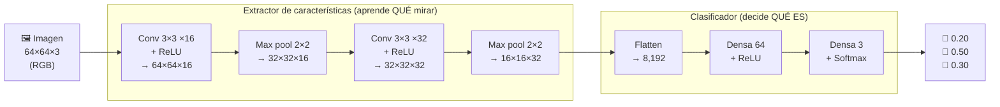

<p align="center">
  
</p>

*Arquitectura típica: convoluciones y submuestreo (pooling) alternados, y al final capas totalmente conectadas. Imagen: [Aphex34](https://commons.wikimedia.org/wiki/File:Typical_cnn.png), CC BY-SA 4.0.*

| Pieza | Pregunta que responde | ¿Tiene pesos que se aprenden? | Efecto en el tamaño |
|---|---|---|---|
| **Convolución** | ¿Dónde aparece este patrón en la imagen? | ✅ Sí (los kernels) | Igual o un poco menor (depende del padding) |
| **ReLU** | ¿Qué respuestas son relevantes? | ❌ No | Igual |
| **Pooling** | ¿Cuál es lo más importante de cada zona? | ❌ No | Reduce (2×2 → la mitad) |
| **Flatten** | ¿Cómo paso de mapas 2D a un vector? | ❌ No | Lo convierte en 1D |
| **Capa densa** | ¿Qué combinación de características indica cada clase? | ✅ Sí | Lo que tú definas |
| **Softmax** | ¿Qué tan probable es cada clase? | ❌ No | Igual (n.º de clases) |

---

### 1. La convolución: un kernel que recorre la imagen

Una capa convolucional desliza un **kernel** (una matriz pequeña de pesos, por ejemplo 3×3) sobre la imagen. En cada posición **multiplica** elemento por elemento y **suma**, y ese número se escribe en el **mapa de características** (*feature map*). Es exactamente la operación del Tema 2; la diferencia es que aquí los valores del kernel **no los eliges tú**: empiezan aleatorios y se ajustan durante el entrenamiento.

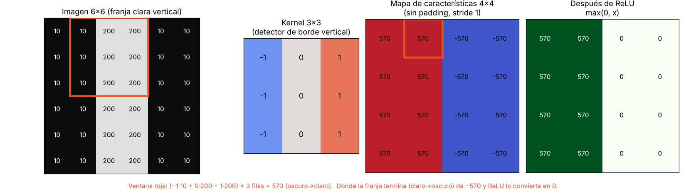

*Una imagen de 6×6 con una franja clara. El kernel `[-1 0 1]` da valores **altos** donde la imagen pasa de oscuro a claro, **negativos** donde pasa de claro a oscuro y **0** en zonas uniformes. Después, ReLU deja solo las respuestas positivas. Así "ve" una CNN un borde.*

<p align="center">
  
  &nbsp;&nbsp;&nbsp;
  
  &nbsp;&nbsp;&nbsp;
  
</p>

*Izquierda: kernel 3×3 sin padding (la salida se encoge). Centro: con **padding** "same" (la salida conserva el tamaño). Derecha: con padding y **stride 2** (el kernel salta de 2 en 2 y la salida se reduce a la mitad). Azul = entrada, cian = salida. Animaciones: [Vincent Dumoulin y Francesco Visin](https://github.com/vdumoulin/conv_arithmetic), licencia MIT.*

#### Los tres "perillas" de una convolución

| Hiperparámetro | Qué es | Efecto | Valor típico |
|---|---|---|---|
| **Tamaño del kernel** | Ancho × alto de la ventana | Más grande = ve más contexto, pero más pesos | 3×3 (a veces 5×5, 7×7 en la primera capa) |
| **Stride** (paso) | Cuántos píxeles salta el kernel | Stride 2 reduce la salida a la mitad | 1 o 2 |
| **Padding** (relleno) | Ceros alrededor del borde | Evita que la imagen se encoja y que los bordes se "pierdan" | `same` (1 para 3×3) |
| **Número de filtros** | Cuántos kernels distintos aprende la capa | Cada filtro produce **un** mapa de características | 32, 64, 128… (crece con la profundidad) |

**Fórmula del tamaño de salida** (la verás en cualquier curso de CNN):

```
Salida = ⌊ (N − K + 2P) / S ⌋ + 1

N = tamaño de entrada, K = tamaño del kernel, P = padding, S = stride
```

| Entrada | Kernel | Padding | Stride | Salida |
|---|---|---|---|---|
| 6×6 | 3×3 | 0 | 1 | (6 − 3 + 0)/1 + 1 = **4×4** |
| 6×6 | 3×3 | 1 | 1 | (6 − 3 + 2)/1 + 1 = **6×6** |
| 224×224 | 7×7 | 3 | 2 | ⌊(224 − 7 + 6)/2⌋ + 1 = **112×112** (primera capa de ResNet) |

#### Imágenes a color: el kernel también tiene profundidad

Con una imagen RGB, cada kernel no es de 3×3 sino de **3×3×3** (un "cubito" que cubre los tres canales a la vez). Multiplica y suma **los 27 valores** y produce **un solo número** por posición. Si la capa tiene 16 filtros, la salida tiene 16 mapas apilados (profundidad 16).

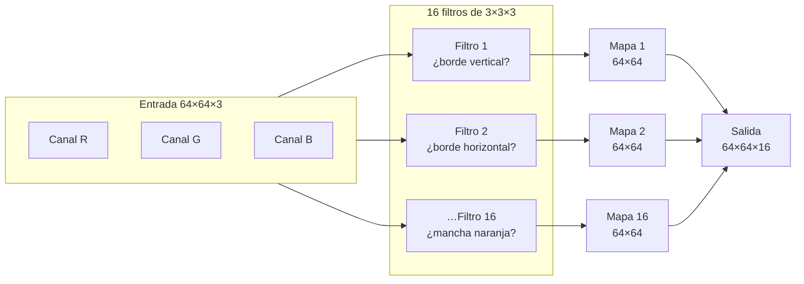

<p align="center">
  
</p>

*Tres filtros de la primera capa recorriendo una imagen a color; cada uno genera su propio mapa de características. Animación: [Cecbur](https://commons.wikimedia.org/wiki/File:3_filters_in_a_Convolutional_Neural_Network.gif), CC BY-SA 4.0.*

> 🧮 **Cuenta de parámetros de una capa convolucional:** `filtros × (alto × ancho × canales_entrada + 1)`. Para `Conv2d(3, 16, 3)`: 16 × (3×3×3 + 1) = **448** pesos. Fíjate que **no depende del tamaño de la imagen**: los mismos 448 pesos sirven para una foto de 64×64 o de 4K.

#### Así se ve con una foto real

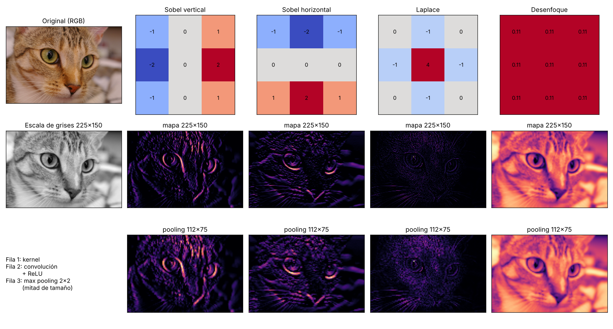

*Cuatro kernels clásicos aplicados a una foto real (imagen de ejemplo "chelsea" de scikit-image). Cada kernel resalta algo distinto: el Sobel vertical, los bordes verticales (bigotes laterales, contorno de los ojos); el horizontal, los bordes horizontales; Laplace, los detalles finos en todas direcciones; el desenfoque suaviza. La fila de abajo muestra que después del **max pooling** la imagen tiene la mitad de tamaño, pero **los rasgos importantes siguen ahí**. Una CNN aprende decenas o cientos de kernels como estos, pero elegidos por los datos y no a mano.*

---

### 2. Función de activación: ReLU

Después de cada convolución se aplica una **función de activación**. La más usada es **ReLU** (*Rectified Linear Unit*): `max(0, x)`. Convierte los negativos en 0 y deja pasar los positivos.

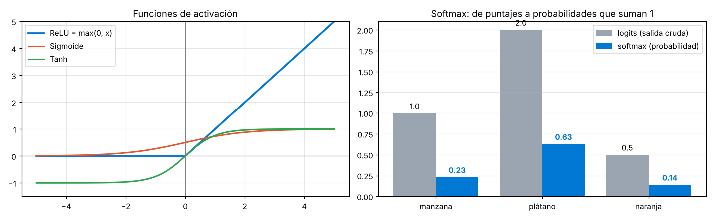

*Izquierda: ReLU frente a la sigmoide y la tangente hiperbólica. Derecha: el softmax de la última capa (sección 5).*

¿Por qué hace falta?
- **Sin activación no hay "inteligencia":** apilar convoluciones y capas densas sin nada en medio equivale matemáticamente a **una sola** capa lineal. La activación introduce **no linealidad**, que es lo que permite aprender formas complejas.
- **¿Por qué ReLU y no sigmoide?** La sigmoide se "aplana" en los extremos (su pendiente se acerca a 0), y en redes profundas el gradiente se va desvaneciendo capa por capa (*vanishing gradient*). ReLU tiene pendiente 1 para los positivos, es baratísima de calcular y fue clave en el éxito de AlexNet (2012).

> Analogía: ReLU es como un portero que dice "si el detector no encontró nada (negativo), no me interesa; si encontró algo, pásale con la intensidad que trae".

---

### 3. Pooling: resumir y reducir

El **pooling** reduce el tamaño de cada mapa de características quedándose con lo más importante de cada zona. No tiene pesos que aprender.

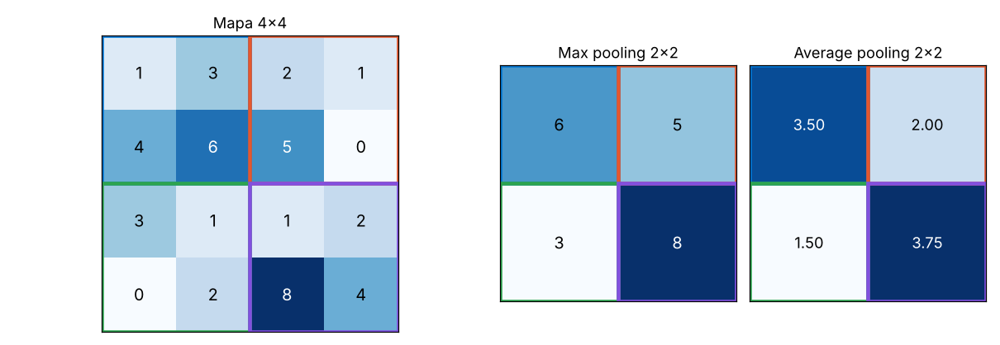

*Con ventanas de 2×2 y stride 2, un mapa de 4×4 se convierte en uno de 2×2. **Max pooling** se queda con el valor más alto de cada bloque (¿apareció el patrón en esta zona?); **average pooling** calcula el promedio.*

<p align="center">
  
</p>

*Max pooling 2×2 con stride 2. Imagen: [Aphex34](https://commons.wikimedia.org/wiki/File:Max_pooling.png), CC BY-SA 4.0.*

Para qué sirve:
1. **Menos cómputo:** cada max pool 2×2 deja **¼** de los valores.
2. **Tolerancia a pequeños desplazamientos:** si el ojo del gato se movió un píxel, el máximo de la zona casi no cambia.
3. **Ver más contexto:** después de reducir, un kernel de 3×3 cubre una zona más grande de la imagen original (sección 7).

| Tipo | Qué hace | Dónde se usa |
|---|---|---|
| **Max pooling** | Máximo de cada bloque | El más común entre capas convolucionales |
| **Average pooling** | Promedio de cada bloque | Menos común entre capas |
| **Global average pooling** | Promedia **todo** el mapa en un solo número | Al final de ResNet y redes modernas, en lugar de un Flatten gigante |

> En redes modernas a veces el pooling se sustituye por convoluciones con **stride 2**, que reducen el tamaño y además aprenden cómo hacerlo.

---

### 4. Flatten y capas totalmente conectadas

Al final del extractor tienes un "cubo" de mapas (en la MiniCNN de la práctica, 16×16×32). **Flatten** lo convierte en un vector de 8,192 números y se lo pasa a una red **totalmente conectada** (*fully connected* o densa), donde cada neurona está conectada a todos los valores de entrada.

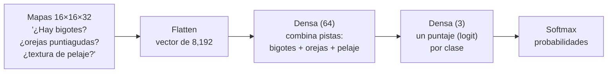

Aquí está el **trabajo de decisión**: si las características dicen "forma alargada + color amarillo + curva", la red densa aprende que eso pesa a favor de "plátano".

---

### 5. Softmax: de puntajes a probabilidades

La última capa produce **logits** (puntajes crudos que pueden ser cualquier número). **Softmax** los convierte en probabilidades entre 0 y 1 que **suman 1**:

```
softmax(zᵢ) = e^zᵢ / Σⱼ e^zⱼ
```

Con logits `[1.0, 2.0, 0.5]` para [manzana, plátano, naranja] → `[0.23, 0.63, 0.14]`. La predicción es la clase con mayor probabilidad: **plátano**.

> [!TIP]
> En el examen: **softmax** = la función de la capa de salida que convierte las salidas en **probabilidades por clase** (ej. `[0.2, 0.5, 0.3]`). Si ves un vector de probabilidades que suma 1, es la salida de un clasificador multiclase.

---

### 6. Entrenamiento: cómo aprenden los kernels

Este es el corazón del tema: **los kernels empiezan con pesos aleatorios** y se ajustan solos.

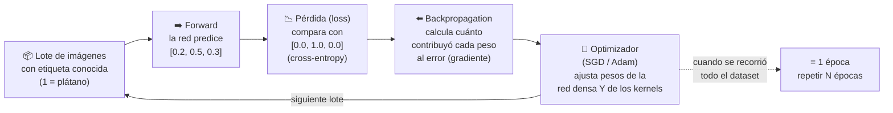

| Concepto | Qué es | Analogía |
|---|---|---|
| **Etiqueta** | La respuesta correcta conocida | La clave de respuestas de un examen |
| **Pérdida (loss)** | Qué tan equivocada está la predicción | La calificación al revés: más alta = peor |
| **Cross-entropy** | La pérdida estándar para clasificación; castiga mucho estar **seguro y equivocado** | Decir "100% seguro" y fallar cuesta más que dudar |
| **Backpropagation** | Algoritmo que reparte "la culpa" del error hacia atrás, capa por capa | Revisar qué paso del procedimiento causó el error |
| **Gradiente** | Dirección en que hay que mover cada peso para bajar la pérdida | La pendiente de una montaña: bajas hacia donde baja |
| **Learning rate** | Qué tan grande es cada ajuste | El tamaño de tus pasos montaña abajo |
| **Lote (batch)** | Grupo de imágenes que se procesa antes de ajustar | Calificar exámenes de 64 en 64 |
| **Época** | Una pasada completa por todo el dataset de entrenamiento | Releer todo el libro una vez |

#### Un entrenamiento real

Entrené una CNN pequeña (3,786 parámetros) con el dataset de dígitos escritos a mano de scikit-learn (1,797 imágenes de 8×8). El código está en la práctica de abajo.

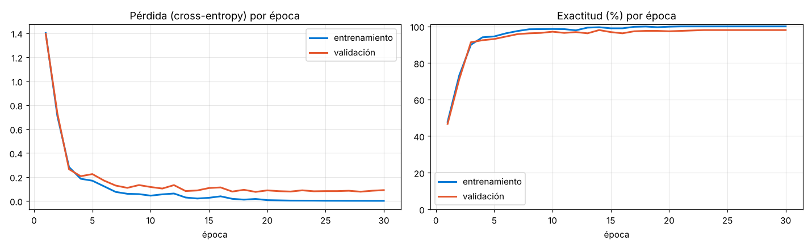

*En la época 1 la red acierta ~47%; en la 5 ya ~93% en validación y termina en **98%**. Observa la **separación** entre las curvas: en entrenamiento llega a 100% y la pérdida casi a 0, pero en validación se estanca. Eso es el inicio del **sobreajuste** (*overfitting*): la red empieza a memorizar los ejemplos de entrenamiento.*

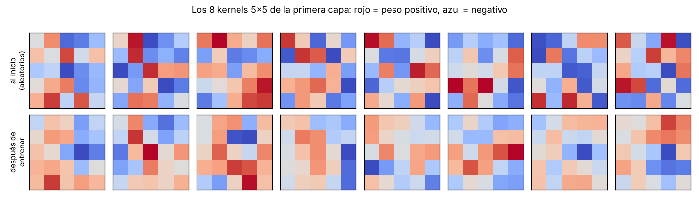

*Los 8 kernels de la primera capa al inicio (ruido aleatorio) y después de 30 épocas. Cambiaron para responder a trazos útiles para distinguir dígitos. Con imágenes tan pequeñas no se ven "bonitos"; en redes grandes entrenadas con millones de fotos (como AlexNet), la primera capa aprende detectores muy claros de bordes en distintas orientaciones y manchas de color.*

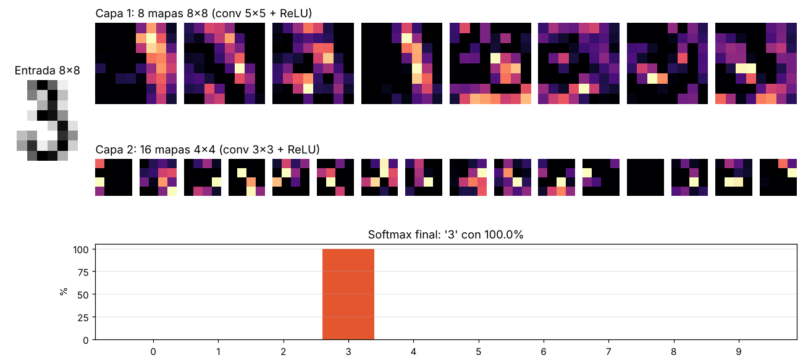

*Un "3" de validación atravesando la red ya entrenada: la capa 1 genera 8 mapas (cada uno resalta trazos distintos), la capa 2 genera 16 mapas más abstractos y pequeños, y el softmax final asigna prácticamente toda la probabilidad a la clase 3.*

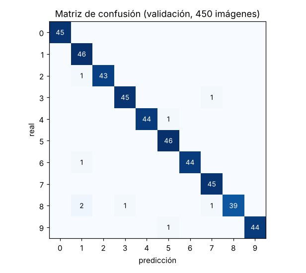

*Matriz de confusión con las 450 imágenes de validación: la diagonal son aciertos. Solo 9 errores; el más frecuente es confundir algunos **8** con **1**.*

---

### 7. Por qué funcionan tan bien con imágenes

#### a) Pesos compartidos: muchísimos menos parámetros

El mismo kernel recorre toda la imagen, así que detecta un borde esté donde esté **con los mismos pesos**. Una red densa necesitaría un peso por cada píxel y por cada neurona:

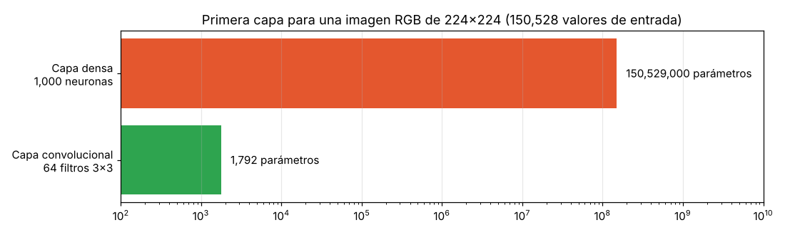

*Para una imagen RGB de 224×224 (150,528 valores), una capa densa de 1,000 neuronas necesita **150.5 millones** de parámetros; una convolucional de 64 filtros 3×3, solo **1,792**: unas **84,000 veces menos**.*

#### b) Jerarquía de características

Cada capa combina lo que encontró la anterior:

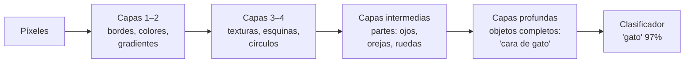

> Si quieres **ver** esto con imágenes reales de una red entrenada, revisa el artículo [Feature Visualization (Distill)](https://distill.pub/2017/feature-visualization/): muestra cómo GoogLeNet pasa de bordes a texturas, patrones, partes y objetos.

#### c) Campo receptivo que crece

Una neurona de la primera capa solo "ve" 3×3 píxeles. Pero una neurona de la segunda capa ve 3×3 neuronas de la primera, que a su vez veían 3×3 píxeles cada una… El **campo receptivo** crece con la profundidad, y **mucho más rápido con pooling**:

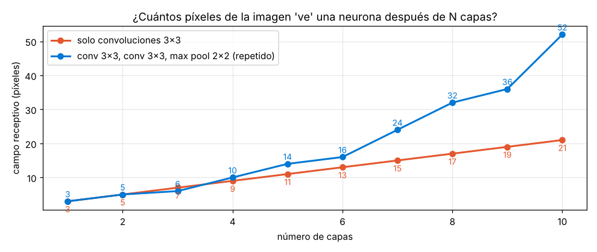

*Con 10 convoluciones de 3×3 una neurona ve 21×21 píxeles; intercalando max pooling, 52×52. Por eso las capas profundas pueden reconocer objetos completos aunque cada kernel sea pequeñito.*

#### d) Invarianza (aproximada) a la traslación

Un gato en la esquina sigue siendo gato: la convolución detecta el patrón en cualquier posición y el pooling tolera pequeños desplazamientos. Ojo: las CNN **no** son naturalmente invariantes a **rotaciones** o cambios de **escala** grandes; eso se aprende con *data augmentation* (sección 9).

---

### 8. Arquitecturas famosas: la historia en 25 años

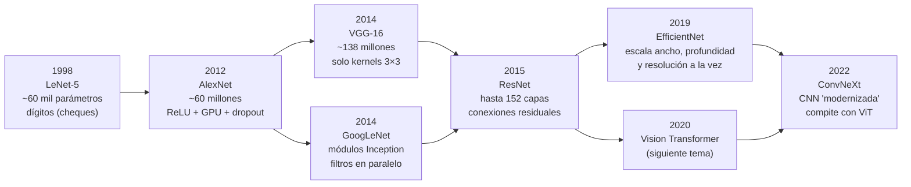

<p align="center">
  
</p>

*LeNet (izquierda) y AlexNet (derecha): la misma idea de convolución + pooling + capas densas, pero AlexNet es mucho más grande, usa imágenes de 224×224 a color y ReLU en lugar de sigmoide. Imagen: [Cmglee](https://commons.wikimedia.org/wiki/File:Comparison_image_neural_networks.svg), CC BY-SA 4.0.*

| Arquitectura | Año | Idea clave | Por qué importa |
|---|---|---|---|
| **LeNet-5** | 1998 | Convolución + pooling + densas | Leía dígitos en cheques bancarios; el "abuelo" de todas |
| **AlexNet** | 2012 | ReLU, dropout, entrenamiento en GPU | Ganó ImageNet con 15.3% de error top-5 contra 26.2% del segundo lugar: **detonó el boom del deep learning** |
| **VGG** | 2014 | Apilar muchos kernels 3×3 | Mostró que la **profundidad** importa; muy usada para *transfer learning* |
| **GoogLeNet / Inception** | 2014 | Filtros de varios tamaños en paralelo | Más precisa que VGG con muchos menos parámetros |
| **ResNet** | 2015 | **Conexiones residuales** (atajos) | Permitió entrenar redes de 50, 101 y 152 capas; 3.57% de error top-5 |
| **EfficientNet** | 2019 | Escalado compuesto | Mejor precisión por parámetro; popular en móviles |
| **ConvNeXt** | 2022 | Ideas de los Transformers aplicadas a una CNN | Demostró que las CNN siguen siendo competitivas |

#### ResNet: el truco de los atajos

Antes de ResNet, agregar más capas **empeoraba** el entrenamiento: el gradiente se desvanecía al viajar hacia atrás por tantas capas. ResNet agrega un **atajo** que suma la entrada del bloque a su salida: `salida = F(x) + x`. Así el bloque solo tiene que aprender **la diferencia** (el *residuo*) y el gradiente tiene una "autopista" para regresar.

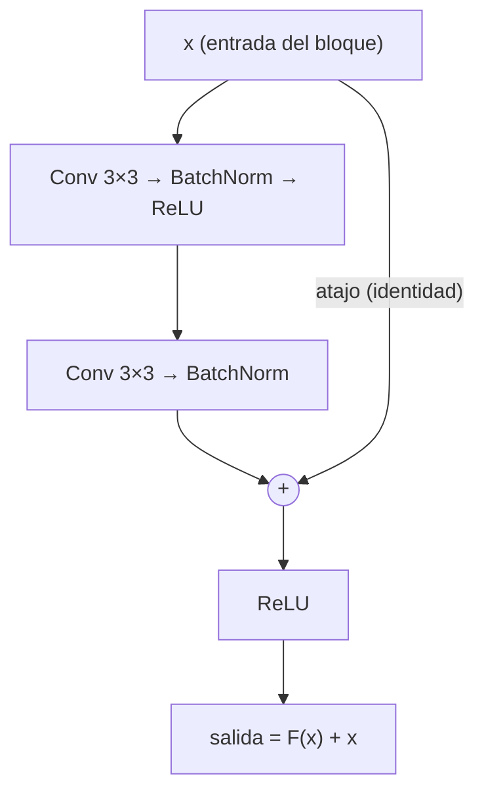

<p align="center">
  
</p>

*Bloque residual de ResNet. Imagen: [Zhang, Lipton, Li y Smola – Dive into Deep Learning](https://commons.wikimedia.org/wiki/File:ResNet_block.svg), CC BY-SA 4.0.*

#### El efecto ImageNet

<p align="center">
  
</p>

*Tasa de error en el reto de clasificación de ImageNet por año. El desplome a partir de 2012 es la llegada de las CNN. Imagen: [Gkrusze](https://commons.wikimedia.org/wiki/File:ImageNet_error_rate_history_(just_systems).svg), CC BY-SA 4.0.*

---

### 9. Problemas reales y cómo se resuelven

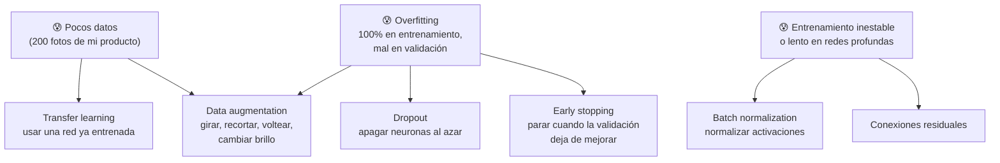

#### Transfer learning: no empieces de cero

Entrenar una CNN grande desde cero requiere millones de imágenes y mucho cómputo. En la práctica casi siempre se toma una red **ya entrenada** (por ejemplo con ImageNet), se **congelan** sus capas convolucionales (que ya saben detectar bordes, texturas y partes) y solo se entrena un **clasificador nuevo** con tus clases:

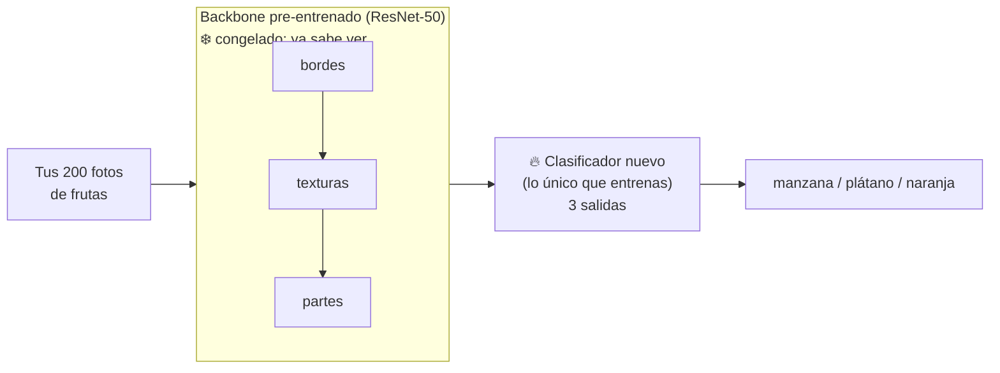

> Esto es justo lo que hacían por dentro servicios como **Azure AI Custom Vision**: subías unas decenas de imágenes por etiqueta y obtenías un modelo útil en minutos.

---

### 10. Más allá de clasificar: detección y segmentación

La misma columna vertebral convolucional se reutiliza para otras tareas cambiando solo la "cabeza" del modelo (las tareas que viste en el Tema 1):

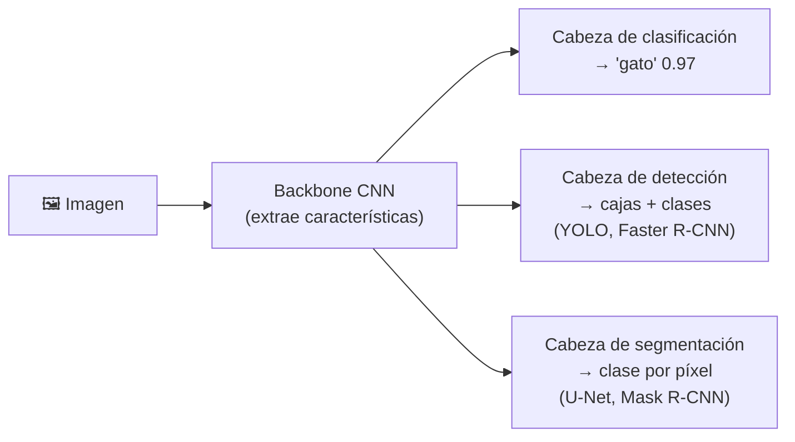

| Tarea | Salida | Arquitecturas CNN representativas |
|---|---|---|
| Clasificación | Una etiqueta (o probabilidades) para toda la imagen | ResNet, EfficientNet |
| Detección de objetos | Cajas delimitadoras (*bounding boxes*) + clase + confianza | Faster R-CNN (2015), YOLO (2016) |
| Segmentación semántica | Una clase por cada píxel | U-Net (2015, imágenes médicas) |
| Segmentación de instancias | Máscara por cada objeto individual | Mask R-CNN (2017) |

---

### 11. CNN vs Vision Transformer (adelanto del siguiente tema)

| | CNN | Vision Transformer (ViT) |
|---|---|---|
| Unidad básica | Kernel que recorre la imagen | Parches de imagen + atención |
| Qué ve al inicio | Solo una zona local (3×3) | Relaciona **cualquier** parche con cualquier otro desde la primera capa |
| Suposiciones de diseño | Fuertes: localidad y traslación ("sesgo inductivo") | Débiles: aprende las relaciones de los datos |
| Datos necesarios | Funciona bien con datasets medianos | Brilla con datasets enormes o pre-entrenamiento masivo |
| Dónde destaca hoy | Dispositivos pequeños, tiempo real, detección | Modelos fundacionales y **multimodales** (imagen + texto) |

Una CNN ve **localmente**: relacionar dos zonas lejanas de la imagen requiere muchas capas. Los **Vision Transformers** usan atención para relacionar cualquier parte con cualquier otra desde la primera capa (siguiente tema). Los modelos de visión de Azure y los modelos multimodales de Foundry (como GPT-4o o GPT-5) se basan mayormente en Transformers, aunque muchos sistemas combinan ambas ideas.

---

### ¿Y en Azure? Dónde te topas con CNN sin programarlas

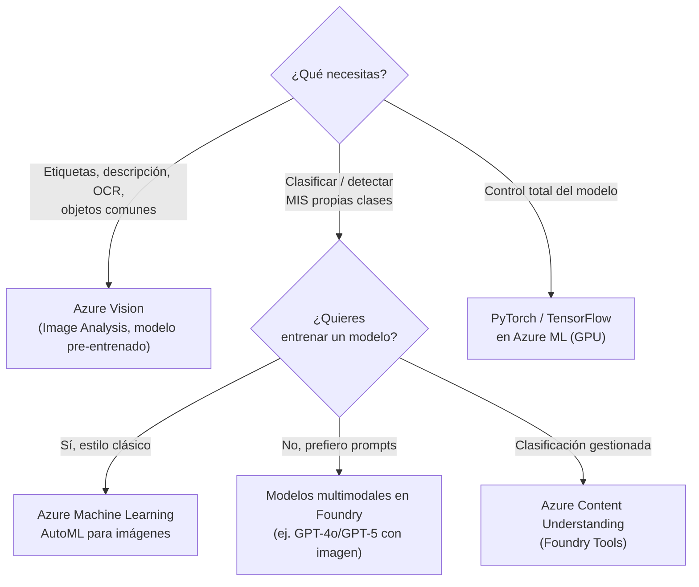

> [!WARNING]
> **Azure AI Custom Vision** (el servicio clásico para entrenar clasificadores y detectores propios, basado en transfer learning) se **retira el 25 de septiembre de 2028**. Microsoft recomienda migrar a Azure Machine Learning (AutoML), a soluciones generativas en Microsoft Foundry o a Azure Content Understanding.

---

### Práctica en Python

```bash
pip install numpy torch scikit-learn
```

#### 1) Una convolución a mano con NumPy

```python
import numpy as np

imagen = np.array([[10, 10, 200, 200, 10, 10]] * 6)      # franja clara vertical
kernel = np.array([[-1, 0, 1],
                   [-1, 0, 1],
                   [-1, 0, 1]])                             # detector de borde vertical

def convolucion(img, k, stride=1, padding=0):
    img = np.pad(img, padding)
    kh, kw = k.shape
    oh = (img.shape[0] - kh) // stride + 1
    ow = (img.shape[1] - kw) // stride + 1
    salida = np.zeros((oh, ow))
    for i in range(oh):
        for j in range(ow):
            ventana = img[i*stride:i*stride+kh, j*stride:j*stride+kw]
            salida[i, j] = np.sum(ventana * k)               # multiplicar y sumar
    return salida

mapa = convolucion(imagen, kernel)
print("Mapa de características:\n", mapa)
print("Después de ReLU:\n", np.maximum(mapa, 0))
print("Con padding=1 ->", convolucion(imagen, kernel, padding=1).shape)
print("Con stride=2  ->", convolucion(imagen, kernel, stride=2).shape)
```

Salida:
```
Mapa de características:
 [[ 570.  570. -570. -570.]
 [ 570.  570. -570. -570.]
 [ 570.  570. -570. -570.]
 [ 570.  570. -570. -570.]]
Después de ReLU:
 [[570. 570.   0.   0.]
 [570. 570.   0.   0.]
 [570. 570.   0.   0.]
 [570. 570.   0.   0.]]
Con padding=1 -> (6, 6)
Con stride=2  -> (2, 2)
```
- **Explicación:** `+570` donde la imagen pasa de oscuro a claro, `−570` donde pasa de claro a oscuro. Comprueba la fórmula: sin padding (6 − 3)/1 + 1 = 4; con padding 1, 6; con stride 2, ⌊(6 − 3)/2⌋ + 1 = 2.

#### 2) Una CNN mínima con PyTorch: formas y parámetros capa por capa

```python
# pip install torch
import torch
import torch.nn as nn

class MiniCNN(nn.Module):
    def __init__(self, num_clases=3):
        super().__init__()
        self.extractor = nn.Sequential(
            nn.Conv2d(3, 16, kernel_size=3, padding=1),  # 16 filtros 3x3 sobre RGB
            nn.ReLU(),
            nn.MaxPool2d(2),                             # 64x64 -> 32x32
            nn.Conv2d(16, 32, kernel_size=3, padding=1), # 32 filtros
            nn.ReLU(),
            nn.MaxPool2d(2),                             # 32x32 -> 16x16
        )
        self.clasificador = nn.Sequential(
            nn.Flatten(),                                # 32 * 16 * 16 = 8192 valores
            nn.Linear(32 * 16 * 16, 64),
            nn.ReLU(),
            nn.Linear(64, num_clases),
        )

    def forward(self, x):
        return self.clasificador(self.extractor(x))

torch.manual_seed(0)
modelo = MiniCNN()
x = torch.rand(1, 3, 64, 64)                            # 1 imagen RGB de 64x64

for capa in list(modelo.extractor) + list(modelo.clasificador):
    x = capa(x)
    params = sum(p.numel() for p in capa.parameters())
    print(f"{capa.__class__.__name__:<10} -> forma {str(tuple(x.shape)):<18} parámetros {params:>8,}")

print(f"Total de parámetros: {sum(p.numel() for p in modelo.parameters()):,}")
print("Probabilidades sin entrenar:", torch.softmax(x, dim=1).detach().numpy().round(3))
```

Salida:
```
Conv2d     -> forma (1, 16, 64, 64)    parámetros      448
ReLU       -> forma (1, 16, 64, 64)    parámetros        0
MaxPool2d  -> forma (1, 16, 32, 32)    parámetros        0
Conv2d     -> forma (1, 32, 32, 32)    parámetros    4,640
ReLU       -> forma (1, 32, 32, 32)    parámetros        0
MaxPool2d  -> forma (1, 32, 16, 16)    parámetros        0
Flatten    -> forma (1, 8192)          parámetros        0
Linear     -> forma (1, 64)            parámetros  524,352
ReLU       -> forma (1, 64)            parámetros        0
Linear     -> forma (1, 3)             parámetros      195
Total de parámetros: 529,635
Probabilidades sin entrenar: [[0.365 0.31  0.325]]
```
- **Explicación:**
  - `Conv2d(3, 16, 3)`: 16 kernels de 3×3×3 → 16 × (27 + 1) = 448 pesos. Empiezan aleatorios.
  - `MaxPool2d(2)`: reduce a la mitad el ancho y alto; no tiene parámetros.
  - **Dato revelador:** el 99% de los parámetros (524,352) está en la **primera capa densa**, no en las convoluciones. Por eso las redes modernas usan *global average pooling* en lugar de un Flatten grande.
  - Sin entrenar, las probabilidades son casi iguales (≈ 1/3 cada una): la red todavía no sabe nada.

#### 3) Entrenar una CNN de verdad (dígitos escritos a mano)

```python
# pip install torch scikit-learn
import torch, torch.nn as nn
from sklearn.datasets import load_digits
from sklearn.model_selection import train_test_split

torch.manual_seed(0)
d = load_digits()                                        # 1,797 dígitos de 8x8 (vienen con scikit-learn)
X = torch.tensor(d.images / 16.0, dtype=torch.float32).unsqueeze(1)   # (N, 1, 8, 8)
y = torch.tensor(d.target)
Xtr, Xva, ytr, yva = train_test_split(X, y, test_size=0.25, random_state=0, stratify=y)

modelo = nn.Sequential(
    nn.Conv2d(1, 8, kernel_size=5, padding=2), nn.ReLU(), nn.MaxPool2d(2),    # 8x8 -> 4x4
    nn.Conv2d(8, 16, kernel_size=3, padding=1), nn.ReLU(), nn.MaxPool2d(2),   # 4x4 -> 2x2
    nn.Flatten(), nn.Linear(16 * 2 * 2, 32), nn.ReLU(), nn.Linear(32, 10),
)
print(f"Parámetros: {sum(p.numel() for p in modelo.parameters()):,}")

perdida = nn.CrossEntropyLoss()                          # incluye el softmax
optim = torch.optim.Adam(modelo.parameters(), lr=0.01)

for epoca in range(1, 31):
    modelo.train()
    orden = torch.randperm(len(Xtr))
    for i in range(0, len(Xtr), 64):                     # mini-lotes de 64 imágenes
        lote = orden[i:i + 64]
        optim.zero_grad()
        loss = perdida(modelo(Xtr[lote]), ytr[lote])     # 1) forward + pérdida
        loss.backward()                                  # 2) backpropagation (gradientes)
        optim.step()                                     # 3) ajustar pesos (kernels incluidos)
    if epoca in (1, 5, 10, 20, 30):
        modelo.eval()
        with torch.no_grad():
            acc_tr = (modelo(Xtr).argmax(1) == ytr).float().mean()
            acc_va = (modelo(Xva).argmax(1) == yva).float().mean()
            l_va = perdida(modelo(Xva), yva)
        print(f"época {epoca:>2} | pérdida val {l_va:.3f} | exactitud entrenamiento {acc_tr:.1%} | validación {acc_va:.1%}")
```

Salida (CPU, unos segundos):
```
Parámetros: 3,786
época  1 | pérdida val 1.395 | exactitud entrenamiento 47.8% | validación 46.7%
época  5 | pérdida val 0.225 | exactitud entrenamiento 94.5% | validación 93.1%
época 10 | pérdida val 0.117 | exactitud entrenamiento 98.6% | validación 97.1%
época 20 | pérdida val 0.088 | exactitud entrenamiento 99.9% | validación 97.3%
época 30 | pérdida val 0.091 | exactitud entrenamiento 100.0% | validación 98.0%
```
- **Explicación:** las tres líneas marcadas `1)`, `2)` y `3)` son el ciclo de entrenamiento del diagrama de la sección 6. Con solo 3,786 parámetros la red llega a 98% en imágenes que **nunca vio**. Desde la época 20 la pérdida de validación deja de bajar mientras la de entrenamiento sigue cayendo: ese es el punto donde convendría aplicar *early stopping*.
- Los números exactos pueden variar ligeramente según la versión de PyTorch.

---

### Errores comunes (y cómo los preguntan)

| Mito | Realidad |
|---|---|
| "En una CNN el programador diseña los filtros." | No: **los kernels empiezan aleatorios y se aprenden** con backpropagation. Diseñarlos a mano es procesamiento de imágenes clásico (Tema 2). |
| "El pooling tiene pesos." | No. Solo las convoluciones y las capas densas tienen pesos entrenables. |
| "Softmax es la función de activación de las capas ocultas." | No. Las capas ocultas suelen usar **ReLU**; softmax va en la **capa de salida**. |
| "Más capas siempre es mejor." | Sin conexiones residuales, normalización y suficientes datos, más capas pueden empeorar el modelo. |
| "Una CNN entiende la imagen como un humano." | Aprende correlaciones estadísticas; puede fallar con fondos inusuales o ataques adversarios. |

### Para reflexionar (IA responsable)
- **Equidad:** una CNN aprende lo que ve. Si el dataset de rostros o de lesiones de piel tiene pocos ejemplos de ciertos tonos de piel, el modelo será **menos preciso** para esas personas.
- **Atajos engañosos:** en un experimento clásico de explicabilidad (LIME, 2016), un clasificador de "husky vs. lobo" en realidad se fijaba en la **nieve del fondo**, porque casi todas las fotos de lobos la tenían. Revisa **qué** está mirando el modelo (mapas de atribución / saliency).
- **Transparencia:** las CNN son difíciles de interpretar; en salud o seguridad, combina sus predicciones con revisión humana.
- **Privacidad:** los datasets de imágenes pueden contener rostros y datos personales; obtén consentimiento y anonimiza.

---

### Preguntas tipo examen

1. **¿Con qué valores empiezan los kernels de filtro de una CNN antes de entrenar?**
   → Con **pesos aleatorios**; se ajustan durante el entrenamiento para reducir la pérdida.
2. **¿Cómo se llaman las matrices de valores que generan los filtros al recorrer la imagen?**
   → **Mapas de características** (*feature maps*).
3. **¿Qué capa reduce el tamaño de los mapas de características?**
   → **Pooling** (agrupación / reducción de muestreo).
4. **¿Qué paso convierte los mapas de características en un arreglo unidimensional?**
   → **Flatten** (aplanado), antes de la red totalmente conectada.
5. **Un modelo devuelve `[0.1, 0.8, 0.1]` para [manzana, plátano, naranja]. ¿Qué función produjo esos valores y qué predice?**
   → **Softmax**; predice **plátano**.
6. **Para una imagen de un plátano (clase 1), ¿cuál es el vector de salida ideal?**
   → `[0.0, 1.0, 0.0]`. La diferencia con la predicción es la **pérdida**.
7. **¿Cómo se llama cada pasada completa por todo el conjunto de entrenamiento?**
   → **Época**.

---

### Recursos
- [Microsoft Learn: Redes neuronales convolucionales (módulo oficial del examen)](https://learn.microsoft.com/es-es/training/modules/introduction-computer-vision/4-computer-vision-models?pivots=text)
- [CNN Explainer (visualización interactiva)](https://poloclub.github.io/cnn-explainer/)
- [Animaciones de aritmética de convoluciones (padding, stride, dilatación)](https://github.com/vdumoulin/conv_arithmetic)
- [Feature Visualization – Distill (qué aprende cada capa)](https://distill.pub/2017/feature-visualization/)
- [Dive into Deep Learning – capítulo de CNN (gratis)](https://d2l.ai/chapter_convolutional-neural-networks/index.html)
- [Custom Vision: opciones de migración (Microsoft Learn)](https://learn.microsoft.com/es-es/azure/ai-services/custom-vision-service/migration-options)
- [Funciones de activación ReLU y sigmoide (acordeón AI-900)](https://github.com/josejesusguzman/acordeon-ia-900/blob/main/docs/intro_deep_learning.md)
