# Tema 4: Vision Transformers y modelos multimodales — Fundamentos técnicos

### Descripción
Los **Transformers** revolucionaron el lenguaje y luego la visión. Un **Vision Transformer (ViT)** trata una imagen como si fuera una oración: la corta en **parches** (como si fueran tokens) y usa **atención** para entender cómo se relacionan. Cuando además se entrena con pares imagen–texto, se obtiene un **modelo multimodal** que puede describir imágenes o responder preguntas sobre ellas.

Analogía: una CNN es como leer una página con una lupa, cuadrito por cuadrito. Un ViT es como ver la página completa de un vistazo y conectar ideas de distintas partes al mismo tiempo.

Lectura oficial: [Introducción a los conceptos de computer vision (unidad "Transformadores de visión y modelos multimodales") – Microsoft Learn](https://learn.microsoft.com/es-es/training/modules/introduction-computer-vision/)

> 📷 Las figuras de este tema usan la misma foto del tema 2 ([`dog.jpg`](https://github.com/Azure-Samples/cognitive-services-sample-data-files), samples oficiales de Azure AI Vision, licencia MIT) y se generaron con Python; el código está en el documento.

---

### 1. Del texto a la imagen: la idea central

Los Transformers nacieron para texto (paper *Attention Is All You Need*, 2017). En 2020, el paper *An Image is Worth 16x16 Words* demostró que la **misma arquitectura** funciona con imágenes si las conviertes en una secuencia de "palabras visuales".

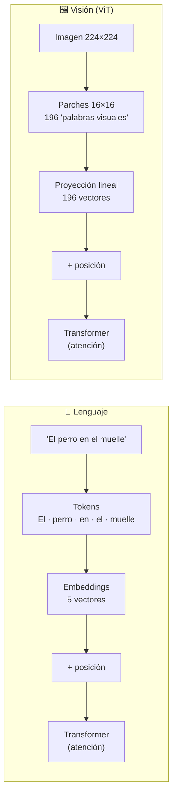

| | Texto | Imagen (ViT) |
|---|---|---|
| Unidad mínima | Token (palabra o subpalabra) | **Parche** (ej. 16×16 píxeles) |
| Cómo se vuelve vector | Tabla de embeddings (búsqueda) | **Proyección lineal** del parche aplanado |
| Orden | Posición en la oración | Posición (fila, columna) en la cuadrícula |
| Longitud típica | Cientos a miles de tokens | 196 parches (224×224 con parches de 16) |

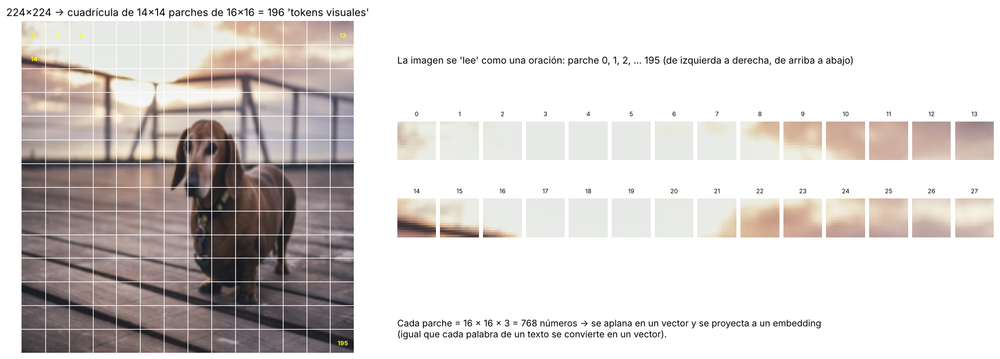

*La foto de 224×224 se divide en una cuadrícula de 14×14. Cada parche se numera de izquierda a derecha y de arriba a abajo, como se leen las palabras de una página. Los primeros parches (0–13) son cielo; los del 14 en adelante empiezan a mostrar el barandal.*

---

### 2. Cómo funciona un ViT, paso a paso

1. **Parcheo:** se corta la imagen en parches (224×224 / 16×16 → 14 × 14 = **196 parches**).
2. **Proyección lineal:** cada parche (16×16×3 = **768 valores**) se convierte en un vector (embedding) multiplicándolo por una matriz de pesos **aprendida**.
3. **Token [CLS]:** se agrega un vector extra al inicio que, tras todas las capas, "resume" la imagen completa (es el que se usa para clasificar).
4. **Codificación posicional:** se suma la posición de cada parche (si no, el modelo no sabría si la cabeza está arriba o abajo).
5. **Atención:** cada parche "mira" a todos los demás y calcula su influencia según color, forma, contraste y textura. Se repite en varias capas.
6. **Resultado:** un "mapa" multidimensional de características visuales donde las que aparecen juntas (un **sombrero** y una **cabeza**) quedan con vectores de dirección similar.
   - El modelo no "sabe" qué es un sombrero; aprende la **relación entre características visuales**.

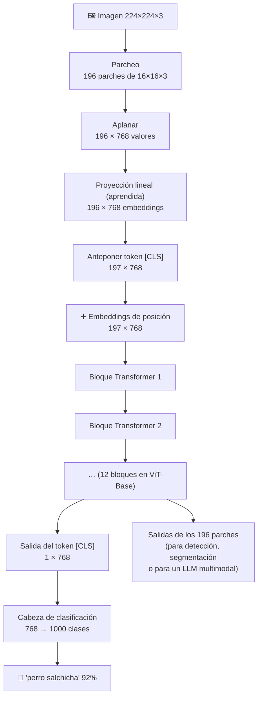

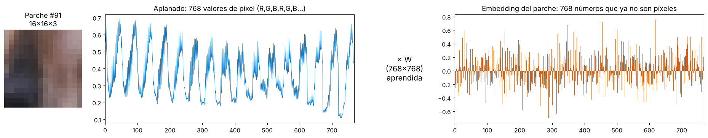

*Un parche del perro (16×16×3) se aplana en 768 números de píxel y se multiplica por una matriz W de 768×768. El resultado ya no son colores: es una representación que la red aprendió a construir para que la atención pueda comparar parches. (En la imagen, W es aleatoria; en un ViT entrenado, sus pesos codifican patrones útiles.)*

#### Codificación posicional

La atención trata la entrada como un **conjunto**: si barajas los parches, sin información de posición el resultado sería el mismo. La codificación posicional le da a cada parche una "huella" de su ubicación, de modo que las posiciones cercanas tengan huellas parecidas.

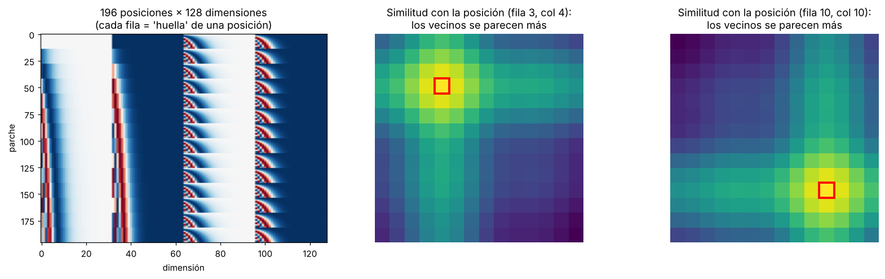

*Izquierda: cada fila es la huella de una de las 196 posiciones (aquí con funciones seno y coseno de distintas frecuencias). Centro y derecha: similitud de una posición con todas las demás; los parches vecinos se parecen más, así el modelo sabe qué está junto a qué. El ViT original **aprende** sus embeddings de posición, y terminan mostrando un patrón muy parecido.*

#### El bloque Transformer

Cada uno de los 12 bloques (en ViT-Base) aplica dos sub-capas, cada una con una **conexión residual** (se suma la entrada a la salida, como en las ResNet del tema anterior):

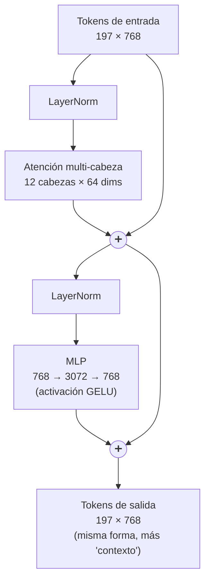

- **Atención multi-cabeza:** los parches intercambian información ("¿qué otros parches son relevantes para mí?").
- **MLP:** cada parche procesa por separado lo que recibió (como "pensar" sobre la información recolectada).
- **LayerNorm y residuales:** estabilizan el entrenamiento de redes muy profundas.

---

### 3. La atención: cada parche mira a todos los demás

Para cada parche se calculan tres vectores con pesos aprendidos:

| Vector | Pregunta que representa | Analogía (biblioteca) |
|---|---|---|
| **Query (Q)** | "¿Qué estoy buscando?" | Lo que escribes en el buscador |
| **Key (K)** | "¿Qué contengo?" | La etiqueta del lomo de cada libro |
| **Value (V)** | "¿Qué información aporto?" | El contenido del libro |

```
Atención(Q, K, V) = softmax( Q · Kᵀ / √d ) · V
```

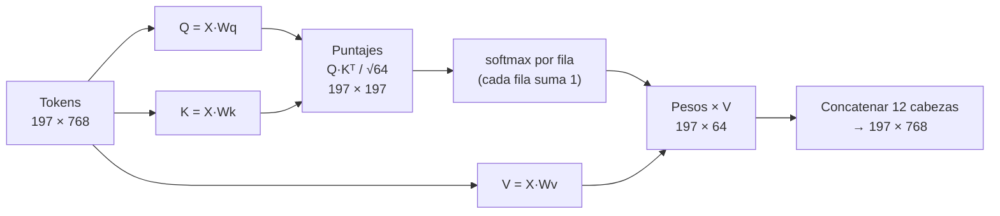

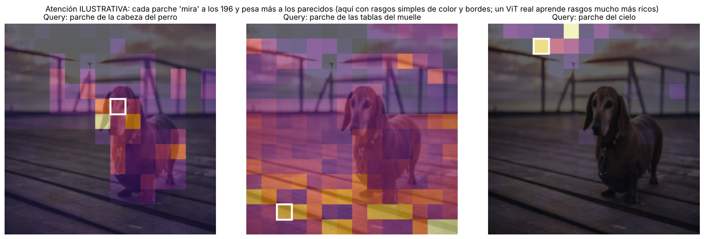

*Ejemplo **ilustrativo** (calculado con rasgos simples de color y bordes, no con un ViT entrenado): el parche marcado en blanco es la *query*, y el color indica cuánta atención presta a cada uno de los 196 parches. El parche de la cabeza se fija sobre todo en otras partes del perro; el de las tablas, en otras tablas; el del cielo, en el cielo. Un ViT entrenado aprende rasgos mucho más ricos (por ejemplo, que un ojo y una oreja "van juntos" aunque tengan colores distintos).*

#### CNN vs ViT: el campo receptivo

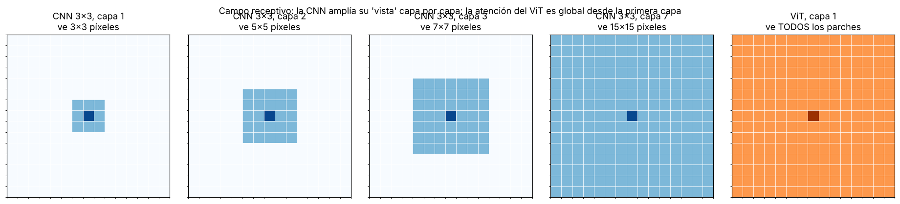

*Con kernels de 3×3, una CNN necesita muchas capas para que un píxel "vea" lejos: 3×3 en la capa 1, 5×5 en la 2, 7×7 en la 3… En un ViT, la atención conecta **cualquier parche con cualquier otro desde la primera capa**. Por eso un ViT capta mejor relaciones globales (la correa en el cuello y la mano que la sostiene al otro lado de la foto).*

| | CNN | ViT |
|---|---|---|
| **Sesgo inductivo** (suposiciones de fábrica) | Fuerte: localidad y traslación (un borde es un borde en cualquier lugar) | Débil: tiene que **aprender** que los píxeles cercanos se relacionan |
| **Consecuencia** | Aprende bien con pocos datos | Necesita **muchos** datos (o preentrenamiento) para superar a una CNN |
| **Escala** | Mejora poco al crecer mucho | Mejora consistentemente con más datos y parámetros |
| **Costo** | Lineal con el número de píxeles | **Cuadrático** con el número de parches (atención todos-con-todos) |

> 💡 **Dato del paper original del ViT:** entrenado solo con ImageNet (1.3 millones de imágenes), el ViT quedaba **por debajo** de las mejores CNN. Preentrenado con 300 millones de imágenes (JFT-300M), las **superó**. La lección: los Transformers cambian sesgo inductivo por datos.

#### Por qué la resolución cuesta tanto

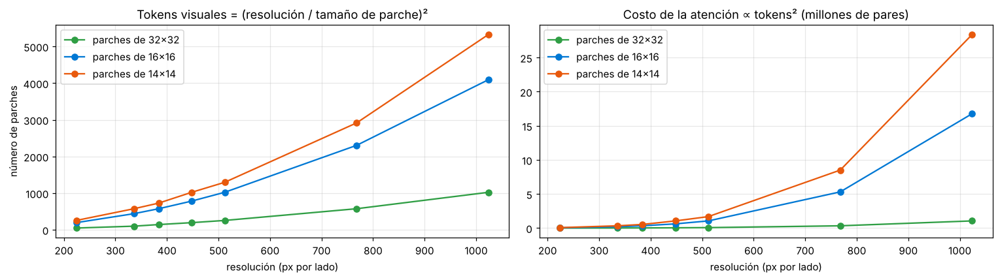

*Duplicar la resolución cuadruplica los parches y multiplica por 16 el costo de la atención (es cuadrático en el número de tokens). Por eso los modelos multimodales reducen o dividen en recuadros las imágenes grandes, y por eso Azure OpenAI ofrece un modo `low` (más barato) y uno `high` (más detalle).*

| Modelo | Capas | Dimensión | Cabezas | Parámetros (paper) |
|---|---|---|---|---|
| ViT-Base | 12 | 768 | 12 | 86 M |
| ViT-Large | 24 | 1024 | 16 | 307 M |
| ViT-Huge | 32 | 1280 | 16 | 632 M |

---

### 4. Modelos multimodales

Un modelo multimodal combina un **codificador de visión** (normalmente un ViT) y un **modelo de lenguaje**, entrenados con millones de pares imagen–descripción.

- **Atención cruzada (cross-modal attention):** crea una representación unificada donde los embeddings de imagen y de texto viven en el **mismo espacio vectorial**.
- Por eso el modelo puede describir una foto que nunca vio: busca el lenguaje asociado a esas características visuales. Ejemplo de Microsoft Learn: "Una persona en un parque con sombrero y mochila".

#### Tres formas de conectar visión y lenguaje

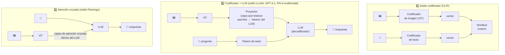

| Arquitectura | Qué produce | Bueno para | Ejemplos |
|---|---|---|---|
| **Doble codificador** | Embeddings comparables (imagen y texto) | Búsqueda de imágenes por texto, clasificación zero-shot, recomendaciones | CLIP, modelos de embeddings multimodales |
| **Codificador + LLM** | Texto libre | Describir, responder preguntas, leer gráficas y documentos, agentes | GPT-4.1, GPT-5.x, Phi-4-multimodal, LLaVA |
| **Atención cruzada** | Texto libre | Diálogos con varias imágenes intercaladas | Flamingo y derivados |

> 🔑 En la arquitectura 2, el LLM recibe los parches de la imagen **como si fueran tokens de texto**. Por eso una imagen "consume tokens" de la ventana de contexto y del costo de la llamada (ver la sección 6).

#### Aprendizaje contrastivo (CLIP)

**CLIP** (OpenAI, 2021) se entrenó con unos **400 millones de pares imagen–texto** sacados de internet. La idea es simple: en cada lote de N pares, acercar la imagen a **su** texto y alejarla de los otros N−1 textos.

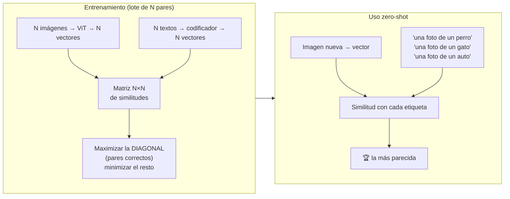

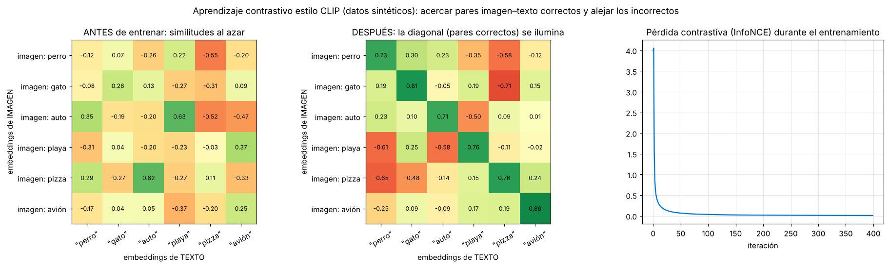

*Simulación real (con datos sintéticos) del entrenamiento contrastivo: antes, las similitudes imagen–texto son aleatorias (por ejemplo, "imagen de pizza" se parece más a "auto"). Tras 400 iteraciones de la pérdida InfoNCE, la **diagonal** (pares correctos) se ilumina en verde y los pares incorrectos quedan bajos.*

**Clasificación zero-shot:** como imagen y texto viven en el mismo espacio, puedes clasificar con etiquetas **que nunca se usaron en el entrenamiento**: solo escribes "una foto de un ___" para cada clase y eliges la más similar.

---

### 5. CNN vs. ViT vs. Multimodal

| | CNN | ViT | Multimodal |
|---|---|---|---|
| Unidad de análisis | Ventanas locales (kernels) | Parches + atención global | Parches + tokens de texto |
| Fortaleza | Eficiente con pocos datos | Relaciones globales, escala muy bien | Entiende y genera lenguaje sobre imágenes |
| Salida típica | Etiqueta, cajas | Etiqueta, embeddings | Texto libre, respuestas, JSON |
| Datos necesarios | Medianos | Muchos | Enormes (pares imagen–texto) |
| Etiquetas | Fijas (las del entrenamiento) | Fijas | **Abiertas** (cualquier texto) |
| Costo de inferencia | Bajo | Medio | Alto |
| Ejemplos | ResNet, EfficientNet, YOLO | ViT, DeiT, Swin | CLIP, GPT-4.1, GPT-5.x, Phi-4-multimodal |

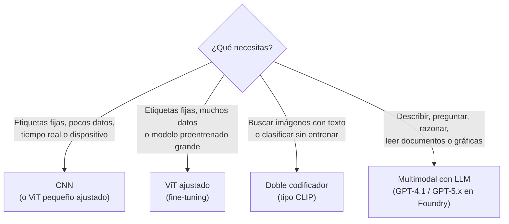

---

### 6. Multimodales en Microsoft Foundry

- **GPT-4.1 / 4.1-mini / 4.1-nano:** describir imágenes, preguntas visuales, analizar documentos, capturas, gráficas y diagramas.
- **Serie GPT-5 (5.1, 5.2):** escenarios empresariales y agénticos con imágenes, salidas estructuradas y herramientas.
- **Phi-4-multimodal-instruct** y modelos de socios (Anthropic, Mistral) con entrada de imagen.
- Tutorial en la [Parte 2, Módulo 5](../../parte2/modulo5/tema2.md).


*Imagen de ejemplo que usa la documentación de Microsoft Foundry en su quickstart de visión multimodal (un auto chocado contra una barrera). Es un caso típico de seguros: un modelo multimodal puede describir el daño, identificar la parte afectada (defensa y cofre) y redactar un borrador del reporte del siniestro. Imagen: documentación oficial de Microsoft (CC BY 4.0).*

#### Cómo envía la imagen el modelo (nivel de detalle)

Según la documentación oficial de Azure OpenAI para modelos con visión, puedes elegir el parámetro `detail`:

| `detail` | Qué hace el modelo | Cuándo usarlo |
|---|---|---|
| `low` | Procesa una sola versión de **512×512** de la imagen | Respuestas rápidas y baratas cuando no necesitas detalle fino (¿qué hay en la foto?) |
| `high` | Ve primero la versión de baja resolución y luego **segmentos detallados de 512×512**; cada segmento usa el doble del presupuesto de tokens | Texto pequeño, gráficas, documentos, objetos diminutos |
| `auto` (por defecto) | El modelo decide según el tamaño de la imagen | Si no estás seguro |

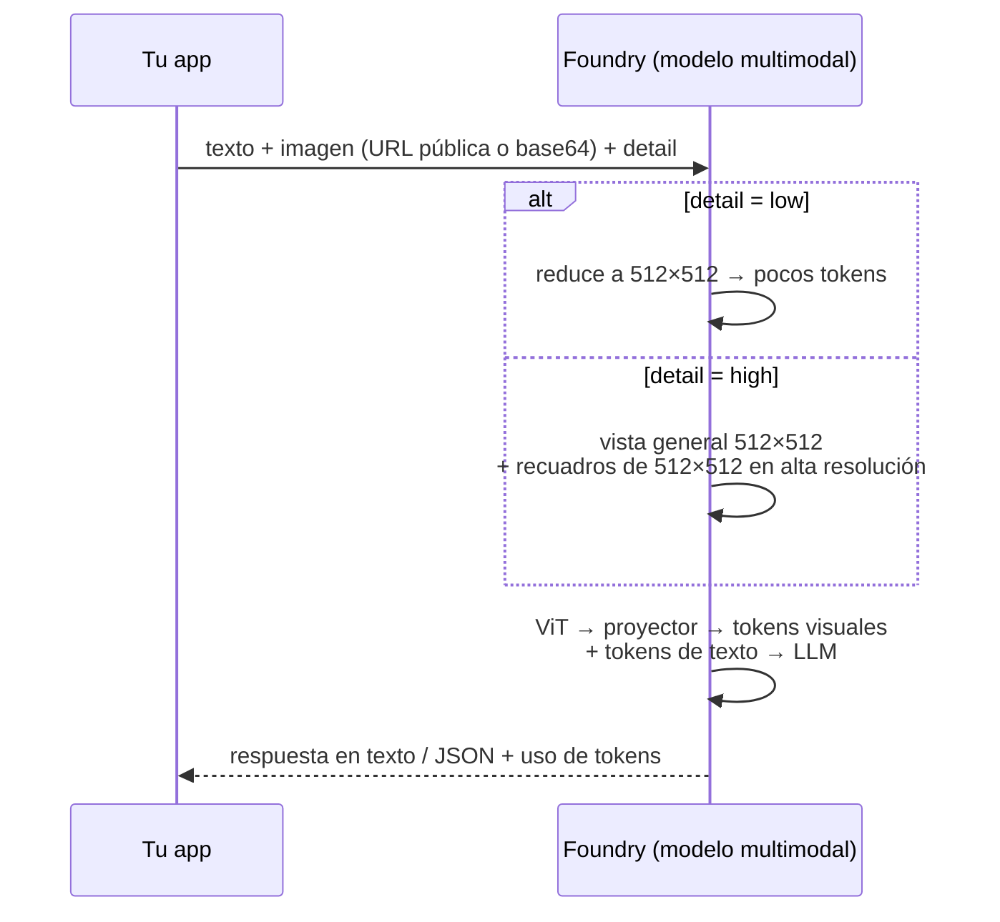

**Límites documentados** (pueden variar por modelo): imágenes de hasta **20 MB**, máximo **10 imágenes por llamada**, formatos **JPEG, PNG, GIF (solo el primer cuadro) y WEBP**, y las URL deben ser **públicas** (no se aceptan URL detrás de endpoints privados o firewalls; para eso envía la imagen en base64). El modo de baja resolución puede reducir la precisión al reconocer objetos y texto.

---

### Práctica en Python

Los ejemplos 1 a 5 solo usan `numpy` y `pillow` y funcionan sin GPU ni Azure; muestran **por dentro** lo que hace un ViT y un modelo tipo CLIP.

```bash
pip install numpy pillow
```

Descarga la foto de ejemplo (la misma del tema 2):

```python
import urllib.request
urllib.request.urlretrieve("https://raw.githubusercontent.com/Azure-Samples/cognitive-services-sample-data-files/"
                           "master/ComputerVision/Images/dog.jpg", "dog.jpg")
```

#### 1) De imagen a secuencia de tokens (parcheo, [CLS] y posición)

```python
import numpy as np
from PIL import Image

img = np.array(Image.open("dog.jpg").convert("RGB").resize((224, 224)), dtype=np.float32) / 255.0
P, D = 16, 768                                   # tamaño de parche y dimensión del embedding (ViT-Base)
G = 224 // P                                     # 14 parches por lado

# 1) PARCHEO: (224, 224, 3) -> (196, 16, 16, 3) -> (196, 768)
parches = img.reshape(G, P, G, P, 3).transpose(0, 2, 1, 3, 4).reshape(G * G, P * P * 3)
print("Imagen:", img.shape, "-> parches aplanados:", parches.shape)

# 2) PROYECCIÓN LINEAL (en un ViT real, W_e se APRENDE durante el entrenamiento)
rng = np.random.default_rng(0)
W_e = rng.normal(0, 0.02, (P * P * 3, D))
tokens = parches @ W_e                           # (196, 768)

# 3) TOKEN [CLS]: un vector extra que al final "resume" toda la imagen (para clasificar)
cls = rng.normal(0, 0.02, (1, D))
tokens = np.vstack([cls, tokens])                # (197, 768)

# 4) CODIFICACIÓN POSICIONAL: sin esto, el modelo no sabría dónde estaba cada parche
pos = rng.normal(0, 0.02, (G * G + 1, D))
entrada = tokens + pos
print("Secuencia que entra al Transformer:", entrada.shape, "-> 1 [CLS] + 196 parches, 768 dims c/u")

# Prueba de por qué hace falta la posición: barajar los parches NO cambia el conjunto sin 'pos'
perm = rng.permutation(196) + 1
barajada = np.vstack([tokens[:1], tokens[perm]])
print("Sin posición, ¿mismo conjunto de vectores al barajar?:",
      np.allclose(np.sort(tokens, axis=0), np.sort(barajada, axis=0)))
print("Con posición, ¿la entrada cambia al barajar?:", not np.allclose(entrada, barajada + pos))
```

Salida:
```
Imagen: (224, 224, 3) -> parches aplanados: (196, 768)
Secuencia que entra al Transformer: (197, 768) -> 1 [CLS] + 196 parches, 768 dims c/u
Sin posición, ¿mismo conjunto de vectores al barajar?: True
Con posición, ¿la entrada cambia al barajar?: True
```
- **Explicación:**
  - El `reshape` + `transpose` corta la imagen en la cuadrícula de 14×14 sin bucles; es el equivalente a una convolución con kernel 16×16 y *stride* 16 (fórmula del tema 2: (224 − 16)/16 + 1 = 14).
  - Sin la posición, barajar los parches deja exactamente el **mismo conjunto** de vectores: para la atención, una foto y su versión "rompecabezas desarmado" serían idénticas. La codificación posicional lo evita.

#### 2) Self-attention desde cero

```python
import numpy as np

rng = np.random.default_rng(1)
N, D, H = 197, 768, 12            # tokens, dimensión, cabezas de atención (ViT-Base)
d_h = D // H                      # 64 dimensiones por cabeza
X = rng.normal(size=(N, D))       # la secuencia de tokens del ejemplo anterior

def softmax(z):
    z = z - z.max(axis=-1, keepdims=True)
    e = np.exp(z); return e / e.sum(axis=-1, keepdims=True)

# Pesos aprendidos de Query, Key y Value para UNA cabeza
Wq, Wk, Wv = (rng.normal(0, D ** -0.5, (D, d_h)) for _ in range(3))
Q, K, V = X @ Wq, X @ Wk, X @ Wv                  # (197, 64) cada uno

puntajes = Q @ K.T / np.sqrt(d_h)                 # (197, 197): ¿cuánto le importa el token i al token j?
A = softmax(puntajes)                             # cada fila suma 1
salida = A @ V                                    # (197, 64): mezcla ponderada de los valores

print("Q, K, V:", Q.shape, "| matriz de atención:", A.shape, "| salida de 1 cabeza:", salida.shape)
print("¿Cada fila de atención suma 1?:", np.allclose(A.sum(axis=1), 1))
print(f"El token [CLS] reparte su atención: máx {A[0].max():.3f}, mín {A[0].min():.4f} entre {N} tokens")

# Multi-cabeza: 12 cabezas de 64 dims se concatenan -> 768 de nuevo
print(f"\n{H} cabezas × {d_h} dims = {H * d_h} (se concatenan y se proyectan otra vez a {D})")
print(f"Pares de atención por cabeza y capa: {N}² = {N**2:,}")
print(f"En 12 capas × 12 cabezas: {12 * 12 * N**2:,} puntajes de atención por imagen")
```

Salida:
```
Q, K, V: (197, 64) | matriz de atención: (197, 197) | salida de 1 cabeza: (197, 64)
¿Cada fila de atención suma 1?: True
El token [CLS] reparte su atención: máx 0.035, mín 0.0004 entre 197 tokens

12 cabezas × 64 dims = 768 (se concatenan y se proyectan otra vez a 768)
Pares de atención por cabeza y capa: 197² = 38,809
En 12 capas × 12 cabezas: 5,588,496 puntajes de atención por imagen
```
- **Explicación:**
  - La matriz `A` de 197×197 es literalmente "cuánto mira cada parche a cada otro"; es lo que se dibujó en la imagen de atención ilustrativa.
  - Se divide entre √64 = 8 para que los puntajes no crezcan demasiado y el softmax no se vuelva extremo.
  - Con pesos aleatorios, la atención del [CLS] está casi repartida por igual; durante el entrenamiento aprende a concentrarse en los parches útiles (por ejemplo, el perro y no el cielo).
  - Más de **5.5 millones** de puntajes por imagen en un ViT-Base explican por qué la atención es la parte más costosa.

#### 3) ¿De dónde salen los 86 millones de parámetros de ViT-Base?

```python
def params_vit(capas=12, D=768, mlp=3072, parche=16, img=224, canales=3, clases=1000):
    n = (img // parche) ** 2
    embed = parche * parche * canales * D + D            # proyección lineal de parches (+ sesgo)
    extra = D + (n + 1) * D                              # token [CLS] + embeddings de posición
    atencion = 4 * (D * D + D)                           # Wq, Wk, Wv y proyección de salida
    mlp_p = D * mlp + mlp + mlp * D + D                  # dos capas densas
    norma = 2 * 2 * D                                    # dos LayerNorm por bloque
    bloque = atencion + mlp_p + norma
    cabeza = 2 * D + D * clases + clases                 # LayerNorm final + clasificador
    return embed + extra + capas * bloque + cabeza

for nombre, cfg in [("ViT-Base/16 ", dict(capas=12, D=768,  mlp=3072)),
                    ("ViT-Large/16", dict(capas=24, D=1024, mlp=4096)),
                    ("ViT-Huge/14 ", dict(capas=32, D=1280, mlp=5120, parche=14))]:
    print(f"{nombre}: {params_vit(**cfg)/1e6:6.1f} millones de parámetros")
```

Salida:
```
ViT-Base/16 :   86.6 millones de parámetros
ViT-Large/16:  304.3 millones de parámetros
ViT-Huge/14 :  632.0 millones de parámetros
```
- **Explicación:**
  - Coincide con lo reportado en el paper del ViT (86 M, 307 M y 632 M); la pequeña diferencia en ViT-Large viene de detalles de la cabeza de clasificación usada en el paper.
  - Dos tercios de cada bloque están en el **MLP** (768 → 3072 → 768), no en la atención.
  - Comparado con un LLM moderno (miles de millones de parámetros), el codificador de visión es pequeño: en un modelo multimodal, la mayor parte del tamaño está en la parte de lenguaje.

#### 4) Pérdida contrastiva (CLIP) y clasificación zero-shot

```python
import numpy as np

def normalizar(z): return z / np.linalg.norm(z, axis=1, keepdims=True)

def perdida_contrastiva(img_emb, txt_emb, temperatura=0.07):
    """InfoNCE simétrica de CLIP: el par i-i es el correcto; los demás de la fila/columna son 'negativos'."""
    S = normalizar(img_emb) @ normalizar(txt_emb).T / temperatura      # (N, N)
    log_sm_filas = S - np.log(np.exp(S).sum(axis=1, keepdims=True))     # imagen -> texto
    log_sm_cols  = S - np.log(np.exp(S).sum(axis=0, keepdims=True))     # texto -> imagen
    return -(np.mean(np.diag(log_sm_filas)) + np.mean(np.diag(log_sm_cols))) / 2

rng = np.random.default_rng(7)
N, D = 4, 8
conceptos = rng.normal(size=(N, D))                       # "perro", "gato", "auto", "playa"
alineados    = (conceptos + 0.1 * rng.normal(size=(N, D)), conceptos + 0.1 * rng.normal(size=(N, D)))
desalineados = (conceptos, rng.normal(size=(N, D)))      # textos que no corresponden
print(f"Pérdida con pares ALINEADOS:    {perdida_contrastiva(*alineados):.3f}")
print(f"Pérdida con pares DESALINEADOS: {perdida_contrastiva(*desalineados):.3f}")
print(f"(Referencia: adivinar al azar entre {N} opciones = ln({N}) = {np.log(N):.3f})")

# Clasificación ZERO-SHOT: comparar una imagen nueva contra textos de etiquetas
etiquetas = ["una foto de un perro", "una foto de un gato", "una foto de un auto", "una foto de una playa"]
txt = normalizar(alineados[1])
imagen_nueva = normalizar((conceptos[0] + 0.3 * rng.normal(size=D))[None])   # un perro "nunca visto"
sim = (imagen_nueva @ txt.T)[0]
probs = np.exp(sim / 0.07) / np.exp(sim / 0.07).sum()
for e, s, p in sorted(zip(etiquetas, sim, probs), key=lambda t: -t[2]):
    print(f"  {e:<24} similitud coseno {s:+.2f} -> {p:6.1%}")
```

Salida:
```
Pérdida con pares ALINEADOS:    0.004
Pérdida con pares DESALINEADOS: 1.972
(Referencia: adivinar al azar entre 4 opciones = ln(4) = 1.386)
  una foto de un perro     similitud coseno +0.95 ->  99.8%
  una foto de un gato      similitud coseno +0.49 ->   0.2%
  una foto de un auto      similitud coseno +0.37 ->   0.0%
  una foto de una playa    similitud coseno -0.03 ->   0.0%
```
- **Explicación:**
  - La pérdida es casi 0 cuando cada imagen está cerca de **su** texto, y peor que adivinar al azar (ln 4 = 1.386) cuando los pares no corresponden. Entrenar CLIP es mover millones de pesos para bajar este número en millones de pares.
  - La **temperatura** (0.07, el valor inicial de CLIP) amplifica las diferencias de similitud antes del softmax: una similitud de 0.95 contra 0.49 se convierte en 99.8% contra 0.2%.
  - Los embeddings aquí son sintéticos; con CLIP real el proceso es idéntico (ejemplo 7).

#### 5) ¿Cuántos tokens "cuesta" una imagen? (estimación)

```python
import math

def tokens_imagen_aprox(ancho, alto, detail="high", base=85, por_tile=170):
    """Estimación clásica para modelos tipo GPT-4o (puede variar por modelo; revisa la documentación)."""
    if detail == "low":
        return base                                       # una sola versión de 512×512
    # 1) que quepa en 2048×2048
    escala = min(1, 2048 / max(ancho, alto)); ancho, alto = ancho * escala, alto * escala
    # 2) reducir hasta que el lado corto mida 768 (las imágenes pequeñas no se agrandan)
    escala = min(1, 768 / min(ancho, alto)); ancho, alto = ancho * escala, alto * escala
    # 3) contar recuadros de 512×512
    tiles = math.ceil(ancho / 512) * math.ceil(alto / 512)
    return base + por_tile * tiles

for nombre, (w, h) in {"Foto del perro (600×450)": (600, 450),
                       "Foto de celular (4032×3024)": (4032, 3024),
                       "Captura de pantalla (1920×1080)": (1920, 1080),
                       "Documento vertical (1700×2200)": (1700, 2200),
                       "Miniatura (256×256)": (256, 256)}.items():
    print(f"{nombre:<32} low = {tokens_imagen_aprox(w, h, 'low'):4d} tokens | high = {tokens_imagen_aprox(w, h):5d} tokens")
```

Salida:
```
Foto del perro (600×450)         low =   85 tokens | high =   425 tokens
Foto de celular (4032×3024)      low =   85 tokens | high =   765 tokens
Captura de pantalla (1920×1080)  low =   85 tokens | high =  1105 tokens
Documento vertical (1700×2200)   low =   85 tokens | high =   765 tokens
Miniatura (256×256)              low =   85 tokens | high =   255 tokens
```
- **Explicación:**
  - Implementa la lógica de recuadros de 512×512 de la sección 6. Los valores 85 (vista general) y 170 (por recuadro) son los de la fórmula clásica publicada para modelos tipo GPT-4o; **otros modelos calculan distinto**, así que úsalo para entender el orden de magnitud, no para facturar. El número exacto viene en `usage` de cada respuesta.
  - Una foto de celular de 12 MP no cuesta más que una de 1,024 px: el servicio la reduce antes. Mandar imágenes enormes solo hace más lenta la subida.
  - Con `low`, cualquier imagen cuesta lo mismo: ideal para clasificar o etiquetar miles de fotos.

#### 6) Enviar una imagen a un modelo multimodal en Foundry (requiere un proyecto de Foundry)

```python
# pip install azure-ai-projects azure-identity
import os, base64
from azure.ai.projects import AIProjectClient
from azure.identity import DefaultAzureCredential

proyecto = AIProjectClient(endpoint=os.environ["PROJECT_ENDPOINT"], credential=DefaultAzureCredential())
cliente = proyecto.get_openai_client()
modelo = os.environ.get("MODEL_DEPLOYMENT_NAME", "gpt-4.1")

# Opción A: imagen local en base64 (sirve aunque la imagen no sea pública)
with open("dog.jpg", "rb") as f:
    data_url = "data:image/jpeg;base64," + base64.b64encode(f.read()).decode()

for detalle in ("low", "high"):
    r = cliente.responses.create(
        model=modelo,
        input=[{"role": "user", "content": [
            {"type": "input_text", "text": "Describe la escena en una frase y di qué raza parece el perro."},
            {"type": "input_image", "image_url": data_url, "detail": detalle},
        ]}],
    )
    print(f"[{detalle}] tokens de entrada: {r.usage.input_tokens} -> {r.output_text}")
```
- **Explicación:**
  - Es la arquitectura 2 en acción: el servicio corre el codificador de visión, convierte la imagen en tokens visuales y se los pasa al LLM junto con tu pregunta.
  - Compara `input_tokens` entre `low` y `high`: verás en la práctica el efecto de los recuadros de 512×512.
  - Con base64 no importa si la imagen es privada; con una URL, debe ser accesible públicamente (límite documentado del servicio).

#### 7) CLIP real con Hugging Face (zero-shot)

```python
# pip install transformers torch pillow requests
from PIL import Image
import requests
from transformers import CLIPModel, CLIPProcessor

modelo = CLIPModel.from_pretrained("openai/clip-vit-base-patch32")
procesador = CLIPProcessor.from_pretrained("openai/clip-vit-base-patch32")

url = "http://images.cocodataset.org/val2017/000000039769.jpg"   # dos gatos en un sillón
imagen = Image.open(requests.get(url, stream=True).raw)
textos = ["una foto de gatos", "una foto de un perro", "una foto de un coche"]

entradas = procesador(text=textos, images=imagen, return_tensors="pt", padding=True)
probs = modelo(**entradas).logits_per_image.softmax(dim=1)[0]

for texto, p in zip(textos, probs):
    print(f"{texto:25s} {p:.2%}")
```
- **Explicación:**
  - `clip-vit-base-patch32` usa un **ViT** con parches de 32×32 como codificador de imagen (224 / 32 = 7 → solo 49 parches, más rápido que con parches de 16).
  - El modelo compara el embedding de la imagen con el de cada texto; la opción "gatos" obtiene la probabilidad más alta. Es exactamente el ejemplo 4, pero con embeddings aprendidos de 400 millones de pares.
  - Esto es *clasificación zero-shot*: nunca se entrenó con esas etiquetas exactas.
  - El CLIP original se entrenó sobre todo con textos en inglés; con etiquetas en inglés ("a photo of cats") suele dar probabilidades más claras. Necesita descargar ~600 MB de pesos la primera vez.

---

### Para el examen
- Un **ViT** divide la imagen en **parches**, los convierte en **vectores (embeddings)** y usa **atención** para relacionarlos entre sí.
- La **codificación posicional** le dice al modelo dónde estaba cada parche.
- Un **modelo multimodal** combina un **codificador de visión** y uno de **lenguaje**; la **atención cruzada** crea un **espacio vectorial compartido** entre imágenes y texto.
- Por eso puede **describir imágenes que nunca vio** y responder preguntas sobre ellas.
- **CLIP** usa **aprendizaje contrastivo** para alinear imágenes y textos.
- En Foundry, modelos como **GPT-4.1**, **GPT-5.x** y **Phi-4-multimodal** aceptan imágenes como entrada.

**Preguntas rápidas:**
1. *¿En cuántos parches de 16×16 se divide una imagen de 224×224?* → 14 × 14 = **196**.
2. *¿Qué componente del ViT relaciona cada parche con todos los demás?* → La **atención (self-attention)**.
3. *¿Qué pasaría sin codificación posicional?* → El modelo no sabría el **orden/ubicación** de los parches.
4. *¿Qué permite que un modelo multimodal describa una imagen?* → Un **espacio vectorial compartido** entre visión y lenguaje (atención cruzada).
5. *¿Qué técnica alinea imágenes y textos acercando los pares correctos?* → **Aprendizaje contrastivo** (CLIP).

---

### 🖼️ Créditos de imágenes
- `ms-foundry-multimodal-auto.png`: documentación oficial de Microsoft Foundry, repositorio [MicrosoftDocs/azure-ai-docs](https://github.com/MicrosoftDocs/azure-ai-docs) (licencia **CC BY 4.0**, © Microsoft).
- Las demás figuras se generaron con Python para este acordeón a partir de [`dog.jpg`](https://github.com/Azure-Samples/cognitive-services-sample-data-files) (Azure-Samples, licencia MIT) y de datos sintéticos. La figura de atención es **ilustrativa** (rasgos simples), no la salida de un ViT entrenado.

### Recursos
- [Introducción a los conceptos de computer vision (unidad "Transformadores de visión y modelos multimodales") – Microsoft Learn](https://learn.microsoft.com/es-es/training/modules/introduction-computer-vision/)
- [Usar modelos de chat con visión – Azure OpenAI en Microsoft Foundry](https://learn.microsoft.com/en-us/azure/ai-foundry/openai/how-to/gpt-with-vision)
- [An Image is Worth 16x16 Words (paper ViT)](https://arxiv.org/abs/2010.11929)
- [Attention Is All You Need (paper del Transformer)](https://arxiv.org/abs/1706.03762)
- [CLIP: Connecting text and images – OpenAI](https://openai.com/index/clip/) · [paper](https://arxiv.org/abs/2103.00020)
- [Visual Instruction Tuning (LLaVA)](https://arxiv.org/abs/2304.08485)
- [The Illustrated Transformer – Jay Alammar](https://jalammar.github.io/illustrated-transformer/)
