# Tema 5: Generación de imágenes — Fundamentos técnicos

### Descripción
La misma arquitectura multimodal que permite "preguntarle" cosas a una imagen puede funcionar **al revés**: a partir de un prompt en lenguaje natural, el modelo identifica las características visuales asociadas a esas palabras y **sintetiza una imagen nueva**. Hoy la mayoría de los generadores usan **difusión**.

Analogía: un escultor frente a un bloque de mármol. El bloque es **ruido aleatorio**; el escultor (el modelo) quita material poco a poco, guiado por la descripción ("un perro con un palo en el hocico"), hasta que aparece la figura.

Lectura oficial: [Introducción a los conceptos de computer vision (unidad "Generación de imágenes") – Microsoft Learn](https://learn.microsoft.com/es-es/training/modules/introduction-computer-vision/)

> 📷 Las figuras de este tema son **cálculos reales** hechos con Python (el código está en el documento): la foto del perro de los temas anteriores ([`dog.jpg`](https://github.com/Azure-Samples/cognitive-services-sample-data-files), samples de Azure AI Vision, licencia MIT) y datos sintéticos en 2D. Para que corran sin GPU, en lugar de una red neuronal entrenada se usa un **denoiser exacto** sobre conjuntos de datos pequeños; la mecánica de la difusión (ruido, pasos, semilla, guidance) es la misma.

---

### 1. La idea general

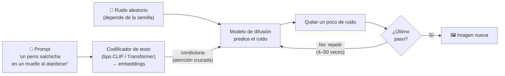

1. **Condicionamiento por texto:** el prompt se convierte en embeddings que identifican características visuales relacionadas.
2. **Inicio con ruido:** la imagen comienza como un conjunto de píxeles aleatorios.
3. **Eliminación iterativa de ruido (denoising):** en cada paso el modelo predice qué parte es ruido y lo quita, creando estructura.
4. **Evaluación contra el prompt:** en cada iteración compara la imagen con la descripción, hasta producir la escena deseada.

> 🔑 Comparado con el tema anterior: un modelo multimodal de **comprensión** va de imagen → texto. Uno de **generación** va de texto → imagen. Ambos se apoyan en el mismo truco: un **espacio vectorial compartido** donde "perro" (texto) y las características visuales de un perro (imagen) están cerca.

---

### 2. ¿Cómo aprende a quitar ruido? El proceso hacia adelante

**Entrenamiento:** se toman millones de imágenes reales con su descripción y se les agrega ruido gradualmente hasta que quedan como estática. Gracias a una propiedad de la distribución normal, no hace falta hacerlo paso por paso: se puede saltar directo a cualquier paso `t`:

```
x_t = √ᾱ_t · x_0  +  √(1 − ᾱ_t) · ε          ε ~ ruido normal N(0, 1)
```

donde `ᾱ_t` ("alfa barra") dice **cuánta imagen original sobrevive** en el paso `t` (1 al inicio, casi 0 al final).

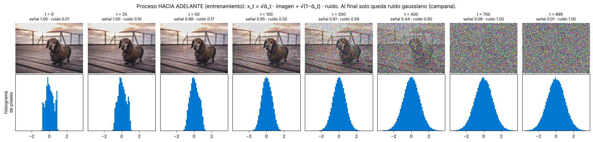

*La foto del perro con el calendario de ruido del paper DDPM (1,000 pasos). Abajo, el histograma de los píxeles: empieza con la forma propia de la foto y termina como una **campana perfecta**, ruido gaussiano puro. En t = 400 todavía se intuye el perro; en t = 700 ya no.*

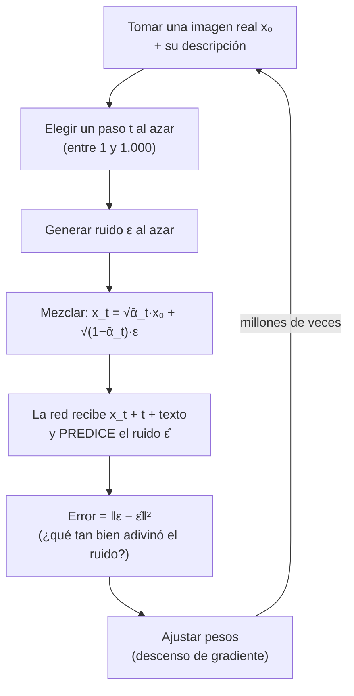

- El modelo aprende la tarea inversa: **dada una imagen con ruido + el texto, predecir el ruido** que hay que quitar.
- Es un problema de **regresión** muy simple de plantear (error cuadrático medio) aplicado a millones de imágenes y a todos los niveles de ruido.
- **Generación (proceso inverso):** se parte de ruido puro y se aplica ese aprendizaje decenas de veces.

#### El calendario de ruido (noise schedule)

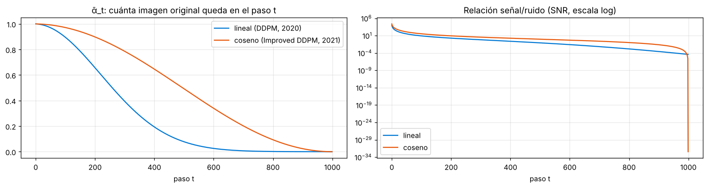

*Izquierda: cuánta imagen queda en cada paso con el calendario **lineal** del DDPM original (2020) y el **coseno** (2021). Con el lineal, la imagen se destruye muy rápido y muchos pasos finales son "ruido sobre ruido"; el coseno reparte mejor la destrucción, y el modelo aprende más de cada paso. Derecha: la relación señal/ruido cae varios órdenes de magnitud.*

---

### 3. El proceso inverso: de ruido a imagen

En la generación se hace el camino contrario: se parte de **ruido puro** y, en cada paso, el modelo estima "¿cómo se vería la imagen limpia?" y se retrocede un poco hacia ella.

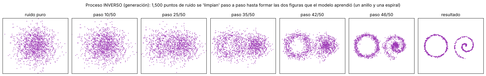

*Ejemplo en 2D (más fácil de ver que en millones de píxeles): los datos de entrenamiento son un **anillo** y una **espiral**. Se lanzan 1,500 puntos de ruido y, en 50 pasos, el modelo los mueve hasta formar exactamente esas figuras. Observa que la estructura aparece **tarde** (después del paso 35): primero se definen las formas generales y al final los detalles. En imágenes pasa lo mismo: primero la composición y los colores, al final las texturas.*

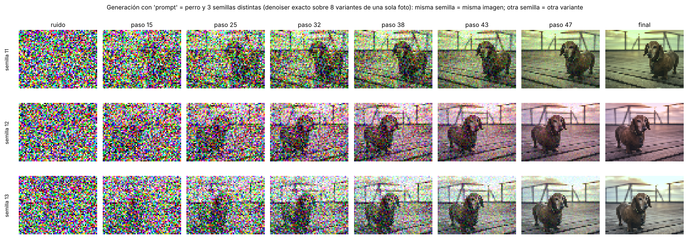

*Lo mismo en una imagen de 64×48 píxeles con "prompt" = perro y tres **semillas** distintas. Cada semilla produce otro ruido inicial y termina en otra variante (otro encuadre, otra iluminación). Con la misma semilla y el mismo prompt saldría exactamente la misma imagen.*

> ⚠️ **Por qué estas imágenes se parecen tanto a la foto original:** aquí el "modelo" es un denoiser exacto que solo conoce 8 variantes de una foto, así que **memoriza** y reproduce una de ellas. Un modelo real se entrena con cientos de millones de imágenes y una red que **generaliza**: combina conceptos ("salchicha" + "muelle" + "acuarela") en imágenes que nunca existieron. Que un generador reproduzca casi idéntica una imagen de su entrenamiento (memorización) es un riesgo real de privacidad y derechos de autor que se estudia activamente.

---

### 4. Difusión latente (Stable Diffusion)

Trabajar sobre millones de píxeles en cada uno de 30–50 pasos es carísimo. La **difusión latente** (paper de 2022, base de Stable Diffusion) primero **comprime** la imagen con un autoencoder (VAE) y hace toda la difusión en ese espacio pequeño (*latente*).

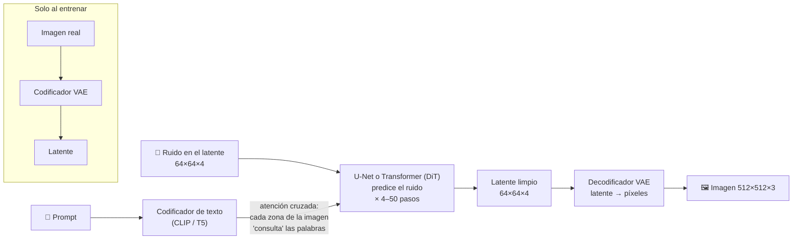

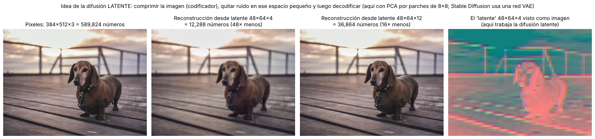

*Demostración de la idea con una compresión sencilla (PCA por parches de 8×8): la foto de 589,824 números se resume en un "latente" de 48×64×4 = 12,288 números (48 veces menos) y aun así se reconstruye reconocible. Stable Diffusion hace lo mismo con una red neuronal (VAE), que reconstruye con muchísimo más detalle. La difusión ocurre en el espacio de la derecha, no en los píxeles.*

| | Difusión en píxeles | Difusión latente |
|---|---|---|
| Espacio de trabajo | 512×512×3 = 786,432 valores | 64×64×4 = 16,384 valores (**48× menos**) |
| Costo por paso | Muy alto | Bajo: corre en una GPU de consumo |
| Quién "pinta" los detalles finos | El modelo de difusión | El **decodificador VAE** |
| Ejemplos | DDPM, Imagen (Google) | Stable Diffusion, SDXL, FLUX |

**Las tres piezas de un generador latente:**

| Pieza | Función | Analogía |
|---|---|---|
| **Codificador de texto** | Convierte el prompt en embeddings | El cliente que describe el encargo |
| **U-Net / Transformer de difusión (DiT)** | Quita el ruido del latente paso a paso, consultando el texto con **atención cruzada** | El escultor |
| **Decodificador VAE** | Convierte el latente final en píxeles | El fotógrafo que revela el negativo |

---

### 5. Parámetros que verás en los generadores

| Parámetro | Qué controla | Valores típicos | Efecto de subirlo |
|---|---|---|---|
| **Prompt** | Qué incluir | Texto descriptivo | — |
| **Negative prompt** | Qué evitar ("borroso, texto, manos deformes") | Texto | — |
| **Pasos (steps)** | Cuántas veces se quita ruido | 20–50 (modelos destilados: 1–4) | Más detalle y más tiempo (con rendimientos decrecientes) |
| **Guidance scale (CFG)** | Qué tanto se apega al prompt vs. creatividad | 5–9 en Stable Diffusion | Más fiel al prompt, menos variedad; muy alto = colores "quemados" |
| **Seed (semilla)** | El ruido inicial | Cualquier entero | — (misma semilla + mismo prompt = misma imagen) |
| **Tamaño y calidad** | Resolución y esfuerzo | 1024×1024, `low`/`medium`/`high` | Más costo y tiempo |

#### Pasos de muestreo

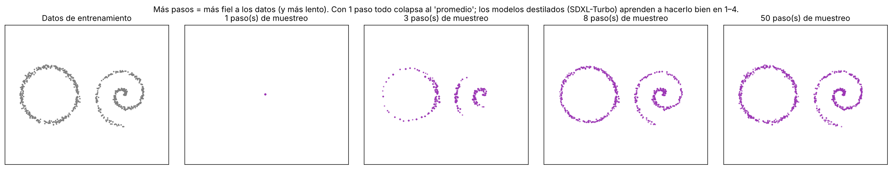

*Con **1 paso**, el modelo solo puede predecir el "promedio" de todo lo que aprendió y los 1,500 puntos caen en un solo lugar (en imágenes: una mancha borrosa). Con 3 pasos aparecen las figuras pero incompletas; con 8 ya están casi completas y de 8 a 50 la mejora es mínima. Por eso existen modelos **destilados** (SDXL-Turbo, LCM) entrenados específicamente para generar bien en 1–4 pasos.*

#### Guidance: apego al prompt vs. diversidad

La técnica más usada es **classifier-free guidance (CFG)**: en cada paso el modelo predice el ruido **dos veces**, con y sin el prompt, y exagera la diferencia:

```
ruido_final = ruido_sin_prompt + w · (ruido_con_prompt − ruido_sin_prompt)
```

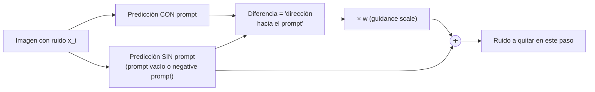

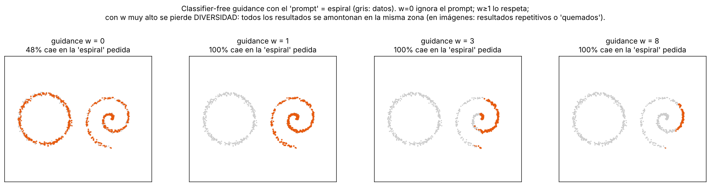

*"Prompt" = espiral. Con **w = 0** el modelo ignora el prompt y genera cualquiera de las dos figuras (48% espirales). Con **w = 1** todas son espirales y cubren toda la figura. Con **w = 3** y **w = 8** siguen siendo espirales, pero se **amontonan** en una parte: se pierde diversidad. En imágenes reales, un guidance excesivo produce resultados repetitivos, sobresaturados o "quemados".*

> 💡 El **negative prompt** se implementa con este mismo mecanismo: en lugar de "sin prompt" se usa la predicción con el negative prompt, así que el modelo se **aleja** activamente de eso.

---

### 6. Otras arquitecturas generativas (contexto histórico)

| Arquitectura | Idea | Ejemplo |
|---|---|---|
| VAE (2013) | Comprimir y reconstruir; muestrear del espacio latente | Imágenes borrosas, pero base de la difusión latente |
| GAN (2014) | Un generador y un discriminador compiten | StyleGAN (rostros que no existen) |
| VQGAN + CLIP (2021) | VQGAN genera y CLIP evalúa si la imagen coincide con el texto, optimizando iterativamente | Arte generativo de 2021 en Google Colab |
| Difusión (2020–hoy) | Quitar ruido guiado por texto | Stable Diffusion, FLUX |
| Generación nativa multimodal | El mismo modelo multimodal que entiende texto e imágenes también las genera (OpenAI la describe como autorregresiva) | Familia GPT-Image |

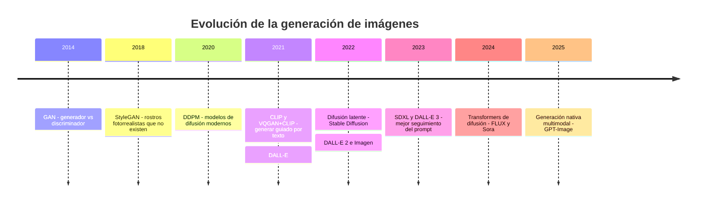

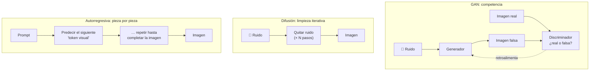

| | GAN | Difusión | Autorregresiva / nativa multimodal |
|---|---|---|---|
| Velocidad | Muy rápida (1 pasada) | Media (varios pasos) | Media–lenta (muchos tokens) |
| Calidad y diversidad | Alta calidad, poca diversidad (*mode collapse*) | Alta calidad y diversidad | Alta, con mejor seguimiento de instrucciones |
| Estabilidad del entrenamiento | Difícil (dos redes compitiendo) | Estable (regresión simple) | Estable (igual que un LLM) |
| Fuerte en | Rostros, estilos específicos | Arte, fotografía, edición | Texto dentro de la imagen, instrucciones complejas, edición conversacional |

---

### 7. Edición de imágenes (inpainting)

La misma técnica sirve para **modificar** una imagen existente: se agrega ruido solo en la zona que quieres cambiar (indicada con una **máscara**) y se regenera esa zona guiada por el prompt, respetando el resto.

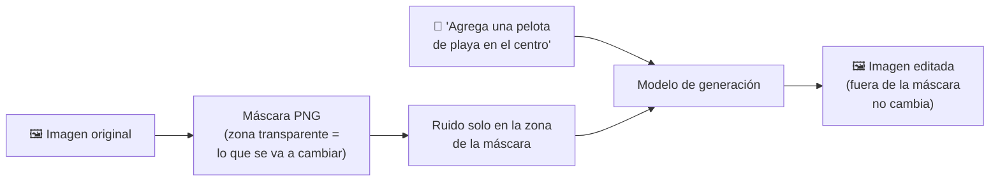

En Microsoft Foundry, según la documentación oficial, el endpoint de edición de imágenes acepta hasta **16 imágenes de entrada** (PNG o JPG, menos de 50 MB cada una); la máscara debe ser un **PNG del mismo tamaño** que la imagen, con **píxeles totalmente transparentes** en la zona a modificar.

---

### 8. Video

Los modelos de video extienden la idea, pero además deben respetar el **comportamiento físico** (que un perro camine con las patas en el suelo) y la **progresión temporal** (una secuencia lógica de acciones). En lugar de quitar ruido a una imagen, lo quitan a un bloque de **espacio × tiempo** (parches que abarcan varios cuadros).

| Reto | Por qué es difícil |
|---|---|
| Consistencia temporal | El perro no debe cambiar de color entre un cuadro y el siguiente |
| Física | Gravedad, colisiones, reflejos, causa y efecto |
| Costo | Un video de 10 s a 24 fps son 240 imágenes que deben ser coherentes entre sí |

En Foundry: **Sora 2** (en preview al momento de escribir esto). La documentación oficial indica que genera video a partir de texto, de imágenes o de otro video generado, puede incluir **audio**, y reconoce como limitaciones la física compleja, las relaciones causa-efecto (por ejemplo, marcas de mordida en una galleta), el razonamiento espacial (izquierda/derecha) y las secuencias de tiempo precisas. Tutorial en la [Parte 2, Módulo 5](../../parte2/modulo5/tema4.md).

---

### 9. Generación de imágenes en Microsoft Foundry

Según la documentación de Azure OpenAI en Microsoft Foundry (consultada en octubre de 2026):

| Modelo | Disponibilidad | Notas |
|---|---|---|
| **GPT-Image-2.5** (variantes *Sunburst* y *Flare*) | Disponibilidad general | Tamaños personalizados; calidad hasta `max` |
| **GPT-Image-2** | Disponibilidad general | Resoluciones arbitrarias (lados múltiplos de 16, lado largo hasta 3840 px) |
| **GPT-Image-1.5**, **GPT-Image-1**, **GPT-Image-1-Mini** | Acceso limitado (requiere solicitud) | Tamaños 1024×1024, 1024×1536, 1536×1024 |
| DALL-E 3 | **Retirado** (marzo de 2026) | Sustituido por la serie GPT-Image |
| FLUX (Black Forest Labs) | Catálogo de modelos de Foundry | Modelos de difusión de socios |

| Parámetro de la API | Valores documentados |
|---|---|
| `n` | 1 a 10 imágenes por llamada |
| `quality` | `low`, `medium`, `high` (más opciones en GPT-Image-2.5) |
| `output_format` | `PNG` (predeterminado) o `JPEG`; WEBP no es compatible |
| `output_compression` | 0–100 (solo JPEG) |
| `background` | `transparent` (requiere PNG) |
| `partial_images` | 1–3 imágenes intermedias en modo *streaming* |

> ⚠️ Los nombres de modelos y su disponibilidad cambian con frecuencia. Para el examen importa entender **cómo** funciona la generación y sus riesgos, no memorizar versiones.

---

### 10. IA responsable en generación de imágenes

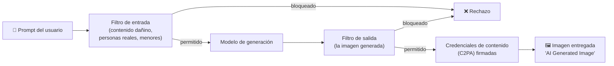

- **Restricciones** sobre personas reales, personajes con derechos de autor y contenido dañino. Por ejemplo, la documentación de Foundry indica que las imágenes fotorrealistas de menores se bloquean por defecto, y que Sora 2 rechaza personas reales (incluidas figuras públicas), personajes y música con derechos de autor.
- Riesgo de *deepfakes* y desinformación → **transparencia** con **credenciales de contenido (C2PA)**: según Microsoft, **todas** las imágenes generadas por Azure OpenAI en Foundry incluyen un manifiesto firmado criptográficamente con la descripción `"AI Generated Image"`, el agente de software (por ejemplo `"Azure OpenAI ImageGen"`) y la fecha. Se puede verificar en [contentcredentials.org/verify](https://contentcredentials.org/verify), que mostrará que las credenciales fueron emitidas por Microsoft Corporation.
- **Sesgos** en las representaciones ("un doctor" siempre genera el mismo perfil): los modelos reproducen los sesgos de sus datos de entrenamiento.
- **Memorización:** un modelo puede reproducir casi idénticas imágenes con las que se entrenó (lo viste en la sección 3), lo que plantea riesgos de privacidad y propiedad intelectual.

| Riesgo | Mitigación |
|---|---|
| Deepfakes de personas reales | Filtros de entrada/salida; bloqueo de rostros reales; credenciales C2PA |
| Contenido dañino o sexual | Filtros de contenido de Foundry (no se pueden desactivar del todo) |
| Derechos de autor | Bloqueo de personajes y estilos protegidos; revisión humana |
| Sesgos | Prompts explícitos y diversos; evaluación de resultados con distintos grupos |
| Desinformación | Marcar el contenido como generado por IA (C2PA, avisos visibles) |

---

### Práctica en Python

Los ejemplos 1 a 3 solo usan `numpy` y `pillow` y corren en cualquier computadora; muestran **por dentro** el ruido, los pasos, la semilla y el guidance.

```bash
pip install numpy pillow
```

```python
# Descarga la foto de ejemplo (la misma de los temas 2 y 4)
import urllib.request
urllib.request.urlretrieve("https://raw.githubusercontent.com/Azure-Samples/cognitive-services-sample-data-files/"
                           "master/ComputerVision/Images/dog.jpg", "dog.jpg")
```

#### 1) El proceso hacia adelante: destruir una foto con ruido

```python
import numpy as np
from PIL import Image

T = 1000
betas = np.linspace(1e-4, 0.02, T)          # cuánto ruido se agrega en cada paso (DDPM)
alpha_bar = np.cumprod(1 - betas)            # cuánta señal original sobrevive hasta el paso t

x0 = np.array(Image.open("dog.jpg").convert("RGB"), dtype=np.float32) / 127.5 - 1   # píxeles en [-1, 1]
rng = np.random.default_rng(0)

def agregar_ruido(x0, t):
    """Atajo del proceso hacia adelante: saltar directo al paso t en UNA operación."""
    eps = rng.normal(size=x0.shape)
    return np.sqrt(alpha_bar[t]) * x0 + np.sqrt(1 - alpha_bar[t]) * eps, eps

print(" paso | % de señal | % de ruido | correlación con la foto original")
for t in [0, 50, 100, 250, 500, 750, 999]:
    xt, _ = agregar_ruido(x0, t)
    corr = np.corrcoef(x0.ravel(), xt.ravel())[0, 1]
    print(f"{t:5d} | {100*np.sqrt(alpha_bar[t]):9.1f}% | {100*np.sqrt(1-alpha_bar[t]):9.1f}% | {corr:6.3f}")

xT, _ = agregar_ruido(x0, T - 1)
print(f"\nEn t=999: media {xT.mean():+.3f}, desviación {xT.std():.3f}  -> prácticamente ruido normal N(0, 1)")
```

Salida:
```
 paso | % de señal | % de ruido | correlación con la foto original
    0 |     100.0% |       1.0% |  1.000
   50 |      98.5% |      17.3% |  0.937
  100 |      94.6% |      32.4% |  0.811
  250 |      72.2% |      69.2% |  0.443
  500 |      27.9% |      96.0% |  0.134
  750 |       5.7% |      99.8% |  0.026
  999 |       0.6% |     100.0% |  0.004

En t=999: media -0.000, desviación 1.000  -> prácticamente ruido normal N(0, 1)
```
- **Explicación:**
  - Los porcentajes son los coeficientes `√ᾱ_t` y `√(1−ᾱ_t)` de la fórmula: la mezcla siempre conserva la "energía" (sus cuadrados suman 1), por eso al final la imagen tiene media 0 y desviación 1, como el ruido puro.
  - La correlación con la foto original cae de 1.0 a prácticamente 0: en el paso 999 no queda información de la foto. Por eso **cualquier** ruido aleatorio sirve como punto de partida para generar.
  - Esto es exactamente lo que se le hace a cada imagen de entrenamiento (con un `t` al azar) para crear los ejemplos de los que aprende el modelo.

#### 2) Generar: pasos, semilla y guidance (DDIM con un denoiser exacto)

```python
import numpy as np

T = 1000
s = 0.008; t_ = np.arange(T + 1) / T
f = np.cos((t_ + s) / (1 + s) * np.pi / 2) ** 2
alpha_bar = (f / f[0])[1:]                                   # calendario coseno

rng = np.random.default_rng(1)
# Datos de "entrenamiento" 2D: dos figuras (anillo y espiral)
th = rng.uniform(0, 2 * np.pi, 400)
anillo = np.c_[np.cos(th), np.sin(th)] * 1.2 + rng.normal(0, .04, (400, 2)) + [-1.6, 0]
u = rng.uniform(0, 1, 400); a = 3.5 * np.pi * u
espiral = np.c_[a * np.cos(a), a * np.sin(a)] / 8 + rng.normal(0, .03, (400, 2)) + [1.6, 0]
datos = np.vstack([anillo, espiral])

def denoiser_perfecto(xt, ab, datos):
    """Predice x0 = promedio de los datos pesado por qué tan probable es que cada uno haya generado xt.
    Una red neuronal real APRENDE a aproximar esta función a partir de millones de ejemplos."""
    d2 = ((xt[:, None, :] - np.sqrt(ab) * datos[None]) ** 2).sum(-1)
    logw = -d2 / (2 * (1 - ab)); logw -= logw.max(1, keepdims=True)
    w = np.exp(logw); w /= w.sum(1, keepdims=True)
    return w @ datos

def generar(datos, n, pasos, semilla, uncond=None, w=0.0):
    """Muestreo DDIM: parte de ruido puro y lo limpia en 'pasos' iteraciones."""
    r = np.random.default_rng(semilla)
    x = r.normal(size=(n, 2))
    ts = np.linspace(T - 1, 0, pasos).astype(int)
    for k, t in enumerate(ts):
        ab = alpha_bar[t]
        eps = (x - np.sqrt(ab) * denoiser_perfecto(x, ab, datos)) / np.sqrt(1 - ab)        # ruido predicho
        if uncond is not None:                                                              # classifier-free guidance
            eps_u = (x - np.sqrt(ab) * denoiser_perfecto(x, ab, uncond)) / np.sqrt(1 - ab)
            eps = eps_u + w * (eps - eps_u)
        x0 = (x - np.sqrt(1 - ab) * eps) / np.sqrt(ab)
        ab_prev = alpha_bar[ts[k + 1]] if k + 1 < len(ts) else 1.0
        x = np.sqrt(ab_prev) * x0 + np.sqrt(1 - ab_prev) * eps
    return x

def calidad(x, datos, radio=0.1):
    d = np.sqrt(((x[:, None] - datos[None]) ** 2).sum(-1))
    precision = (d.min(1) < radio).mean()      # ¿los puntos generados caen sobre las figuras?
    cobertura = (d.min(0) < radio).mean()      # ¿se cubren TODAS las partes de las figuras?
    return precision, cobertura

print("1) PASOS DE MUESTREO vs calidad")
for p in [1, 3, 8, 20, 50]:
    pr, co = calidad(generar(datos, 800, p, semilla=5), datos)
    print(f"   {p:2d} pasos -> precisión {100*pr:5.1f}% | cobertura {100*co:5.1f}%")

print("\n2) SEMILLA: reproducibilidad")
a1, a2, b = generar(datos, 5, 30, 42), generar(datos, 5, 30, 42), generar(datos, 5, 30, 7)
print("   semilla 42 dos veces -> ¿idénticas?:", np.allclose(a1, a2), "| semilla 42 vs 7 -> ¿idénticas?:", np.allclose(a1, b))

print("\n3) GUIDANCE (prompt = 'espiral'): apego al prompt vs diversidad")
for w in [0, 1, 3, 8]:
    x = generar(espiral, 800, 40, semilla=7, uncond=datos, w=w)
    ok = (x[:, 0] > 0).mean()
    print(f"   w = {w}: {100*ok:5.1f}% en la espiral | diversidad (desv. estándar) = {x.std(0).mean():.3f}")
```

Salida:
```
1) PASOS DE MUESTREO vs calidad
    1 pasos -> precisión   0.0% | cobertura   0.0%
    3 pasos -> precisión 100.0% | cobertura  56.6%
    8 pasos -> precisión 100.0% | cobertura  98.1%
   20 pasos -> precisión 100.0% | cobertura  99.1%
   50 pasos -> precisión 100.0% | cobertura  99.2%

2) SEMILLA: reproducibilidad
   semilla 42 dos veces -> ¿idénticas?: True | semilla 42 vs 7 -> ¿idénticas?: False

3) GUIDANCE (prompt = 'espiral'): apego al prompt vs diversidad
   w = 0:  48.8% en la espiral | diversidad (desv. estándar) = 1.162
   w = 1: 100.0% en la espiral | diversidad (desv. estándar) = 0.529
   w = 3: 100.0% en la espiral | diversidad (desv. estándar) = 0.384
   w = 8: 100.0% en la espiral | diversidad (desv. estándar) = 0.178
```
- **Explicación:**
  - `denoiser_perfecto` es la respuesta **exacta** a "¿de qué dato limpio vino este punto ruidoso?" cuando los datos son pocos. Una red neuronal de difusión (U-Net o Transformer) se entrena para **aproximar** esta función con miles de millones de parámetros, y así puede generalizar a imágenes nuevas.
  - **Pasos:** con 1 paso todos los puntos caen en el promedio y nada es válido; con 3 los puntos ya caen sobre las figuras (precisión 100%) pero solo cubren la mitad; con 8 se cubre casi todo. Más allá de 20 pasos la mejora es mínima: por eso los generadores comerciales usan 20–50 pasos, y los destilados, 1–4.
  - **Semilla:** el muestreo DDIM es **determinista** dado el ruido inicial; misma semilla = mismo resultado exacto. Útil para reproducir una imagen y cambiar solo el prompt.
  - **Guidance:** con `w = 0` el "prompt" se ignora (la mitad sale anillo); con `w ≥ 1` todo es espiral, pero la diversidad baja de 0.53 a 0.18 al subir `w` a 8: es el **compromiso fidelidad–diversidad** del guidance.

#### 3) ¿Por qué difusión latente? Comprimir antes de generar

```python
import numpy as np
from PIL import Image

# --- ¿Por qué difusión LATENTE? Cuentas de Stable Diffusion ---
pix = 512 * 512 * 3                 # imagen RGB de 512×512
lat = 64 * 64 * 4                   # latente del VAE: 8× más chico por lado, 4 canales
print(f"Píxeles: {pix:,} valores | Latente: {lat:,} valores | {pix/lat:.0f}× menos trabajo por paso")
print(f"Con 30 pasos: {30*pix:,} vs {30*lat:,} valores procesados por imagen")

# --- Mini 'autoencoder' con PCA por parches de 8×8 (misma idea que el VAE, pero lineal) ---
img = np.array(Image.open("dog.jpg").convert("RGB").resize((512, 384)), dtype=np.float32) / 255
P = 8; H, W = img.shape[0] // P, img.shape[1] // P
X = img.reshape(H, P, W, P, 3).transpose(0, 2, 1, 3, 4).reshape(H * W, P * P * 3)   # cada parche = 192 números
media = X.mean(0)
_, _, Vt = np.linalg.svd(X - media, full_matrices=False)

for k in [4, 12, 48]:
    codificar = lambda x: (x - media) @ Vt[:k].T          # "encoder": 192 -> k
    decodificar = lambda z: z @ Vt[:k] + media            # "decoder": k -> 192
    z = codificar(X)
    error = np.abs(decodificar(z) - X).mean() * 255
    print(f"Latente {H}×{W}×{k:<2} = {z.size:6,} números ({img.size / z.size:4.0f}× compresión) | error medio {error:4.1f} niveles de 255")
```

Salida:
```
Píxeles: 786,432 valores | Latente: 16,384 valores | 48× menos trabajo por paso
Con 30 pasos: 23,592,960 vs 491,520 valores procesados por imagen
Latente 48×64×4  = 12,288 números (  48× compresión) | error medio  6.0 niveles de 255
Latente 48×64×12 = 36,864 números (  16× compresión) | error medio  2.6 niveles de 255
Latente 48×64×48 = 147,456 números (   4× compresión) | error medio  0.8 niveles de 255
```
- **Explicación:**
  - Con la misma reducción que usa Stable Diffusion (8× por lado, 4 canales), el modelo procesa **48 veces menos números** en cada paso. Esa es la razón por la que la difusión latente corre en una GPU de consumo.
  - Incluso un "codificador" lineal tan simple como PCA reconstruye la foto con un error medio de solo 6 niveles (de 255) a 48× de compresión. Un VAE entrenado lo hace mucho mejor porque aprende qué detalles importan visualmente.
  - El compromiso: más compresión = generación más barata, pero el decodificador tiene que "inventar" más detalle fino (por eso las primeras versiones tenían problemas con texto pequeño y rostros).

#### 4) Difusión real con Hugging Face (Colab con GPU gratuita)

```python
# En Google Colab: Entorno de ejecución > Cambiar tipo > GPU T4
# !pip install diffusers transformers accelerate
import torch
from diffusers import AutoPipelineForText2Image

pipe = AutoPipelineForText2Image.from_pretrained(
    "stabilityai/sdxl-turbo", torch_dtype=torch.float16, variant="fp16"
).to("cuda")

prompt = "Un ajolote astronauta flotando sobre la Ciudad de México, ilustración estilo acuarela"
for pasos in [1, 2, 4]:
    g = torch.Generator("cuda").manual_seed(42)                  # misma semilla en las tres pruebas
    imagen = pipe(prompt=prompt, num_inference_steps=pasos, guidance_scale=0.0, generator=g).images[0]
    imagen.save(f"ajolote_{pasos}_pasos.png")
```
- **Explicación:**
  - `sdxl-turbo` es una versión destilada de Stable Diffusion XL que genera en **1–4 pasos** en lugar de 30–50.
  - `num_inference_steps` controla cuántas veces se quita ruido. Al fijar la semilla con `manual_seed(42)`, las tres imágenes parten del **mismo ruido** y solo cambia el número de pasos: así comparas el efecto de forma justa (como en el ejemplo 2).
  - `guidance_scale=0.0` porque SDXL-Turbo se entrenó para funcionar sin classifier-free guidance; en un modelo normal (SDXL, SD 1.5) usarías valores de 5–9.
  - Prueba también cambiar la semilla: misma idea, otra composición.

#### 5) Generar y editar imágenes en Microsoft Foundry (requiere un proyecto de Foundry y un despliegue de GPT-Image)

```python
# pip install azure-ai-projects azure-identity
import os, base64
from azure.ai.projects import AIProjectClient
from azure.identity import DefaultAzureCredential

proyecto = AIProjectClient(endpoint=os.environ["PROJECT_ENDPOINT"], credential=DefaultAzureCredential())
cliente = proyecto.get_openai_client()
modelo = os.environ.get("IMAGE_DEPLOYMENT_NAME", "gpt-image-2")

# ---------- Generar ----------
r = cliente.images.generate(
    model=modelo,
    prompt="Un perro salchicha en un muelle de madera al atardecer, fotografía, luz cálida",
    size="1024x1024",
    quality="medium",      # low / medium / high: más calidad = más tiempo y costo
    n=2,                   # dos variantes en una sola llamada (hasta 10)
)
for i, img in enumerate(r.data):
    with open(f"perro_generado_{i}.png", "wb") as f:
        f.write(base64.b64decode(img.b64_json))     # la serie GPT-Image siempre devuelve base64
print("Imágenes guardadas:", len(r.data))

# ---------- Editar (inpainting con máscara) ----------
# mascara.png: mismo tamaño que la imagen; zona TRANSPARENTE = lo que se va a regenerar
with open("perro_generado_0.png", "rb") as imagen, open("mascara.png", "rb") as mascara:
    e = cliente.images.edit(
        model=modelo,
        image=imagen,
        mask=mascara,
        prompt="Agrega una pelota de playa roja junto al perro",
    )
with open("perro_editado.png", "wb") as f:
    f.write(base64.b64decode(e.data[0].b64_json))
```
- **Explicación:**
  - En Foundry no administras GPU, pasos ni guidance: eliges **prompt, tamaño, calidad y número de imágenes**, y el servicio aplica sus filtros de contenido de entrada y salida.
  - La edición con máscara es el **inpainting** de la sección 7: solo cambia la zona transparente.
  - Cada imagen devuelta lleva **credenciales de contenido C2PA** ("AI Generated Image"). Súbela a [contentcredentials.org/verify](https://contentcredentials.org/verify) para verlas. Ojo: herramientas que recomprimen o quitan metadatos (algunas redes sociales, capturas de pantalla) pueden eliminar el manifiesto.
  - No pude ejecutar este ejemplo aquí (requiere un recurso de Azure); el nombre del despliegue depende del que hayas creado en tu proyecto.

#### 6) VQGAN + CLIP en Google Colab (histórico)

Antes de los modelos de difusión comerciales, uno de los primeros generadores de texto a imagen accesibles para todos fue **VQGAN + CLIP**, publicado por Katherine Crowson como notebook de Google Colab. Es excelente para **ver el proceso iterativo**: la imagen va apareciendo paso a paso mientras CLIP la "califica" contra tu prompt.

- [Notebook original de VQGAN + CLIP (Katherine Crowson) en Google Colab](https://colab.research.google.com/drive/1go6YwMFe5MX6XM9tv-cnQiSTU50N9EeT)
- [Versión mantenida en GitHub (nerdyrodent/VQGAN-CLIP)](https://github.com/nerdyrodent/VQGAN-CLIP)
- [Guía paso a paso de Adafruit para usarlo](https://learn.adafruit.com/generating-ai-art-with-vqgan-clip)

> [!WARNING]
> El notebook original está marcado como descontinuado y puede fallar con las versiones actuales de Colab. Si no corre, usa el repositorio de nerdyrodent o la práctica con difusión del ejemplo 4.

---

### 🖼️ Créditos de imágenes
Todas las figuras se generaron con Python (NumPy, Pillow, OpenCV, matplotlib) para este acordeón, a partir de [`dog.jpg`](https://github.com/Azure-Samples/cognitive-services-sample-data-files) (Azure-Samples, licencia MIT) y datos sintéticos en 2D. Se usa un denoiser exacto en lugar de una red neuronal entrenada, por eso las imágenes generadas reproducen el conjunto de datos (memorización), como se explica en la sección 3.

### Recursos
- [Generación de imágenes con Azure OpenAI en Microsoft Foundry (modelos, parámetros y edición)](https://learn.microsoft.com/en-us/azure/ai-foundry/openai/how-to/dall-e)
- [Credenciales de contenido (C2PA) en Azure OpenAI](https://learn.microsoft.com/en-us/azure/ai-foundry/openai/concepts/content-credentials)
- [Generación de video con Sora 2 en Microsoft Foundry](https://learn.microsoft.com/en-us/azure/ai-foundry/openai/concepts/video-generation)
- [Ho et al. (2020) – Denoising Diffusion Probabilistic Models (DDPM)](https://arxiv.org/abs/2006.11239)
- [Song et al. (2020) – Denoising Diffusion Implicit Models (DDIM)](https://arxiv.org/abs/2010.02502)
- [Rombach et al. (2022) – High-Resolution Image Synthesis with Latent Diffusion Models (Stable Diffusion)](https://arxiv.org/abs/2112.10752)
- [Ho & Salimans (2022) – Classifier-Free Diffusion Guidance](https://arxiv.org/abs/2207.12598)
- [What are Diffusion Models? – Lilian Weng](https://lilianweng.github.io/posts/2021-07-11-diffusion-models/)
- [The Illustrated Stable Diffusion – Jay Alammar](https://jalammar.github.io/illustrated-stable-diffusion/)
