# Tema 1: Fundamentos de minería de datos

### Descripción
La **minería de datos** es el proceso de descubrir patrones, relaciones y conocimiento útil en grandes volúmenes de datos. La **extracción de información** es su paso previo cuando los datos están "atrapados" en documentos, imágenes, audio o video: primero hay que convertir ese contenido no estructurado en datos estructurados, y después se pueden minar.

Analogía: es como la minería de oro. La extracción de información es sacar las piedras de la mina y separar la tierra (convertir PDFs en tablas). La minería de datos es analizar esas piedras para encontrar las pepitas (patrones de negocio).

Lectura oficial: [Introducción a los conceptos de extracción de información con IA – Microsoft Learn](https://learn.microsoft.com/es-es/training/paths/ai-concepts/)

**Mapa del tema:** todo lo que verás aquí es una sola cadena, del documento a la decisión.

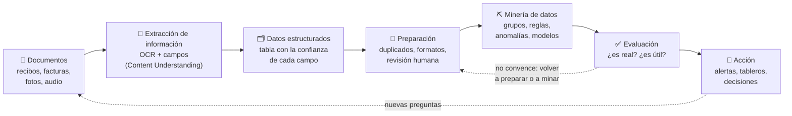


*Ciclo de ciencia de datos según Microsoft Fabric: formular el problema, descubrir y preparar datos, experimentar y modelar, operacionalizar y construir insights. La minería de datos vive en las etapas centrales de este ciclo. Fuente: [Microsoft Learn – Data science in Microsoft Fabric](https://learn.microsoft.com/en-us/fabric/data-science/data-science-overview).*

> 📊 **Datos de ejemplo de todo el tema:** las prácticas y las figuras generadas para este acordeón usan ~460 **recibos de gastos simulados**, como los que obtendrías después de extraerlos con IA (sección 7.1). Tienen problemas "plantados" a propósito (un duplicado, lecturas dudosas, montos atípicos y un patrón de viajes) para que puedas comprobar si cada técnica los descubre.

---

### 1. Minería de datos y sus "vecinos"

Es fácil confundir minería de datos con otras disciplinas cercanas. La diferencia está en la **pregunta** que responde cada una:

| Disciplina | Pregunta que responde | Ejemplo con recibos de gastos | Resultado típico |
|---|---|---|---|
| **Extracción de información** | ¿Qué dice este documento? | Leer Proveedor, Fecha y Total de una foto | Una fila de datos |
| **Business Intelligence (BI)** | ¿Qué pasó? | Gasto total por mes y por área | Tablero (Power BI) |
| **Minería de datos** | ¿Qué patrones hay que no conocía? | "Quien vuela casi siempre se hospeda en el mismo hotel"; "estos 3 recibos no encajan" | Reglas, grupos, anomalías |
| **Machine learning** | ¿Qué va a pasar con un caso nuevo? | Predecir si un recibo nuevo será rechazado | Modelo desplegado |
| **IA generativa** | ¿Cómo lo explico o lo resumo? | Redactar el informe de hallazgos para el director | Texto |

> 💡 En la práctica se combinan: la **extracción** convierte documentos en tablas, la **minería** descubre patrones, el **ML** los convierte en predicciones automáticas y la **IA generativa** los explica en lenguaje natural. El tutorial de este tema hace las cuatro cosas.

**Un poco de historia:** el término se popularizó en los años 90 junto con **KDD** (*Knowledge Discovery in Databases*, descubrimiento de conocimiento en bases de datos). En el artículo clásico de Fayyad, Piatetsky-Shapiro y Smyth (1996), la minería de datos no es todo el proceso, sino **un paso** dentro de KDD: el paso en el que se aplican algoritmos para extraer patrones de datos que ya fueron seleccionados, limpiados y transformados (lo verás en la sección 3).

#### 1.1 Los cuatro niveles de la analítica

Cada nivel responde una pregunta más difícil y más valiosa que el anterior. La minería de datos aporta sobre todo en los niveles **diagnóstico** y **predictivo**.

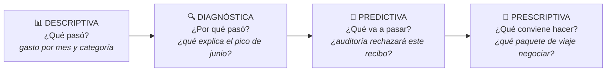

| Nivel | Pregunta | Ejemplo con recibos | Técnicas típicas |
|---|---|---|---|
| **Descriptiva** | ¿Qué pasó? | Gasto por categoría y por mes | Agregaciones, tableros de BI |
| **Diagnóstica** | ¿Por qué pasó? | Junio fue el mes más caro: ¿más viajes? ¿quién viajó? | Desgloses, clustering, reglas de asociación |
| **Predictiva** | ¿Qué va a pasar? | ¿Auditoría rechazará este recibo? ¿Cuánto gastaremos en septiembre? | Clasificación, regresión, series de tiempo |
| **Prescriptiva** | ¿Qué conviene hacer? | ¿Con qué proveedor negociar un paquete de vuelo + hotel? | Optimización, simulación, reglas de negocio |

> De izquierda a derecha aumentan tanto el **valor para el negocio** como la **dificultad** (más datos, más técnica y más validación).

---

### 2. Tipos de datos

| Tipo | Descripción | Ejemplos | ¿Cómo se analiza? |
|---|---|---|---|
| **Estructurados** | Esquema fijo de filas y columnas | Tablas SQL, Excel, CSV | Consultas SQL, BI, ML clásico |
| **Semiestructurados** | Tienen etiquetas pero no esquema rígido | JSON, XML, correos (encabezados + cuerpo) | Parsers + reglas |
| **No estructurados** | Sin formato predefinido | PDFs escaneados, fotos, audio, video, chats | OCR, NLP, visión, Content Understanding |

Se estima que la gran mayoría de los datos de una empresa son **no estructurados**: contratos, facturas, correos, grabaciones. Por eso la extracción de información con IA es lo que "desbloquea" la minería de datos en muchos negocios.

Un recibo es el ejemplo perfecto de dato **no estructurado** que esconde datos **estructurados**:


*Recibo de ejemplo de los samples oficiales de Azure AI Document Intelligence (repositorio Azure-Samples, licencia MIT): Contoso, 10 de junio de 2019, una Surface Pro 6 y una Surface Pen, total $1,203.39. Para una persona es obvio cuál es el comercio, la fecha y el total; para una base de datos es solo una imagen (arrugada y con sombra) hasta que se extrae su información.*

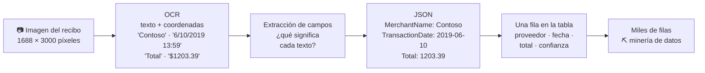

| Nivel | Cómo lo ve la computadora | ¿Se puede minar? |
|---|---|---|
| Imagen del recibo | Millones de píxeles | ❌ |
| Texto del OCR | "Contoso", "123 Main Street", "6/10/2019 13:59", "Surface Pro 6", "Total", "$1203.39"… | ⚠️ Solo búsqueda de texto |
| Campos extraídos | `{"MerchantName": "Contoso", "TransactionDate": "2019-06-10", "Total": 1203.39, ...}` | ✅ |
| Tabla con miles de recibos | Filas × columnas | ✅✅ Aquí empieza la minería |

> El paso de imagen a texto (OCR) se explica a fondo en el [Tema 2: OCR](tema2.md).

#### 2.1 Anatomía de un conjunto de datos

| Término | Sinónimos | En la tabla de recibos |
|---|---|---|
| **Instancia** | registro, fila, observación, ejemplo | Un recibo |
| **Atributo** | variable, columna, característica (*feature*) | `proveedor`, `fecha`, `total`, `confianza_total` |
| **Etiqueta** | variable objetivo, *target*, clase | `rechazado` (solo existe si alguien ya decidió en el pasado; ver 7.6) |
| **Dimensión** | número de atributos | 7 columnas en la práctica 7.1 |

> Si tus datos **tienen etiqueta**, puedes usar técnicas **supervisadas** (aprender a predecirla). Si **no tienen etiqueta**, usas técnicas **no supervisadas** (descubrir estructura: grupos, reglas, anomalías).

#### 2.2 Tipos de variables

El tipo de variable decide qué operaciones tienen sentido. Promediar proveedores, por ejemplo, no significa nada.

| Tipo | Qué representa | Ejemplo con recibos | Operaciones válidas |
|---|---|---|---|
| **Nominal** (categórica) | Categorías sin orden | `proveedor`, `categoria` | Contar, moda, ¿es igual? |
| **Ordinal** | Categorías con orden | Nivel de riesgo: bajo < medio < alto | Lo anterior + ordenar, mediana |
| **Intervalo** | Números sin un cero "real" | `fecha` (el año 0 no es "ausencia de tiempo") | Lo anterior + restar (días entre dos fechas) |
| **Razón** | Números con cero real | `total`, número de recibos | Todas: sumar, promediar, dividir ("el doble de caro") |

#### 2.3 Ingeniería de características: crear mejores variables

Muchas veces el patrón no está en las columnas originales, sino en variables **derivadas** de ellas. Es una de las partes más creativas (y de mayor impacto) de la minería de datos:

| Variable original | Variable derivada | ¿Por qué ayuda? | Dónde la usamos |
|---|---|---|---|
| `fecha` | Día de la semana, ¿fin de semana? | Hay políticas que dependen del día | 7.6 |
| `fecha` | Semana del año | Agrupar gastos de un mismo viaje | 7.4 b, 7.5 |
| `total` | `log(total)` | Los montos tienen "cola larga" (muchos chicos, pocos enormes) | 7.3 |
| `total` | z-score respecto a **su** proveedor | $88 es caro para un taxi, pero barato para un vuelo | 7.3 |
| Recibos de una semana | % del gasto por categoría | Describe el "tipo" de semana | 7.4 b |
| `categoria` | Columnas 0/1 (*one-hot*) | Los algoritmos solo entienden números | 7.6 |

---

### 3. Metodologías: KDD, CRISP-DM y TDSP

Las tres describen el mismo viaje con distinto nivel de detalle. **CRISP-DM** es la más usada en la industria; **TDSP** es la versión de Microsoft orientada a equipos.

| Etapa | KDD (1996) | CRISP-DM (1999) | TDSP (Microsoft) |
|---|---|---|---|
| Entender el problema | — | **Comprensión del negocio** | **Business understanding** |
| Conseguir los datos | Selección | **Comprensión de los datos** | **Data acquisition and understanding** |
| Prepararlos | Preprocesamiento y transformación | **Preparación de los datos** | (dentro de la etapa anterior) |
| Encontrar patrones | **Minería de datos** | **Modelado** | **Modeling** |
| Validar | Interpretación / evaluación | **Evaluación** | (dentro de Modeling) |
| Usar los resultados | — | **Despliegue** | **Deployment** y **Customer acceptance** |

**KDD:** la minería es solo uno de los pasos, y se puede regresar a cualquiera de los anteriores.

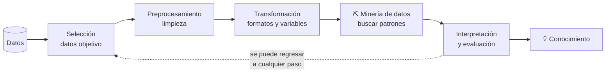

**CRISP-DM:** es un **ciclo**, no una línea. La evaluación puede mandarte de regreso a replantear el negocio, y un despliegue exitoso suele generar nuevas preguntas.

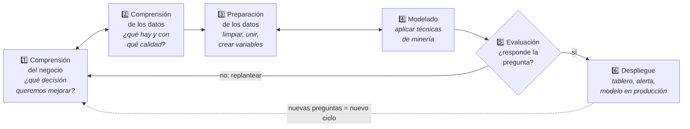

**TDSP:** Microsoft le agregó roles, plantillas de proyecto y una etapa explícita de aceptación del cliente.


*Ciclo de vida de TDSP: comprensión del negocio, adquisición y comprensión de datos, modelado y despliegue, con la aceptación del cliente al final. Observa que las flechas van en ambos sentidos: es iterativo, igual que CRISP-DM. Fuente: repositorio [Azure/Microsoft-TDSP](https://github.com/Azure/Microsoft-TDSP) en GitHub. Nota: Microsoft marcó ese repositorio como obsoleto y las páginas de TDSP en Microsoft Learn hoy redirigen a la guía de adopción de IA del Cloud Adoption Framework; el ciclo sigue siendo una buena referencia conceptual.*

**El proceso clásico, aplicado a recibos de gastos:**

1. **Entender el negocio:** ¿qué pregunta queremos responder? ("¿Por qué aumentaron los reembolsos?")
2. **Recolectar datos:** bases de datos, documentos, APIs.
3. **Extraer y transformar (ETL):** aquí entra la **extracción de información con IA** para documentos y medios.
4. **Limpiar y preparar:** duplicados, valores faltantes, formatos (fechas, monedas).
5. **Minar / modelar:** aplicar técnicas para encontrar patrones.
6. **Evaluar e interpretar:** ¿el patrón es real y útil?
7. **Desplegar:** tableros, alertas, decisiones automatizadas.

> ⚠️ **Regla del 80/20 de la ciencia de datos:** en proyectos reales, la mayor parte del tiempo se va en los pasos 2 a 4 (conseguir, extraer y limpiar datos), no en el "modelado". Por eso automatizar la extracción con IA tiene tanto impacto.

---

### 4. Técnicas de minería de datos

| Técnica | Pregunta | Tipo de aprendizaje | Algoritmos típicos | Ejemplo con recibos | ¿Cómo se evalúa? |
|---|---|---|---|---|---|
| **Clasificación** | ¿A qué categoría pertenece? | Supervisado | Árboles de decisión, regresión logística, random forest, gradient boosting | ¿Este recibo se aprueba o se rechaza? | Accuracy, precisión, recall, F1 |
| **Regresión** | ¿Cuánto vale? | Supervisado | Regresión lineal, random forest, gradient boosting | Gasto esperado del próximo mes | MAE, RMSE, R² |
| **Clustering** | ¿Qué grupos naturales hay? | No supervisado | K-means, DBSCAN, jerárquico | Perfiles de empleados según cómo gastan | Silueta, interpretación de negocio |
| **Reglas de asociación** | ¿Qué cosas aparecen juntas? | No supervisado | Apriori, FP-Growth | "Quien vuela también toma taxi y hotel" | Soporte, confianza, lift |
| **Detección de anomalías** | ¿Qué no encaja? | No supervisado (casi siempre) | Z-score, IQR, Isolation Forest, LOF | Un café de $410 | Revisión humana de los casos marcados |
| **Series de tiempo** | ¿Cómo evoluciona? | Supervisado | Promedios móviles, ARIMA, Prophet | Gasto mensual y estacionalidad | MAPE, MAE |
| **Minería de texto** | ¿De qué habla? | Ambos | TF-IDF, temas (LDA), sentimiento, entidades | Motivos escritos en la justificación del gasto | Depende de la tarea |

**Mapa de técnicas:**

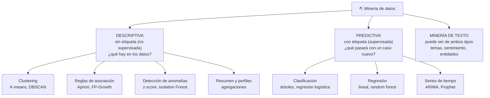

**¿Qué técnica uso?** Empieza por preguntarte si tienes una etiqueta histórica:

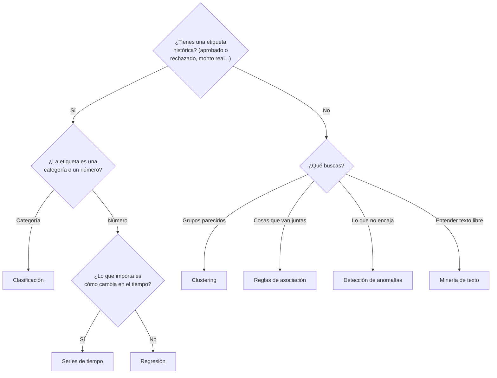

#### 4.1 Clustering: encontrar grupos sin que nadie te los diga

El clustering agrupa instancias **parecidas entre sí y distintas de las de otros grupos**, sin etiquetas previas. El algoritmo más conocido es **K-means**:

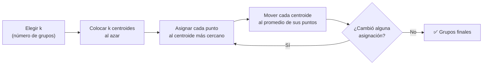

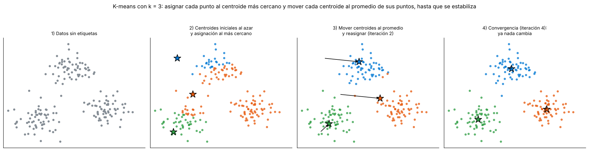

*K-means real sobre 180 puntos de ejemplo con k = 3: los centroides (estrellas) empiezan mal colocados, cada punto se asigna al más cercano y cada centroide se mueve al promedio de sus puntos. En pocas iteraciones el resultado se estabiliza y aparecen los tres grupos.*

**¿Cómo elegir k (el número de grupos)?**

| Método | Idea | Cómo se lee |
|---|---|---|
| **Codo** (*elbow*) | Graficar la inercia (distancia de los puntos a su centroide) para k = 1, 2, 3… | Elegir el k donde la curva "se dobla" y agregar grupos ya casi no ayuda |
| **Silueta** | Para cada punto compara qué tan cerca está de su grupo contra el grupo vecino; va de −1 a 1 | Más cerca de 1 = grupos compactos y bien separados |
| **Interpretabilidad** | ¿Puedes ponerle nombre de negocio a cada grupo? | Entre dos k con métricas parecidas, gana el más fácil de explicar (lo harás en 7.4 b) |

**Limitaciones de K-means y alternativas:**

- Supone grupos más o menos "redondos" y de tamaño parecido; falla con formas alargadas o anillos.
- Es sensible a la **escala** (por eso se estandarizan las variables) y a los valores atípicos.
- Necesita que le digas k y su resultado depende de dónde empiezan los centroides (por eso se repite varias veces con `n_init`).
- **DBSCAN** agrupa por densidad, no necesita k y marca como "ruido" los puntos aislados (útil también para anomalías). El clustering **jerárquico** produce un árbol de grupos (dendrograma) que puedes "cortar" al nivel que quieras.


*Comparación oficial de scikit-learn: cada columna es un algoritmo y cada fila un conjunto de datos de juguete. MiniBatch K-means (primera columna) parte mal los anillos y las medias lunas porque asume grupos "redondos"; DBSCAN y HDBSCAN los separan bien y marcan en negro los puntos de ruido. La última fila no tiene estructura: un buen algoritmo no debería inventar grupos ahí. Fuente: [scikit-learn – Comparing clustering algorithms](https://scikit-learn.org/stable/auto_examples/cluster/plot_cluster_comparison.html) (licencia BSD-3-Clause).*

#### 4.2 Reglas de asociación: ¿qué cosas van juntas?

Es la técnica del clásico "análisis de canasta": en lugar de productos de un supermercado, aquí la "canasta" es todo lo que un empleado gastó en una semana.

**Métricas de las reglas de asociación (pregunta frecuente):**

| Métrica | Fórmula | Pregunta | Ejemplo: {vuelo} → {hotel} |
|---|---|---|---|
| **Soporte** | P(A y B) | ¿Qué tan común es la combinación? | 15% de las semanas tienen vuelo **y** hotel |
| **Confianza** | P(B \| A) | Si pasa A, ¿qué tan seguido pasa B? | 82% de las semanas con vuelo también tienen hotel |
| **Lift** | Confianza / P(B) | ¿A aumenta la probabilidad de B más que el azar? | 2.01 = el doble de lo normal (> 1 = relación real) |

**El cálculo con números reales de la práctica 7.5** (183 semanas de empleados):

```
Semanas con vuelo:              34   →  P(vuelo) = 34 / 183 = 0.186
Semanas con hotel:              75   →  P(hotel) = 75 / 183 = 0.410
Semanas con vuelo Y hotel:      28   →  soporte  = 28 / 183 = 0.153

Confianza {vuelo} → {hotel} = 28 / 34      = 0.82   (82% de las semanas con vuelo tienen hotel)
Lift      {vuelo} → {hotel} = 0.82 / 0.410 = 2.01   (el hotel es 2 veces más probable si hubo vuelo)
```

> ⚠️ Una regla con **confianza alta puede ser inútil** si el consecuente es muy común. Si el 95% de todas las semanas tuviera comidas, cualquier regla "→ {comida}" tendría una confianza cercana a 95% aunque no hubiera ninguna relación; su lift (≈ 1) lo delata. En estos datos, {hospedaje} → {alimentos} tiene lift 0.82: el hotel ni siquiera aumenta la probabilidad de gastar en comida. Por eso siempre se revisa el **lift**.

**¿Cómo encuentra Apriori las combinaciones sin probarlas todas?** Con una idea muy simple, el **principio Apriori**: *si un conjunto no es frecuente, ningún conjunto que lo contenga puede serlo*. Así poda el árbol de combinaciones nivel por nivel (con un soporte mínimo de 10%):

```mermaid
flowchart LR
    subgraph L1["Nivel 1: 1 categoría"]
        direction TB
        a["{alimentos} 65%"]
        h["{hospedaje} 41%"]
        t["{transporte} 60%"]
        v["{vuelos} 19%"]
    end
    subgraph L2["Nivel 2: pares"]
        direction TB
        ah["{alim, hosp} 22%"]
        at["{alim, transp} 34%"]
        av["{alim, vuelos} 11%"]
        ht["{hosp, transp} 29%"]
        hv["{hosp, vuelos} 15%"]
        tv["{transp, vuelos} 18%"]
    end
    subgraph L3["Nivel 3: tríos"]
        direction TB
        aht["{alim, hosp, transp} 18%"]
        ahv["{alim, hosp, vuelos}<br/>9.8% ✂️ debajo del 10%"]
        atv["{alim, transp, vuelos} 11%"]
        htv["{hosp, transp, vuelos} 15%"]
    end
    subgraph L4["Nivel 4"]
        all["{las 4 categorías}<br/>❌ ni siquiera se cuenta:<br/>contiene un trío<br/>que no es frecuente"]
    end
    L1 -->|"combinar los<br/>frecuentes"| L2
    L2 -->|"combinar los<br/>frecuentes"| L3
    L3 -->|"poda"| L4
    classDef ok fill:#d3f9d8,stroke:#2f9e44
    classDef podado fill:#ffe3e3,stroke:#c92a2a
    classDef skip fill:#f1f3f5,stroke:#868e96,stroke-dasharray: 4 3
    class a,h,t,v,ah,at,av,ht,hv,tv,aht,atv,htv ok
    class ahv podado
    class all skip
```

*Soportes reales de las 183 semanas de la práctica. El trío {alimentos, hospedaje, vuelos} aparece en 9.8% de las semanas, debajo del mínimo de 10%, así que el conjunto de las 4 categorías (que lo contiene) se descarta sin contarlo. Con 4 categorías el ahorro es pequeño; con los miles de productos de un supermercado, esta poda es lo que hace posible el análisis.*

#### 4.3 Detección de anomalías: encontrar lo que no encaja

Una anomalía (*outlier*) es un dato que se aleja del comportamiento esperado. Hay tres tipos:

| Tipo | Qué es | Ejemplo con gastos | Cómo se detecta |
|---|---|---|---|
| **Puntual** | Un valor raro por sí solo | Un café de $410 | Estadística por grupo (z-score, IQR), Isolation Forest |
| **Contextual** | Normal en un contexto, raro en otro | $72 de gasto diario es normal entre semana, pero no un domingo | Agregar el contexto como variable (día, temporada) o comparar contra el mismo contexto |
| **Colectiva** | Cada valor parece normal, el grupo no | 12 recibos seguidos de $47–$49.90 con un límite de $50 ("fraccionamiento" para no pasar el tope) | Analizar secuencias o grupos: conteos, distribuciones, ventanas de tiempo |

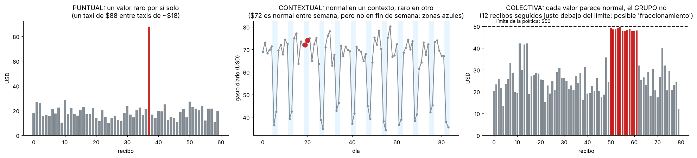

*Ejemplos sintéticos de los tres tipos de anomalía. Observa la de la derecha: ninguna barra roja rebasa el límite, por eso una regla de "monto máximo" nunca la detectaría; solo aparece al mirar el grupo completo.*

**Métodos más usados:**

| Método | Idea | Ventaja | Cuidado |
|---|---|---|---|
| **Z-score** | (valor − promedio) / desviación estándar; marcar si \|z\| > 3 | Simple | Los propios atípicos inflan el promedio y la desviación |
| **Z-score robusto** | Igual, pero con **mediana** y **MAD** (desviación absoluta mediana) | No se "contamina" con los atípicos | Supone una sola "nube" de datos por grupo |
| **IQR (regla de Tukey)** | Atípico si está por debajo de Q1 − 1.5·IQR o por encima de Q3 + 1.5·IQR | Es la regla de los diagramas de caja | Igual que la anterior |
| **Isolation Forest** | Hace cortes al azar; lo raro se **aísla** con pocos cortes | Combina muchas variables; escala bien | Hay que fijar qué proporción esperas de anomalías |
| **LOF** (*Local Outlier Factor*) | Compara la densidad de un punto con la de sus vecinos | Detecta anomalías "locales" | Más lento con muchos datos |
| **Ley de Benford** | En muchos datos financieros el primer dígito es 1 cerca del 30% de las veces; desviaciones fuertes pueden indicar números inventados | Clásica en auditoría forense | Solo aplica a datos que abarcan varios órdenes de magnitud |

**¿Por qué funciona Isolation Forest?** Porque un dato raro se separa del resto con muy pocos cortes al azar, mientras que un dato típico está "rodeado" de otros parecidos y necesita muchos:

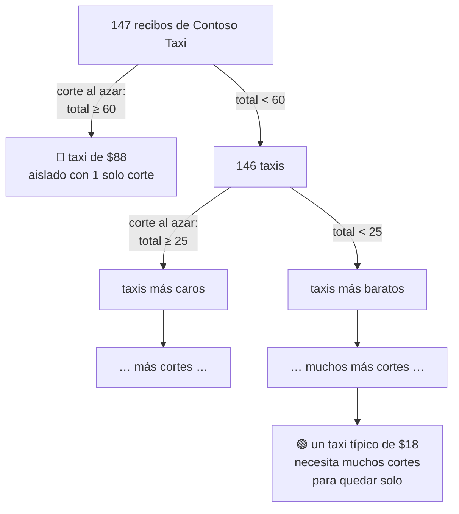


*Comparación oficial de scikit-learn de cinco métodos sobre datos de juguete: naranja = datos normales, azul = marcados como anomalía, y la línea negra es la frontera que aprende cada método. Isolation Forest y LOF se adaptan bien cuando hay varios grupos; la covarianza robusta supone una sola "elipse". Fuente: [scikit-learn – Comparing anomaly detection algorithms](https://scikit-learn.org/stable/auto_examples/miscellaneous/plot_anomaly_comparison.html) (licencia BSD-3-Clause).*

**Herramientas de Microsoft para anomalías:**

- **Microsoft Fabric – Real-Time Intelligence:** detección de anomalías sobre tablas de un *eventhouse* sin copiar los datos (en *preview* al momento de escribir esto).
- **Power BI:** detección automática de anomalías en gráficos de líneas, con explicaciones de las posibles causas.
- **Azure AI Anomaly Detector:** ⚠️ el servicio **se retiró el 1 de octubre de 2026** (no se pueden crear recursos nuevos desde septiembre de 2023). Microsoft recomienda migrar a Microsoft Fabric o al proyecto de código abierto [microsoft/anomaly-detector](https://github.com/microsoft/anomaly-detector).


*Visualización y tabla de resultados de un detector de anomalías en Fabric Real-Time Intelligence. Fuente: [Microsoft Learn – Anomaly detection in Real-Time Intelligence](https://learn.microsoft.com/en-us/fabric/real-time-intelligence/anomaly-detection).*


*Detección de anomalías en gráficos de líneas de Power BI (captura de la documentación oficial). Fuente: [Microsoft Learn – Anomaly detection in Power BI](https://learn.microsoft.com/en-us/power-bi/visuals/power-bi-visualization-anomaly-detection).*

> 🔑 **Anomalía no es lo mismo que fraude.** Una anomalía es una pregunta ("¿por qué este recibo es tan distinto?"), no una conclusión. Puede ser un error de captura, una excepción autorizada o, a veces, un fraude. Siempre termina en revisión humana.

#### 4.4 Clasificación y regresión: aprender de decisiones pasadas

Son técnicas **supervisadas**: necesitan ejemplos históricos con la respuesta correcta (la etiqueta). La clasificación predice una categoría (aprobado/rechazado) y la regresión un número (monto del próximo mes).

| Concepto | Qué es | Por qué importa |
|---|---|---|
| **Entrenamiento / prueba** | Separar los datos, por ejemplo 70% para aprender y 30% para evaluar | Evaluar con los mismos datos con los que aprendió es como calificar un examen que el alumno ya vio |
| **Sobreajuste** (*overfitting*) | El modelo memoriza el ruido de los datos de entrenamiento | Un árbol muy profundo acierta 100% en entrenamiento y falla con recibos nuevos |
| **Línea base** | El resultado de la estrategia más tonta posible | Si el 81% de los recibos se aprueba, "aprobar todo" ya tiene 81% de exactitud: tu modelo debe superar eso |
| **Precisión y recall** | Precisión: de lo que marqué como rechazado, ¿cuánto lo era? Recall: de lo que era rechazado, ¿cuánto encontré? | Con clases desbalanceadas, la exactitud (*accuracy*) engaña |
| **Interpretabilidad** | ¿Se puede explicar por qué decidió eso? | Un árbol de decisión produce reglas legibles: eso **es** conocimiento minado (práctica 7.6) |
| **Fuga de datos** (*data leakage*) | Usar como variable algo que solo se sabe después | Usar "fecha de reembolso" para predecir si se aprueba: el modelo "hace trampa" |

#### 4.5 Series de tiempo

Analizan cómo cambia un valor en el tiempo. Normalmente se separan cuatro componentes: **tendencia** (sube o baja a largo plazo), **estacionalidad** (patrones que se repiten: fin de mes, vacaciones), **eventos** (un congreso, una contingencia) y **ruido**. Un **promedio móvil** suaviza el ruido para ver la tendencia; lo verás en la gráfica de la práctica 7.2.

#### 4.6 Minería de texto

Aplica la minería a texto libre: frecuencias de palabras (TF-IDF), temas, sentimiento y entidades. En los recibos serviría para analizar la **justificación** que escribe el empleado ("cena con cliente", "taxi al aeropuerto") y descubrir motivos de gasto que no tienen columna propia. Las técnicas se explican en el Módulo 3: [análisis estadístico de texto](../modulo3/tema1.md) y [modelos de lenguaje semántico](../modulo3/tema2.md).

---

### 5. Calidad de los datos: la base de todo

"Basura entra, basura sale". Antes de minar, revisa estas dimensiones:

| Dimensión | Pregunta | Problema típico con datos extraídos de documentos |
|---|---|---|
| **Completitud** | ¿Están todos los campos? | El OCR no encontró la fecha en un recibo arrugado |
| **Exactitud** | ¿El valor es correcto? | "$18.00" leído como "$1800" |
| **Consistencia** | ¿Tiene el mismo formato en todos lados? | Fechas `15/08/2026`, `2026-08-15` y `Aug 15` mezcladas |
| **Unicidad** | ¿Hay duplicados? | El mismo recibo subido dos veces |
| **Validez** | ¿Respeta las reglas? | Subtotal + impuestos ≠ total |
| **Oportunidad** | ¿Está actualizado? | Recibos procesados un mes tarde |

> 🔑 Los servicios de extracción de Azure devuelven un **puntaje de confianza** por campo. Úsalo como filtro: los campos con confianza baja van a **revisión humana** antes de entrar al análisis; si los minas directamente, puedes "descubrir" patrones que solo son errores de lectura.

**El flujo con humano en el ciclo (*human-in-the-loop*):**

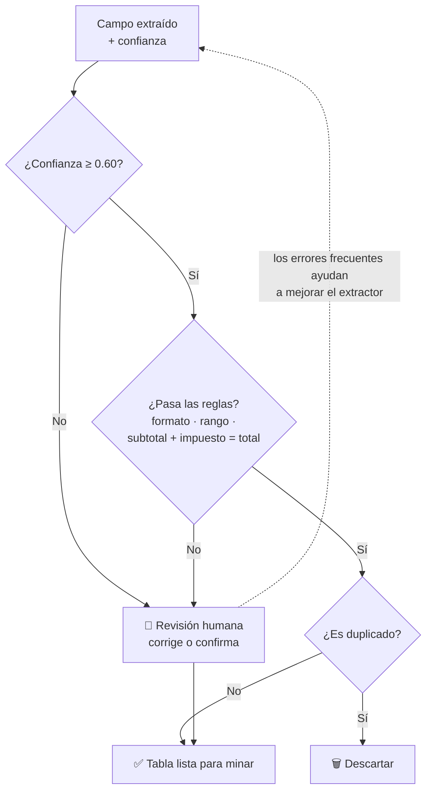

**Técnicas de preparación más comunes:**

| Problema | Técnica | Cuándo usarla | Ejemplo con recibos |
|---|---|---|---|
| Valores faltantes | Eliminar la fila, imputar (mediana o moda) o agregar una columna "faltaba" | Pocos faltantes al azar: eliminar; muchos: imputar | Una fecha ilegible va a revisión; **no** se inventa |
| Duplicados | Eliminar por una llave de negocio | Siempre, antes de sumar o contar | Mismo empleado, proveedor, fecha y total |
| Valores atípicos | Investigar antes de borrar | Pueden ser errores… o el hallazgo que buscas | El café de $410 |
| Escalas distintas | Estandarizar (z) o normalizar (0–1) | Algoritmos basados en distancias, como K-means | Número de recibos (cientos) vs ticket promedio (decenas) |
| Variables categóricas | Codificación *one-hot* | Casi todos los algoritmos | `cat_alimentos`, `cat_vuelos`… |
| Distribuciones sesgadas | Transformación logarítmica | Montos con cola larga | `log(total)` |
| Formatos mezclados | Normalizar (ISO 8601, una sola moneda) | Datos de varias fuentes o países | `15/08/2026` → `2026-08-15` |


*Data Wrangler en notebooks de Microsoft Fabric: muestra estadísticas y valores faltantes de cada columna, permite aplicar operaciones de limpieza (quitar duplicados, llenar faltantes, cambiar tipos, *one-hot encoding*…) y **genera el código de pandas** de cada paso. Fuente: [Microsoft Learn – Data Wrangler](https://learn.microsoft.com/en-us/fabric/data-science/data-wrangler).*

---

### 6. Del documento al insight: ejemplo completo

1. **Entrada:** 1,000 recibos escaneados o fotografiados por los empleados.
2. **Extracción:** OCR + extracción de campos (Proveedor, Fecha, Total) con Content Understanding o Document Intelligence.
3. **Estructura:** tabla en CSV, base de datos o lakehouse, con la confianza de cada campo.
4. **Limpieza:** quitar duplicados y mandar a revisión los campos de baja confianza.
5. **Minería:** gasto por proveedor, tendencia mensual, anomalías, grupos y reglas de asociación.
6. **Insight:** "El 18% del gasto en taxis supera la política" o "3 recibos tienen montos 10 veces mayores a lo normal".
7. **Acción:** alerta automática al área de finanzas y tablero en Power BI.


*Framework de **Azure Content Understanding** en Foundry Tools: documentos, imágenes, audio y video entran a **analizadores** (prebuilt o personalizados) y salen como **datos estructurados** listos para minar o para alimentar agentes. Es el paso 2 del ejemplo anterior. Fuente: [Microsoft Learn – Content Understanding overview](https://learn.microsoft.com/en-us/azure/ai-services/content-understanding/overview).*

#### 6.1 Dónde viven los datos: arquitectura medallón

En una plataforma de datos moderna (como un *lakehouse* de Microsoft Fabric), los datos se organizan en tres capas de calidad creciente. Es la versión "ordenada" de los pasos 3 a 6 del ejemplo:

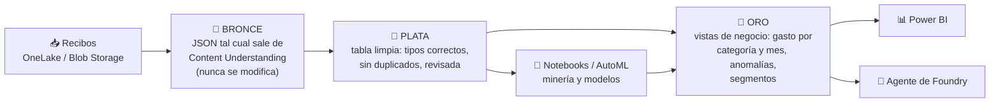

| Capa | Qué guarda | Ejemplo con recibos | Quién la usa |
|---|---|---|---|
| 🥉 **Bronce** (cruda) | Todo tal cual llega; no se modifica | JSON completo de Content Understanding + la imagen original | Auditoría, reprocesar si cambia la lógica |
| 🥈 **Plata** (enriquecida) | Datos limpios: formatos estándar, sin duplicados, validados | La tabla `recibos` de la práctica 7, ya revisada | Analistas y científicos de datos |
| 🥇 **Oro** (curada) | Vistas listas para el negocio | Gasto por categoría y mes, lista de anomalías, segmentos | Power BI, agentes, directivos |


*Arquitectura medallón en OneLake: fuentes de datos, preparación y transformación en tres capas (bronce, plata y oro) y análisis con SQL y Power BI. Microsoft la resume así: bronce guarda todo exactamente como llega, plata corrige errores, estandariza formatos y quita duplicados, y oro organiza los datos para reportes y tableros. Fuente: [Microsoft Learn – Medallion lakehouse architecture](https://learn.microsoft.com/en-us/fabric/onelake/onelake-medallion-lakehouse-architecture).*

> 💡 Guardar la capa bronce "intacta" te permite **volver a extraer** sin pedir de nuevo los documentos: si mañana mejoras el analizador o descubres un error de limpieza, reprocesas desde bronce.

---

### 7. Práctica en Python: minar datos ya extraídos

Esta práctica corre en tu computadora **sin Azure**. Simula lo que obtendrías después de extraer ~460 recibos con IA (con algunos problemas "plantados" a propósito: un duplicado, campos de baja confianza, montos atípicos y un patrón de viajes) y aplica las técnicas de la sección 4. Las gráficas de esta sección se generaron con estos mismos datos.

```bash
pip install pandas numpy scikit-learn mlxtend matplotlib
```

#### 7.1) Generar el conjunto de datos (como si viniera del extractor)

```python
import numpy as np, pandas as pd

rng = np.random.default_rng(2026)
n = 400
proveedores = {
    "Fourth Coffee":  ("alimentos",  6.5,  0.25),
    "Contoso Taxi":   ("transporte", 18.0, 0.35),
    "Northwind Air":  ("vuelos",     240.0, 0.30),
    "Hotel Central":  ("hospedaje",  110.0, 0.20),
    "Tailwind Foods": ("alimentos",  22.0, 0.30),
}
empleados = ["Ana", "Luis", "Marta", "Jorge", "Sofía", "Raúl"]
nombres = list(proveedores)
prob = [0.30, 0.30, 0.08, 0.12, 0.20]

filas = []
for i in range(n):
    p = rng.choice(nombres, p=prob)
    cat, media, sigma = proveedores[p]
    total = round(float(rng.lognormal(np.log(media), sigma)), 2)
    fecha = pd.Timestamp("2026-01-01") + pd.Timedelta(days=int(rng.integers(0, 240)))
    filas.append({"id": i, "empleado": rng.choice(empleados), "proveedor": p, "categoria": cat,
                  "fecha": fecha, "total": total, "confianza_total": round(float(rng.uniform(0.80, 0.99)), 2)})
# Patrón "plantado": quien vuela casi siempre toma taxi y se hospeda esa misma semana
extra = []
for f in [f for f in filas if f["categoria"] == "vuelos"]:
    for p in ["Contoso Taxi", "Hotel Central"]:
        if rng.uniform() < 0.85:
            cat, media, sigma = proveedores[p]
            extra.append({**f, "proveedor": p, "categoria": cat,
                          "fecha": f["fecha"] + pd.Timedelta(days=int(rng.integers(0, 3))),
                          "total": round(float(rng.lognormal(np.log(media), sigma)), 2)})
filas += extra
recibos = pd.DataFrame(filas).sort_values("fecha").reset_index(drop=True)
recibos["id"] = range(len(recibos))

# Anomalías "plantadas" (lo que la minería debería descubrir)
def plantar(proveedor, monto, k):                                     # montos fuera de patrón
    idx = recibos.index[recibos["proveedor"] == proveedor][k]; recibos.loc[idx, "total"] = monto
plantar("Hotel Central", 480.0, 5); plantar("Fourth Coffee", 410.0, 20); plantar("Contoso Taxi", 88.0, 40)
recibos.loc[recibos.sample(6, random_state=1).index, "confianza_total"] = 0.41   # extracción dudosa
n = len(recibos)
recibos.loc[n] = {"id": n, "empleado": "Raúl", "proveedor": "Contoso Taxi", "categoria": "transporte",
                    "fecha": pd.Timestamp("2026-03-14"), "total": 18.0, "confianza_total": 0.95}
recibos.loc[n + 1] = {**recibos.loc[n].to_dict(), "id": n + 1}       # recibo duplicado

recibos.to_csv("recibos.csv", index=False)
print("Recibos generados:", recibos.shape)
```

Salida:
```
Recibos generados: (466, 7)
```
- **Explicación:** cada fila es lo que devolvería el servicio de extracción por recibo: proveedor, fecha, total y la **confianza** del campo total. Los montos siguen una distribución log-normal (muchos gastos chicos y pocos grandes, como en la vida real).

#### 7.2) Limpieza, calidad y minería descriptiva

```python
import pandas as pd

recibos = pd.read_csv("recibos.csv", parse_dates=["fecha"])

# 1) LIMPIEZA: duplicados exactos (mismo empleado, proveedor, fecha y total)
llave = ["empleado", "proveedor", "fecha", "total"]
dup = recibos[recibos.duplicated(llave, keep="first")]
print(f"Duplicados encontrados: {len(dup)} -> ids {dup['id'].tolist()}")
recibos = recibos.drop_duplicates(llave, keep="first")

# 2) CALIDAD DE LA EXTRACCIÓN: baja confianza -> revisión humana, no se mina todavía
revisar = recibos[recibos["confianza_total"] < 0.6]
print(f"Recibos con confianza < 0.60 enviados a revisión humana: {len(revisar)}")
limpios = recibos[recibos["confianza_total"] >= 0.6].copy()
print(f"Recibos listos para minar: {len(limpios)}\n")

# 3) MINERÍA DESCRIPTIVA: ¿en qué se gasta?
resumen = (limpios.groupby("categoria")["total"]
           .agg(recibos="count", gasto_total="sum", promedio="mean", mediana="median")
           .sort_values("gasto_total", ascending=False).round(2))
resumen["% del gasto"] = (100 * resumen["gasto_total"] / resumen["gasto_total"].sum()).round(1)
print(resumen, "\n")

# 4) TENDENCIA: gasto mensual
mensual = limpios.groupby(limpios["fecha"].dt.to_period("M"))["total"].sum().round(2)
print("Gasto por mes:"); print(mensual.to_string())
```

Salida:
```
Duplicados encontrados: 1 -> ids [465]
Recibos con confianza < 0.60 enviados a revisión humana: 6
Recibos listos para minar: 459

            recibos  gasto_total  promedio  mediana  % del gasto
categoria                                                       
hospedaje        90     10498.24    116.65   111.72         42.4
vuelos           35      8277.89    236.51   233.92         33.4
alimentos       187      3054.04     16.33     9.52         12.3
transporte      147      2926.16     19.91    18.40         11.8 

Gasto por mes:
fecha
2026-01    4247.65
2026-02    3760.60
2026-03    3371.39
2026-04    3173.41
2026-05    1439.63
2026-06    4539.23
2026-07    2054.75
2026-08    2169.67
Freq: M
```
- **Explicación:**
  - El duplicado (mismo empleado, proveedor, fecha y total) se elimina antes de cualquier cálculo; si no, ese gasto contaría dos veces.
  - Los 6 recibos con confianza menor a 0.60 **no se descartan**: se mandan a revisión humana y se minan después de corregirlos.
  - Hospedaje y vuelos son solo el 27% de los recibos pero el **76% del gasto**: la minería descriptiva ya te dice dónde enfocar la auditoría.
  - En alimentos la mediana (9.52) es mucho menor que el promedio (16.33): señal de que hay montos muy altos jalando el promedio. Lo investigamos en el siguiente paso.

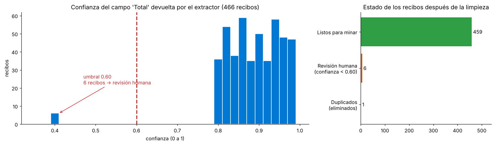

*La confianza del campo "Total" en los 466 recibos: casi todos están entre 0.80 y 0.99, y 6 quedan muy abajo (0.41), del otro lado del umbral de 0.60. A la derecha, cómo terminan después de la limpieza.*

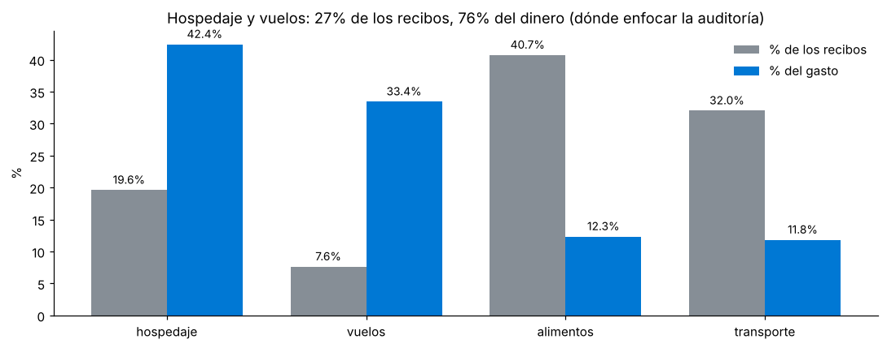

*Efecto Pareto: alimentos y transporte son la mayoría de los recibos, pero hospedaje y vuelos concentran la mayor parte del dinero.*

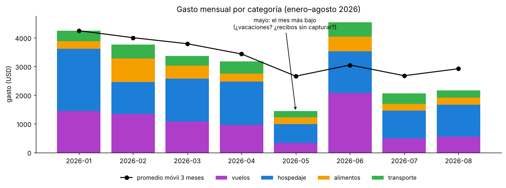

*La serie de tiempo mensual: junio es el mes más alto (por los vuelos) y mayo el más bajo. La línea negra es un promedio móvil de 3 meses, que suaviza los picos para ver la tendencia. Una caída así es una pregunta para el negocio, no una conclusión: ¿vacaciones?, ¿recibos que no se capturaron?*

#### 7.3) Detección de anomalías: dos enfoques

```python
import numpy as np, pandas as pd
from sklearn.ensemble import IsolationForest

recibos = pd.read_csv("recibos.csv", parse_dates=["fecha"]).drop_duplicates(["empleado", "proveedor", "fecha", "total"])
recibos = recibos[recibos["confianza_total"] >= 0.6].copy()

# A) Regla estadística robusta POR PROVEEDOR: z-score con mediana y MAD (no se "contamina" con los atípicos)
def z_robusto(x):
    mediana = x.median(); mad = (x - mediana).abs().median()
    return 0.6745 * (x - mediana) / mad
recibos["z"] = recibos.groupby("proveedor")["total"].transform(z_robusto)
reglas = recibos[recibos["z"].abs() > 3.5]
print("Anomalías por z-score robusto (|z| > 3.5):")
print(reglas[["id", "empleado", "proveedor", "total", "z"]].round(1).to_string(index=False), "\n")

# B) Modelo no supervisado: Isolation Forest con varias variables
X = pd.get_dummies(recibos[["proveedor"]]).astype(float)
X["log_total"] = np.log(recibos["total"])
X["dia_semana"] = recibos["fecha"].dt.dayofweek
modelo = IsolationForest(contamination=0.01, random_state=0).fit(X)
recibos["puntaje"] = -modelo.score_samples(X)              # mayor = más raro
top = recibos.sort_values("puntaje", ascending=False).head(4)
print("Top 4 más 'raros' según Isolation Forest:")
print(top[["id", "empleado", "proveedor", "total", "puntaje"]].round(3).to_string(index=False))
```

Salida:
```
Anomalías por z-score robusto (|z| > 3.5):
 id empleado     proveedor  total     z
  4    Jorge  Contoso Taxi   48.3   4.4
 21    Jorge Hotel Central  480.0  18.7
107     Raúl Fourth Coffee  410.0 224.8
123    Sofía  Contoso Taxi   88.0  10.2
253    Sofía  Contoso Taxi   43.4   3.7
365    Marta  Contoso Taxi   52.6   5.0 

Top 4 más 'raros' según Isolation Forest:
 id empleado      proveedor  total  puntaje
107     Raúl  Fourth Coffee 410.00    0.652
135      Ana  Northwind Air 127.90    0.646
 21    Jorge  Hotel Central 480.00    0.636
149     Luis Tailwind Foods  10.29    0.635
```
- **Explicación:**
  - **Z-score robusto por proveedor:** usa la mediana y la desviación absoluta mediana (MAD) en lugar del promedio y la desviación estándar, así los propios atípicos no "inflan" la referencia. Encontró las 3 anomalías plantadas (hotel de $480, café de $410, taxi de $88) y 3 taxis caros adicionales que valdría la pena revisar.
  - **Isolation Forest:** aísla los puntos que son fáciles de separar del resto combinando varias variables. Coincide en el café y el hotel, pero propone otros casos (un vuelo inusualmente barato de $127.90). **Ningún método es "la verdad"**: generan una lista corta para que una persona revise, en lugar de revisar los 459 recibos.
  - El z-score se calcula **por proveedor**: $88 es normal para un vuelo pero absurdo para un taxi.

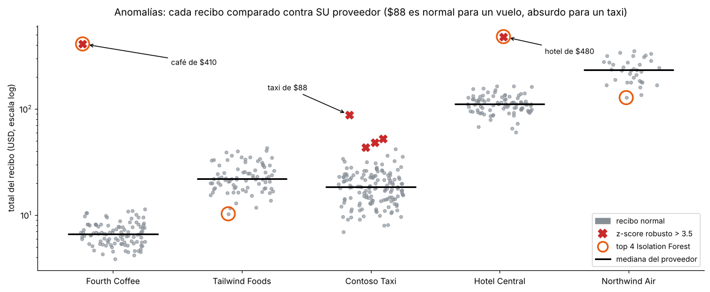

*Cada punto es un recibo y la línea negra es la mediana de su proveedor (escala logarítmica). Las X rojas son las anomalías del z-score robusto y los círculos naranjas, las 4 más raras según Isolation Forest. Ambos métodos coinciden en el café de $410 y el hotel de $480; el resto lo deciden de forma distinta.*

#### 7.4) Clustering: perfiles de proveedores y empleados

**a) Perfiles de proveedores y empleados**

```python
import pandas as pd
from sklearn.cluster import KMeans
from sklearn.preprocessing import StandardScaler

recibos = pd.read_csv("recibos.csv", parse_dates=["fecha"]).drop_duplicates(["empleado", "proveedor", "fecha", "total"])
recibos = recibos[recibos["confianza_total"] >= 0.6]

# Perfil de cada PROVEEDOR: cuántos recibos, ticket promedio, variabilidad, en cuántos días distintos aparece
perfil = recibos.groupby("proveedor").agg(recibos=("id", "count"), ticket_promedio=("total", "mean"),
                                         variabilidad=("total", "std"), dias=("fecha", "nunique"))
X = StandardScaler().fit_transform(perfil)                 # misma escala para todas las variables
perfil["grupo"] = KMeans(n_clusters=2, n_init=10, random_state=0).fit_predict(X)
print(perfil.round(1).sort_values("grupo"), "\n")

# Perfil de cada EMPLEADO: % de su gasto en cada categoría
mezcla = pd.crosstab(recibos["empleado"], recibos["categoria"], values=recibos["total"], aggfunc="sum", normalize="index")
mezcla["grupo"] = KMeans(n_clusters=2, n_init=10, random_state=0).fit_predict(mezcla)
print((mezcla * [100, 100, 100, 100, 1]).round(1).sort_values("grupo"))
```

Salida:
```
                recibos  ticket_promedio  variabilidad  dias  grupo
proveedor                                                          
Contoso Taxi        147             19.9           9.6   114      0
Fourth Coffee       105             10.7          39.4    85      0
Hotel Central        90            116.6          44.2    76      0
Tailwind Foods       82             23.6           7.3    67      0
Northwind Air        35            236.5          60.8    34      1 

categoria  alimentos  hospedaje  transporte  vuelos  grupo
empleado                                                  
Marta           11.8       53.5        11.4    23.3      0
Ana              7.1       44.7        10.6    37.6      1
Jorge           14.4       41.3         9.5    34.7      1
Luis            13.2       42.4        16.0    28.4      1
Raúl            16.6       33.5        11.6    38.3      1
Sofía           10.6       41.6        12.7    35.0      1
```
- **Explicación:**
  - Se **estandarizan** las variables (`StandardScaler`) para que "número de recibos" (cientos) no domine a "ticket promedio" (decenas) solo por su escala.
  - K-means separó a la aerolínea (pocos recibos, muy caros) de los proveedores del día a día.
  - En empleados, **Marta** queda en su propio grupo: más de la mitad de su gasto es hospedaje. No significa que haga algo mal; es un patrón que alguien de negocio debe interpretar (¿viaja a proyectos largos?). El clustering descubre grupos; **no** les pone nombre ni juicio.

**b) Segmentar semanas de gasto y elegir k con la silueta**

Con 5 proveedores o 6 empleados hay muy pocos puntos para agrupar. Un análisis más rico es segmentar las **183 semanas** de gasto de todos los empleados para descubrir "tipos de semana":

```python
import numpy as np, pandas as pd
from sklearn.cluster import KMeans
from sklearn.metrics import silhouette_score
from sklearn.preprocessing import MinMaxScaler

recibos = pd.read_csv("recibos.csv", parse_dates=["fecha"]).drop_duplicates(["empleado", "proveedor", "fecha", "total"])
recibos = recibos[recibos["confianza_total"] >= 0.6].copy()

# Cada fila = una semana de un empleado; columnas = cuánto gastó en cada categoría
recibos["semana"] = recibos["fecha"].dt.isocalendar().week
semanas = pd.crosstab([recibos["empleado"], recibos["semana"]], recibos["categoria"],
                      values=recibos["total"], aggfunc="sum").fillna(0)

# Características: MEZCLA del gasto (% por categoría) + TAMAÑO de la semana (log del total, escalado 0-1)
mezcla = semanas.div(semanas.sum(axis=1), axis=0)
tamano = MinMaxScaler().fit_transform(np.log10(semanas.sum(axis=1)).to_frame())
X = np.c_[mezcla.values, tamano]

print("k | silueta (más cerca de 1 = grupos más compactos y separados)")
for k in range(2, 9):
    etiquetas = KMeans(n_clusters=k, n_init=10, random_state=0).fit_predict(X)
    print(f"{k} | {silhouette_score(X, etiquetas):.3f}")

# Elegimos k = 4 y describimos cada segmento
semanas["segmento"] = KMeans(n_clusters=4, n_init=10, random_state=0).fit_predict(X)
perfil = mezcla.groupby(semanas["segmento"]).mean().mul(100).round(0)
perfil.columns = [f"% {c}" for c in perfil.columns]
perfil.insert(0, "semanas", semanas.groupby("segmento").size())
perfil.insert(1, "gasto_medio", semanas.drop(columns="segmento").sum(axis=1).groupby(semanas["segmento"]).mean().round(1))
perfil["dominante"] = mezcla.groupby(semanas["segmento"]).mean().idxmax(axis=1)
print("\n", perfil.sort_values("gasto_medio", ascending=False).to_string(index=False))
```

Salida:
```
k | silueta (más cerca de 1 = grupos más compactos y separados)
2 | 0.480
3 | 0.625
4 | 0.701
5 | 0.708
6 | 0.682
7 | 0.626
8 | 0.521

  semanas  gasto_medio  % alimentos  % hospedaje  % transporte  % vuelos  dominante
      34        428.9          4.0         28.0           8.0      60.0     vuelos
      47        147.6          6.0         86.0           8.0       0.0  hospedaje
      46         32.5         16.0          0.0          84.0       0.0 transporte
      56         31.2         96.0          0.0           4.0       0.0  alimentos
```
- **Explicación:**
  - Cada semana se describe con su **mezcla** (qué % del gasto fue en cada categoría) y su **tamaño** (logaritmo del total, escalado de 0 a 1). Todas las variables quedan entre 0 y 1, así ninguna domina por su escala.
  - La **silueta** sube hasta k = 4 (0.701), en k = 5 apenas mejora (0.708) y después baja. Se elige **k = 4**: casi la misma calidad y grupos más fáciles de explicar (principio de parsimonia).
  - Los 4 segmentos tienen nombre de negocio: **semanas de viaje** (vuelo + hotel, ~$429), **hotel sin vuelo** (~$148), **traslados locales** (~$33) y **solo comidas** (~$31).
  - **Hallazgo:** hay 47 semanas con hotel pero **sin vuelo**. ¿Son viajes por carretera, o vuelos que se pagaron por otro medio y no se reportaron? Ninguna tabla dinámica te habría hecho esa pregunta.
  - El número de cada grupo (0, 1, 2…) es arbitrario y puede cambiar entre versiones de scikit-learn; por eso el código identifica cada segmento por su categoría **dominante**.

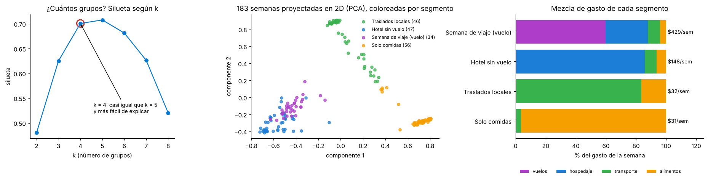

*Izquierda: la silueta según el número de grupos. Centro: las 183 semanas proyectadas en 2D con PCA (cada color es un segmento). Derecha: la mezcla de gasto y el gasto semanal promedio de cada segmento.*

#### 7.5) Reglas de asociación: ¿qué gastos van juntos?

```python
import pandas as pd
from mlxtend.frequent_patterns import apriori, association_rules

recibos = pd.read_csv("recibos.csv", parse_dates=["fecha"]).drop_duplicates(["empleado", "proveedor", "fecha", "total"])
recibos = recibos[recibos["confianza_total"] >= 0.6].copy()      # igual que en 7.3 y 7.4: sin recibos dudosos

# "Canasta" = todo lo que un empleado gastó en la misma SEMANA (un viaje de trabajo, aproximadamente)
recibos["semana"] = recibos["fecha"].dt.isocalendar().week
canastas = pd.crosstab([recibos["empleado"], recibos["semana"]], recibos["categoria"]).gt(0)
print(f"Canastas (empleado-semana): {len(canastas)}\n")

frecuentes = apriori(canastas, min_support=0.10, use_colnames=True)
reglas = association_rules(frecuentes, metric="confidence", min_threshold=0.6)
reglas = reglas[reglas["lift"] > 1].sort_values("lift", ascending=False)
conjunto = lambda s: "{" + ", ".join(sorted(s)) + "}"           # orden alfabético: salida reproducible
for _, r in reglas.head(5).iterrows():
    print(f"{conjunto(r['antecedents'])} -> {conjunto(r['consequents'])}: "
          f"soporte {r['support']:.2f} | confianza {r['confidence']:.2f} | lift {r['lift']:.2f}")
```

Salida:
```
Canastas (empleado-semana): 183

{vuelos} -> {hospedaje, transporte}: soporte 0.15 | confianza 0.79 | lift 2.74
{transporte, vuelos} -> {hospedaje}: soporte 0.15 | confianza 0.84 | lift 2.06
{vuelos} -> {hospedaje}: soporte 0.15 | confianza 0.82 | lift 2.01
{alimentos, vuelos} -> {transporte}: soporte 0.11 | confianza 1.00 | lift 1.66
{hospedaje, vuelos} -> {transporte}: soporte 0.15 | confianza 0.96 | lift 1.60
```
- **Explicación:**
  - Cada "canasta" es todo lo que un empleado gastó en una semana. Apriori busca combinaciones frecuentes y luego las convierte en reglas. Igual que en 7.3 y 7.4, se excluyen los recibos de baja confianza.
  - `{vuelos} → {hospedaje, transporte}` con **lift 2.74**: cuando hay un vuelo, es casi 2.7 veces más probable de lo normal que en esa semana también haya hotel y taxi. Es el patrón que plantamos en los datos, y el algoritmo lo encontró sin que se lo dijéramos.
  - `{alimentos, vuelos} → {transporte}` tiene confianza 1.00 (siempre se cumple), pero su lift (1.66) es menor que el de la primera regla porque el taxi ya es muy común por sí solo.
  - Uso de negocio: negociar paquetes vuelo + hotel + traslado con un solo proveedor, o detectar viajes "incompletos" (vuelo sin hotel) que podrían indicar un recibo faltante.

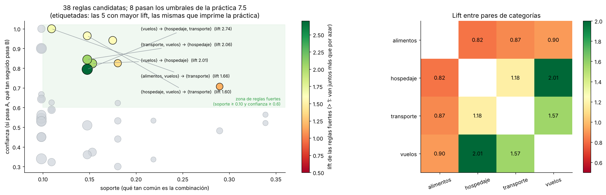

*Izquierda: las 38 reglas candidatas (soporte ≥ 5%, confianza ≥ 30%); en color, las que pasan los umbrales de la práctica, y etiquetadas, las 5 que imprime el código. Derecha: lift entre pares de categorías. Vuelos con hospedaje (2.01) y vuelos con transporte (1.57) van juntos mucho más que por azar; alimentos tiene lift menor a 1 con todo: las comidas ocurren casi igual en cualquier tipo de semana.*

#### 7.6) Clasificación: descubrir la política "no escrita" de auditoría

Las técnicas anteriores no necesitaban etiquetas. Ahora supón que el sistema de gastos sí guarda la **decisión histórica** del auditor (aprobado o rechazado), pero nadie escribió nunca la política completa. Un **árbol de decisión** puede redescubrirla a partir de esas decisiones:

```python
import numpy as np, pandas as pd
from sklearn.tree import DecisionTreeClassifier
from sklearn.model_selection import train_test_split
from sklearn.metrics import confusion_matrix, classification_report

recibos = pd.read_csv("recibos.csv", parse_dates=["fecha"]).drop_duplicates(["empleado", "proveedor", "fecha", "total"])
recibos = recibos[recibos["confianza_total"] >= 0.6].copy()

# --- Decisiones HISTÓRICAS de auditoría (en la vida real vienen del sistema de gastos) ---
# La política nunca se escribió: vive en la cabeza de los auditores. Aquí la simulamos:
limite = {"alimentos": 30, "transporte": 40, "hospedaje": 180, "vuelos": 350}
fin_de_semana = recibos["fecha"].dt.dayofweek >= 5
excede = recibos["total"] > recibos["categoria"].map(limite)
comida_finde = fin_de_semana & (recibos["categoria"] == "alimentos")
rng = np.random.default_rng(7)
ruido = rng.uniform(size=len(recibos)) < 0.04                      # 4% de decisiones "inconsistentes"
recibos["rechazado"] = ((excede | comida_finde) ^ ruido).astype(int)
print(f"Recibos rechazados en el histórico: {recibos['rechazado'].sum()} de {len(recibos)}")
print("Ejemplos por regla oculta:", {"excede límite": int(excede.sum()), "comida en fin de semana": int(comida_finde.sum())}, "\n")

# --- Características (features) que verá el modelo: NO le decimos cuál es la política ---
X = pd.get_dummies(recibos["categoria"], prefix="cat").astype(int)
X["total"] = recibos["total"]
X["dia_semana"] = recibos["fecha"].dt.dayofweek                    # 0 = lunes ... 6 = domingo
y = recibos["rechazado"]

X_ent, X_prueba, y_ent, y_prueba = train_test_split(X, y, test_size=0.3, stratify=y, random_state=0)
arbol = DecisionTreeClassifier(max_depth=3, min_samples_leaf=5, random_state=0).fit(X_ent, y_ent)

def reglas_de_rechazo(modelo, columnas):
    """Recorre el árbol y devuelve los caminos que terminan en 'rechazado'."""
    t = modelo.tree_
    def recorrer(nodo, condiciones):
        if t.children_left[nodo] == -1:                                # es una hoja
            conteo = t.value[nodo][0]
            if conteo.argmax() == 1:
                yield condiciones, int(t.n_node_samples[nodo]), conteo[1] / conteo.sum()
            return
        col, umbral = columnas[t.feature[nodo]], t.threshold[nodo]
        yield from recorrer(t.children_left[nodo], condiciones + [f"{col} <= {umbral:.1f}"])
        yield from recorrer(t.children_right[nodo], condiciones + [f"{col} > {umbral:.1f}"])
    return list(recorrer(0, []))

print("Reglas de RECHAZO que descubrió el árbol:")
for condiciones, n, pureza in reglas_de_rechazo(arbol, list(X.columns)):
    print(f"  SI {' Y '.join(condiciones)}  ->  rechazado  ({n} recibos de entrenamiento, {pureza:.0%} rechazados)")

pred = arbol.predict(X_prueba)
print("\nMatriz de confusión en datos de PRUEBA (filas = real, columnas = predicho) [aprobado, rechazado]:")
print(confusion_matrix(y_prueba, pred))
print(classification_report(y_prueba, pred, target_names=["aprobado", "rechazado"], digits=2))
```

Salida:
```
Recibos rechazados en el histórico: 86 de 459
Ejemplos por regla oculta: {'excede límite': 25, 'comida en fin de semana': 52} 

Reglas de RECHAZO que descubrió el árbol:
  SI dia_semana <= 4.5 Y total > 28.4 Y cat_alimentos > 0.5  ->  rechazado  (14 recibos de entrenamiento, 71% rechazados)
  SI dia_semana > 4.5 Y cat_alimentos > 0.5 Y dia_semana <= 5.5  ->  rechazado  (14 recibos de entrenamiento, 93% rechazados)
  SI dia_semana > 4.5 Y cat_alimentos > 0.5 Y dia_semana > 5.5  ->  rechazado  (22 recibos de entrenamiento, 100% rechazados)

Matriz de confusión en datos de PRUEBA (filas = real, columnas = predicho) [aprobado, rechazado]:
[[111   1]
 [  6  20]]
              precision    recall  f1-score   support

    aprobado       0.95      0.99      0.97       112
   rechazado       0.95      0.77      0.85        26

    accuracy                           0.95       138
   macro avg       0.95      0.88      0.91       138
weighted avg       0.95      0.95      0.95       138
```
- **Explicación:**
  - La política oculta tenía dos partes: montos mayores a un límite por categoría y comidas en fin de semana. Al modelo **no** se le dijo; solo vio categoría, total, día de la semana y la decisión del auditor.
  - **Regla 1:** comida entre semana por más de **$28.40** → rechazo. El límite real era $30: el árbol se acercó bastante con solo 14 ejemplos.
  - **Reglas 2 y 3:** comida en sábado o en domingo → rechazo. El árbol las separó en dos ramas, pero dicen lo mismo.
  - **Lo que no aprendió:** los límites de taxis ($40), hoteles ($180) y vuelos ($350). En todos los datos solo había 5, 1 y 1 ejemplos de esos casos: **un modelo solo aprende lo que ve suficientes veces**. De los 6 rechazos que el árbol no detectó en la prueba, 3 son taxis de más de $40 y los otros 3 son decisiones "inconsistentes" (el ruido del 4%).
  - **Evaluación honesta:** 95% de exactitud en datos que el árbol **no vio**. Ojo: "aprobar todo" ya daría 81% (112 de 138), así que la mejora real se ve mejor en el **recall de rechazados** (0.77: encuentra 20 de 26) y en su **precisión** (0.95: casi no acusa en falso).
  - Uso responsable: las reglas se validan con los auditores y se convierten en una política escrita, o el modelo **pre-marca** recibos para que una persona decida. No debería rechazar recibos por sí solo.

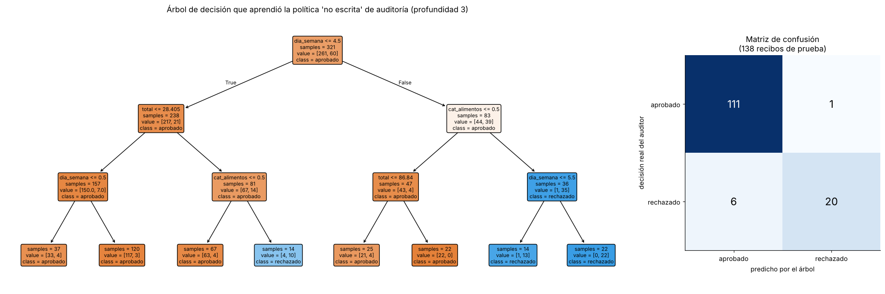

*El árbol completo de profundidad 3 (azul = rechazado, naranja = aprobado; "value" son los recibos de cada clase) y la matriz de confusión en los 138 recibos de prueba.*

#### 7.7) Visualizar los hallazgos

Una buena gráfica comunica en segundos lo que una tabla tarda minutos en explicar. Este bloque genera un resumen visual de tres de los análisis anteriores:

```python
import numpy as np, pandas as pd, matplotlib.pyplot as plt
from mlxtend.frequent_patterns import apriori, association_rules

recibos = pd.read_csv("recibos.csv", parse_dates=["fecha"]).drop_duplicates(["empleado", "proveedor", "fecha", "total"])
recibos = recibos[recibos["confianza_total"] >= 0.6].copy()

fig, ax = plt.subplots(1, 3, figsize=(18, 5))

# 1) Anomalías: cada recibo contra la mediana de SU proveedor (escala logarítmica)
mediana = recibos.groupby("proveedor")["total"].transform("median")
mad = recibos.groupby("proveedor")["total"].transform(lambda x: (x - x.median()).abs().median())
recibos["anomalo"] = (0.6745 * (recibos["total"] - mediana) / mad).abs() > 3.5
proveedores = sorted(recibos["proveedor"].unique())
for i, p in enumerate(proveedores):
    datos = recibos[recibos["proveedor"] == p]
    x = i + np.random.default_rng(i).uniform(-0.2, 0.2, len(datos))
    ax[0].scatter(x, datos["total"], s=12, c=np.where(datos["anomalo"], "red", "gray"))
ax[0].set_yscale("log"); ax[0].set_xticks(range(len(proveedores)), proveedores, rotation=20)
ax[0].set_title("Recibos por proveedor (rojo = anomalía)")

# 2) Tendencia: gasto mensual apilado por categoría
mensual = recibos.pivot_table(index=recibos["fecha"].dt.to_period("M").astype(str), columns="categoria",
                              values="total", aggfunc="sum").fillna(0)
mensual.plot(kind="bar", stacked=True, ax=ax[1], rot=45)
ax[1].set_title("Gasto mensual por categoría"); ax[1].set_xlabel("")

# 3) Reglas de asociación: soporte vs confianza (tamaño = lift)
recibos["semana"] = recibos["fecha"].dt.isocalendar().week
canastas = pd.crosstab([recibos["empleado"], recibos["semana"]], recibos["categoria"]).gt(0)
reglas = association_rules(apriori(canastas, min_support=0.05, use_colnames=True), metric="confidence", min_threshold=0.3)
ax[2].scatter(reglas["support"], reglas["confidence"], s=reglas["lift"] * 100, c=reglas["lift"], cmap="RdYlGn", edgecolors="black")
ax[2].set_xlabel("soporte"); ax[2].set_ylabel("confianza"); ax[2].set_title(f"{len(reglas)} reglas (tamaño y color = lift)")

plt.tight_layout()
plt.savefig("hallazgos.png", dpi=120)
plt.show()
print("Gráfica guardada en hallazgos.png |", int(recibos["anomalo"].sum()), "anomalías marcadas en rojo |", len(reglas), "reglas graficadas")
```

Salida:
```
Gráfica guardada en hallazgos.png | 6 anomalías marcadas en rojo | 38 reglas graficadas
```
- **Explicación:**
  - Es una versión compacta del código con el que se hicieron las figuras de este documento: anomalías por proveedor, tendencia mensual y mapa de reglas.
  - La **escala logarítmica** del primer panel permite ver en la misma gráfica cafés de $7 y vuelos de $240.
  - `plt.savefig` guarda la imagen para compartirla o subirla a un informe; en un notebook de Fabric o Jupyter, `plt.show()` la muestra en línea.

---

### 8. Tutorial: de recibos a insights con Azure y Microsoft Foundry

En este tutorial harás el flujo completo en la nube: **extraer** campos de recibos con **Azure Content Understanding** (Foundry Tools), **minarlos** con Python y pedirle a un **modelo de Microsoft Foundry** que redacte el informe de hallazgos.

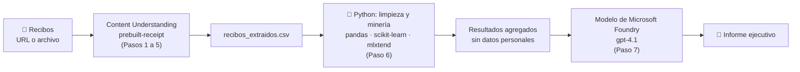

#### Paso 0. Requisitos

- Una suscripción de Azure ([cuenta gratuita](https://azure.microsoft.com/free/)).
- Rol **Contributor** (o superior) en la suscripción o el grupo de recursos para crear recursos.
- Python 3.9 o superior.
- Recibos de prueba. Puedes usar los samples oficiales de Azure:
  - `https://raw.githubusercontent.com/Azure-Samples/cognitive-services-REST-api-samples/master/curl/form-recognizer/contoso-receipt.png`
  - `https://raw.githubusercontent.com/Azure-Samples/cognitive-services-REST-api-samples/master/curl/form-recognizer/rest-api/receipt.png`

#### Paso 1. Crear el recurso de Microsoft Foundry

1. Entra a [ai.azure.com](https://ai.azure.com) (Microsoft Foundry) e inicia sesión.
2. Crea un **proyecto** nuevo; el asistente crea también el **recurso de Microsoft Foundry** que lo contiene. Elige una región compatible con Content Understanding ([lista de regiones](https://learn.microsoft.com/en-us/azure/ai-services/content-understanding/language-region-support)).
3. Desde el **portal de Azure** ([portal.azure.com](https://portal.azure.com)) abre el recurso de Foundry y, en **Keys and Endpoint** (Claves y punto de conexión), copia el **endpoint** y una **clave**. Para producción, en lugar de claves usa **Microsoft Entra ID** (`DefaultAzureCredential`).


*Sección de claves y endpoint de un recurso en el portal de Azure. Fuente: Microsoft Learn.*

#### Paso 2. Conectar el recurso en Content Understanding Studio

Content Understanding usa modelos generativos por dentro, así que necesita **despliegues predeterminados** (un modelo estándar, uno mini y uno de embeddings).

1. Abre la página de configuración de [Content Understanding Studio](https://contentunderstanding.ai.azure.com/settings).
2. Selecciona **+ Add resource**, elige tu recurso de Foundry y luego **Next** > **Save**.
3. Deja marcada la opción **Enable autodeployment for required models if no defaults are available**: Studio desplegará automáticamente los tres modelos que necesita.

> 📌 Según la documentación oficial, el playground de Content Understanding dentro de Foundry (new) solo ofrece un subconjunto de analizadores prebuilt y no permite crear analizadores personalizados; para el catálogo completo y analizadores propios usa **Content Understanding Studio**. Foundry (classic) quedó en desuso el 15 de julio de 2026.

#### Paso 3. Probar el analizador de recibos sin código

1. En [Content Understanding Studio](https://contentunderstanding.ai.azure.com/), abre la lista de **analizadores prebuilt**.
2. Selecciona **prebuilt-receipt** (en la categoría *Procurement* también están `prebuilt-invoice`, `prebuilt-receipt.hotel`, `prebuilt-utilityBill`, `prebuilt-purchaseOrder`…).
3. Prueba con los datos de ejemplo o sube uno de los recibos del Paso 0.
4. Revisa el panel de resultados: cada campo extraído viene con su valor, su **confianza** y la región del documento de donde salió.


*Content Understanding Studio: selección de analizadores prebuilt y panel de resultados. Fuente: [Microsoft Learn – Get started with Content Understanding Studio](https://learn.microsoft.com/en-us/azure/ai-services/content-understanding/quickstart/content-understanding-studio).*


*La alternativa clásica, **Azure Document Intelligence**, con su modelo `prebuilt-receipt`: extrae comercio, fecha, hora, subtotal, impuestos, propina, total y partidas. Fuente: [Microsoft Learn – Receipt model](https://learn.microsoft.com/en-us/azure/ai-services/document-intelligence/prebuilt/receipt).*

| | Content Understanding | Document Intelligence |
|---|---|---|
| Tipo de entrada | Documentos, imágenes, **audio y video** | Documentos e imágenes |
| Cómo extrae | Analizadores con modelos generativos + OCR | Modelos especializados (OCR + ML) |
| Campos personalizados | Defines un **esquema** en lenguaje natural (con métodos *extract*, *generate*, *classify*) | Entrenas un modelo personalizado con documentos etiquetados |
| Cuándo elegirlo | Escenarios nuevos, formatos variados, campos que requieren razonamiento | Formularios muy estables, alto volumen, resultados deterministas |

#### Paso 4. Instalar las librerías y configurar variables de entorno

```bash
pip install --pre azure-ai-contentunderstanding
pip install azure-identity azure-ai-projects pandas scikit-learn mlxtend
```

```bash
# Windows (PowerShell)
$env:CONTENTUNDERSTANDING_ENDPOINT = "https://<tu-recurso>.services.ai.azure.com/"
$env:CONTENTUNDERSTANDING_KEY      = "<tu-clave>"
$env:PROJECT_ENDPOINT              = "https://<tu-recurso>.services.ai.azure.com/api/projects/<tu-proyecto>"
$env:MODEL_DEPLOYMENT_NAME         = "gpt-4.1"
```

#### Paso 5. Extraer los recibos con Python (Content Understanding)

La extracción es una **operación asíncrona**: el servicio acepta la solicitud, procesa en segundo plano y tú consultas el resultado. El SDK hace esa consulta por ti:

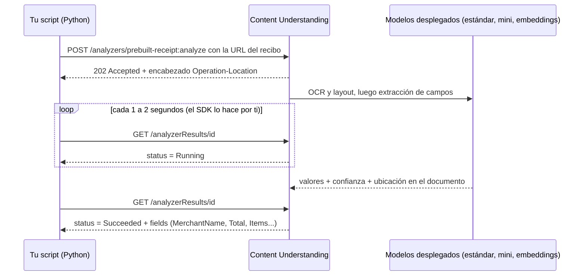

```python
import os
import pandas as pd
from azure.ai.contentunderstanding import ContentUnderstandingClient
from azure.ai.contentunderstanding.models import AnalysisInput, ArrayField, ObjectField
from azure.core.credentials import AzureKeyCredential

cliente = ContentUnderstandingClient(
    endpoint=os.environ["CONTENTUNDERSTANDING_ENDPOINT"],
    credential=AzureKeyCredential(os.environ["CONTENTUNDERSTANDING_KEY"]),
)

BASE = "https://raw.githubusercontent.com/Azure-Samples/cognitive-services-REST-api-samples/master/curl/form-recognizer/"
recibos_url = [BASE + "contoso-receipt.png", BASE + "rest-api/receipt.png"]

def valor(campo):
    """Convierte un campo de Content Understanding (simple, objeto o arreglo) a tipos de Python."""
    if campo is None:
        return None
    if isinstance(campo, ObjectField):
        return {k: valor(v) for k, v in (campo.value or {}).items()}
    if isinstance(campo, ArrayField):
        return [valor(v) for v in (campo.value or [])]
    return campo.value

filas = []
for url in recibos_url:
    poller = cliente.begin_analyze(analyzer_id="prebuilt-receipt", inputs=[AnalysisInput(url=url)])
    resultado = poller.result()                       # operación asíncrona: espera a que termine
    doc = resultado.contents[0]
    campos = doc.fields or {}
    print(f"\n{url.split('/')[-1]} -> campos disponibles: {sorted(campos)}")

    total = campos.get("Total")
    filas.append({
        "archivo":   url.split("/")[-1],
        "proveedor": valor(campos.get("MerchantName")),
        "fecha":     valor(campos.get("TransactionDate")),
        "total":     valor(total),
        "confianza_total": getattr(total, "confidence", None),
        "partidas":  len(valor(campos.get("Items")) or []),
    })

tabla = pd.DataFrame(filas)
print("\n", tabla)
tabla.to_csv("recibos_extraidos.csv", index=False)  # la tabla que vas a minar
```
- **Explicación:**
  - `begin_analyze` envía cada recibo al analizador **prebuilt-receipt** y devuelve un *poller*: la extracción es una operación asíncrona (por dentro, el SDK consulta el estado hasta que es `Succeeded`).
  - `resultado.contents[0].fields` es un diccionario de campos. Cada campo trae `.value`, `.confidence` y `.source` (de qué parte del documento salió). Los campos compuestos (`Items`, o un total con monto y moneda) son `ArrayField` u `ObjectField`, por eso la función `valor` los convierte recursivamente.
  - El código imprime **los nombres de campo disponibles** antes de usarlos: el esquema exacto puede variar entre versiones del analizador, así que revisa esa lista y ajusta `MerchantName`, `TransactionDate`, `Total` o `Items` si fuera necesario.
  - Guardar `confianza_total` permite repetir aquí el filtro de calidad de la práctica 7.2.
  - Para recibos locales, usa `cliente.begin_analyze_binary("prebuilt-receipt", open("recibo.jpg", "rb").read())`.

**Alternativa con Document Intelligence** (si tu organización ya lo usa):

```python
# pip install azure-ai-documentintelligence
import os
from azure.ai.documentintelligence import DocumentIntelligenceClient
from azure.ai.documentintelligence.models import AnalyzeDocumentRequest
from azure.core.credentials import AzureKeyCredential

di = DocumentIntelligenceClient(os.environ["DOCUMENTINTELLIGENCE_ENDPOINT"],
                                AzureKeyCredential(os.environ["DOCUMENTINTELLIGENCE_KEY"]))
poller = di.begin_analyze_document("prebuilt-receipt",
                                   AnalyzeDocumentRequest(url_source=recibos_url[0]))
recibo = poller.result().documents[0]
comercio, total = recibo.fields.get("MerchantName"), recibo.fields.get("Total")
print("Comercio:", comercio.value_string, "| confianza", comercio.confidence)
print("Total:", total.value_currency.amount, total.value_currency.currency_code, "| confianza", total.confidence)
```
- **Explicación:** mismo resultado con el modelo especializado `prebuilt-receipt` de Document Intelligence. Aquí cada campo tiene propiedades tipadas (`value_string`, `value_date`, `value_currency`, `value_array`…).

#### Paso 6. Minar los datos extraídos

Con los recibos en `recibos_extraidos.csv` aplicas exactamente las técnicas de la sección 7: limpieza y calidad (7.2), anomalías (7.3), clustering y segmentación (7.4), reglas de asociación (7.5) y, si tienes decisiones históricas de auditoría, clasificación (7.6). Con dos recibos de muestra no hay patrones que descubrir; en un proyecto real procesarías cientos o miles. Para practicar el resto del tutorial, continúa con el `recibos.csv` de la práctica 7.1 o une ambos:

```python
import pandas as pd
historico = pd.read_csv("recibos.csv", parse_dates=["fecha"])          # práctica 7.1
nuevos = pd.read_csv("recibos_extraidos.csv", parse_dates=["fecha"])   # Paso 5
recibos = pd.concat([historico, nuevos], ignore_index=True)
```

#### Paso 7. Pedirle a un modelo de Foundry que redacte el informe

La minería produce tablas; la IA generativa las convierte en un informe para personas de negocio. Envía al modelo **solo resultados agregados**, no los recibos individuales con datos personales.

```python
import os
import pandas as pd
from azure.ai.projects import AIProjectClient
from azure.identity import DefaultAzureCredential

recibos = pd.read_csv("recibos.csv", parse_dates=["fecha"]).drop_duplicates(["empleado", "proveedor", "fecha", "total"])
recibos = recibos[recibos["confianza_total"] >= 0.6]

# Resultados de la minería (agregados, sin nombres de empleados)
por_categoria = recibos.groupby("categoria")["total"].agg(["count", "sum", "median"]).round(2)
mediana = recibos.groupby("proveedor")["total"].transform("median")
mad = recibos.groupby("proveedor")["total"].transform(lambda x: (x - x.median()).abs().median())
anomalias = recibos[(0.6745 * (recibos["total"] - mediana) / mad).abs() > 3.5][["proveedor", "fecha", "total"]]

contexto = f"""Resumen por categoría:\n{por_categoria.to_string()}

Recibos atípicos detectados (z-score robusto por proveedor > 3.5):\n{anomalias.to_string(index=False)}

Regla de asociación encontrada: {{vuelos}} -> {{hospedaje, transporte}}, confianza 0.79, lift 2.74."""

proyecto = AIProjectClient(endpoint=os.environ["PROJECT_ENDPOINT"], credential=DefaultAzureCredential())
cliente = proyecto.get_openai_client()
respuesta = cliente.responses.create(
    model=os.environ.get("MODEL_DEPLOYMENT_NAME", "gpt-4.1"),
    instructions=("Eres analista de finanzas. Redacta en español un informe ejecutivo de máximo 200 palabras "
                  "con 3 hallazgos y 3 acciones recomendadas. Usa solo los datos proporcionados; "
                  "si algo no se puede concluir con esos datos, dilo."),
    input=contexto,
)
print(respuesta.output_text)
```
- **Explicación:**
  - Los cálculos (sumas, anomalías, reglas) los hace **Python**, que es exacto y reproducible; el modelo solo **interpreta y redacta**. Pedirle a un LLM que sume 459 montos es más caro y menos confiable.
  - Las instrucciones limitan al modelo a los datos dados (reduce invenciones) y fijan formato y extensión.
  - Al enviar solo agregados y quitar nombres, aplicas **minimización de datos**: el modelo no necesita saber quién gastó qué para redactar el informe.

#### Paso 8. Llevarlo a producción en Azure

| Necesidad | Servicio de Azure | Para qué |
|---|---|---|
| Procesar recibos automáticamente al subirlos | **Azure Blob Storage** + **Azure Functions** (o Logic Apps) | Cada archivo nuevo dispara la extracción |
| Guardar y consultar los datos extraídos | **Microsoft Fabric (Lakehouse)**, Azure SQL o Cosmos DB | Base estructurada para minar |
| Minería y modelos a escala | **Notebooks de Microsoft Fabric**, **Azure Machine Learning** o Azure Databricks | Ejecutar el análisis de la sección 7 con millones de filas |
| Entrenar modelos sin escribir el algoritmo | **Azure Machine Learning – AutoML** | Clasificación, regresión y pronóstico automáticos |
| Tableros para negocio | **Power BI** | Visualizar gasto, anomalías y tendencias |
| Agente que responde preguntas sobre los datos | **Foundry Agent Service** | "¿Cuánto gastamos en hoteles en junio?" |

Así se conectan las piezas en una solución de producción:

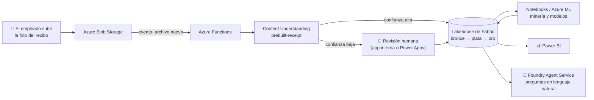


*Arquitectura de referencia del Azure Architecture Center para identificar, clasificar y buscar documentos con Azure Functions (Durable Functions), servicios de IA de documentos y búsqueda. Es el esqueleto típico del paso de extracción automatizada. Fuente: [Azure Architecture Center](https://learn.microsoft.com/en-us/azure/architecture/ai-ml/architecture/automate-document-classification-durable-functions).*


*Automated ML de Azure Machine Learning: prueba automáticamente múltiples algoritmos y configuraciones sobre tus datos y elige el mejor modelo. Útil para convertir un patrón minado (por ejemplo, "recibos que suelen rechazarse") en un modelo predictivo. Fuente: [Microsoft Learn – What is automated ML](https://learn.microsoft.com/en-us/azure/machine-learning/concept-automated-ml).*


*Experiencia de Data Science en Microsoft Fabric: notebooks, experimentos y modelos junto a los datos del lakehouse y Power BI. Fuente: [Microsoft Learn](https://learn.microsoft.com/en-us/fabric/data-science/data-science-overview).*

#### Paso 9. Limpiar recursos

Si solo estabas practicando, elimina los recursos para no generar costos:
1. En el portal de Azure, abre el **grupo de recursos** que creaste.
2. Selecciona **Delete resource group** (Eliminar grupo de recursos) y confirma escribiendo su nombre.

Esto borra el recurso de Foundry, los despliegues de modelos que creó Content Understanding y cualquier almacenamiento asociado.

---

### Consideraciones de IA responsable

| Riesgo | Ejemplo | Mitigación |
|---|---|---|
| **Privacidad** | Los recibos tienen nombres, RFC, direcciones, últimos dígitos de tarjeta | Minimiza: extrae solo los campos necesarios; enmascara datos personales; controla el acceso al almacenamiento y usa Entra ID en lugar de claves |
| **Calidad** | Un "$18.00" leído como "$1800" se convierte en una "anomalía" falsa | Filtra por confianza y manda a revisión humana; valida reglas (subtotal + impuestos = total) |
| **Equidad** | Un modelo entrenado con rechazos históricos puede castigar a un área o región que antes se auditaba más | Revisa los resultados por grupo; no automatices sanciones a partir de patrones sin validación humana |
| **Transparencia** | Un empleado no entiende por qué su recibo fue marcado | Explica la regla (por ejemplo, "10 veces la mediana del proveedor") y ofrece un canal de aclaración |
| **Correlación ≠ causalidad** | "Quien vuela gasta más en taxis" no significa que volar *cause* gastar en taxis de forma indebida | Trata los patrones como hipótesis para investigar, no como conclusiones |
| **Envío de datos a modelos** | Mandar todos los recibos con nombres a un LLM para que "los analice" | Envía agregados; usa filtros de contenido y las políticas de datos de tu organización |
| **Datos insuficientes** | El árbol de 7.6 nunca aprendió el límite de vuelos porque solo había 1 ejemplo | Revisa cuántos ejemplos hay de cada caso antes de confiar en un modelo; complementa con reglas explícitas |
| **Limitación de la finalidad** | Usar los datos de reembolsos para evaluar el desempeño de las personas | Usa los datos solo para el propósito con el que se recolectaron e infórmalo a los empleados |

### 🖼️ Créditos de imágenes
- Figuras de `images/modulo6/`: generadas con Python (pandas, scikit-learn, mlxtend y matplotlib) para este acordeón, a partir de los datos simulados de la práctica 7 y de datos sintéticos.
- Recibo de ejemplo de Contoso: repositorio [Azure-Samples/cognitive-services-REST-api-samples](https://github.com/Azure-Samples/cognitive-services-REST-api-samples) (licencia MIT).
- Ciclo de vida de TDSP: repositorio [Azure/Microsoft-TDSP](https://github.com/Azure/Microsoft-TDSP) de Microsoft.
- Comparaciones de clustering y de detección de anomalías: documentación de [scikit-learn](https://scikit-learn.org/) (licencia BSD-3-Clause).
- Capturas y diagramas de Fabric, Power BI, Content Understanding, Document Intelligence, Azure Machine Learning y Azure Architecture Center: documentación oficial de Microsoft en [Microsoft Learn](https://learn.microsoft.com/), enlazadas desde su ubicación original.

### Recursos
- [Azure Content Understanding – información general](https://learn.microsoft.com/en-us/azure/ai-services/content-understanding/overview)
- [Analizadores prebuilt de Content Understanding](https://learn.microsoft.com/en-us/azure/ai-services/content-understanding/concepts/prebuilt-analyzers)
- [Quickstart de Content Understanding con REST y SDK](https://learn.microsoft.com/en-us/azure/ai-services/content-understanding/quickstart/use-rest-api)
- [Modelo de recibos de Document Intelligence](https://learn.microsoft.com/en-us/azure/ai-services/document-intelligence/prebuilt/receipt)
- [Data Science en Microsoft Fabric](https://learn.microsoft.com/en-us/fabric/data-science/data-science-overview)
- [Data Wrangler en Microsoft Fabric](https://learn.microsoft.com/en-us/fabric/data-science/data-wrangler)
- [Arquitectura medallón en OneLake (Microsoft Fabric)](https://learn.microsoft.com/en-us/fabric/onelake/onelake-medallion-lakehouse-architecture)
- [Detección de anomalías en Fabric Real-Time Intelligence](https://learn.microsoft.com/en-us/fabric/real-time-intelligence/anomaly-detection)
- [Detección de anomalías en Power BI](https://learn.microsoft.com/en-us/power-bi/visuals/power-bi-visualization-anomaly-detection)
- [Azure AI Anomaly Detector (aviso de retiro)](https://learn.microsoft.com/en-us/azure/ai-services/anomaly-detector/overview)
- [Automated ML en Azure Machine Learning](https://learn.microsoft.com/en-us/azure/machine-learning/concept-automated-ml)
- [Fayyad, Piatetsky-Shapiro y Smyth (1996) – From Data Mining to Knowledge Discovery in Databases](https://ojs.aaai.org/aimagazine/index.php/aimagazine/article/view/1230)
- [Team Data Science Process (repositorio original de Microsoft)](https://github.com/Azure/Microsoft-TDSP)
- [scikit-learn – Clustering](https://scikit-learn.org/stable/modules/clustering.html)
- [scikit-learn – Detección de anomalías (Isolation Forest, LOF)](https://scikit-learn.org/stable/modules/outlier_detection.html)
- [mlxtend – Apriori y reglas de asociación](https://rasbt.github.io/mlxtend/user_guide/frequent_patterns/apriori/)
- [Inicio en la ciencia de datos (acordeón AI-900)](https://github.com/josejesusguzman/acordeon-ia-900/blob/main/docs/inicio_ciencia_datos.md)
