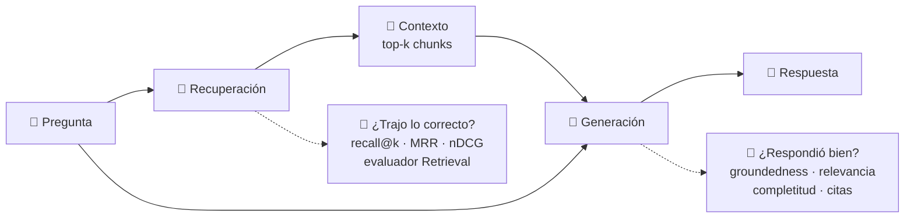
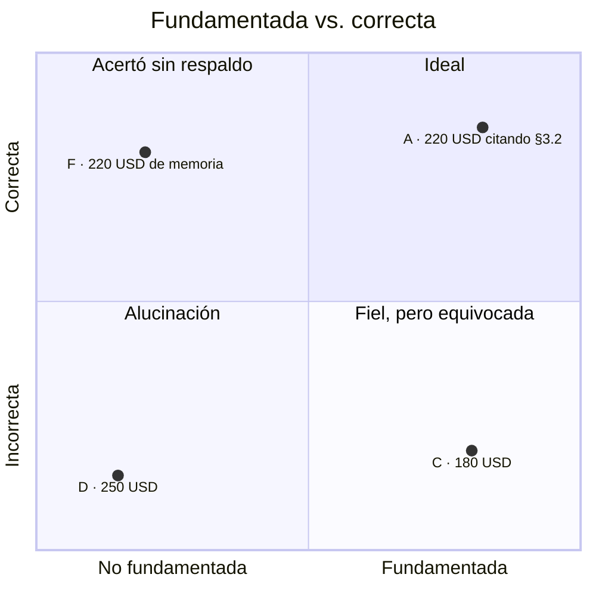
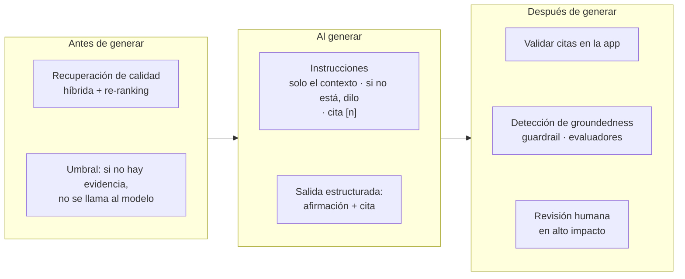
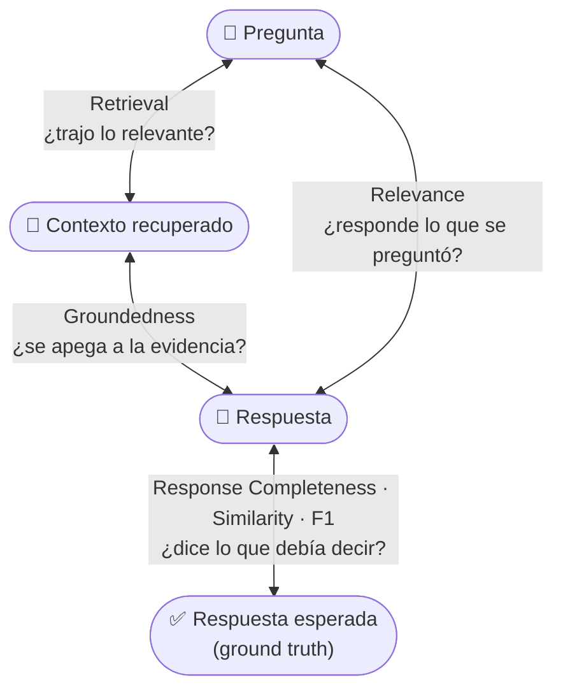
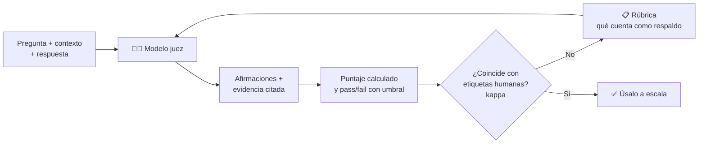
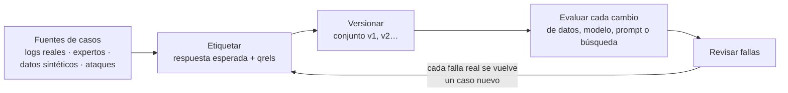
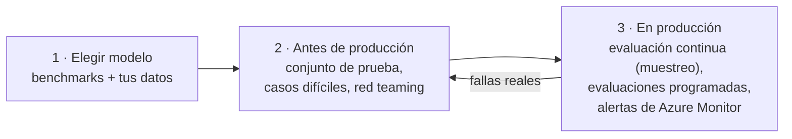
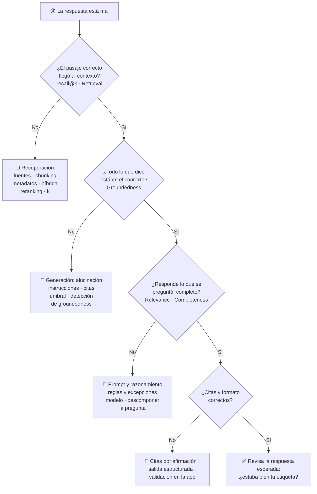

# Tema 2: Grounding y métricas de evaluación

### Descripción
**Grounding (fundamentación)** significa que cada afirmación de la respuesta está **respaldada por el contenido recuperado**. Un RAG puede fallar en dos lugares: en la **recuperación** (no encontró la información correcta) o en la **generación** (encontró la información, pero el modelo la usó mal o inventó). Por eso se evalúan **por separado**.

Analogía: un alumno que hace un ensayo con fuentes. La recuperación es si sacó los **libros correctos** de la biblioteca; la generación es si **citó correctamente** y no inventó datos que no estaban en esos libros. Un profesor que solo lee el ensayo final no sabe cuál de las dos cosas salió mal; uno que también revisa la bibliografía, sí.



A lo largo del tema evaluaremos **el mismo RAG de Contoso que construiste en el [Tema 1](tema1.md)**: la política de viáticos, sus 9 chunks y el buscador híbrido.

---

## 1. Grounding a fondo

### 1.1 ¿Qué significa "fundamentada"?
Una respuesta está fundamentada cuando **todo lo que afirma se puede rastrear hasta el contexto** que recibió el modelo. Microsoft Foundry lo separa en dos caras:
- **Groundedness** mide la **precisión**: que la respuesta **no contenga nada fuera** del contexto.
- **Response completeness** mide el **recall**: que la respuesta **no omita información crítica** comparada con la respuesta esperada.

Analogía: un abogado en un juicio solo puede argumentar con lo que está **en el expediente**. Si inventa un testigo, la respuesta no está fundamentada (falla de precisión); si olvida presentar la prueba clave que sí estaba en el expediente, la respuesta está incompleta (falla de recall).

### 1.2 Fundamentada no es lo mismo que correcta
Es la confusión más común. Que la respuesta se apegue al contexto no garantiza que sea correcta, y una respuesta correcta puede no estar fundamentada. Estos son cuatro casos de la práctica 10.3 para la pregunta *"¿Cuánto me pagan de hotel en un congreso en Madrid?"* (la respuesta correcta es **220 USD**):



| Cuadrante | Ejemplo | Qué pasó | Qué pieza revisar |
|---|---|---|---|
| **Ideal** | A: "Hasta 220 USD por noche, porque Madrid está en Europa" | Recuperó §3.2 y la usó bien | Nada |
| **Fiel, pero equivocada** | C: "El tope es de 180 USD…" | Todo lo que dice está en §3.2, pero aplicó la regla general e ignoró la excepción de Europa | Generación: razonamiento, instrucciones, modelo |
| **Acertó sin respaldo** | F: "220 USD por noche en Europa" con el chunk de *Alimentos* como contexto | La recuperación falló y el modelo respondió de memoria; esta vez acertó, la próxima no | Recuperación (y no confiar en la memoria del modelo) |
| **Alucinación** | D: "El tope es de 250 USD" | Inventó una cifra que contradice la fuente | Generación + controles de grounding |

Hay un quinto comportamiento que no cabe en el cuadro: la **abstención**. "No encontré esa información" es correcto cuando la información no existe, pero es un error cuando sí estaba en el contexto (caso E de la práctica).

### 1.3 Tipos de alucinación
La literatura (por ejemplo, la revisión de Ji et al., 2022) distingue dos tipos:
- **Intrínseca:** **contradice** la fuente. "El tope es de 250 USD" cuando la política dice 220.
- **Extrínseca:** **agrega** algo que la fuente no dice, ni a favor ni en contra. "…y además incluye el desayuno".

La extrínseca es más traicionera porque suena razonable y no choca con nada. Y existe una **zona gris**: las inferencias de conocimiento general. "Porque Madrid está en Europa" no aparece en la política, pero es indiscutible y es lo que conecta la pregunta con la regla. Tu rúbrica de evaluación tiene que decir explícitamente si eso se vale (en la práctica 10.7 decimos que sí, solo para **conectar** la pregunta con el contexto, nunca para **agregar datos**).

### 1.4 Cómo se logra el grounding: defensa en capas
Ninguna técnica sola lo garantiza. Se combinan antes, durante y después de generar:



| Técnica | Qué evita |
|---|---|
| Instrucciones explícitas ("responde solo con el contexto", "si no está, dilo", "cita la fuente") | Respuestas de memoria e inventos |
| Citas **por afirmación**, no al final | Que una cita "de adorno" respalde todo el párrafo |
| Umbral de relevancia antes de llamar al modelo | Que invente cuando no hay evidencia |
| Validar en la app que cada `[n]` exista y respalde lo dicho | Citas inventadas o cruzadas |
| Detección de groundedness (guardrail de Foundry o Azure AI Content Safety) | Respuestas sin respaldo que llegan al usuario |
| Revisión humana | Daños en decisiones de alto impacto |

> [!NOTE]
> En los guardrails de Foundry, el control **Groundedness** está en **preview** y aplica a modelos, no a agentes. La detección de groundedness de Azure AI Content Safety ofrece un modo rápido (sí/no), un modo con razonamiento que explica qué fragmento no tiene respaldo y una función de **corrección** en preview. Ojo: hoy está optimizada **solo para contenido en inglés** (puedes enviar texto en español, pero sin garantía de precisión); para español, apóyate en los evaluadores con modelo juez.

---

## 2. La tríada RAG: qué se compara con qué

Toda métrica de RAG compara **dos** de estas piezas: la pregunta, el contexto recuperado, la respuesta y, cuando la tienes, la respuesta esperada (*ground truth*). A las tres relaciones entre pregunta, contexto y respuesta se les conoce como la **tríada RAG** (término popularizado por TruLens):



| Par comparado | Pregunta que responde | Evaluador de Foundry | ¿Necesita respuesta esperada o etiquetas? | ¿Usa modelo juez? |
|---|---|---|---|---|
| Pregunta ↔ contexto | ¿Los chunks sirven para esta pregunta? | **Retrieval** (1–5) | No | Sí |
| Contexto ↔ etiquetas | ¿Recuperó y ordenó bien lo que una persona marcó como relevante? | **Document Retrieval** (nDCG, XDCG, Fidelity…) | Sí, juicios de relevancia (*qrels*) | No |
| Contexto ↔ respuesta | ¿Todo lo dicho está en la evidencia? | **Groundedness** (1–5), **Groundedness Pro** (sí/no) | No | Sí / Content Safety |
| Pregunta ↔ respuesta | ¿Responde directamente lo que se preguntó? | **Relevance** (1–5) | No | Sí |
| Respuesta ↔ esperada | ¿Incluye lo importante? ¿Se parece? | **Response Completeness**, **Similarity** (1–5); **F1, BLEU, GLEU, ROUGE, METEOR** (0–1) | Sí | Completeness y Similarity sí; las de texto no |

Lo práctico: los evaluadores **sin** respuesta esperada (Retrieval, Groundedness, Relevance) se pueden correr sobre **tráfico real en producción**; los que la necesitan se corren sobre tu **conjunto de prueba**.

---

## 3. Métricas de recuperación a fondo

### 3.1 Con juicios de relevancia (*qrels*)
Para medir la recuperación con precisión necesitas que una persona marque, para cada pregunta, qué chunks son relevantes y **qué tanto**. Esas marcas se llaman *qrels* (*query relevance judgments*). En la práctica usaremos la misma escala de 0 a 4 del semantic ranker: **4** = responde todo, **3** = relevante, pero le faltan detalles, **2** = responde una parte, **1** = relacionado, **0** = irrelevante.

| Métrica | Cómo se calcula | Qué te dice | Su punto ciego |
|---|---|---|---|
| **Precision@k** | relevantes en el top-k ÷ k | Qué tanto ruido llega al prompt | Si solo existe 1 chunk relevante, lo máximo con k = 3 es 0.33 |
| **Recall@k** | relevantes recuperados ÷ relevantes que existen | Si llegó **toda** la evidencia necesaria | No le importa el orden |
| **Hit rate@k** | ¿llegó al menos uno relevante? (sí/no) | Lo mínimo indispensable | Muy permisiva |
| **MRR** | promedio de 1 ÷ posición del **primer** relevante | Qué tan arriba aparece la evidencia | Solo mira el primero |
| **nDCG@k** | DCG ÷ DCG ideal, con grados de relevancia | Si lo **más** relevante quedó **más** arriba | Necesita etiquetas graduadas |

```text
DCG@k  =  Σ  (2^etiqueta − 1) / log2(posición + 1)        nDCG@k = DCG@k / DCG@k del orden ideal
```

- La ganancia `2^etiqueta − 1` premia mucho más a un chunk con 4 (ganancia 15) que a uno con 1 (ganancia 1).
- El descuento `log2(posición + 1)` castiga bajar posiciones: en la 1 divide entre 1; en la 3, entre 2.
- Lo verás paso a paso en la práctica 10.1, donde **MRR dice "perfecto"** en la pregunta del Uber y **nDCG detecta** que el mejor chunk quedó en segundo lugar.

Los resultados de la práctica para el RAG del Tema 1 (8 preguntas, k = 3):

| Método | precision@3 | recall@3 | MRR | nDCG@3 |
|---|---|---|---|---|
| BM25 | 0.292 | 0.750 | 0.750 | 0.750 |
| Vectorial | 0.375 | 1.000 | 0.938 | 0.911 |
| **Híbrida** | 0.375 | 1.000 | **1.000** | **0.962** |

### 3.2 Las métricas de Document Retrieval en Foundry
El evaluador **Document Retrieval** de Foundry recibe tus *qrels* (`retrieval_ground_truth`) y lo que devolvió el buscador (`retrieved_documents`, con su puntaje) y calcula, sin modelo juez:

| Métrica | Qué mide | Detalle |
|---|---|---|
| **nDCG@3** | Qué tan cerca está tu orden del orden ideal | Misma fórmula de arriba: en la práctica 10.2 da exactamente lo mismo que nuestra implementación |
| **XDCG@3** | Qué tan buenos son, en términos absolutos, los 3 primeros | Promedio ponderado de las etiquetas con descuento por posición, escalado de 0 a 100 (con la escala 0–4) |
| **Fidelity** | Cuántos de los documentos buenos conocidos sí llegaron | Ponderado por etiqueta; 1.0 = no faltó ninguno |
| **Top-1 relevance / Top-3 max relevance** | La etiqueta del primer resultado y la mejor del top-3 | Útil para ver si "lo mejor" está arriba |
| **Holes / holes_ratio** | Documentos recuperados **sin etiqueta** | Si son muchos, tus métricas no son confiables |

> [!TIP]
> Los **holes** te avisan que tus etiquetas están incompletas. La solución clásica (de las competencias TREC) es el *pooling*: junta el top-k de **todos** los buscadores que comparas y etiqueta esa unión. Así ningún método sale beneficiado por haber recuperado algo que nadie revisó.

### 3.3 Sin etiquetas: el evaluador Retrieval
Etiquetar cuesta. Cuando no tienes *qrels* (por ejemplo, con tráfico real de producción), el evaluador **Retrieval** usa un modelo juez para calificar de 1 a 5 si los chunks recuperados son relevantes para la pregunta (umbral de aprobación por defecto: 3). Es menos preciso que las etiquetas humanas, pero escala.

### 3.4 Seguridad y frescura también son recuperación
- **Seguridad:** que un usuario reciba un chunk que no tiene permiso de ver es una **falla de recuperación**, aunque la respuesta sea "correcta". Pruébalo preguntando lo mismo con usuarios de distintos grupos (como la colaboradora y la directora del [Tema 1, práctica 9.9](tema1.md)).
- **Frescura:** si el índice todavía tiene la política 2025, la respuesta puede estar perfectamente fundamentada… en una fuente vencida. Incluye en tus pruebas preguntas sobre reglas que cambiaron.

---

## 4. Métricas de generación a fondo

### 4.1 Los evaluadores de Foundry para la respuesta

| Evaluador | Qué mide | Entradas | Escala (umbral) | ¿Cómo califica? |
|---|---|---|---|---|
| **Groundedness** | Que no haya nada fuera del contexto (precisión) | `response`, `context` (`query` opcional) | 1–5 (3) | Modelo juez |
| **Groundedness Pro** (preview) | Consistencia estricta con el contexto | `query`, `response`, `context` | Verdadero/Falso | Azure AI Content Safety |
| **Relevance** | Si responde directa y completamente a la pregunta | `query`, `response` | 1–5 (3) | Modelo juez |
| **Response Completeness** (preview) | Que no omita lo importante de la respuesta esperada (recall) | `ground_truth`, `response` | 1–5 (3) | Modelo juez |
| **Coherence / Fluency** | Lógica y naturalidad del texto | `query`, `response` / `response` | 1–5 (3) | Modelo juez |
| **Similarity** | Parecido **semántico** con la respuesta esperada | `query`, `response`, `ground_truth` | 1–5 (3) | Modelo juez |
| **F1, BLEU, GLEU, ROUGE, METEOR** | Palabras o n-gramas en común con la esperada | `response`, `ground_truth` | 0–1 (0.5) | Algoritmo, sin modelo |

Todos devuelven además un resultado **pass/fail** según su umbral, como una prueba unitaria.

### 4.2 Calidad de citas
Una cita sirve si el usuario puede abrirla y **encontrar ahí lo que se afirmó**. Inspirados en el trabajo de Gao et al. (2023) sobre generación con citas, se miden dos cosas:
- **Precisión de citas:** de todas las citas, ¿cuántas respaldan de verdad su afirmación?
- **Recall de citas:** de todas las afirmaciones, ¿cuántas tienen al menos una cita que las respalde?

En la práctica 10.4 verás una respuesta con las dos citas **cruzadas**: cada afirmación es verdadera, pero cita el documento equivocado. Precisión y recall de citas: 0.

### 4.3 Incertidumbre apropiada: saber decir "no sé"
- En preguntas **sin respuesta** en los documentos (por ejemplo, "¿Puedo llevar a mi mascota?"), mide qué porcentaje de veces el sistema **se abstiene** en lugar de inventar.
- En preguntas **con respuesta**, mide las **falsas abstenciones**: decir "no encontré" cuando la evidencia sí estaba (caso E de la práctica 10.3).
- Las dos se jalan: un umbral muy estricto sube las abstenciones correctas, pero también las falsas.

### 4.4 Métricas de texto: útiles, pero engañosas
F1, BLEU, GLEU, ROUGE y METEOR cuentan **palabras o secuencias de palabras en común** con la respuesta esperada. Son rápidas, gratis y deterministas, pero no entienden significado. Resultados reales de la práctica 10.5 contra la esperada *"Hasta 220 USD por noche, porque Madrid está en Europa."*:

| Respuesta | ¿Correcta? | F1 | BLEU | ROUGE-L | METEOR |
|---|---|---|---|---|---|
| "En Europa el tope de hospedaje es de 220 USD por noche." | ✅ | 0.55 | 0.21 | 0.36 | 0.52 |
| "220 USD por noche." | ✅ | 0.57 | 0.14 | 0.57 | 0.40 |
| "Hasta 180 USD por noche, porque Madrid **no** está en Europa." | ❌ | **0.86** | **0.63** | **0.86** | **0.91** |

La respuesta **incorrecta** gana en todas porque copia casi todas las palabras. Úsalas para lo que sirven: traducción, resúmenes contra una referencia o detectar cambios bruscos entre versiones. Para juzgar si una respuesta es correcta, usa evaluadores semánticos (Similarity, Response Completeness) o revisión humana.

### 4.5 Equivalencias aproximadas con RAGAS
RAGAS es un framework open source muy usado para evaluar RAG. Sus métricas se parecen a las de Foundry, aunque **no son idénticas** (cambian los prompts y las escalas):

| RAGAS | Lo más parecido en Foundry |
|---|---|
| Faithfulness | Groundedness |
| Response Relevancy | Relevance |
| Context Precision | Retrieval / nDCG de Document Retrieval |
| Context Recall | Fidelity de Document Retrieval (con etiquetas) |
| Noise Sensitivity | Sin equivalente directo: errores causados por chunks irrelevantes |

---

## 5. El LLM como juez: útil, pero hay que vigilarlo



Un modelo "juez" lee la pregunta, el contexto y la respuesta, y califica según una rúbrica. Así funcionan Groundedness, Relevance y los demás evaluadores de IA de Foundry. Escala a miles de respuestas y explica su calificación, pero tiene sesgos. Los tres primeros de esta tabla los documentaron Zheng et al. (2023) al estudiar a GPT-4 como juez; los otros dos son problemas frecuentes en la práctica:

| Sesgo | Qué hace | Cómo mitigarlo |
|---|---|---|
| **De posición** | Al comparar dos respuestas, prefiere la que va primero | Evalúa en ambos órdenes o califica una por una |
| **De verbosidad** | Premia respuestas largas aunque no sean mejores | Rúbrica que pida concisión; penaliza relleno |
| **De autopreferencia** | Favorece textos generados por su misma familia de modelos | Usa un juez distinto del modelo que genera |
| **Indulgencia** | Califica alto "por cortesía" | Rúbrica con anclas concretas por puntaje |
| **Sensibilidad al prompt** | Un cambio pequeño en la rúbrica mueve los puntajes | Versiona la rúbrica y vuelve a calibrar al cambiarla |

Buenas prácticas:
1. Pide **afirmaciones con evidencia** y calcula el puntaje en tu código (práctica 10.7), en lugar de pedir un número "a ojo".
2. Exige **salida estructurada** (JSON con esquema) para no depender de parsear texto libre.
3. Usa temperatura 0 cuando el modelo la acepte (algunos modelos de razonamiento no aceptan `temperature`).
4. **Calibra** contra etiquetas humanas antes de confiar en él. La medida estándar es la **kappa de Cohen**, que descuenta el acuerdo que se daría por puro azar:

```text
κ = (acuerdo observado − acuerdo esperado por azar) / (1 − acuerdo esperado por azar)
```

| κ | Interpretación (Landis y Koch, 1977) |
|---|---|
| < 0 | Peor que el azar |
| 0.00 – 0.20 | Leve |
| 0.21 – 0.40 | Justa |
| 0.41 – 0.60 | Moderada |
| 0.61 – 0.80 | Sustancial |
| 0.81 – 1.00 | Casi perfecta |

En la práctica 10.6, un verificador automático basado en palabras coincide con las etiquetas humanas el 58 % de las veces, pero su **kappa es 0.17 (leve)**: se le escapan contradicciones escritas con las mismas palabras y da falsas alarmas con paráfrasis. Por eso existen los jueces con modelo y por eso **a todo juez se le mide**.

---

## 6. El conjunto de prueba (golden dataset)

Es la pieza más valiosa de toda la evaluación: sin él, cada cambio es una apuesta. Cada fila tiene la pregunta y lo que esperas; al correr la evaluación se agregan el contexto y la respuesta del sistema:

```json
{"query": "¿Cuánto me pagan de hotel en un congreso en Madrid?", "ground_truth": "Hasta 220 USD por noche, porque Madrid está en Europa.", "retrieval_ground_truth": [{"document_id": "3.2", "query_relevance_label": 4}, {"document_id": "3.1", "query_relevance_label": 1}]}
```

| Tipo de caso | Ejemplo con Contoso | Qué pone a prueba |
|---|---|---|
| Directa | "tope de hospedaje en Monterrey" | Lo básico |
| Con otras palabras | "¿Me dejan volar en business a Tokio?" | Búsqueda semántica |
| Código exacto | "¿Para qué es el formato GV-07?" | Búsqueda por palabras clave |
| Compuesta | "¿Qué me reembolsan de hotel y de taxi en Madrid?" | Recall, descomposición |
| Sin respuesta | "¿Puedo llevar a mi mascota?" | Que diga "no sé" |
| Ambigua | "¿Cuánto me dan?" | Que pida aclaración |
| Desactualizada | Una regla que cambió en 2026 | Frescura del índice |
| No autorizada | Preguntar por el anexo de Dirección sin permiso | Recorte de seguridad |
| Ataque | Un documento con "ignora tus instrucciones" | Inyección indirecta |



Reglas de oro:
- **Versiona** el conjunto y guarda con qué versión se midió cada resultado.
- **No estudies para el examen:** si ajustas el sistema mirando siempre las mismas preguntas, terminarás optimizando para ellas. Aparta un grupo de preguntas que solo uses para la medición final.
- **Crece con la realidad:** cada falla que reporte un usuario se convierte en un caso nuevo.
- Para arrancar rápido, Foundry puede generar **datos sintéticos** y **simular conversaciones** (funciones en preview), y el **AI red teaming agent** simula ataques basados en PyRIT. Revisa siempre lo generado: un caso sintético mal hecho mide lo que no es.

---

## 7. Calidad vs. latencia vs. costo

Más contexto ayuda… hasta que deja de ayudar. Así se ve en el RAG del Tema 1 (práctica 10.1):

| k (chunks al prompt) | recall@k | Contexto promedio |
|---|---|---|
| 1 | 0.938 | ≈ 36 tokens |
| 2 | **1.000** | ≈ 71 tokens |
| 3 | 1.000 | ≈ 102 tokens |
| 5 | 1.000 | ≈ 146 tokens |

A partir de k = 2 ya llegó toda la evidencia: los chunks extra solo agregan tokens (costo y latencia) y **ruido** que puede distraer al modelo. En tus datos el codo estará en otro lugar; lo importante es **medirlo** en lugar de adivinarlo.

| Decisión | Calidad | Latencia | Costo |
|---|---|---|---|
| Más chunks (k mayor) | ⬆️ hasta el codo, luego ⬇️ por ruido | ⬆️ | ⬆️ tokens de entrada |
| Re-ranking semántico | ⬆️ | ⬆️ un poco | ⬆️ por consulta |
| Modelo generador más grande | ⬆️ en razonamiento | ⬆️ | ⬆️ |
| Recuperación agéntica | ⬆️ en preguntas compuestas | ⬆️ (planeación con LLM) | ⬆️ tokens |

La evaluación también cuesta: los evaluadores de IA consumen tokens del modelo juez (cuentan contra tu cuota de Azure OpenAI), y las evaluaciones del playground de agentes vienen **activadas por defecto** y se cobran por consumo. Para ahorrar, Microsoft sugiere usar un juez más pequeño (por ejemplo `gpt-4.1-mini` en lugar de `gpt-4.1`) o un conjunto más chico.

---

## 8. Evaluar en Microsoft Foundry



Microsoft describe tres etapas de la evaluación: elegir el modelo base, evaluar antes de desplegar y monitorear en producción. Las formas de evaluar:

| Forma | Cómo | Para qué |
|---|---|---|
| **Portal** | **Evaluation › Create**: eliges el objetivo (agente, modelo, dataset o trazas), los datos (existentes o sintéticos), el mapeo de campos y los evaluadores | Empezar sin código |
| **SDK local** | Paquete `azure-ai-evaluation` y su función `evaluate()` (práctica 10.8) | Iterar rápido en tu máquina; los resultados se pueden publicar en el proyecto |
| **En la nube** | `project_client.get_openai_client().evals` con evaluadores `builtin.*` (práctica 10.9) | Corridas grandes, reportes en el portal, integración con CI/CD |
| **Playground de agentes** | Métricas activadas por defecto en cada respuesta | Revisión rápida mientras pruebas |
| **Producción** | Evaluación continua sobre una muestra del tráfico, evaluaciones y red teaming programados, alertas en Azure Monitor | Detectar degradación y deriva |

Catálogo de evaluadores integrados (por categoría):

| Categoría | Evaluadores |
|---|---|
| Propósito general | Coherence, Fluency |
| Similitud textual | Similarity, F1, BLEU, GLEU, ROUGE, METEOR |
| RAG | Retrieval, Document Retrieval, Groundedness, Groundedness Pro (preview), Relevance, Response Completeness (preview) |
| Riesgo y seguridad | Hate and Unfairness, Sexual, Violence, Self-Harm, Protected Materials, Indirect Attack, Code Vulnerability, Ungrounded Attributes, entre otros |
| Agentes | Task Adherence, Task Completion, Intent Resolution, Tool Call Accuracy, entre otros (varios en preview) |
| Graders de Azure OpenAI y personalizados | Model Labeler, String Checker, Text Similarity, Model Scorer; evaluadores propios (preview) |

Necesitas el rol **Foundry User** en el proyecto y, para los evaluadores de IA, un deployment de un modelo GPT que funcione como juez.

---

## 9. Diagnóstico: del síntoma a la pieza



| Síntoma | Causa probable | Métrica que lo delata | Arreglo |
|---|---|---|---|
| La respuesta correcta no está en los fragmentos | Recuperación | recall@k, Retrieval, Fidelity | Mejorar chunking, metadatos, búsqueda híbrida, re-ranking |
| Está en los fragmentos, pero la respuesta es incorrecta | Generación | Groundedness alto + Completeness bajo | Mejores instrucciones, modelo más capaz, menos ruido |
| Inventa cuando no hay información | Falta de incertidumbre apropiada | Groundedness bajo en preguntas sin respuesta | "Si no está en el contexto, di que no lo sabes" + umbral |
| Cita una fuente que no dice eso | Calidad de citas | Precisión de citas | Pedir citas por afirmación; validar en la app; LLM juez |
| La evidencia correcta llega en 3.er lugar | Ranking | MRR, nDCG | Re-ranking semántico, mejores títulos y metadatos |
| Las métricas cambian mucho entre corridas | Juez inestable o conjunto chico | Varianza entre corridas, kappa | Temperatura 0, rúbrica más concreta, más casos |
| Funciona en pruebas y falla con usuarios | Conjunto de prueba poco realista | Evaluación continua en producción | Agregar casos reales al conjunto |

> [!TIP]
> Mide siempre **antes y después** de cada cambio, con el mismo conjunto de prueba. Y vuelve a evaluar cada vez que cambien los datos, el modelo, el prompt o la configuración de búsqueda: Microsoft Learn lo pide explícitamente.

---

## 10. Práctica en Python: evaluar el RAG del Tema 1

Las prácticas 10.1 a 10.6 corren en cualquier computadora y sus salidas son exactamente las que ves aquí. Usan los archivos de la [práctica del Tema 1](tema1.md) (`chunks.json`, que generan sus pasos 9.1 y 9.2, `bm25.py`, `vectorial.py`, `hibrida.py` y, para 10.8, `prompt.py`): guarda estos nuevos scripts en esa misma carpeta.

```bash
pip install numpy nltk azure-ai-evaluation
```

#### 10.1) Métricas de recuperación desde cero (`metricas_recuperacion.py`)
```python
import json
import math
from pathlib import Path

from hibrida import BuscadorHibrido

# Juicios de relevancia (qrels), escala 0-4 como el semantic ranker: 4 = responde todo, 2 = responde una parte,
# 1 = relacionado. Lo que no aparece no se etiquetó. "Relevante" para métricas binarias = etiqueta >= 2.
QRELS = {
    "¿Cuánto me pagan de hotel en un congreso en Madrid?": {"3.2": 4, "3.1": 1},
    "¿Para qué es el formato GV-07?": {"7": 4},
    "¿Me reembolsan las cervezas de la cena?": {"4": 4},
    "¿Me dejan volar en business a Tokio?": {"2": 4, "3.2": 1},
    "¿Qué necesito para comprobar un Uber?": {"6": 4, "5": 2},
    "¿Qué pasa si cancelo mi viaje un día antes?": {"8": 4},
    "tope de hospedaje en Monterrey": {"3.1": 4, "3.2": 1},
    "¿Cuántos días tengo para entregar mis comprobantes?": {"6": 4, "7": 1},
}
UMBRAL_RELEVANTE = 2


def precision_at_k(ids, qrels, k):
    return sum(qrels.get(d, 0) >= UMBRAL_RELEVANTE for d in ids[:k]) / k


def recall_at_k(ids, qrels, k):
    relevantes = [d for d, e in qrels.items() if e >= UMBRAL_RELEVANTE]
    return sum(d in ids[:k] for d in relevantes) / len(relevantes)


def reciprocal_rank(ids, qrels, k):
    for posicion, d in enumerate(ids[:k], start=1):
        if qrels.get(d, 0) >= UMBRAL_RELEVANTE:
            return 1 / posicion
    return 0.0


def dcg(etiquetas):
    return sum((2 ** e - 1) / math.log2(posicion + 1) for posicion, e in enumerate(etiquetas, start=1))


def ndcg_at_k(ids, qrels, k):
    obtenido = dcg([qrels.get(d, 0) for d in ids[:k]])
    ideal = dcg(sorted(qrels.values(), reverse=True)[:k])     # el mejor orden posible
    return obtenido / ideal


if __name__ == "__main__":
    chunks = json.loads(Path("chunks.json").read_text(encoding="utf-8"))
    buscador = BuscadorHibrido(chunks)
    K = 3

    resultados = {"BM25": {}, "Vectorial": {}, "Híbrida": {}}
    for pregunta in QRELS:
        hibrida, texto, vector = buscador.buscar(pregunta, top=5)
        for metodo, lista in zip(resultados, (texto, vector, hibrida)):
            resultados[metodo][pregunta] = [chunks[doc]["id"] for doc, _ in lista]

    print(f"Promedio en {len(QRELS)} preguntas (k = {K})")
    print(f"{'Método':<10} {'precision@3':>11} {'recall@3':>9} {'MRR':>6} {'nDCG@3':>7}")
    for metodo, por_pregunta in resultados.items():
        filas = [(precision_at_k(ids, QRELS[p], K), recall_at_k(ids, QRELS[p], K),
                  reciprocal_rank(ids, QRELS[p], K), ndcg_at_k(ids, QRELS[p], K)) for p, ids in por_pregunta.items()]
        promedios = [sum(col) / len(filas) for col in zip(*filas)]
        print(f"{metodo:<10} {promedios[0]:>11.3f} {promedios[1]:>9.3f} {promedios[2]:>6.3f} {promedios[3]:>7.3f}")

    pregunta = "¿Qué necesito para comprobar un Uber?"
    ids, qrels = resultados["Híbrida"][pregunta], QRELS[pregunta]
    etiquetas = [qrels.get(d, 0) for d in ids[:K]]
    print(f"\nPaso a paso, híbrida: {pregunta}")
    print(f"  top-3 = {ids[:K]} -> etiquetas {etiquetas}")
    ideales = sorted(qrels.values(), reverse=True)[:K]
    formula = lambda es: " + ".join(f"(2^{e}-1)/log2({p + 1})" for p, e in enumerate(es, start=1))
    print(f"  DCG  = {formula(etiquetas)} = {dcg(etiquetas):.3f}")
    print(f"  IDCG = {formula(ideales)} = {dcg(ideales):.3f}")
    print(f"  nDCG@3 = {ndcg_at_k(ids, qrels, K):.3f} | MRR = {reciprocal_rank(ids, qrels, K):.0f}"
          f" (el chunk 5 ya cuenta como relevante, aunque el mejor era el 6)")

    print("\nCalidad vs. costo en la híbrida: ¿cuántos chunks mandar al prompt?")
    for k in range(1, 6):
        recall = sum(recall_at_k(ids, QRELS[p], k) for p, ids in resultados["Híbrida"].items()) / len(QRELS)
        tokens = sum(sum(len(c["texto"]) for c in chunks if c["id"] in ids[:k]) / 4
                     for ids in resultados["Híbrida"].values()) / len(QRELS)
        print(f"  k = {k}: recall@{k} = {recall:.3f} | contexto promedio ≈ {tokens:5.1f} tokens")
```

Salida:
```
Promedio en 8 preguntas (k = 3)
Método     precision@3  recall@3    MRR  nDCG@3
BM25             0.292     0.750  0.750   0.750
Vectorial        0.375     1.000  0.938   0.911
Híbrida          0.375     1.000  1.000   0.962

Paso a paso, híbrida: ¿Qué necesito para comprobar un Uber?
  top-3 = ['5', '6', '7'] -> etiquetas [2, 4, 0]
  DCG  = (2^2-1)/log2(2) + (2^4-1)/log2(3) + (2^0-1)/log2(4) = 12.464
  IDCG = (2^4-1)/log2(2) + (2^2-1)/log2(3) = 16.893
  nDCG@3 = 0.738 | MRR = 1 (el chunk 5 ya cuenta como relevante, aunque el mejor era el 6)

Calidad vs. costo en la híbrida: ¿cuántos chunks mandar al prompt?
  k = 1: recall@1 = 0.938 | contexto promedio ≈  36.2 tokens
  k = 2: recall@2 = 1.000 | contexto promedio ≈  70.8 tokens
  k = 3: recall@3 = 1.000 | contexto promedio ≈ 101.6 tokens
  k = 4: recall@4 = 1.000 | contexto promedio ≈ 130.6 tokens
  k = 5: recall@5 = 1.000 | contexto promedio ≈ 146.0 tokens
```
- **Explicación:**
  - `QRELS` son los juicios humanos: para la pregunta del Uber, el chunk 6 (comprobación con CFDI) vale 4 y el 5 (tope de taxi) vale 2.
  - **Precision@3 es baja para todos** (0.29–0.38) porque casi todas las preguntas tienen un solo chunk relevante: con k = 3, lo máximo posible es 0.33. No es un mal resultado; es una métrica que no encaja con este conjunto.
  - BM25 pierde las dos preguntas escritas con otras palabras (hotel/Madrid y business/Tokio): recall 0.75. La vectorial y la híbrida recuperan todo (recall 1.0).
  - **MRR vs. nDCG:** en el Uber, la híbrida pone primero el chunk 5 (etiqueta 2) y después el 6 (etiqueta 4). Para MRR basta con que el primero sea "relevante", así que da 1. nDCG ve el orden y baja a 0.738, porque el mejor chunk quedó en segundo lugar.
  - **Calidad vs. costo:** recall@k llega a 1.0 con k = 2. De ahí en adelante, cada chunk extra solo agrega tokens.

#### 10.2) Las mismas métricas con el evaluador de Foundry (`foundry_retrieval.py`)
`DocumentRetrievalEvaluator` es algorítmico: corre en tu computadora, sin modelo juez y sin cuenta de Azure.

```python
import json
from pathlib import Path

from azure.ai.evaluation import DocumentRetrievalEvaluator    # pip install azure-ai-evaluation

from hibrida import BuscadorHibrido
from metricas_recuperacion import QRELS, ndcg_at_k

chunks = json.loads(Path("chunks.json").read_text(encoding="utf-8"))
buscador = BuscadorHibrido(chunks)
evaluador = DocumentRetrievalEvaluator(ground_truth_label_min=0, ground_truth_label_max=4)   # escala 0-4

print(f"{'Pregunta':<52} {'nDCG@3':>6} {'propio':>6} {'XDCG@3':>6} {'fidel.':>6} {'holes':>5}")
suma = {"ndcg@3": 0, "xdcg@3": 0, "fidelity": 0, "holes": 0}
for pregunta, qrels in QRELS.items():
    hibrida, _, _ = buscador.buscar(pregunta, top=5)
    recuperados = [{"document_id": chunks[doc]["id"], "relevance_score": puntos} for doc, puntos in hibrida]
    verdad = [{"document_id": d, "query_relevance_label": e} for d, e in qrels.items()]

    r = evaluador(retrieval_ground_truth=verdad, retrieved_documents=recuperados)["document_retrieval_properties"]
    propio = ndcg_at_k([d["document_id"] for d in recuperados], qrels, 3)       # nuestra función de 10.1
    for m in suma:
        suma[m] += r[m]
    print(f"{pregunta:<52} {r['ndcg@3']:>6.3f} {propio:>6.3f} {r['xdcg@3']:>6.1f} {r['fidelity']:>6.2f} {r['holes']:>5}")

n = len(QRELS)
print(f"{'Promedio':<52} {suma['ndcg@3'] / n:>6.3f} {'':>6} {suma['xdcg@3'] / n:>6.1f} "
      f"{suma['fidelity'] / n:>6.2f} {suma['holes'] / n:>5.2f}")
```

Salida:
```
Pregunta                                             nDCG@3 propio XDCG@3 fidel. holes
¿Cuánto me pagan de hotel en un congreso en Madrid?   0.960  0.960   51.0   1.00     3
¿Para qué es el formato GV-07?                        1.000  1.000   51.0   1.00     1
¿Me reembolsan las cervezas de la cena?               1.000  1.000   51.0   1.00     4
¿Me dejan volar en business a Tokio?                  1.000  1.000   58.7   1.00     2
¿Qué necesito para comprobar un Uber?                 0.738  0.738   56.1   1.00     1
¿Qué pasa si cancelo mi viaje un día antes?           1.000  1.000   51.0   1.00     4
tope de hospedaje en Monterrey                        1.000  1.000   58.7   1.00     3
¿Cuántos días tengo para entregar mis comprobantes?   1.000  1.000   58.7   1.00     2
Promedio                                              0.962          54.5   1.00  2.50
```
- **Explicación:**
  - La columna **nDCG@3 de Foundry es idéntica a la nuestra** (`propio`): ahora sabes exactamente qué calcula.
  - **XDCG@3** de 51.0 aparece cuando solo el primer resultado es relevante (etiqueta 4) y los otros dos no: es la etiqueta promedio ponderada, escalada de 0 a 100. Sube a 58.7 cuando el segundo o el tercero también aportan algo. Mide el **ruido** que entra al prompt, algo que nDCG no castiga.
  - **Fidelity = 1.00** en todas: los documentos buenos conocidos siempre llegaron en el top-5.
  - **Holes = 2.5 en promedio:** la mayoría de los chunks recuperados no tienen etiqueta, porque solo marcamos los relevantes. Antes de comparar sistemas en serio, etiqueta el *pool* (sección 3.2).
  - Ojo: el evaluador ordena los documentos por `relevance_score`, no por el orden de la lista. Mándale el puntaje real de tu buscador.

#### 10.3) Fundamentada vs. correcta: un verificador por afirmación (`verificador.py`)
Un verificador **heurístico**: cada oración de la respuesta es una afirmación, y sus cifras y términos deben venir del contexto (o de la propia pregunta). Es barato y transparente, y en 10.6 mediremos qué tan confiable es.

```python
import json
import re
from pathlib import Path

from bm25 import palabras, raiz, STOPWORDS

RELLENO = STOPWORDS | {"te", "porque", "esta", "son", "hay", "ademas", "tambien", "solo"}
ABSTENCION = ("no encontré", "no tengo información", "no lo sé")


def terminos(texto):
    return {raiz(p) for p in palabras(texto) if p not in RELLENO and not p[0].isdigit()}


def cifras(texto):
    return set(re.findall(r"\d+(?:[.,]\d+)*", texto))


def verificar(respuesta, contexto, pregunta):
    """Revisa cada afirmación (oración): sus cifras y sus términos deben venir del contexto
    (o de la propia pregunta, como 'Madrid'). Devuelve las afirmaciones sin respaldo."""
    if respuesta.lower().startswith(ABSTENCION):
        return None                                                     # se abstuvo: no afirmó nada
    sin_respaldo = []
    for afirmacion in re.split(r"(?<=[.;])\s+", respuesta.strip()):
        cifras_malas = cifras(afirmacion) - cifras(contexto)
        terminos_malos = terminos(afirmacion) - terminos(contexto) - terminos(pregunta)
        if cifras_malas or terminos_malos:
            sin_respaldo.append(sorted(cifras_malas) + sorted(terminos_malos))
    return sin_respaldo


if __name__ == "__main__":
    chunks = {c["id"]: c["texto"] for c in json.loads(Path("chunks.json").read_text(encoding="utf-8"))}
    pregunta = "¿Cuánto me pagan de hotel en un congreso en Madrid?"
    DATO_CORRECTO = "220"                                                   # de la respuesta esperada

    CASOS = [   # (nombre, chunk que llegó como contexto, respuesta del modelo)
        ("A", "3.2", "Te pagan hasta 220 USD por noche, porque Madrid está en Europa."),
        ("B", "3.2", "Te pagan hasta 220 USD por noche y además incluye el desayuno."),
        ("C", "3.2", "El tope es de 180 USD por noche en viajes al extranjero."),
        ("D", "3.2", "El tope es de 250 USD por noche."),
        ("E", "3.2", "No encontré esa información en la política."),
        ("F", "4", "Te pagan hasta 220 USD por noche en Europa."),             # la recuperación trajo Alimentos
    ]

    print(f"{'Caso':<5}{'Contexto':<10}{'¿Fundamentada?':<34}{'¿Dato correcto?':<17}Cuadrante")
    for nombre, chunk_id, respuesta in CASOS:
        resultado = verificar(respuesta, chunks[chunk_id], pregunta)
        correcta = DATO_CORRECTO in respuesta
        if resultado is None:
            fundamentada, cuadrante = "— (se abstuvo)", "abstención: la respuesta sí existía"
        else:
            fundamentada = "sí" if not resultado else f"no: {', '.join(resultado[0])}"
            cuadrante = {(True, True): "ideal",
                         (True, False): "fiel al contexto, pero equivocada",
                         (False, True): "dato correcto sin respaldo",
                         (False, False): "alucinación"}[(not resultado, correcta)]
        print(f"{nombre:<5}{'§' + chunk_id:<10}{fundamentada:<34}{'sí' if correcta else 'no':<17}{cuadrante}")
```

Salida:
```
Caso Contexto  ¿Fundamentada?                    ¿Dato correcto?  Cuadrante
A    §3.2      sí                                sí               ideal
B    §3.2      no: desayun, inclu                sí               dato correcto sin respaldo
C    §3.2      sí                                no               fiel al contexto, pero equivocada
D    §3.2      no: 250                           no               alucinación
E    §3.2      — (se abstuvo)                    no               abstención: la respuesta sí existía
F    §4        no: 220, europ, noch              sí               dato correcto sin respaldo
```
- **Explicación:**
  - **A** es el caso ideal: "Madrid" no está en el contexto, pero viene de la pregunta, así que no cuenta como invento.
  - **B** tiene la cifra correcta, pero agrega el desayuno: **alucinación extrínseca**. Una métrica que solo revise "¿dijo 220?" la daría por buena.
  - **C** es la trampa clásica: todo lo que dice está en §3.2 (fundamentada), pero aplicó la regla general de 180 USD e ignoró la excepción de Europa. Es una falla de **razonamiento**, no de grounding.
  - **D** inventa 250 USD: **alucinación intrínseca**.
  - **E** se abstiene aunque la respuesta estaba en el contexto: falsa abstención.
  - **F** dice el dato correcto, pero su contexto era *Alimentos*: la recuperación falló y el modelo contestó de memoria. Hoy acertó; mañana inventará con la misma seguridad.

#### 10.4) Calidad de citas (`citas.py`)
```python
import json
import re
from pathlib import Path

from verificador import verificar

chunks = {c["id"]: c["texto"] for c in json.loads(Path("chunks.json").read_text(encoding="utf-8"))}
pregunta = "¿Cuánto me pagan de hotel en un congreso en Madrid?"
DOCUMENTOS = {1: chunks["3.2"], 2: chunks["4"]}          # lo que se mandó en el prompt, numerado

RESPUESTAS = {
    "R1": "Hasta 220 USD por noche, porque Madrid está en Europa [1]. "
          "En viajes al extranjero el tope es de 180 USD por noche [1].",
    "R2": "Hasta 220 USD por noche [2]. Las bebidas alcohólicas no son reembolsables [1].",
    "R3": "Hasta 220 USD por noche [1]. Además, el desayuno está incluido.",
}


def respalda(doc_id, afirmacion):
    return verificar(afirmacion, DOCUMENTOS[doc_id], pregunta) == []


for nombre, respuesta in RESPUESTAS.items():
    total_citas = citas_buenas = afirmaciones_respaldadas = 0
    notas = []
    afirmaciones = re.split(r"(?<=[.;])\s+", respuesta.strip())
    for afirmacion in afirmaciones:
        citas = [int(n) for n in re.findall(r"\[(\d+)\]", afirmacion)]
        texto = re.sub(r"\s*\[\d+\]", "", afirmacion)
        buenas = [n for n in citas if n in DOCUMENTOS and respalda(n, texto)]
        total_citas += len(citas)
        citas_buenas += len(buenas)
        afirmaciones_respaldadas += bool(buenas)
        if not buenas:
            otras = [n for n in DOCUMENTOS if respalda(n, texto)]
            pista = f"la respalda [{otras[0]}]" if otras else "ningún documento la respalda"
            corta = texto if len(texto) <= 40 else texto[:39] + "…"
            notas.append(f'"{corta}" cita {citas or "nada"}; {pista}')
    precision = citas_buenas / total_citas if total_citas else 0.0
    recall = afirmaciones_respaldadas / len(afirmaciones)
    print(f"{nombre}: precisión de citas = {precision:.2f} | recall de citas = {recall:.2f}")
    for nota in notas:
        print(f"    - {nota}")
```

Salida:
```
R1: precisión de citas = 1.00 | recall de citas = 1.00
R2: precisión de citas = 0.00 | recall de citas = 0.00
    - "Hasta 220 USD por noche." cita [2]; la respalda [1]
    - "Las bebidas alcohólicas no son reembols…" cita [1]; la respalda [2]
R3: precisión de citas = 1.00 | recall de citas = 0.50
    - "Además, el desayuno está incluido." cita nada; ningún documento la respalda
```
- **Explicación:**
  - **R1** es perfecta: cada afirmación cita un documento que la respalda.
  - **R2** tiene las citas **cruzadas**: las dos afirmaciones son verdaderas, pero cada una cita el documento de la otra. Precisión y recall de citas: 0. El usuario que abra la cita no encontrará lo que se afirmó.
  - **R3** cita bien la primera afirmación, pero el desayuno no tiene cita ni respaldo: precisión 1.00, recall 0.50. Las afirmaciones sin cita son justo donde se esconden las alucinaciones.

#### 10.5) Métricas de texto de Foundry: el peligro de contar palabras (`metricas_texto.py`)
Estos evaluadores también son algorítmicos y corren sin Azure. La primera vez, `azure-ai-evaluation` descarga datos de NLTK.

```python
from azure.ai.evaluation import (BleuScoreEvaluator, F1ScoreEvaluator, GleuScoreEvaluator,
                                 MeteorScoreEvaluator, RougeScoreEvaluator, RougeType)

esperada = "Hasta 220 USD por noche, porque Madrid está en Europa."
candidatas = {
    "Copia exacta": esperada,
    "Paráfrasis correcta": "En Europa el tope de hospedaje es de 220 USD por noche.",
    "Corta y correcta": "220 USD por noche.",
    "Casi igual, INCORRECTA": "Hasta 180 USD por noche, porque Madrid no está en Europa.",
}
evaluadores = {               # todos son algorítmicos: corren en tu computadora, sin modelo juez
    "F1": (F1ScoreEvaluator(), "f1_score"),
    "BLEU": (BleuScoreEvaluator(), "bleu_score"),
    "GLEU": (GleuScoreEvaluator(), "gleu_score"),
    "ROUGE-L": (RougeScoreEvaluator(rouge_type=RougeType.ROUGE_L), "rouge_score"),
    "METEOR": (MeteorScoreEvaluator(), "meteor_score"),
}

print(f"{'Respuesta':<24}" + "".join(f"{nombre:>9}" for nombre in evaluadores))
for nombre, respuesta in candidatas.items():
    fila = [ev(response=respuesta, ground_truth=esperada)[clave] for ev, clave in evaluadores.values()]
    print(f"{nombre:<24}" + "".join(f"{valor:>9.2f}" for valor in fila))
```

Salida:
```
Respuesta                      F1     BLEU     GLEU  ROUGE-L   METEOR
Copia exacta                 1.00     1.00     1.00     1.00     1.00
Paráfrasis correcta          0.55     0.21     0.26     0.36     0.52
Corta y correcta             0.57     0.14     0.24     0.57     0.40
Casi igual, INCORRECTA       0.86     0.63     0.66     0.86     0.91
```
- **Explicación:**
  - La **copia exacta** saca 1.00 en todo: el control de que todo funciona.
  - La **paráfrasis correcta** saca 0.21 en BLEU: dice lo mismo con otras palabras y el algoritmo no lo sabe.
  - La respuesta **incorrecta** (180 USD y "no está en Europa") gana en **todas** las métricas, porque repite casi todas las palabras de la esperada. Con el umbral por defecto de 0.5, las cinco métricas la aprobarían, mientras que BLEU, GLEU y ROUGE-L reprobarían a la paráfrasis correcta.
  - METEOR considera raíces y sinónimos, por eso es la menos injusta con la paráfrasis (0.52), pero aun así premia a la incorrecta (0.91).

#### 10.6) Calibrar al juez contra etiquetas humanas (`calibrar_juez.py`)
```python
import json
from pathlib import Path

from verificador import verificar

chunks = {c["id"]: c["texto"] for c in json.loads(Path("chunks.json").read_text(encoding="utf-8"))}
HOTEL, CERVEZA, UBER = ("¿Cuánto me pagan de hotel en un congreso en Madrid?",
                        "¿Me reembolsan las cervezas de la cena?", "¿Qué necesito para comprobar un Uber?")
CANCELA, GV07 = "¿Qué pasa si cancelo mi viaje un día antes?", "¿Para qué es el formato GV-07?"

# (pregunta, chunk de contexto, respuesta, etiqueta HUMANA: ¿está fundamentada?)
ETIQUETADAS = [
    (HOTEL, "3.2", "Te pagan hasta 220 USD por noche, porque Madrid está en Europa.", True),
    (HOTEL, "3.2", "Hasta 220 USD por noche y además incluye el desayuno.", False),
    (HOTEL, "3.2", "El tope es de 250 USD por noche.", False),
    (HOTEL, "3.2", "En Europa puedes gastar hasta 220 USD por cada noche de hotel.", True),
    (HOTEL, "3.2", "En Japón el tope es de 180 USD por noche.", False),
    (CERVEZA, "4", "No, las bebidas alcohólicas no son reembolsables.", True),
    (CERVEZA, "4", "Sí, te reembolsan hasta $600 MXN en bebidas.", False),
    (UBER, "6", "Necesitas un CFDI 4.0 a nombre de Contoso México.", True),
    (UBER, "6", "Basta con el ticket de la app; no se requiere factura.", False),
    (CANCELA, "8", "Debes cancelar las reservaciones en las siguientes 24 horas.", True),
    (CANCELA, "8", "Tienes 48 horas para cancelar sin cargo.", False),
    (GV07, "7", "Sirve para pedir un anticipo de hasta el 80% del presupuesto.", True),
]


def medir_acuerdo(humano, juez):
    """Compara al juez con las etiquetas humanas. Positivo = 'NO fundamentada' (lo que queremos atrapar)."""
    vp = sum(not h and not j for h, j in zip(humano, juez))
    fn = sum(not h and j for h, j in zip(humano, juez))
    fp = sum(h and not j for h, j in zip(humano, juez))
    vn = sum(h and j for h, j in zip(humano, juez))
    n = len(humano)
    div = lambda a, b: a / b if b else 0.0
    acuerdo = (vp + vn) / n
    azar = ((vp + fn) / n) * ((vp + fp) / n) + ((vn + fp) / n) * ((vn + fn) / n)   # acuerdo esperado por azar
    kappa = div(acuerdo - azar, 1 - azar)
    print(f"Matriz (positivo = no fundamentada): VP={vp} FN={fn} FP={fp} VN={vn}")
    print(f"Acuerdo con humanos = {acuerdo:.2f} | kappa de Cohen = {kappa:.2f}")
    print(f"Recall (alucinaciones atrapadas) = {div(vp, vp + fn):.2f} | "
          f"precisión de sus alertas = {div(vp, vp + fp):.2f}")


if __name__ == "__main__":
    humano = [etiqueta for *_, etiqueta in ETIQUETADAS]
    juez = [verificar(r, chunks[c], p) == [] for p, c, r, _ in ETIQUETADAS]     # el verificador de 10.3
    medir_acuerdo(humano, juez)
    print("\nDesacuerdos:")
    for (p, c, r, h), j in zip(ETIQUETADAS, juez):
        if h != j:
            print(f"  [{'falsa alarma' if h else 'se le escapó':<12}] §{c}: {r}")
```

Salida:
```
Matriz (positivo = no fundamentada): VP=4 FN=2 FP=3 VN=3
Acuerdo con humanos = 0.58 | kappa de Cohen = 0.17
Recall (alucinaciones atrapadas) = 0.67 | precisión de sus alertas = 0.57

Desacuerdos:
  [falsa alarma] §3.2: En Europa puedes gastar hasta 220 USD por cada noche de hotel.
  [se le escapó] §3.2: En Japón el tope es de 180 USD por noche.
  [se le escapó] §4: Sí, te reembolsan hasta $600 MXN en bebidas.
  [falsa alarma] §8: Debes cancelar las reservaciones en las siguientes 24 horas.
  [falsa alarma] §7: Sirve para pedir un anticipo de hasta el 80% del presupuesto.
```
- **Explicación:**
  - Aquí **lo que se evalúa es al evaluador**: el verificador de 10.3 contra 12 respuestas que una persona ya etiquetó.
  - Coincide en 58 % de los casos, pero como la mitad de las respuestas están bien y la otra mitad mal, el azar ya daba 50 %: la **kappa de 0.17** (leve) lo deja claro.
  - **Se le escapan** contradicciones escritas con las mismas palabras ("En Japón el tope es de 180 USD": todas las palabras están en §3.2, pero Japón es de 220). Y da **falsas alarmas** con paráfrasis legítimas ("puedes gastar", "debes cancelar", "sirve para").
  - Conclusión: este verificador sirve como **filtro barato de cifras inventadas**, no como juez de groundedness. Para eso está el juez con modelo de 10.7… al que también hay que medirle la kappa con este mismo código.

#### 10.7) Juez con modelo en Microsoft Foundry (`juez_llm.py`)
Requiere un deployment de chat en Foundry que funcione como juez (de preferencia distinto del que genera las respuestas).

```bash
pip install openai
# Variables: AZURE_OPENAI_ENDPOINT=https://<recurso>.openai.azure.com/openai/v1/  FOUNDRY_KEY=...  FOUNDRY_JUDGE_MODEL=gpt-4.1
```

```python
import json
import os

from openai import OpenAI

from calibrar_juez import ETIQUETADAS, chunks, medir_acuerdo

client = OpenAI(base_url=os.environ["AZURE_OPENAI_ENDPOINT"],  # https://<recurso>.openai.azure.com/openai/v1/
                api_key=os.environ["FOUNDRY_KEY"])
JUEZ = os.environ["FOUNDRY_JUDGE_MODEL"]       # de preferencia, un modelo distinto al que genera las respuestas

RUBRICA = """Eres un evaluador estricto de groundedness (fundamentación).
1. Divide la RESPUESTA en afirmaciones atómicas (un hecho por afirmación).
2. Para cada afirmación decide si el CONTEXTO la respalda:
   - true: el contexto lo dice o se deduce directamente de él.
   - false: el contexto no lo dice o lo contradice.
3. Puedes usar conocimiento general indiscutible solo para conectar la pregunta con el contexto
   (por ejemplo, que Madrid está en Europa), nunca para agregar datos nuevos.
4. La PREGUNTA no es evidencia. Copia en "evidencia" la frase exacta del contexto, o "" si no existe."""

ESQUEMA = {
    "type": "object",
    "properties": {"afirmaciones": {"type": "array", "items": {
        "type": "object",
        "properties": {"afirmacion": {"type": "string"}, "respaldada": {"type": "boolean"},
                       "evidencia": {"type": "string"}},
        "required": ["afirmacion", "respaldada", "evidencia"], "additionalProperties": False}}},
    "required": ["afirmaciones"], "additionalProperties": False,
}


def juzgar(pregunta, contexto, respuesta):
    r = client.responses.create(
        model=JUEZ,
        instructions=RUBRICA,
        input=f"PREGUNTA: {pregunta}\nCONTEXTO: {contexto}\nRESPUESTA: {respuesta}",
        text={"format": {"type": "json_schema", "name": "veredicto", "schema": ESQUEMA, "strict": True}},
    )
    return json.loads(r.output_text)["afirmaciones"]


veredictos = []
for pregunta, chunk_id, respuesta, _ in ETIQUETADAS:
    afirmaciones = juzgar(pregunta, chunks[chunk_id], respuesta)
    respaldadas = sum(a["respaldada"] for a in afirmaciones)
    veredictos.append(respaldadas == len(afirmaciones))       # fundamentada solo si TODO está respaldado
    print(f"{respaldadas}/{len(afirmaciones)} afirmaciones respaldadas | {respuesta}")

medir_acuerdo([etiqueta for *_, etiqueta in ETIQUETADAS], veredictos)
```
- **Explicación:**
  - La **rúbrica** codifica tu política de etiquetado. El punto 3 resuelve la zona gris: "Madrid está en Europa" se vale para **conectar** la pregunta con el contexto, no para agregar datos.
  - El juez no da un número "a ojo": devuelve **afirmaciones con la evidencia literal**, y el veredicto se calcula en el código (fundamentada solo si todo está respaldado). Así puedes auditar cada calificación.
  - `text={"format": {"type": "json_schema", ..., "strict": True}}` obliga a la Responses API a devolver exactamente ese JSON.
  - Al final se reutiliza `medir_acuerdo` de 10.6: si la kappa del juez no sale al menos "sustancial" (≥ 0.61), ajusta la rúbrica antes de usarlo a escala.

> [!NOTE]
> Si usas un modelo de razonamiento (por ejemplo, de la familia GPT-5), algunos no aceptan `temperature`; por eso este código no lo envía. Con modelos que sí lo aceptan, `temperature=0` hace la evaluación más estable.

#### 10.8) Evaluación local con `azure-ai-evaluation` (`evaluar_local_foundry.py`)
Evalúa el RAG completo: `evaluate()` llama a tu sistema (`target`) con cada pregunta y después pasa la pregunta, el contexto, la respuesta y la esperada a cada evaluador. Además de las variables de 10.7, necesitas `FOUNDRY_MODEL_NAME` (el modelo que genera) y `FOUNDRY_PROJECT_ENDPOINT`.

```python
# pip install azure-ai-evaluation azure-identity openai
import json
import os
from pathlib import Path

from azure.ai.evaluation import (AzureOpenAIModelConfiguration, F1ScoreEvaluator, GroundednessEvaluator,
                                 RelevanceEvaluator, ResponseCompletenessEvaluator, RetrievalEvaluator, evaluate)
from azure.identity import DefaultAzureCredential
from openai import OpenAI

from hibrida import BuscadorHibrido
from prompt import INSTRUCCIONES, construir_prompt

ENDPOINT = os.environ["AZURE_OPENAI_ENDPOINT"]        # https://<recurso>.openai.azure.com/openai/v1/
chunks = json.loads(Path("chunks.json").read_text(encoding="utf-8"))
buscador = BuscadorHibrido(chunks)
llm = OpenAI(base_url=ENDPOINT, api_key=os.environ["FOUNDRY_KEY"])


def mi_rag(query):
    """El sistema bajo prueba (el RAG del Tema 1): recupera, aumenta y genera."""
    resultados, _, _ = buscador.buscar(query, top=3)
    entrada, _ = construir_prompt(query, chunks, resultados)
    respuesta = llm.responses.create(model=os.environ["FOUNDRY_MODEL_NAME"], instructions=INSTRUCCIONES, input=entrada)
    return {"response": respuesta.output_text, "context": "\n".join(chunks[d]["texto"] for d, _ in resultados)}


# 1) Conjunto de prueba: pregunta + respuesta esperada (ground truth)
ESPERADAS = {
    "¿Cuánto me pagan de hotel en un congreso en Madrid?": "Hasta 220 USD por noche, porque Madrid está en Europa.",
    "¿Para qué es el formato GV-07?": "Para pedir un anticipo de hasta el 80% del presupuesto del viaje.",
    "¿Me reembolsan las cervezas de la cena?": "No. Las bebidas alcohólicas no son reembolsables.",
    "¿Me dejan volar en business a Tokio?": "Solo si el vuelo dura más de 8 horas y lo aprueba la Dirección.",
    "¿Qué necesito para comprobar un Uber?": "Un CFDI 4.0 a nombre de Contoso México; el tope es de $450 MXN.",
    "¿Qué pasa si cancelo mi viaje un día antes?": "Debes cancelar las reservaciones en las siguientes 24 horas.",
    "tope de hospedaje en Monterrey": "$2,200 MXN por noche.",
    "¿Cuántos días tengo para entregar mis comprobantes?": "10 días hábiles después del regreso.",
}
with open("preguntas.jsonl", "w", encoding="utf-8") as f:
    for query, ground_truth in ESPERADAS.items():
        f.write(json.dumps({"query": query, "ground_truth": ground_truth}, ensure_ascii=False) + "\n")

# 2) Evaluadores: los de IA usan un modelo juez; F1 es algorítmico
credencial = DefaultAzureCredential()
juez = AzureOpenAIModelConfiguration(azure_endpoint=ENDPOINT.split("/openai/")[0],
                                     azure_deployment=os.environ["FOUNDRY_JUDGE_MODEL"])
evaluadores = {
    "groundedness": GroundednessEvaluator(juez, credential=credencial),          # contexto ↔ respuesta
    "relevance": RelevanceEvaluator(juez, credential=credencial),                # pregunta ↔ respuesta
    "retrieval": RetrievalEvaluator(juez, credential=credencial),                # pregunta ↔ contexto
    "completeness": ResponseCompletenessEvaluator(juez, credential=credencial),  # respuesta ↔ esperada
    "f1": F1ScoreEvaluator(),
}

# 3) Correr: evaluate() llama a mi_rag por cada pregunta y luego a cada evaluador
resultado = evaluate(
    data="preguntas.jsonl",
    target=mi_rag,
    evaluators=evaluadores,
    evaluator_config={"default": {"column_mapping": {
        "query": "${data.query}", "ground_truth": "${data.ground_truth}",
        "response": "${target.response}", "context": "${target.context}"}}},
    azure_ai_project=os.environ["FOUNDRY_PROJECT_ENDPOINT"],   # opcional: publica la corrida en tu proyecto
    output_path="resultados_eval.json",
)

for metrica, valor in resultado["metrics"].items():
    print(f"{metrica:<45} {valor:.2f}")
print("Ver en Foundry:", resultado.get("studio_url"))

# 4) Guardar las filas (pregunta, contexto, respuesta, esperada) para reutilizarlas en la nube
with open("respuestas_rag.jsonl", "w", encoding="utf-8") as f:
    for fila in resultado["rows"]:
        f.write(json.dumps({"query": fila["inputs.query"], "ground_truth": fila["inputs.ground_truth"],
                            "response": fila["outputs.response"], "context": fila["outputs.context"]},
                           ensure_ascii=False) + "\n")
```
- **Explicación:**
  - `target=mi_rag` es el RAG del Tema 1: recupera con la búsqueda híbrida, arma el prompt con `construir_prompt` y genera con Foundry. Devuelve `response` y `context`, que es justo lo que piden los evaluadores.
  - El `column_mapping` dice de dónde sale cada entrada: `${data.…}` viene del archivo y `${target.…}` de lo que devolvió tu sistema. Cada evaluador toma solo los campos que necesita.
  - Groundedness, Relevance, Retrieval y Response Completeness usan el **modelo juez**; F1 es algorítmico.
  - Con `azure_ai_project`, la corrida queda registrada en tu proyecto de Foundry y `studio_url` te lleva al reporte.
  - Al final guarda `respuestas_rag.jsonl` para reutilizar las mismas filas en la nube (10.9).

#### 10.9) Evaluación en la nube con evaluadores `builtin.*` (`evaluar_nube_foundry.py`)
La misma evaluación, pero ejecutada por el servicio de Foundry: no necesitas mantener tu máquina encendida y el reporte queda en el portal.

```python
# pip install "azure-ai-projects>=2.8.0" azure-identity
import json
import os
import time

from azure.ai.projects import AIProjectClient
from azure.ai.projects.models import TestingCriterionAzureAIEvaluator
from azure.identity import DefaultAzureCredential
from openai.types.eval_create_params import DataSourceConfigCustom
from openai.types.evals.create_eval_jsonl_run_data_source_param import (
    CreateEvalJSONLRunDataSourceParam, SourceFileContent, SourceFileContentContent)

proyecto = AIProjectClient(endpoint=os.environ["FOUNDRY_PROJECT_ENDPOINT"], credential=DefaultAzureCredential())
cliente = proyecto.get_openai_client()
JUEZ = os.environ["FOUNDRY_JUDGE_MODEL"]


def criterio(nombre, campos, juez=None):
    """Un evaluador integrado de Foundry (builtin.*); los de IA reciben el deployment del modelo juez."""
    extra = {"initialization_parameters": {"deployment_name": juez}} if juez else {}
    return TestingCriterionAzureAIEvaluator(
        type="azure_ai_evaluator", name=nombre, evaluator_name=f"builtin.{nombre}",
        data_mapping={campo: "{{item." + campo + "}}" for campo in campos}, **extra)


criterios = [
    criterio("groundedness", ["query", "context", "response"], JUEZ),
    criterio("relevance", ["query", "response"], JUEZ),
    criterio("retrieval", ["query", "context"], JUEZ),
    criterio("response_completeness", ["ground_truth", "response"], JUEZ),
    criterio("f1_score", ["ground_truth", "response"]),
]
esquema = DataSourceConfigCustom(type="custom", item_schema={
    "type": "object",
    "properties": {campo: {"type": "string"} for campo in ("query", "context", "response", "ground_truth")},
    "required": ["query", "context", "response", "ground_truth"]})

evaluacion = cliente.evals.create(name="rag-viaticos", data_source_config=esquema, testing_criteria=criterios)

filas = [json.loads(linea) for linea in open("respuestas_rag.jsonl", encoding="utf-8")]   # salieron de 10.8
corrida = cliente.evals.runs.create(
    eval_id=evaluacion.id,
    name="rag-viaticos-v1",
    data_source=CreateEvalJSONLRunDataSourceParam(type="jsonl", source=SourceFileContent(
        type="file_content", content=[SourceFileContentContent(item=fila) for fila in filas])),
)

while corrida.status not in ("completed", "failed", "canceled", "cancelled"):
    time.sleep(5)
    corrida = cliente.evals.runs.retrieve(run_id=corrida.id, eval_id=evaluacion.id)

conteo = corrida.result_counts
print(f"Estado: {corrida.status} | filas que pasaron todo: {conteo.passed} de {conteo.total} (errores: {conteo.errored})")
for c in corrida.per_testing_criteria_results or []:
    print(f"  {c.testing_criteria:<28} pasaron {c.passed} de {c.passed + c.failed}")
print("Reporte en Foundry:", corrida.report_url)
```
- **Explicación:**
  - `get_openai_client()` devuelve un cliente de OpenAI apuntando a tu proyecto; la evaluación se crea con la API de *evals*.
  - Cada `TestingCriterionAzureAIEvaluator` es un evaluador integrado (`builtin.groundedness`, `builtin.relevance`…). Los de IA reciben el deployment del juez en `initialization_parameters`; `builtin.f1_score` no lo necesita.
  - `data_mapping` conecta los campos de cada fila (`{{item.query}}`…) con las entradas del evaluador.
  - Las filas se mandan **en línea** (`file_content`). Para conjuntos grandes, súbelos como dataset del proyecto con `project_client.datasets.upload_file(...)` y usa `SourceFileID`.
  - Cada evaluador devuelve un puntaje y un **pass/fail**; `report_url` abre el reporte en el portal.

---

### Para el examen
- **Grounding** = cada afirmación de la respuesta está **respaldada por el contenido recuperado**. Reduce las respuestas sin respaldo, pero **no las elimina**.
- Un RAG falla en la **recuperación** (no trajo la información) o en la **generación** (la usó mal o inventó): **se evalúan por separado**.
- **Recuperación:** relevancia, cobertura (**recall**), ranking (**MRR, nDCG**), precisión@k, **seguridad** (solo contenido autorizado) y **frescura** (contenido vigente).
- **Generación:** **groundedness**, relevancia, completitud, **calidad de citas** e **incertidumbre apropiada** (no adivinar cuando no hay contexto suficiente).
- **Groundedness** = precisión (nada fuera del contexto); **Response Completeness** = recall (no omitir lo importante de la respuesta esperada).
- Foundry tiene métricas **asistidas por IA** (groundedness, relevancia, coherencia, fluidez, similitud; usan un **modelo juez**) y métricas de **NLP tradicionales** (F1, BLEU, ROUGE, GLEU, METEOR; algorítmicas, comparan palabras con la respuesta esperada).
- **Conjunto de prueba:** preguntas realistas + pasajes esperados + criterios de respuesta aceptable + **casos difíciles** (ambiguas, sin respuesta, documentos desactualizados, intentos de acceso no autorizado).
- Más chunks = más cobertura, pero prompts más **largos, lentos y caros**; demasiado contexto puede **distraer** al modelo.
- **Monitorea** el uso real y **re-evalúa** cada vez que cambien datos, modelos, prompts o configuración de búsqueda.

| Escenario | Respuesta |
|---|---|
| La respuesta correcta no está en los fragmentos recuperados | Problema de **recuperación** (chunking, metadatos, búsqueda híbrida, re-ranking) |
| Los fragmentos tienen la respuesta, pero el modelo responde mal | Problema de **generación** (instrucciones, modelo, ruido) |
| Medir si la respuesta contiene información que no está en el contexto | **Groundedness** |
| Medir si la respuesta atiende directamente la pregunta | **Relevance** |
| Medir si los chunks recuperados sirven para la pregunta, sin etiquetas | **Retrieval** |
| Medir si la respuesta cubre todo lo de la respuesta esperada | **Response Completeness** |
| Medir el orden de los resultados contra etiquetas humanas | **nDCG** / Document Retrieval |
| Comparar palabras en común con una respuesta de referencia, sin modelo | **F1, BLEU, ROUGE, GLEU, METEOR** |
| La app inventa cuando la pregunta no tiene respuesta en los documentos | Falta **incertidumbre apropiada**: "si no está, di que no lo sabes" |
| La cita apunta a un documento que no dice eso | **Calidad de citas** |
| Calificar miles de respuestas con explicación | **LLM como juez** (evaluadores de IA de Foundry) |

**Preguntas rápidas:**
1. *¿Qué significa que una respuesta esté fundamentada (grounded)?* → Que **cada afirmación** está respaldada por el **contexto recuperado**.
2. *¿Por qué se evalúan por separado la recuperación y la generación?* → Porque un RAG puede fallar en **cualquiera de las dos**, y el arreglo es distinto en cada caso.
3. *Una respuesta es fluida pero trae un dato incorrecto. ¿Qué revisas primero?* → Si se **recuperó el pasaje correcto y vigente**.
4. *¿Qué evaluador de Foundry detecta afirmaciones que no están en el contexto?* → **Groundedness**.
5. *¿Qué mide nDCG que no mide MRR?* → El **orden de todos** los resultados relevantes, con **grados** de relevancia; MRR solo mira el **primero**.
6. *¿Qué necesitan F1, BLEU y ROUGE para calcularse?* → Una **respuesta esperada (ground truth)**; no necesitan modelo juez.
7. *¿Qué casos difíciles debe incluir un conjunto de prueba?* → Preguntas **ambiguas**, **sin respuesta**, con **documentos desactualizados** e intentos de acceder a información **no autorizada**.
8. *¿Qué pasa si agregas muchos chunks al prompt?* → Más cobertura, pero más **costo y latencia**, y el exceso de contexto puede **distraer** al modelo.

---

### Recursos
- [Módulo de Microsoft Learn: Evaluar una solución RAG](https://learn.microsoft.com/es-es/training/modules/rag-fundamentals/5-evaluate-rag)
- [Observabilidad y evaluación en Microsoft Foundry](https://learn.microsoft.com/es-es/azure/foundry/concepts/observability)
- [Evaluadores integrados de Foundry (catálogo)](https://learn.microsoft.com/es-es/azure/foundry/concepts/built-in-evaluators)
- [Evaluadores de RAG (Retrieval, Document Retrieval, Groundedness, Relevance…)](https://learn.microsoft.com/es-es/azure/foundry/concepts/evaluation-evaluators/rag-evaluators)
- [Evaluadores de similitud textual (F1, BLEU, ROUGE…)](https://learn.microsoft.com/es-es/azure/foundry/concepts/evaluation-evaluators/textual-similarity-evaluators)
- [Evaluación en la nube con el SDK de Foundry](https://learn.microsoft.com/es-es/azure/foundry/how-to/develop/cloud-evaluation)
- [Crear una evaluación desde el portal de Foundry](https://learn.microsoft.com/es-es/azure/foundry/how-to/evaluate-generative-ai-app)
- [Detección de groundedness en Azure AI Content Safety](https://learn.microsoft.com/es-es/azure/ai-services/content-safety/concepts/groundedness)
- [Paquete `azure-ai-evaluation` (PyPI)](https://pypi.org/project/azure-ai-evaluation/)
- [Ejemplos oficiales de evaluación con `azure-ai-projects` (GitHub)](https://github.com/Azure/azure-sdk-for-python/tree/main/sdk/ai/azure-ai-projects/samples/evaluations)
- [La tríada RAG (TruLens)](https://www.trulens.org/getting_started/core_concepts/rag_triad)
- [RAGAS: framework open source para evaluar RAG](https://docs.ragas.io/)
- [Zheng et al. (2023): *Judging LLM-as-a-Judge with MT-Bench and Chatbot Arena*](https://arxiv.org/abs/2306.05685)
- [Gao et al. (2023): *Enabling Large Language Models to Generate Text with Citations*](https://arxiv.org/abs/2305.14627)
- [Ji et al. (2022): *Survey of Hallucination in Natural Language Generation*](https://arxiv.org/abs/2202.03629)
