# Tema 1: Cómo elegir el modelo de IA adecuado para los requerimientos

### Descripción
El catálogo de Microsoft Foundry tiene **más de mil modelos** (el módulo de Microsoft Learn para AI-901 habla de 1,900+ y la documentación del catálogo de más de 10,000 si cuentas la comunidad de Hugging Face). Elegir bien impacta la **calidad**, la **latencia** y, sobre todo, el **costo**: el mismo prompt puede costar 50 veces más en un modelo de frontera que en un modelo pequeño, y para muchas tareas la respuesta es igual de buena.

Microsoft Learn resume el método en una frase: la selección empieza por tu **carga de trabajo, el tipo de tarea y tus restricciones** (presupuesto, latencia, idioma, cumplimiento, región). Después comparas con **leaderboards y benchmarks** y, al final, evalúas **con tus propios datos**.

Analogía: elegir un modelo es como elegir un vehículo. No vas por las tortillas en un tráiler ni mudas una casa en motoneta. Un modelo enorme de razonamiento es el tráiler: potente, pero caro y lento para tareas simples. Un modelo *nano* es la motoneta: barato y rápido, pero no le pidas que cargue un refrigerador. Y a veces lo que necesitas ni siquiera es un vehículo propio, sino tomar el metro: una **Foundry Tool** ya construida para esa ruta.

Lecturas oficiales:
- [Generative AI models (módulo "Get started with generative AI and agents", AI-901) – Microsoft Learn](https://learn.microsoft.com/en-us/training/modules/get-started-with-generative-ai-and-agents/2-generative-ai-models)
- [Select, deploy, and evaluate Microsoft Foundry models – Microsoft Learn](https://learn.microsoft.com/en-us/training/modules/model-catalog-evaluate/)
- [Foundry Models overview](https://learn.microsoft.com/en-us/azure/foundry/concepts/foundry-models-overview) · [Model leaderboards](https://learn.microsoft.com/en-us/azure/foundry/concepts/model-benchmarks) · [Deployment types](https://learn.microsoft.com/en-us/azure/foundry/foundry-models/concepts/deployment-types)

**Mapa del tema:** todo lo que verás aquí es un embudo. Entras con una necesidad de negocio y sales con un *deployment* configurado.

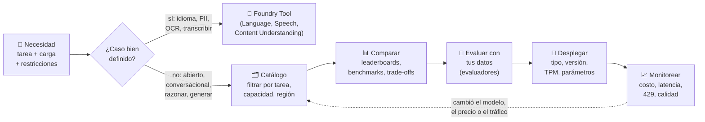

> [!NOTE]
> Este tema cubre el objetivo del examen **"Identify an appropriate AI model, based on capabilities"** y **"Identify appropriate model deployment options and configuration parameters"** (dominio *Identify AI model components and configurations*). El [Tema 2](tema2.md) continúa con la diferencia entre modelo y agente.

---

### 1. El catálogo de Foundry Models

El catálogo (**Discover → Models** en el portal de Foundry) es el punto de partida. No es una lista plana: tiene dos grandes grupos, fichas por modelo y filtros que te ahorran horas.


*Catálogo de modelos de Foundry: búsqueda por palabra clave y filtros por colección, capacidades, proveedor y tarea de inferencia. Fuente: [Microsoft Learn – Generative AI models](https://learn.microsoft.com/en-us/training/modules/get-started-with-generative-ai-and-agents/2-generative-ai-models).*

#### 1.1 Dos grupos de modelos

| | **Vendidos directamente por Azure** | **De socios y comunidad** |
|---|---|---|
| ¿Quién los hospeda? | Microsoft, bajo los *Microsoft Product Terms* | El proveedor (serverless) o tú (*managed compute*) |
| Ejemplos | Azure OpenAI (GPT-5.x, GPT-4.1, GPT-Image), modelos de Microsoft (Phi), Mistral, DeepSeek, Llama, Grok y otros "vendidos por Azure" | Claude (Anthropic), Cohere, NVIDIA, modelos de Hugging Face, modelos de industria |
| Soporte | Soporte de Microsoft, **SLA empresarial**, integración profunda con Azure, revisión interna de IA responsable | Soporte del proveedor |
| Facturación | En tu suscripción de Azure | Según el proveedor (a veces vía Azure Marketplace: "Agree and Proceed") |
| Cuándo | Producción, cumplimiento, ecosistema Azure | Experimentar, casos especializados, open source |

> 💡 En el examen, si leen "SLA empresarial, soporte de Microsoft y revisión de IA responsable" están describiendo a los **modelos vendidos directamente por Azure**. Si leen "open source, experimentar, dominio específico, comunidad" son **socios y comunidad**.

#### 1.2 Dos formas de hospedar: serverless vs. managed compute


*Con **managed compute** el modelo corre en GPUs de tu suscripción (tú pagas la máquina aunque esté ociosa). Con **serverless API / Models as a Service** el modelo vive en un pool de cómputo compartido y pagas por token. Los "tipos de despliegue" de la sección 7 solo aplican al modo serverless. Fuente: [Microsoft Learn – Foundry Models overview](https://learn.microsoft.com/en-us/azure/foundry/concepts/foundry-models-overview).*

| | **Serverless API (Models as a Service)** | **Managed compute** |
|---|---|---|
| Qué pagas | Tokens (o PTU reservadas) | Horas de VM con GPU + cuota de Azure ML compute |
| Quién administra | Microsoft/proveedor | Tú eliges SKU de VM e instancias |
| Modelos | Azure OpenAI, Claude, Mistral, DeepSeek, Llama, Phi… | Open source y modelos ajustados que necesitan control total |
| Arranque | Segundos | Minutos (provisionar GPU) |
| Para el examen | **La opción por defecto** y la que cubre AI-901 | Mencionada como "opción de despliegue"; no esperes detalles |

#### 1.3 Qué trae la ficha de un modelo (model card)


*Ficha de `gpt-4.1`: descripción, versión, tipos de datos soportados, pestaña de benchmarks, despliegues existentes y licencia. Fuente: [Microsoft Learn – Generative AI models](https://learn.microsoft.com/en-us/training/modules/get-started-with-generative-ai-and-agents/2-generative-ai-models).*

| Pestaña / sección | Qué te dice | Para qué la usas |
|---|---|---|
| **Quick facts / Details** | Proveedor, versión, fecha de corte de entrenamiento, ventana de contexto, modalidades de entrada/salida, idiomas | Descartar rápido: ¿acepta imágenes? ¿cabe mi contrato? |
| **Capabilities / Feature support** | *Function calling*, *structured output*, visión, razonamiento, fine-tuning | ¿Sirve para un agente con herramientas? |
| **Benchmarks** | Calidad, seguridad, costo, throughput, con gráficas comparativas (si no aparece, el modelo no tiene benchmarks publicados) | Comparar contra modelos parecidos |
| **Deployments** | Despliegues existentes en tu recurso | Reutilizar en vez de duplicar |
| **License / Terms** | Licencia (MIT, Apache, Llama, propietaria), términos de uso | Uso comercial, hosting, redistribución |
| **Responsible AI** | *Model card* del proveedor: limitaciones, sesgos conocidos, usos no recomendados | Transparencia y rendición de cuentas (ver Parte 1) |

#### 1.4 Filtros del catálogo

| Filtro | Opciones típicas | Ejemplo de uso |
|---|---|---|
| **Collection / Source** | Azure OpenAI, Microsoft, Anthropic, Mistral, Meta, Cohere, DeepSeek, Hugging Face | "Solo quiero modelos vendidos por Azure" |
| **Capabilities** | Reasoning, tool calling, multimodal, structured output | "Necesito que llame funciones" |
| **Inference task** | Chat completion, embeddings, image generation, audio generation, speech-to-text, video | "Busco un modelo de embeddings" |
| **Deployment option / SKU** | Serverless API, managed compute; Global Standard, PTU, Batch… | "Que se pueda desplegar en Global Batch" |
| **Region** | Regiones de Azure | "Disponible en East US 2 o Sweden Central" |
| **Lifecycle** | Preview, Generally Available, Deprecated | "Nada en preview para producción" |
| **Industry** | Salud, retail, manufactura, finanzas | "Modelo entrenado con literatura médica" |
| **Fine-tuning** | Métodos soportados | "Lo voy a ajustar con mis datos" |

#### 1.5 Taxonomía: qué tipos de modelos hay

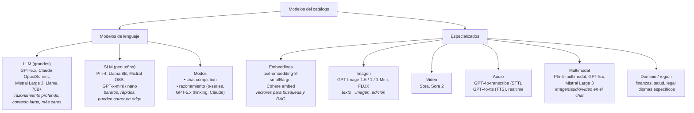

| Tipo | Qué lo distingue | Señal en el examen |
|---|---|---|
| **LLM** | Miles de millones de parámetros; mejor razonamiento y contexto largo; más caro y lento | "razonamiento complejo", "análisis profundo", "contexto extenso" |
| **SLM** | Pocos parámetros; corre en hardware modesto o en el dispositivo; barato | "app ligera en el teléfono", "edge", "bajo costo", "alto volumen" |
| **Modelo de razonamiento** | "Piensa" antes de responder (cadena de razonamiento interna); acepta `reasoning.effort`; TTFT alto | "matemáticas", "código complejo", "planeación multi-paso", "ciencia" |
| **Chat completion** | Respuesta directa, conversacional | "chatbot", "asistente", "generar contenido" |
| **Embeddings** | No genera texto: devuelve vectores | "búsqueda semántica", "RAG", "recomendaciones", "similitud" |
| **Multimodal** | Acepta imagen/audio/video además de texto | "describir una foto", "responder a un prompt hablado" |
| **Dominio específico** | Entrenado o ajustado para una industria o idioma | "literatura médica", "contratos", "regulación financiera" |
| **Fundacional** | Grande, preentrenado, se usa directo o se ajusta (fine-tuning) | "foundation model", "preentrenado por el proveedor" |

> 🧠 **Familias**: una *familia* agrupa modelos con la misma arquitectura o linaje pero distinto tamaño, especialización o versión (GPT-5, GPT-5-mini, GPT-5-nano; Claude Opus, Sonnet, Haiku; Phi-4, Phi-4-mini, Phi-4-multimodal). Dentro de una familia, **bajar de tamaño** es la forma más fácil de ahorrar sin cambiar de proveedor ni de API.

Familias que Microsoft Learn destaca para el examen:

| Familia | Fortaleza según Learn | Casos |
|---|---|---|
| **GPT-5.x** | Razonamiento multi-paso, lógica estructurada, planeación, flujos agénticos; "niveles de pensamiento" ajustables; **requiere registro** | Reportes técnicos, análisis de código, orquestación multi-herramienta |
| **Claude Opus / Sonnet** (Anthropic) | Agentes sofisticados, razonamiento de código complejo, *computer use*; ventanas de contexto y salida grandes | Especificaciones largas, diffs multi-archivo, investigación extendida |
| **Mistral Large 3** | Balance calidad / throughput / costo; multilingüe | Redacción multilingüe, reportes de negocio, agentes de latencia media |
| **GPT-4.1** | Disponible para todos; velocidad, eficiencia, baja latencia | Chat en tiempo real, soporte, producción de alto volumen |
| **Phi-4** (SLM de Microsoft) | Pequeño, barato, multimodal en su variante | Tareas comunes de NLP, dispositivos, prototipos |

---

### 2. ¿Modelo del catálogo o Foundry Tool?

Antes de abrir el catálogo, la primera pregunta es si siquiera necesitas un modelo generativo. Microsoft Learn es explícito: **si el caso de uso está bien definido, considera una Foundry Tool**; sus modelos precompilados dan rendimiento predecible, cumplimiento integrado y valor rápido sin modelado a la medida.

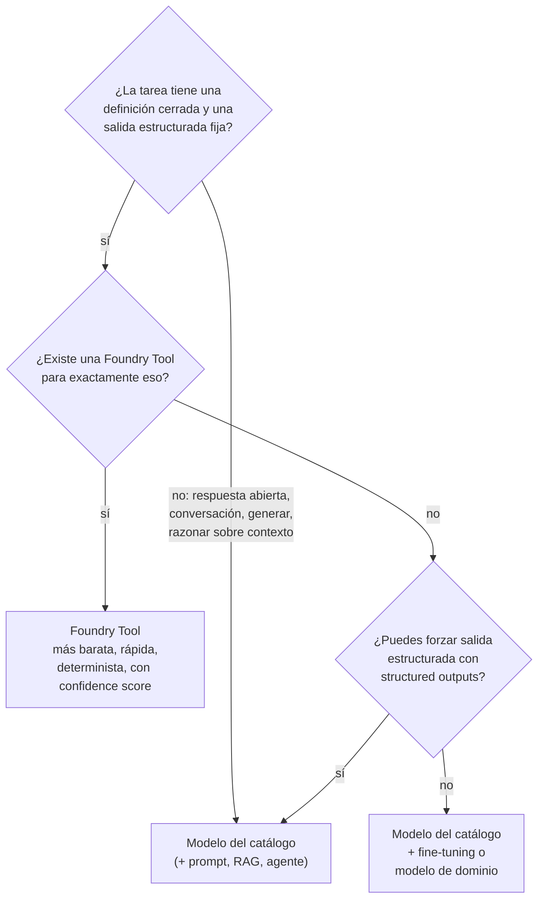

| Necesidad | Usa esto | No uses esto |
|---|---|---|
| Detectar el idioma de un texto | **Azure Language** (language detection) | Un LLM "adivinando" |
| Encontrar y enmascarar PII | **Azure Language** (PII) | Un prompt "quita los datos personales" |
| Sentimiento, entidades, frases clave de 1 millón de reseñas | **Azure Language** | GPT-5 reseña por reseña (carísimo) |
| OCR de recibos, facturas, formularios | **Content Understanding** / Document Intelligence | Modelo multimodal describiendo la foto |
| Transcribir audio o sintetizar voz | **Azure Speech** | — |
| Traducir documentos | **Azure Translator** | — |
| Detectar contenido dañino | **Content Safety** (o guardrails) | — |
| Responder preguntas sobre tus PDFs con citas | Modelo del catálogo **+ RAG / agente con knowledge** | Foundry Tool (no razona sobre contexto) |
| Redactar, resumir, clasificar con categorías nuevas, extraer a un JSON a la medida | Modelo del catálogo (+ structured outputs) | — |
| Código, matemáticas, planeación multi-paso | Modelo de **razonamiento** | SLM / Tool |

> 📚 La comparación completa (salida estructurada, *confidence score*, costo por transacción vs. por token, auditoría) está en [Parte 2 · Módulo 3 · Tema 1](../modulo3/tema1.md). Aquí basta con la regla: **caso cerrado → Tool; caso abierto → catálogo**.

---

### 3. El proceso de selección en 5 pasos

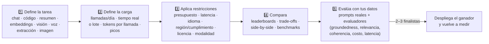

**Paso 1. Define la tarea.** La tarea elige la *categoría* de modelo (sección 1.5) y da candidatos iniciales. Tabla de Microsoft Learn (módulo AI-901):

| Tarea | Modelos recomendados | Fortaleza |
|---|---|---|
| Chat | GPT-5.x chat, Claude Sonnet/Opus, Mistral-Large-3, DeepSeek V3.1, SLMs (Phi-4, Llama) | Razonamiento, conversación, seguridad |
| Código | GPT-5.1-codex, Claude Sonnet | Flujos de agente complejos |
| Resumen | GPT-5.x de razonamiento, Claude Opus/Sonnet | Contexto largo, compresión de calidad |
| Embeddings | `text-embedding-3-small` u otros | Vectores semánticos |
| Multimodal | Phi-4-multimodal-instruct, GPT-5.x multimodal, Mistral-Large-3 | Imágenes, audio y video en el chat |
| Imágenes | GPT-Image-1.5, GPT-Image-1, GPT-Image-1-Mini, FLUX | Texto a imagen y edición |
| Video | Sora, Sora 2 | Texto/imagen a video |
| Dominio específico | Modelos ajustados por industria | Finanzas, salud, legal |

**Paso 2. Define la carga de trabajo.** ¿Cuántas llamadas al día? ¿El usuario espera la respuesta en vivo o puede llegar mañana? ¿Cuántos tokens entran y salen por llamada? ¿Hay picos (lunes 9 am, Buen Fin)? Estas respuestas deciden el **tamaño** del modelo y el **tipo de despliegue** (sección 7).

**Paso 3. Aplica restricciones.** Presupuesto, latencia máxima, idioma, dónde pueden procesarse los datos, licencia y modalidad. Cada una elimina candidatos (sección 4).

**Paso 4. Compara.** Leaderboards por escenario, gráficas de trade-off, comparación lado a lado y la pestaña Benchmarks (sección 5).

**Paso 5. Evalúa con tus datos.** Los benchmarks públicos usan datasets estandarizados que **pueden no reflejar tu caso** (tu jerga, tu español, tus formatos). Arma 30-100 prompts reales con respuestas esperadas y corre evaluadores (sección 6).

> 💡 Regla práctica: **empieza con el modelo más pequeño que apruebe tu evaluación** y sube de tamaño solo donde falle. Es más barato subir que bajar: cuando ya tienes prompts afinados para un modelo grande, migrar a uno pequeño te obliga a re-evaluar todo.

---

### 4. Los criterios de decisión, uno por uno

| Criterio | Pregunta | Implicación |
|---|---|---|
| **Calidad** | ¿Qué tan difícil es la tarea? | Razonamiento complejo → modelos grandes / de razonamiento |
| **Latencia** | ¿El usuario espera en tiempo real? | Modelos *mini/nano* o SLMs; streaming; PTU si la variabilidad importa |
| **Costo** | ¿Cuántas llamadas al día? | Alto volumen → modelo más pequeño; o despliegue *batch* |
| **Ventana de contexto** | ¿Cuánto texto entra en cada llamada? | Contratos largos → modelos de contexto amplio |
| **Modalidad** | ¿Entran imágenes, audio? | Modelo multimodal |
| **Idioma** | ¿Español de México? | Prueba con tus propios datos |
| **Cumplimiento** | ¿Dónde deben residir/procesarse los datos? | Región y tipo de despliegue (*Data Zone* / regional) |
| **Licencia** | ¿Open source o propietario? | Afecta uso comercial y opciones de hosting |
| **Disponibilidad** | ¿Está en mi región? ¿Requiere registro? | GPT-5 requiere registro; no todo está en todas las regiones |

#### 4.1 Calidad: ¿qué tan difícil es la tarea?

La calidad no es un número único. Depende de la tarea: un modelo puede ser excelente en código y mediocre en español coloquial. Por eso Microsoft recomienda empezar por el **leaderboard del escenario** (razonamiento, código, matemáticas, QA, groundedness) y no por el índice general.

| Dificultad | Ejemplos | Modelo típico |
|---|---|---|
| Baja: transformación directa | Clasificar sentimiento, extraer fecha y total, traducir una frase, detectar idioma | SLM, *nano*, *mini* (o una Foundry Tool) |
| Media: generar con criterio | Redactar un correo, resumir un artículo, responder FAQ con RAG, clasificar con 30 categorías | *mini*, GPT-4.1, Mistral Large 3 |
| Alta: razonar en varios pasos | Depurar código, resolver un problema de física, planear un itinerario con restricciones, auditar un contrato | GPT-5.x (thinking), Claude Opus/Sonnet, modelos de razonamiento |

#### 4.2 Latencia: ¿cuánto espera el usuario?

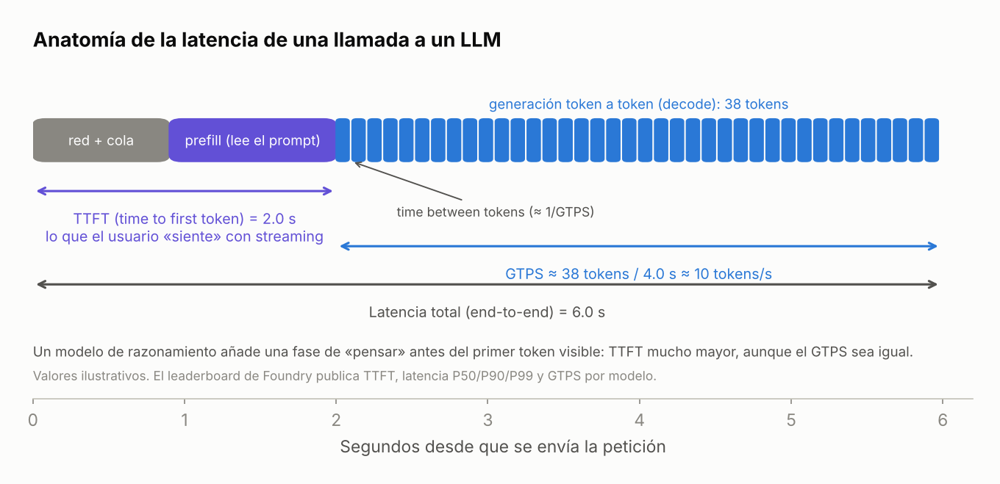

*Una llamada tiene tres fases: red + cola, **prefill** (el modelo lee todo el prompt) y **decode** (genera token por token). Con streaming, lo que el usuario "siente" es el **TTFT** (time to first token); la velocidad de lectura la fija el **GTPS** (generated tokens per second). Valores ilustrativos.*

| Métrica | Qué mide | Cuándo importa |
|---|---|---|
| **TTFT** (time to first token) | Segundos hasta el primer token con streaming | Chat en vivo, voz: el usuario nota más de ~1 s |
| **Latencia total** (mean, P50, P90, P95, P99) | Segundos hasta la respuesta completa | Procesos síncronos, APIs con timeout |
| **GTPS** (generated tokens/s) | Velocidad de generación | Respuestas largas; voz (TTS necesita texto a tiempo) |
| **TTPS** (total tokens/s) | Entrada + salida por segundo | Throughput global del sistema |
| **Time between tokens** | Pausa entre tokens | Sensación de fluidez en streaming |

Factores que suben la latencia: modelos más grandes, **modelos de razonamiento** (piensan antes del primer token: TTFT de varios segundos), prompts largos (prefill), `max_output_tokens` alto en respuestas largas, y tráfico compartido (los despliegues *Standard* son *best effort*; **Provisioned** da latencia predecible).

> 💡 Microsoft Learn: los percentiles importan. Un P50 de 1 s con P99 de 12 s significa que 1 de cada 100 usuarios espera 12 segundos. Para interfaces en vivo mira **P90/P99 y TTFT**, no el promedio.

#### 4.3 Costo: tokens × llamadas × precio

El costo se calcula por **tokens**: un token es la unidad mínima que procesa el modelo (una palabra, parte de una palabra, un carácter o un signo). Como regla, ~750 palabras en inglés ≈ 1,000 tokens; en español sale **~20-30 % más tokens** por el mismo texto porque las palabras se parten más. Los tokens de **salida cuestan más** que los de entrada (típicamente 3-8×).

```
costo por llamada ≈ (tokens_entrada × precio_entrada + tokens_salida × precio_salida) / 1,000,000
costo mensual     ≈ costo por llamada × llamadas por día × 30
```

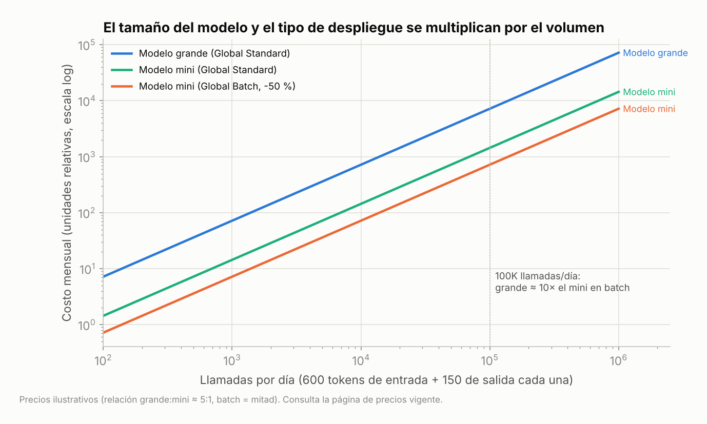

*Con precios ilustrativos (grande:mini ≈ 5:1 y batch a la mitad), a 100K llamadas por día el modelo grande cuesta ~10× lo que el mini en Global Batch. El tamaño del modelo y el tipo de despliegue se **multiplican** por el volumen: por eso para alto volumen se baja de tamaño o se procesa por lotes.*

Palancas para bajar costo, en orden de impacto:

1. **Modelo más pequeño** para las tareas fáciles (o enrutar: fácil → mini, difícil → grande; ver *model router* en la sección 10).
2. **Global Batch** (−50 %) para todo lo que no sea urgente.
3. **Prompts más cortos**: instrucciones concisas, menos ejemplos, *prompt caching* (los tokens de entrada repetidos y en caché se cobran menos o no consumen PTU).
4. **`max_output_tokens`** acotado y pedir formatos compactos (JSON sin prosa).
5. **PTU con reservación** solo si tu uso promedio es alto y estable (sección 7.4).

#### 4.4 Ventana de contexto: ¿cuánto cabe en una llamada?

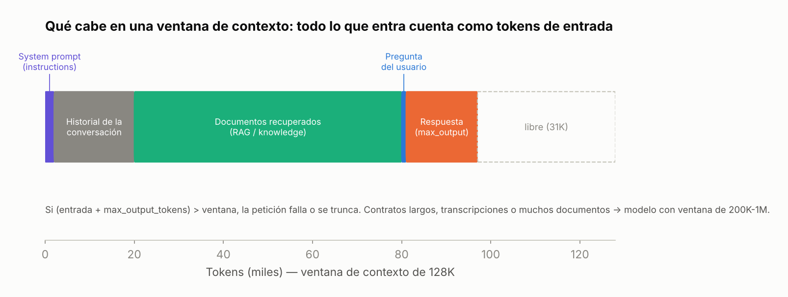

*Todo lo que entra (system prompt, historial, documentos recuperados, pregunta) cuenta como tokens de entrada, y hay que **reservar** espacio para la respuesta. Si entrada + `max_output_tokens` rebasa la ventana, la petición falla o se trunca.*

| Ventana | Qué cabe aproximadamente | Modelos típicos |
|---|---|---|
| 8K-32K | Un artículo largo; chat corto | Modelos viejos, algunos SLM |
| 128K | Un libro corto (~90,000 palabras); varias decenas de páginas de RAG | GPT-4o, GPT-4.1-mini, Phi-4, muchos modelos del catálogo |
| 200K-400K | Un contrato de 300 páginas; una base de código mediana | Claude Sonnet/Opus, GPT-5.x |
| 1M+ | Varios libros; repositorios completos | GPT-4.1 (1M), modelos de contexto largo |

> ⚠️ Ventana grande ≠ barato ni rápido: cada token de entrada se cobra y se procesa en el prefill. Para preguntas sobre documentos grandes, **RAG** (traer solo los fragmentos relevantes) suele ganarle a "meter todo el PDF" en costo y calidad. Y con *model router*, la ventana efectiva es la del **modelo más pequeño** del grupo.

#### 4.5 Modalidad: ¿qué entra y qué sale?

| Entrada → Salida | Modelo |
|---|---|
| Texto → texto | Cualquier LLM / SLM |
| Texto + imagen → texto | Multimodal (GPT-4.1, GPT-5.x, Phi-4-multimodal, Mistral Large 3, Claude) |
| Texto + audio → texto / audio | Multimodal con audio (GPT-4o-audio, realtime) o Azure Speech + LLM |
| Texto → imagen | GPT-Image-1.5 / 1 / 1-Mini, FLUX |
| Texto / imagen → video | Sora, Sora 2 |
| Texto → vector | Embeddings |
| Audio → texto | GPT-4o-transcribe o Azure Speech (STT) |
| Texto → audio | GPT-4o-tts o Azure Speech (TTS, SSML) |

#### 4.6 Idioma: el español de México no viene en los benchmarks

Los leaderboards se miden casi siempre en inglés. Un modelo puede rankear alto y aun así confundir "ahorita", "checar" o "¿mande?". Para audiencias mexicanas y latinoamericanas: incluye en tu set de evaluación **prompts reales en español con regionalismos, acentos faltantes y errores de dedo**, y mide groundedness y fluidez ahí. Mistral Large 3 y GPT-4.1 son buenos puntos de partida multilingües; los SLM varían mucho entre idiomas.

#### 4.7 Cumplimiento y residencia de datos

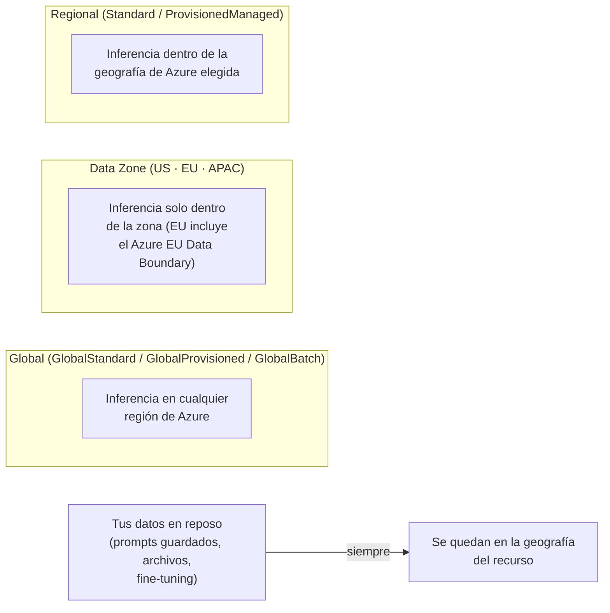

- Los **datos en reposo** se quedan en la geografía del recurso **en todos** los tipos de despliegue.
- Lo que cambia es dónde se **procesa la inferencia**: Global (cualquier región del mundo), Data Zone (US, EU o APAC) o Regional (la geografía que elegiste).
- Si una ley o un cliente exige "los datos no salen de la UE" → **Data Zone EU**. Si exige "no salen de esta región" → **Standard / Regional Provisioned** en esa región. Si no hay restricción → **Global Standard** (más cuota, más modelos, modelos nuevos primero).

#### 4.8 Licencia

| Licencia | Ejemplos | Implicaciones |
|---|---|---|
| Propietaria (API) | GPT, Claude, Mistral Large (vía API) | Solo vía el servicio; sin pesos; términos del proveedor |
| Open weights permisiva (MIT, Apache 2.0) | Phi-4, Mistral OSS, DeepSeek | Uso comercial, fine-tuning, hospedar donde quieras |
| Open weights con condiciones | Llama (Llama Community License) | Uso comercial con condiciones (p. ej. límites de usuarios activos, atribución) |
| Comunidad (Hugging Face) | Miles | **Revisa cada licencia**: algunas son solo investigación |

#### 4.9 Disponibilidad y registro

- No todos los modelos están en todas las regiones ni con todos los tipos de despliegue; el filtro **Region** y la ficha te lo dicen.
- Algunas familias (GPT-5.x, ciertos modelos de razonamiento) **requieren registro** y aprobación antes de desplegarse.
- Revisa el **Lifecycle**: *Preview* puede cambiar o desaparecer; *Deprecated* tiene fecha de retiro. Las fichas publican fechas de **retiro de versión**; el despliegue con *auto-update* migra solo a la versión nueva.

---

### 5. Leaderboards, benchmarks y gráficas de trade-off

En **Discover → Models** el portal muestra un resumen del **model leaderboard**: los mejores modelos por calidad, seguridad, costo estimado y throughput, con ligas a la tabla completa.


*Leaderboard de modelos: cuatro paneles (Quality, Safety, Throughput, Estimated cost) y debajo la tabla donde marcas modelos para compararlos lado a lado. Fuente: [Microsoft Learn – Generative AI models](https://learn.microsoft.com/en-us/training/modules/get-started-with-generative-ai-and-agents/2-generative-ai-models).*

#### 5.1 Las cuatro dimensiones

| Dimensión | Cómo se mide | Lectura |
|---|---|---|
| **Quality (índice de calidad)** | Promedio de exactitud (`exact_match`, `pass@1`, `arena_hard`) sobre datasets públicos de razonamiento, conocimiento, QA, matemáticas y código. Normalizado 0-1 | Más alto = mejor |
| **Safety** | HarmBench (ASR: tasa de éxito de ataques; **más bajo = mejor**), ToxiGen (F1 detectando contenido tóxico; más alto = mejor), WMDP (conocimiento en dominios sensibles; más alto = **más riesgo**) | Ojo: no todas las métricas van "para arriba" |
| **Cost (costo estimado)** | Precio por 1M tokens de entrada y de salida, combinados en proporción **3:1** (entrada:salida) | Más bajo = mejor |
| **Performance (throughput / latencia)** | Mediciones reales durante 14 días, 24 pruebas al día: TTFT, latencia P50/P90/P95/P99, GTPS, TTPS, tiempo entre tokens | TTFT bajo y GTPS alto = mejor |

Datasets del índice de calidad que vale la pena reconocer:

| Dataset | Mide | Categoría |
|---|---|---|
| **MMLU-Pro** | Conocimiento general multi-disciplina | Conocimiento |
| **GPQA** | Preguntas de posgrado en ciencia | QA / razonamiento |
| **BIG-Bench Hard**, **MuSR** | Razonamiento multi-paso | Razonamiento |
| **MATH** | Problemas matemáticos | Matemáticas |
| **HumanEval+**, **MBPP+** | Generación de código (pass@1) | Código |
| **IFEval** | Seguir instrucciones | Instrucciones |
| **Arena-Hard** | Preferencia humana en prompts difíciles | General |
| **tau2 (telecom)** | Selección de herramientas en flujos agénticos | Agentes |
| **TruthfulQA** | Veracidad | Groundedness (leaderboard de escenario) |

> 🔎 Para **embeddings** hay un leaderboard aparte: exactitud en recuperación de información, clustering y resumen (métricas como NDCG@10, MAP, V-measure).

#### 5.2 Gráficas de trade-off

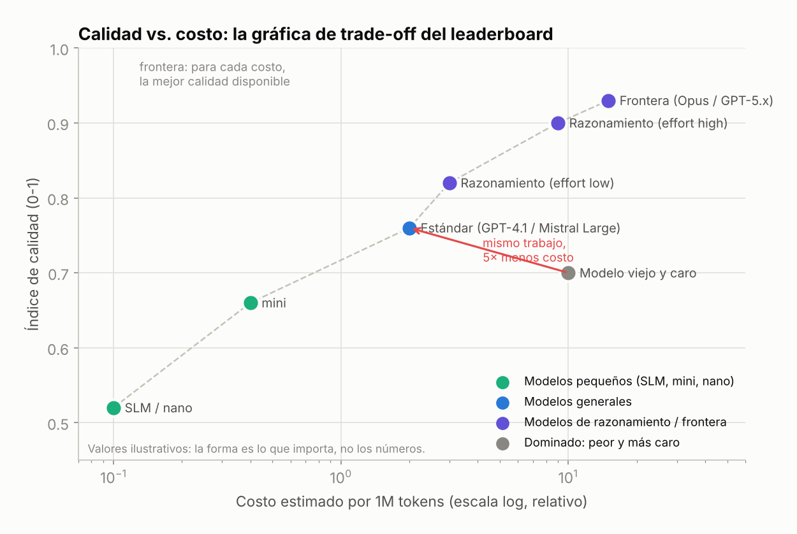

*La gráfica de trade-off del leaderboard cruza calidad con costo (o throughput o seguridad). Los modelos cerca de la **esquina superior izquierda** (o superior derecha, según cómo esté orientado el eje) son los que rinden bien en ambos ejes; los que quedan abajo de la "frontera" están **dominados**: hay otro modelo mejor y más barato. Valores ilustrativos.*

Cómo leerla en el portal:
1. En el leaderboard, usa **Compare quality against** → *cost*, *throughput* o *safety*.
2. Agrega o quita modelos con el selector (mínimo dos).
3. Busca la **frontera**: para tu presupuesto, el modelo más alto; para tu calidad mínima, el más barato.

#### 5.3 Leaderboards por escenario y comparación lado a lado


*Vista **Compare** del portal (máximo tres modelos): calidad, seguridad, costo estimado y throughput; modalidades de entrada/salida; ventana de contexto, salida máxima y fecha de entrenamiento; y qué endpoints soporta (chat completions, Responses, agentes, fine-tuning). Fuente: [Microsoft Learn – Benchmark model in catalog](https://learn.microsoft.com/en-us/azure/foundry/how-to/benchmark-model-in-catalog).*

| Herramienta | Qué hace | Cuándo usarla |
|---|---|---|
| **Leaderboards by scenario** | Rankings por Reasoning, Coding, Math, QA, Groundedness, Safety | Primero: si tu app cae en un escenario, empieza aquí |
| **Trade-off charts** | Calidad vs. costo / throughput / seguridad | Para encontrar la frontera |
| **Compare** (2-3 modelos) | Pestañas *Performance benchmarks*, *Model details*, *Supported endpoints*, *Feature support* | Para los finalistas |
| **Benchmarks** (pestaña de la ficha) | Puntajes agregados, gráficas comparativas, tabla por métrica y dataset, fecha de evaluación | Para un modelo específico |


*Pestaña **Benchmarks** de una ficha: puntajes por métrica y dataset, con botón para expandir y elegir métricas. Si la pestaña no aparece, el modelo no tiene benchmarks publicados. Fuente: [Microsoft Learn – Benchmark model in catalog](https://learn.microsoft.com/en-us/azure/foundry/how-to/benchmark-model-in-catalog).*

> [!NOTE]
> La opción **Benchmarks → Try with your own data** existe en **Foundry (classic)**. En el portal nuevo, el equivalente es **Evaluate generative AI apps** (sección 6), que es lo que el examen llama "evaluar con tus propios datos". Microsoft advierte: los benchmarks públicos **pueden no reflejar el rendimiento con tus datos**.

Limitaciones que conviene saber:
- No todos los modelos del catálogo tienen benchmarks.
- Los puntajes se actualizan periódicamente; revisa la **fecha de evaluación** en la ficha.
- El costo del leaderboard es por correr los benchmarks (con reasoning effort alto); tu costo real depende de tu mezcla de tokens.
- Un benchmark "saturado" (todos sacan 95+) ya no discrimina.

---

### 6. Evaluar con tus propios datos

Microsoft Learn distingue dos enfoques, y el examen los pregunta.

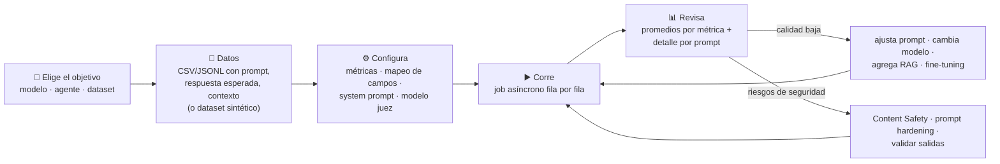

#### 6.1 Manual vs. automatizada

| | **Evaluación manual** | **Evaluación automatizada** |
|---|---|---|
| Quién | Personas (revisores, usuarios) | Evaluadores: métricas NLP o un modelo juez |
| Qué captura | Satisfacción, adecuación al contexto, tono de marca, cosas subjetivas | Consistencia, escala, regresiones |
| Formas | Playground (pruebas interactivas, comparar modelos lado a lado con el mismo system prompt), revisión estructurada (escala 1-5), estudios con usuarios | Métricas NLP, métricas asistidas por IA, evaluadores de seguridad |
| Costo | Alto en tiempo | Bajo por corrida |
| Cuándo | Al principio y para validar a los automáticos | Siempre que cambies prompt, modelo o datos |


*El **Playground** es la evaluación manual más rápida: cambias system prompt, temperatura y máximo de tokens, pruebas preguntas simples, razonamiento multi-paso, formatos y casos límite; y puedes abrir dos modelos lado a lado con las mismas instrucciones. Fuente: [Microsoft Learn – Evaluate model performance](https://learn.microsoft.com/en-us/training/modules/model-catalog-evaluate/5-evaluate-performance).*

#### 6.2 Métricas automatizadas

| Familia | Métricas | Necesita | Mejor para |
|---|---|---|---|
| **NLP (matemáticas)** | **F1** (balance precisión/recall), **BLEU** (traducción, n-gramas), **METEOR** (BLEU + sinónimos), **ROUGE** (resumen, recall), **GLEU** (oración por oración); exactitud, precisión, recall | Respuesta de referencia (*ground truth*) | Tareas con respuesta correcta definida: clasificación, extracción, traducción |
| **Asistidas por IA (modelo juez)** | **Groundedness** (¿se basa en el contexto dado? *Groundedness Pro* da sí/no), **Relevance** (¿responde lo que se preguntó?), **Coherence** (¿fluye con lógica?), **Fluency** (¿español correcto y natural?), **Similarity** (¿se parece a la respuesta esperada?) | Un modelo evaluador (GPT) y a veces contexto o referencia | Generación abierta, RAG, chat |
| **Seguridad (riesgo)** | Autolesión, odio e injusticia, violencia, contenido sexual, **material protegido**, **ataque indirecto (jailbreak)** | Nada: se reporta **tasa de defectos** (% de respuestas sobre el umbral, típicamente *Medium*) | Antes de lanzar y en cada cambio |


*Resultados de evaluación: puntaje promedio por métrica y detalle por fila para encontrar dónde falla el modelo. Fuente: [Microsoft Learn – Evaluate model performance](https://learn.microsoft.com/en-us/training/modules/model-catalog-evaluate/5-evaluate-performance).*

Reglas de memoria para el examen:
- **Groundedness** = "¿se inventó algo que no está en el contexto?" (alucinación).
- **Relevance** = "¿contestó la pregunta?".
- **Coherence** = "¿tiene lógica interna?".
- **Fluency** = "¿está bien escrito?" (gramática, naturalidad).
- **F1 / BLEU / ROUGE** = comparan contra una respuesta correcta; sin *ground truth* no sirven.
- Los **evaluadores de seguridad detectan y puntúan**, **no corrigen**: para corregir usas Content Safety / guardrails, *prompt hardening* o validación de salidas.

> 💡 La **Evaluator library** del proyecto centraliza evaluadores de calidad, seguridad y rendimiento curados por Microsoft, con sus prompts de anotación y definiciones de severidad; también guarda tus evaluadores personalizados con versiones.

---

### 7. Tipos de despliegue

Desplegar un modelo asigna cómputo, crea un **endpoint** seguro y escalable, fija la configuración (versión, filtros de contenido, cuota) y activa el **monitoreo** (uso, latencia, errores, costo). Tu aplicación llama al endpoint pasando el **nombre del deployment** en el parámetro `model`.


*Al desplegar eliges el **nombre** (lo que pondrás en `model`) y el **tipo de despliegue**. El portal explica cada tipo; aquí Global Standard: "pago por llamada con los límites más altos; los datos pueden procesarse globalmente, pero el almacenamiento se queda en la geografía del recurso". Fuente: [Microsoft Learn – Deployment types](https://learn.microsoft.com/en-us/azure/foundry/foundry-models/concepts/deployment-types).*


*Pasos en el portal: **Discover → Models** → ficha → **Deploy** → *Default settings* (recomendado) o *Custom settings* → nombre, tipo, versión, cuota TPM, filtro de contenido → **Deploy** → estado *Succeeded* → aterrizas en el Playground. Los despliegues viven en **Build → Models**. Fuente: [Microsoft Learn – Deploy models to endpoints](https://learn.microsoft.com/en-us/training/modules/model-catalog-evaluate/4-deploy-models).*

#### 7.1 Los nueve tipos

Son combinaciones de **cómo pagas** (por token, capacidad reservada, lote) y **dónde se procesa** (global, zona de datos, región).

| | **Global** (cualquier región) | **Data Zone** (US / EU / APAC) | **Regional** (tu geografía) |
|---|---|---|---|
| **Pago por token** (Standard) | **Global Standard** `GlobalStandard` — cuota más alta, más modelos, modelos nuevos primero. *El punto de partida recomendado* | **Data Zone Standard** `DataZoneStandard` | **Standard** `Standard` — volumen bajo-medio, residencia regional |
| **Capacidad reservada** (Provisioned, PTU) | **Global Provisioned** `GlobalProvisionedManaged` | **Data Zone Provisioned** `DataZoneProvisionedManaged` | **Regional Provisioned** `ProvisionedManaged` |
| **Lote asíncrono** (Batch, −50 %, 24 h) | **Global Batch** `GlobalBatch` | **Data Zone Batch** `DataZoneBatch` | — |

Más uno especial: **Developer** (`DeveloperTier`): pago por token, cualquier región, **solo para evaluar modelos ajustados (fine-tuned)**; vive 24 horas y se borra solo; sin SLA ni residencia de datos.

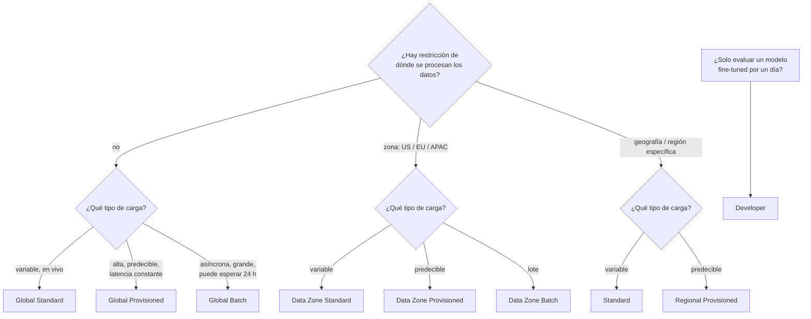

#### 7.2 Standard: pago por token, *best effort*

- Pagas solo lo que usas; sin compromiso; ideal para desarrollo, pruebas y tráfico variable o impredecible.
- La capacidad es **compartida**: la latencia puede variar con la demanda, y al rebasar tu cuota TPM/RPM recibes **429**.
- **Global Standard** es la opción por defecto y la que recomienda Microsoft cuando no hay restricciones.

#### 7.3 Global Batch: la mitad de precio si puedes esperar


*Creación de un **batch job** en el portal: subes un archivo JSONL con las peticiones y el servicio las procesa en segundo plano. Fuente: [Microsoft Learn – Global Batch](https://learn.microsoft.com/en-us/azure/foundry/openai/how-to/batch).*

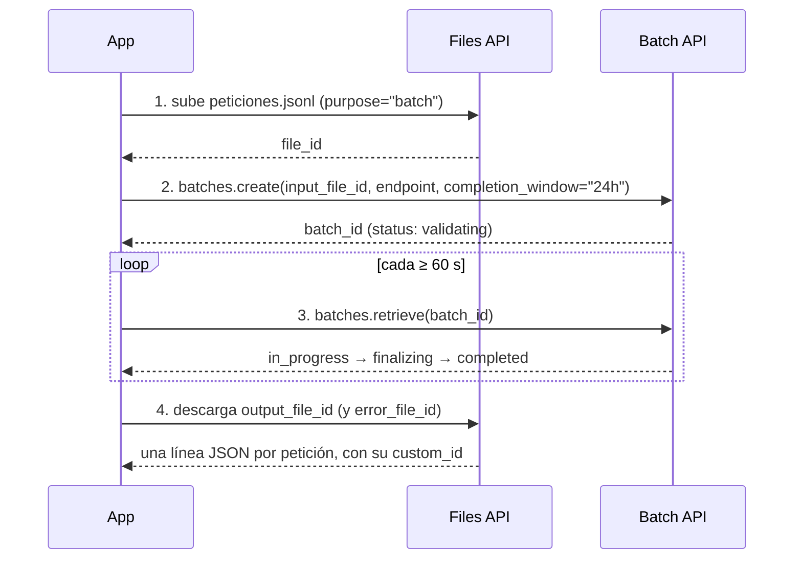

| Dato | Valor |
|---|---|
| Descuento | **~50 %** respecto a Global Standard |
| Tiempo objetivo | **24 horas** (puede tardar más; el job no expira: sigue hasta terminar o cancelarlo) |
| Formato | Archivo **JSONL**: una petición por línea con `custom_id`, `method`, `url` (`/v1/responses` o `/v1/chat/completions`) y `body` con el nombre del deployment |
| Cuota | **Enqueued tokens** separada de la cuota en línea: los tokens del archivo cuentan hasta que el job termina |
| Límites | 100,000 peticiones por archivo; 200 MB por archivo (1 GB con tu propio Storage) |
| No soportado | Embeddings, modelos fine-tuned, *On Your Data*, Assistants |
| Resultados | No vienen en orden: empareja por `custom_id` |

Casos típicos: clasificar millones de reseñas, generar descripciones de productos, resumir un archivo histórico de documentos, traducir un catálogo, enriquecer datos para analítica.

#### 7.4 Provisioned (PTU): capacidad reservada

Una **PTU** (*provisioned throughput unit*) es una unidad de capacidad de procesamiento reservada para tu deployment, **la uses o no**. No está atada a un modelo: la misma cantidad de PTU rinde más o menos TPM según el peso del modelo, y cada modelo tiene un **mínimo de PTU**.

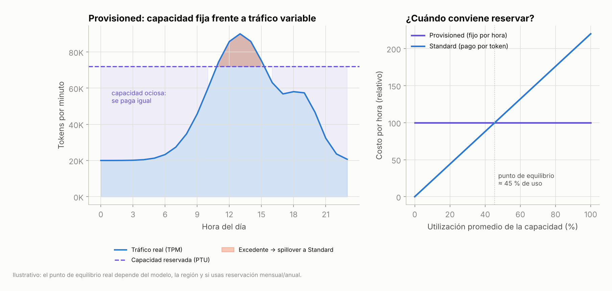

*Izquierda: con capacidad reservada pagas la línea punteada completa; lo que queda por debajo es capacidad ociosa y lo que sobresale se rechaza (429) o, con **spillover**, se desvía a un deployment Standard. Derecha: reservar conviene cuando la utilización promedio supera el punto de equilibrio (ilustrativo; depende del modelo, la región y si usas reservación mensual o anual).*

| Concepto | Qué significa |
|---|---|
| **Cuota vs. capacidad** | *Cuota* = cuántas PTU te permite desplegar tu suscripción (gratis, es política). *Capacidad* = PTU realmente disponibles para ese modelo en esa región en ese momento. Tener cuota no garantiza capacidad: el despliegue puede fallar |
| **Dimensionar** | Se estima con RPM esperado, tokens promedio de entrada y salida y tasa de caché. Los tokens de salida consumen más capacidad; los de entrada en caché no consumen PTU. El portal tiene una **calculadora de capacidad** |
| **Facturación por hora** | Desde que creas el deployment hasta que lo borras, uses o no. Bien para pruebas cortas; caro si lo dejas encendido |
| **Reservaciones (1 mes / 1 año)** | Descuento sobre el precio por hora. Es un **descuento de facturación, no una garantía de capacidad**: primero despliega (confirma capacidad), luego compra |
| **Spillover** | Opcional: cuando el deployment provisioned se agota (429), las peticiones extra van a un deployment Standard del mismo recurso. Puede ser global o por petición (header `x-ms-spillover-deployment`). Disponible para modelos Azure OpenAI |
| **Latencia** | Varianza baja y consistente; para cargas críticas en tiempo real |

| Elige **Provisioned** cuando… | Elige **Standard** cuando… |
|---|---|
| El tráfico es predecible y puedes estimar RPM y tokens | El tráfico es variable o difícil de pronosticar |
| Necesitas latencia baja y constante (apps interactivas, voz) | Estás desarrollando, probando o el volumen es bajo |
| El volumen es tan alto que pagar por token sale caro | No quieres compromiso ni planeación de capacidad |
| Es una carga de producción crítica | — |

> 💡 Opción intermedia que Microsoft lista en la misma tabla: **priority processing** (pago por token a precio premium con objetivo de latencia y sin compromiso).

#### 7.5 Qué se configura al desplegar

| Parámetro | Qué decide | Consejo |
|---|---|---|
| **Deployment name** | El nombre que usarás en `model=` | Nómbralo por función (`chat-mini`, `extract-batch`), no por modelo, para poder cambiar el modelo sin tocar código |
| **Deployment type** | Dónde se procesa y cómo pagas (7.1) | Global Standard si no hay restricciones |
| **Model version** | Versión específica o *auto-update* | Producción: fija la versión y prueba antes de migrar; dev: auto-update |
| **TPM (tokens por minuto)** | Cuota asignada; define también el RPM | Reparte la cuota de la suscripción entre deployments |
| **Content filter** | Filtro de contenido (guardrails) aplicado al deployment | Default o uno personalizado; ver Parte 1 |
| **Managed compute**: SKU de VM e instancias | Solo para modelos en cómputo administrado | Requiere cuota de Azure ML |

Al terminar, de la página del deployment tomas lo que tu código necesita: **endpoint** (el de proyecto para funciones de Foundry o el `/openai/v1/` compatible con OpenAI), **autenticación** (llave o Microsoft Entra ID, recomendado en producción) y **nombre del deployment**.

---

### 8. Cuotas, TPM, RPM y throttling

La cuota se asigna **por suscripción**, por modelo y por tipo de despliegue, y se reparte entre tus deployments en **TPM**. Desde mayo de 2026 los deployments del mismo modelo y versión comparten un **pool de cuota** (Global Standard: todas las regiones de la suscripción; Data Zone Standard: por zona).

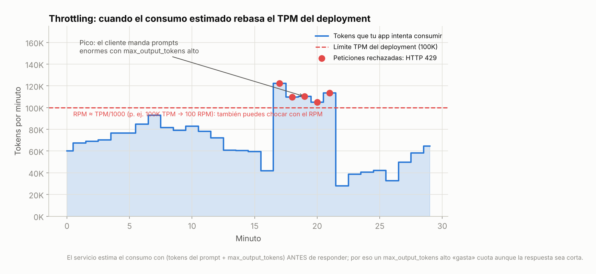

*Cuando la estimación de tokens por minuto rebasa el TPM del deployment, las peticiones adicionales reciben **HTTP 429 (Too Many Requests)**. El servicio estima el consumo **antes** de responder usando los tokens del prompt y `max_output_tokens`; por eso un `max_output_tokens` innecesariamente alto "gasta" cuota aunque la respuesta sea corta. Valores ilustrativos.*

| Término | Qué es | Relación |
|---|---|---|
| **TPM** | Tokens por minuto que puede procesar el deployment | Lo asignas al desplegar |
| **RPM** | Peticiones por minuto | Derivado del TPM; en muchos modelos ≈ **1 RPM por cada 1,000 TPM** (p. ej. `gpt-4.1` Global Standard Tier 1: 1,000 RPM / 1,000,000 TPM); algunas versiones usan 10 RPM por 1,000 TPM. Revisa la tabla de cuotas |
| **429** | Respuesta cuando rebasas TPM **o** RPM | Trae un header `retry-after` |
| **Niveles de cuota** | Free y Tier 1 a 6; suben solos con el uso (*dynamic quota*, preview) o por solicitud | Clientes EA / MCA-E parten de niveles más altos |
| **Usage tiers** | Volumen mensual de tokens a partir del cual la latencia puede volverse variable | No aplica a batch ni a PTU; para latencia crítica → PTU |
| **Enqueued tokens** | Cuota separada para batch | Tokens en cola hasta terminar el job |

Buenas prácticas de Microsoft para evitar throttling:
1. **Reintentos con *backoff* exponencial** respetando `retry-after` (la librería `openai` ya reintenta por defecto; configúralo).
2. **Sube el tráfico gradualmente**; evita picos bruscos (precalienta).
3. **Reduce `max_output_tokens`** y las peticiones concurrentes.
4. **Pide más cuota** o mueve cuota de otro deployment.
5. Monitorea en el portal de Azure (métricas de tokens, 429, latencia).
6. Para alto volumen sensible a latencia, **PTU**.

Otros límites útiles: 32 deployments Standard por recurso; 30 recursos por región por suscripción; 128 herramientas por petición; embeddings: 2,048 entradas y 300,000 tokens por petición.

---

### 9. Parámetros de inferencia

Ya con el modelo desplegado, cada llamada acepta parámetros que cambian el comportamiento. Son los mismos que ves en el Playground y en el código que genera.

| Parámetro | Efecto | Valor típico |
|---|---|---|
| `instructions` | System prompt: rol, tono, reglas, formato | Siempre; corto y concreto |
| `input` | El prompt del usuario (texto o lista de mensajes/partes multimodales) | — |
| `temperature` | Creatividad vs. determinismo (0-2) | 0–0.3 para extracción/clasificación; 0.7–1 para creatividad |
| `top_p` | Muestreo por probabilidad acumulada (nucleus sampling) | Ajusta este **o** la temperatura, no ambos |
| `max_output_tokens` | Longitud máxima de la respuesta | Limítalo para controlar costo y throttling |
| `reasoning.effort` | Cuánto "piensa" un modelo de razonamiento | `low` / `medium` / `high` (algunos: `minimal`, `xhigh`) |
| `stream` | Devuelve tokens conforme se generan | `True` en chat y voz (mejora el TTFT percibido) |
| `store` / `previous_response_id` | Guarda la respuesta (30 días) y encadena turnos sin reenviar el historial | Conversaciones multi-turno |
| `tools` | Funciones, Code Interpreter, MCP, búsqueda… | Agentes (Tema 2) |
| `text.format` | Salida estructurada (JSON schema) | Extracción, integraciones |

#### 9.1 Temperatura y top_p, por dentro

Un modelo no "elige" el siguiente token: calcula una **distribución de probabilidad** sobre todos los tokens posibles y **muestrea** uno. La temperatura reescala esa distribución antes de muestrear; `top_p` recorta la cola.

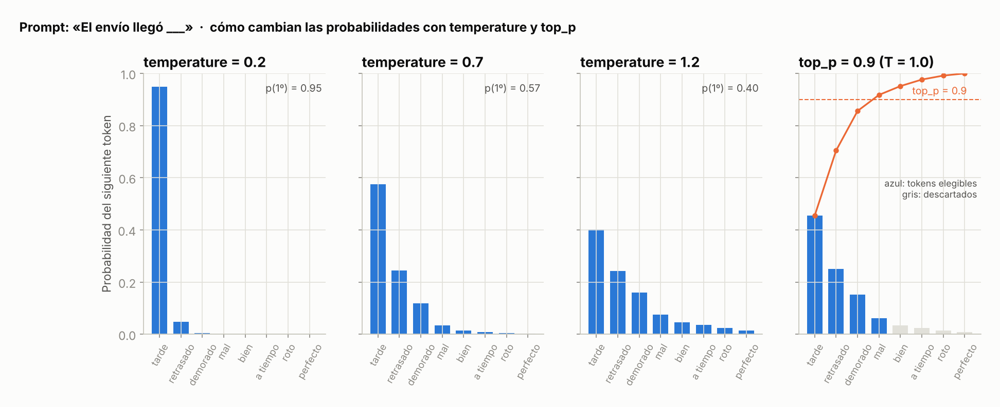

*Para el prompt «El envío llegó ___»: con `temperature` 0.2 el token más probable ("tarde") acapara el 95 % y la salida es casi determinista; con 1.2 la distribución se aplana y aparecen alternativas (más variedad, más riesgo de incoherencia). Con `top_p` 0.9 solo participan los tokens cuya probabilidad acumulada llega al 90 % (azul); el resto se descarta (gris). Valores ilustrativos.*

| Quiero… | temperature | Por qué |
|---|---|---|
| Clasificar, extraer campos, responder con JSON, tests reproducibles | **0 – 0.3** | Mismo prompt → casi la misma respuesta |
| Chat de soporte, resúmenes | 0.3 – 0.7 | Natural sin inventar |
| Lluvia de ideas, nombres, historias, copys | **0.7 – 1.0+** | Variedad |

> [!NOTE]
> Algunos modelos de razonamiento **no aceptan `temperature` ni `top_p`** (devuelven error o los ignoran). Revisa la ficha del modelo. Incluso con `temperature=0`, la salida **no es 100 % determinista** entre llamadas (hardware, batching); si necesitas exactamente lo mismo, guarda la respuesta.

#### 9.2 `max_output_tokens`: el parámetro que controla dos cosas

1. **Costo**: la respuesta no puede pasarse de ahí.
2. **Throttling**: el servicio lo usa para **estimar** el consumo de TPM antes de responder.

Si lo pones demasiado bajo, la respuesta se corta (`incomplete_details.reason = "max_output_tokens"`); si lo pones demasiado alto "sin usarlo", consumes cuota de más. Ajústalo a lo que la tarea necesita: ~50 para una clasificación, ~300 para un resumen corto, 1,000-4,000 para redacción larga. En modelos de razonamiento, **los tokens de razonamiento cuentan dentro de `max_output_tokens`**: déjales espacio.

#### 9.3 `reasoning.effort`: pagar por pensar

| effort | Qué pasa | Cuándo |
|---|---|---|
| `low` / `minimal` | Poca cadena de razonamiento; rápido y barato | Tareas fáciles con un modelo de razonamiento (p. ej. por consistencia de un solo deployment) |
| `medium` | Balance (default) | General |
| `high` / `xhigh` | Piensa mucho; más tokens de salida, TTFT alto, mejor en problemas difíciles | Matemáticas, código complejo, planeación |

Los tokens de razonamiento se **cobran como salida** aunque no los veas. Un `effort=high` puede multiplicar el costo por 5-10 en la misma pregunta.

#### 9.4 La Responses API en una llamada

```python
import os
from openai import OpenAI

client = OpenAI(
    base_url=os.environ["AZURE_OPENAI_ENDPOINT"],   # https://<recurso>.openai.azure.com/openai/v1/
    api_key=os.environ["FOUNDRY_KEY"],
)

r = client.responses.create(
    model="chat-mini",                     # nombre de TU deployment, no del modelo
    instructions="Eres un asistente de soporte de una tienda en línea mexicana. Responde en español, breve y amable.",
    input="¿Puedo cambiar la dirección de entrega de mi pedido?",
    temperature=0.3,
    max_output_tokens=200,
    # reasoning={"effort": "low"},         # solo en modelos de razonamiento
)
print(r.output_text)
print(r.usage.input_tokens, r.usage.output_tokens)   # para calcular costo
```

> 🔧 Si recibes **404**, casi siempre el valor de `model` no coincide con el nombre del deployment. Si recibes **429**, es cuota (sección 8). Si recibes **400** mencionando `temperature`, el modelo no acepta ese parámetro.

---

### 10. Bonus: model router, el "despachador" automático

Si no quieres elegir un modelo por petición, Foundry ofrece **model router**: un deployment que, para cada prompt, elige en tiempo real el modelo subyacente más adecuado (analiza complejidad, necesidad de razonamiento y tipo de tarea) y lo envía a un modelo pequeño cuando basta o a uno grande cuando no.

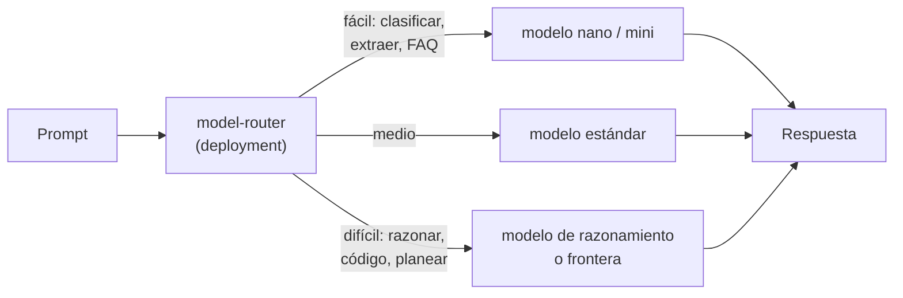

| Modo de ruteo | Comportamiento |
|---|---|
| **Balanced** (default) | Entre los modelos a 1-2 % de la mejor calidad para ese prompt, elige el más barato |
| **Cost** | Banda más amplia (5-6 %) → aún más barato |
| **Quality** | El de mejor calidad, sin mirar costo |

Detalles: se despliega como cualquier modelo (Global Standard o Data Zone Standard); puedes limitar el **subconjunto de modelos**; tiene *failover* automático; la **ventana de contexto efectiva es la del modelo más pequeño** del grupo; las imágenes se aceptan pero el ruteo se decide solo con texto; Claude debe estar desplegado aparte para que el router lo considere. Microsoft recomienda **comparar contra tu línea base con tu propia evaluación** antes de adoptarlo.

---

### 11. Prácticas

#### 11.1 Compara dos (o más) modelos con tus propios prompts (`comparar_modelos.py`)

Mide latencia (promedio y P90), tokens consumidos y un vistazo a la calidad con prompts reales. Así decides con datos, no con intuición.

```python
import os, time, statistics, csv
from openai import OpenAI

client = OpenAI(base_url=os.environ["AZURE_OPENAI_ENDPOINT"], api_key=os.environ["FOUNDRY_KEY"])

# Precios ILUSTRATIVOS por 1M tokens (entrada, salida). Cámbialos por los de la página de precios.
PRECIOS = {"gpt-4.1-mini": (0.40, 1.60), "gpt-4.1-nano": (0.10, 0.40)}
deployments = list(PRECIOS)                      # nombres de TUS deployments

prompts = [
    "Clasifica el sentimiento (positivo/negativo/neutro) y responde solo con la etiqueta: "
    "'El envío llegó tarde pero el producto es excelente'",
    "Resume en una oración: La política de viáticos permite hasta 180 USD por noche en viajes "
    "internacionales, requiere comprobantes y se reembolsa en un máximo de 15 días hábiles.",
    "Extrae en JSON {\"producto\":..., \"monto\":..., \"moneda\":...}: 'Compré una Surface Pro en 24,999 pesos'",
    "¿'Ahorita lo checo' significa que lo revisará de inmediato? Responde sí o no y explica en una línea.",
]

filas = []
for d in deployments:
    tiempos, tok_in, tok_out = [], 0, 0
    for p in prompts:
        inicio = time.perf_counter()
        r = client.responses.create(model=d, input=p, temperature=0.2, max_output_tokens=120)
        ms = (time.perf_counter() - inicio) * 1000
        tiempos.append(ms); tok_in += r.usage.input_tokens; tok_out += r.usage.output_tokens
        print(f"[{d}] {ms:6.0f} ms | {r.usage.input_tokens}+{r.usage.output_tokens} tok | {r.output_text[:70]!r}")
        filas.append([d, p[:40], round(ms), r.usage.input_tokens, r.usage.output_tokens, r.output_text])
    pi, po = PRECIOS[d]
    costo = (tok_in * pi + tok_out * po) / 1e6
    p90 = statistics.quantiles(tiempos, n=10)[-1] if len(tiempos) >= 2 else tiempos[0]
    print(f"== {d}: media {statistics.mean(tiempos):.0f} ms | P90 {p90:.0f} ms | "
          f"{tok_in}+{tok_out} tokens | ≈ ${costo:.5f} por {len(prompts)} prompts "
          f"| ≈ ${costo/len(prompts)*100_000:.2f} por 100K llamadas\n")

with open("comparacion.csv", "w", newline="", encoding="utf-8") as f:
    csv.writer(f).writerows([["deployment", "prompt", "ms", "tok_in", "tok_out", "respuesta"], *filas])
```

- **Qué mides:** latencia por prompt y P90 (no solo promedio), tokens de entrada y salida (costo) y la respuesta para juzgar calidad a ojo o con un evaluador.
- **Cómo decidir:** si el modelo chico acierta en tus prompts, gana: es más rápido y barato. Si falla en los difíciles, considera **enrutar** (chico para lo fácil, grande para lo difícil) o *model router*.
- Extiende la lista a 30-100 prompts reales y guarda `comparacion.csv` como línea base para futuras regresiones.

#### 11.2 Estima TPM, RPM y si te conviene PTU (`dimensionar.py`)

```python
# Estimación rápida de capacidad para dimensionar un deployment.
llamadas_por_dia  = 50_000
pico_x            = 3.0          # el minuto más cargado vs. el promedio
tok_entrada       = 800
tok_salida        = 150
max_output_tokens = 300          # lo que pondrás en la llamada (cuenta para el estimado de TPM)

rpm_prom = llamadas_por_dia / (24 * 60)
rpm_pico = rpm_prom * pico_x
tpm_estimado_pico = rpm_pico * (tok_entrada + max_output_tokens)   # así "cuenta" el servicio
tpm_real_pico     = rpm_pico * (tok_entrada + tok_salida)

print(f"RPM promedio {rpm_prom:.0f} | RPM pico {rpm_pico:.0f}")
print(f"TPM que debes asignar (estimado con max_output_tokens): {tpm_estimado_pico:,.0f}")
print(f"TPM realmente consumido en pico: {tpm_real_pico:,.0f}")
print(f"RPM que te da esa cuota si el modelo usa 1 RPM / 1K TPM: {tpm_estimado_pico/1000:.0f} "
      f"({'OK' if tpm_estimado_pico/1000 >= rpm_pico else '¡cuello de botella por RPM!'})")

utilizacion = rpm_prom / rpm_pico
print(f"Utilización promedio de la capacidad pico: {utilizacion:.0%} → "
      f"{'candidato a PTU con reservación' if utilizacion > 0.5 else 'Standard (pago por token) suele salir mejor'}")
```

- Si el estimado te da un RPM menor al que necesitas, **baja `max_output_tokens`** o reparte el tráfico en más deployments/regiones.
- Si la utilización promedio es alta y estable, corre la **calculadora de capacidad** del portal para PTU.

#### 11.3 Reintentos con backoff ante 429 (`reintentos.py`)

```python
import os, time, random
from openai import OpenAI, RateLimitError

client = OpenAI(base_url=os.environ["AZURE_OPENAI_ENDPOINT"], api_key=os.environ["FOUNDRY_KEY"],
                max_retries=0)   # manejamos los reintentos nosotros para verlos

def llamar(prompt, intentos=6):
    espera = 1.0
    for i in range(intentos):
        try:
            return client.responses.create(model="chat-mini", input=prompt, max_output_tokens=150)
        except RateLimitError as e:
            retry_after = float(e.response.headers.get("retry-after", espera))
            pausa = max(retry_after, espera) + random.uniform(0, 0.5)     # jitter
            print(f"429 en intento {i+1}; espero {pausa:.1f} s")
            time.sleep(pausa)
            espera = min(espera * 2, 30)                                  # backoff exponencial, tope 30 s
    raise RuntimeError("Sin cuota después de varios intentos")

print(llamar("Di 'hola' en tres idiomas.").output_text)
```

- En producción, además del reintento: **colas** para suavizar picos, **circuit breaker** y alertas sobre la métrica de 429.
- La librería `openai` ya reintenta con backoff si dejas `max_retries` en su valor por defecto (2); aquí lo apagamos para mostrar la mecánica.

#### 11.4 Un job de Global Batch en cuatro pasos (`lote.py`)

```python
import os, json, time
from openai import OpenAI

client = OpenAI(base_url=os.environ["AZURE_OPENAI_ENDPOINT"], api_key=os.environ["FOUNDRY_KEY"])

# 1. JSONL: una petición por línea, con el nombre del deployment Global Batch en "model"
resenas = ["Llegó tarde pero excelente", "No sirve, pésimo", "Cumple, nada especial"]
with open("peticiones.jsonl", "w", encoding="utf-8") as f:
    for i, texto in enumerate(resenas):
        f.write(json.dumps({
            "custom_id": f"resena-{i}", "method": "POST", "url": "/v1/responses",
            "body": {"model": "clasificador-batch",
                     "instructions": "Responde solo: positivo, negativo o neutro.",
                     "input": texto, "max_output_tokens": 5}}, ensure_ascii=False) + "\n")

# 2. subir y 3. crear el job
archivo = client.files.create(file=open("peticiones.jsonl", "rb"), purpose="batch")
# endpoint es obligatorio, pero el servicio lee el archivo para saber si es chat completions o Responses
job = client.batches.create(input_file_id=archivo.id, endpoint="/chat/completions", completion_window="24h")
print("job:", job.id, job.status)

# 4. esperar (mínimo 60 s entre consultas) y leer resultados por custom_id
while job.status not in ("completed", "failed", "expired", "cancelled", "canceled"):
    time.sleep(60); job = client.batches.retrieve(job.id); print(job.status)
if job.output_file_id:
    for linea in client.files.content(job.output_file_id).text.splitlines():
        r = json.loads(linea)
        print(r["custom_id"], "→", r["response"]["body"]["output"][-1]["content"][0]["text"])
```

- Con 3 reseñas no tiene sentido (tarda horas); con **3 millones** cuesta la mitad y no compite con tu cuota en línea.
- Si el job falla con `token_limit_exceeded`, rebasaste la cuota de *enqueued tokens*: parte el archivo o reintenta con backoff.

---

### 12. Para el examen

| Si el escenario dice… | La respuesta es… |
|---|---|
| "Menor costo para clasificar millones de reseñas sin urgencia" | Modelo pequeño + **Global Batch** |
| "Detectar el idioma / PII / sentimiento de forma consistente y barata" | **Foundry Tool (Azure Language)**, no un LLM |
| "Capacidad garantizada y latencia predecible para producción" | **Provisioned throughput (PTU)** |
| "Uso general, sin restricciones de residencia, la mayor cuota" | **Global Standard** |
| "Los datos deben procesarse dentro de la UE / EE. UU." | **Data Zone** (Standard / Provisioned / Batch) |
| "Los datos deben quedarse en una región específica" | **Standard** o **Regional Provisioned** |
| "Evaluar un modelo fine-tuned por un día, sin SLA" | **Developer** |
| "App ligera en el teléfono, bajo costo, hardware modesto" | **SLM** (Phi-4, Llama 8B) |
| "Matemáticas, código complejo, planeación multi-paso" | **Modelo de razonamiento** (GPT-5.x, Claude Opus) |
| "Búsqueda semántica / RAG / similitud" | Modelo de **embeddings** (`text-embedding-3-small`) |
| "Describir una imagen en el chat" | Modelo **multimodal** |
| "SLA empresarial, soporte de Microsoft, revisión de IA responsable" | Modelos **vendidos directamente por Azure** |
| "Open source, experimentar, dominio específico" | Modelos de **socios y comunidad** |
| "¿Qué benchmark indica velocidad al procesar prompts y responder?" | **Throughput** (no quality index ni cost) |
| "¿Qué métrica mide corrección lingüística y naturalidad?" | **Fluency** (groundedness = fiel al contexto; relevance = responde la pregunta) |
| "¿Qué parámetro hace las respuestas más creativas?" | **temperature** alta |
| "¿Qué parámetro evita respuestas demasiado largas y throttling?" | **max_output_tokens** |
| "Errores 429 al acercarse al límite" | Bajar `max_output_tokens`, reducir concurrencia, reintentos con backoff, pedir cuota, o PTU |
| "TPM define también…" | El **RPM** |
| "Los evaluadores de seguridad…" | **Detectan y puntúan; no corrigen** |
| "Benchmarks públicos vs. tus datos" | Los públicos **pueden no reflejar** tu caso: evalúa con tus datos |
| "¿Qué pasa al desplegar?" | Se asigna cómputo, se crea el endpoint, se fija la configuración y se activa el monitoreo |
| "¿Qué pones en el parámetro `model`?" | El **nombre del deployment** |

Preguntas del *knowledge check* oficial del módulo [Select, deploy, and evaluate Microsoft Foundry models](https://learn.microsoft.com/en-us/training/modules/model-catalog-evaluate/7-knowledge-check):

1. ¿Qué benchmark indica la capacidad del modelo para procesar prompts y devolver respuestas completas rápidamente? → **Throughput**.
2. ¿Qué tipo de despliegue es mejor para uso general y ofrece la mayor cuota? → **Global Standard**.
3. ¿Qué métrica mide corrección lingüística y calidad del lenguaje natural? → **Fluency**.

Trampas frecuentes:
- **Quality index ≠ velocidad.** Si preguntan por rapidez, es throughput/latencia.
- **Costo estimado** del leaderboard mezcla entrada y salida **3:1**; no es tu factura.
- **Safety**: en HarmBench **más bajo es mejor** (ASR); en WMDP **más alto es peor**; en ToxiGen más alto es mejor.
- **Batch** no es "más rápido": es más barato y asíncrono (24 h).
- **PTU** no es "más barato": es predecible; sale a cuenta solo con uso alto y estable.
- **Data Zone** vs. **Regional**: zona (US/EU/APAC) vs. geografía específica. En ambos, los datos en reposo siempre se quedan en la geografía del recurso.
- **Developer** solo para fine-tuned, 24 horas, sin SLA.
- **temperature** y **top_p**: ajusta uno, no los dos; algunos modelos de razonamiento no los aceptan.
- **Foundry Tool** cuando el caso está **bien definido**; modelo del catálogo cuando necesitas flexibilidad, prompts a la medida o fine-tuning.

---

### Recursos

- [Generative AI models – módulo "Get started with generative AI and agents" (AI-901)](https://learn.microsoft.com/en-us/training/modules/get-started-with-generative-ai-and-agents/2-generative-ai-models)
- [Select, deploy, and evaluate Microsoft Foundry models (módulo completo)](https://learn.microsoft.com/en-us/training/modules/model-catalog-evaluate/): [Explore the model catalog](https://learn.microsoft.com/en-us/training/modules/model-catalog-evaluate/2-explore-model-catalog) · [Select models using benchmarks](https://learn.microsoft.com/en-us/training/modules/model-catalog-evaluate/3-select-models-benchmarks) · [Deploy models to endpoints](https://learn.microsoft.com/en-us/training/modules/model-catalog-evaluate/4-deploy-models) · [Evaluate model performance](https://learn.microsoft.com/en-us/training/modules/model-catalog-evaluate/5-evaluate-performance)
- [Foundry Models overview (catálogo)](https://learn.microsoft.com/en-us/azure/foundry/concepts/foundry-models-overview)
- [Model leaderboards: metodología de calidad, seguridad, costo y rendimiento](https://learn.microsoft.com/en-us/azure/foundry/concepts/model-benchmarks) · [Compare and benchmark models in the catalog](https://learn.microsoft.com/en-us/azure/foundry/how-to/benchmark-model-in-catalog)
- [Deployment types](https://learn.microsoft.com/en-us/azure/foundry/foundry-models/concepts/deployment-types) · [Provisioned throughput](https://learn.microsoft.com/en-us/azure/foundry/openai/concepts/provisioned-throughput) · [Global Batch](https://learn.microsoft.com/en-us/azure/foundry/openai/how-to/batch)
- [Quotas and limits (TPM, RPM, niveles)](https://learn.microsoft.com/en-us/azure/foundry/openai/quotas-limits)
- [Responses API](https://learn.microsoft.com/en-us/azure/foundry/openai/how-to/responses) · [Model router](https://learn.microsoft.com/en-us/azure/foundry/openai/concepts/model-router)
- [Evaluate generative AI apps (con tus propios datos)](https://learn.microsoft.com/en-us/azure/foundry/how-to/evaluate-generative-ai-app)
- [Guía de estudio AI-901](https://learn.microsoft.com/en-us/credentials/certifications/resources/study-guides/ai-901)
- En este acordeón: [Tema 2: modelos vs. agentes](tema2.md) · [Parte 2 · Módulo 3 · Tema 1: cuándo no usar un LLM](../modulo3/tema1.md) · [Parte 1 · Módulo 1: fundamentos de la IA generativa](../../parte1/modulo1/tema1.md)
