# Tema 2: Comprender la diferencia entre los modelos y los agentes y cuándo usar uno u otro

### Descripción
Microsoft Learn lo resume así: **los modelos son inteligencia en bruto**; **los agentes son trabajadores empaquetados y orientados a tareas** construidos sobre esa inteligencia. Un modelo responde a un prompt; un agente tiene un rol fijo (instrucciones), herramientas para actuar, conocimiento para fundamentarse y memoria dentro de la conversación.

Analogía: un **modelo** es un recién egresado brillante al que le preguntas cualquier cosa y te contesta con lo que sabe. Un **agente** es ese mismo egresado ya contratado: tiene un puesto (instrucciones), acceso al sistema de la empresa (herramientas), al manual interno (conocimiento) y recuerda lo que platicaron en la junta (memoria). Y lo más importante: **el egresado contratado puede hacer cosas** (levantar un ticket, mandar un correo), no solo opinar.

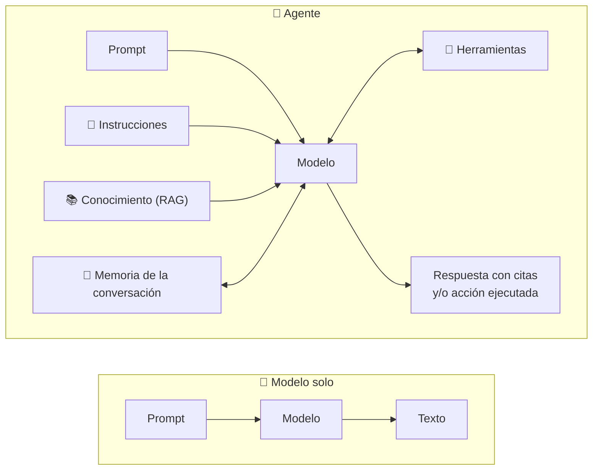

*El modelo es el mismo en ambos lados. Lo que cambia es todo lo que lo rodea.*

> [!NOTE]
> Este tema cubre la habilidad del examen *"Understand the difference between models and agents and when to use each"* del dominio **Implementar soluciones de IA con Microsoft Foundry** (55–60 % del examen). Es de los temas que más caen en preguntas de escenario.

---

### 1. ¿Qué es exactamente un modelo (y qué no hace)?

Un **modelo generativo** desplegado en Foundry es un *endpoint* que recibe tokens y devuelve tokens. Nada más:

- **Entrada:** el prompt (instrucciones de sistema + mensaje del usuario + lo que tú quieras meter en el contexto).
- **Salida:** texto (o JSON, imagen, audio, según el modelo).
- **No tiene estado:** cada llamada empieza de cero. Si quieres que "recuerde" la conversación, **tu código** debe reenviar el historial completo en cada petición.
- **No tiene acceso a nada:** ni a tus bases de datos, ni a internet, ni a tus documentos. Solo sabe lo que aprendió en su entrenamiento y lo que le pongas en el prompt.
- **No puede actuar:** puede *escribir* "voy a crear un ticket", pero no crea nada.

Por eso Microsoft lo llama **inteligencia en bruto**: capacidad de razonar y generar lenguaje, sin empaquetar.

Cuando usas un modelo directamente:
- Quieres **inferencia pura**: "toma este prompt y genera una salida".
- Estás **experimentando** en el Playground.
- Llamas al modelo con la **Responses API** (compatible con OpenAI).

```python
# Un modelo es una función: texto -> texto. Todo lo demás lo pones tú.
from openai import OpenAI
import os

client = OpenAI(base_url=f"{os.environ['AZURE_OPENAI_ENDPOINT']}/openai/v1/",
                api_key=os.environ["AZURE_OPENAI_API_KEY"])

respuesta = client.responses.create(
    model=os.environ["DEPLOYMENT_NAME"],            # nombre del DEPLOYMENT, no del modelo
    input=[{"role": "system", "content": "Eres un asistente conciso."},
           {"role": "user", "content": "Resume en 3 viñetas las notas de la versión."}],
    max_output_tokens=300,
    temperature=0.7,
)
print(respuesta.output_text)
```

---

### 2. Anatomía de un agente

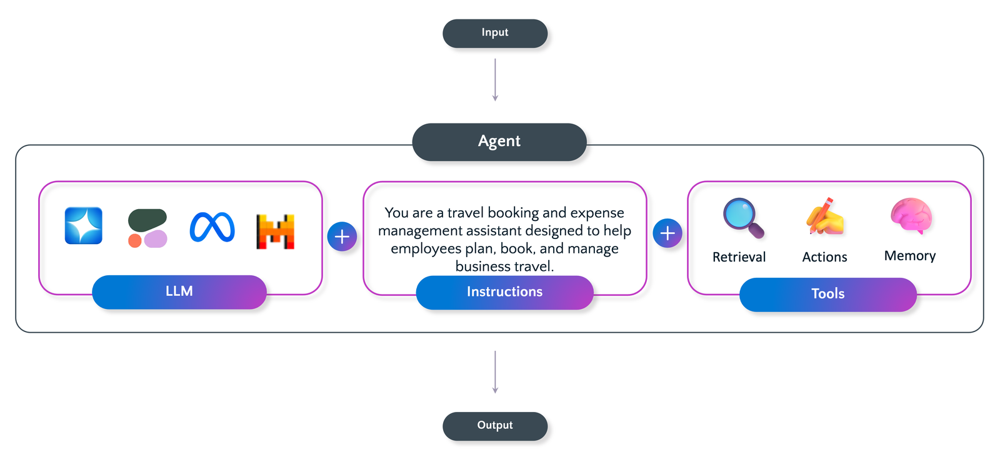

*Diagrama oficial de Microsoft: un agente = **LLM + instrucciones + herramientas** (retrieval, acciones y memoria). La entrada pasa por todo el paquete y sale una respuesta o una acción. Imagen: documentación oficial de Microsoft (CC BY 4.0).*

En Foundry, un agente se define con estas piezas:

| Pieza | Qué es | Pregunta que responde | Ejemplo |
|---|---|---|---|
| **Modelo** | El motor de razonamiento (un deployment del catálogo) | ¿Con qué cerebro piensa? | `gpt-4.1-mini`, `gpt-5-mini` |
| **Instrucciones** | El *system prompt* fijo: rol, tono, límites, formato de salida | ¿Quién es y cómo se comporta? | "Eres un asistente de RR. HH. Responde en español, cita la política y nunca inventes cifras." |
| **Herramientas (tools)** | Capacidades que el agente puede **invocar** para actuar | ¿Qué puede **hacer**? | Buscar en la web, llamar una API, ejecutar código, un servidor MCP |
| **Conocimiento (knowledge)** | Contenido externo que se recupera por **RAG** y se cita | ¿Qué **sabe** de tu organización? | PDFs internos, SharePoint, Azure AI Search, Foundry IQ |
| **Memoria** | Historial de la conversación (y, opcionalmente, un *memory store* entre sesiones) | ¿Qué **recuerda**? | "Antes me dijiste que eres el empleado E-1024" |
| **Guardrails** | Filtros de contenido y protección contra *prompt injection* | ¿Qué **no** debe hacer? | Bloquear jailbreaks, datos sensibles, contenido dañino |

> [!TIP]
> Regla que cae en el examen: **herramientas = acciones; conocimiento = contexto.** Si el escenario dice "consultar", "crear", "enviar", "actualizar" → herramienta. Si dice "responder con base en nuestros documentos y citar la fuente" → conocimiento.

#### 2.1 Instrucciones: el contrato del agente
Las instrucciones son el mismo *system prompt* que escribes en el Playground, pero **guardado y versionado** junto con el agente. Un buen set de instrucciones define:

1. **Rol e identidad:** "Eres *Viajero*, asistente de viajes por México."
2. **Comportamiento y tono:** "Español de México, cercano y profesional."
3. **Límites:** "Si no sabes algo, dilo. Nunca inventes precios."
4. **Cuándo usar cada herramienta:** "Para disponibilidad usa `buscar_vuelos`; no la inventes."
5. **Formato de salida:** "Máximo 5 viñetas; incluye la fuente cuando uses la política."

La diferencia práctica con el modelo: con el modelo **cada aplicación** manda sus propias instrucciones en cada petición; con el agente las instrucciones viven **en un solo lugar** y todas las apps (web, Teams, bot) las heredan.

#### 2.2 Herramientas = acciones
Una herramienta es una capacidad con **nombre, descripción y esquema de parámetros**. El modelo lee esas descripciones y, cuando lo considera necesario, **pide** que se ejecute una (él no la ejecuta: emite una llamada estructurada). En Foundry hay dos familias:

| Familia | Quién la ejecuta | Ejemplos |
|---|---|---|
| **Hospedadas por Foundry** (built-in) | El servicio, sin código tuyo | **Web search / Grounding with Bing**, **File search**, **Code Interpreter**, **Azure AI Search**, **SharePoint**, **Fabric**, **Browser automation**, **Image generation**, **Memory** |
| **Personalizadas** (tú las conectas) | Tu código o tu API | **Function calling** (funciones de tu app), **OpenAPI** (cualquier REST con especificación), **MCP** (servidores remotos como Azure DevOps o GitHub), **Azure Functions**, **Logic Apps**, **A2A** (otro agente) |

- Las herramientas se administran en el **Foundry Tool Catalog**; un **Toolbox** agrupa varias detrás de un solo endpoint compatible con MCP, con autenticación, gobernanza y versiones centralizadas.
- Con **function calling**, Foundry **no ejecuta tu función**: solo te devuelve `function_call` con los argumentos; tu aplicación la corre y regresa el resultado (ver sección 4). El portal puede probar agentes con funciones pero no ejecutarlas.

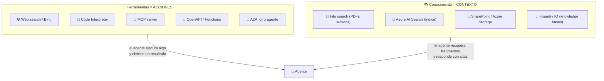

#### 2.3 Conocimiento = contexto (RAG)
Cuando agregas conocimiento, Foundry **ingesta e indexa** el contenido; en cada pregunta busca los fragmentos relevantes, los mete en el prompt y el modelo responde **con una cita** al origen. Es RAG (*retrieval-augmented generation*) sin que escribas el pipeline.

- Fuentes típicas: PDFs internos, SharePoint, archivos en Azure Storage, índices de Azure AI Search, bases de conocimiento de **Foundry IQ**.
- Ventaja sobre meter todo en el prompt: no dependes de la ventana de contexto, el contenido se actualiza sin tocar el agente y **la respuesta es verificable** (cita).
- En el Playground de modelos, la sección **Knowledge** te avisa: *"para usar bases de conocimiento necesitas crear un agente"*. Es decir: **el conocimiento es una capacidad del agente, no del modelo.**

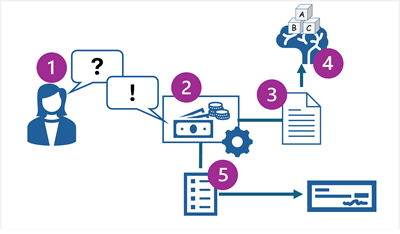

*Ejemplo oficial de Microsoft: (1) el empleado pregunta qué gastos puede reclamar; (2) el agente toma la pregunta como prompt; (3) la **fundamenta** con la política de gastos (conocimiento); (4) el modelo genera la respuesta; (5) el agente **genera y envía** el reclamo de gastos (acción). Un modelo solo llegaría hasta el paso 4 y sin tus datos. Imagen: documentación oficial de Microsoft (CC BY 4.0).*

#### 2.4 Memoria: dentro y entre conversaciones
- **Memoria de trabajo (working memory):** el historial de la conversación actual. Con un modelo directo, tu app la reenvía en cada llamada; con un agente de Foundry, el objeto **conversation** la guarda del lado del servidor.
- **Memory store (preview):** almacenamiento administrado que define qué recuerda el agente **entre sesiones** (por ejemplo, preferencias del usuario). Se adjunta al agente y aparece como contexto adicional.
- Si la conversación supera la ventana de contexto del modelo, el modelo **trunca** lo que usa, pero la conversación almacenada **no** se recorta.

---

### 3. Del Playground al agente: cómo se ve en Foundry

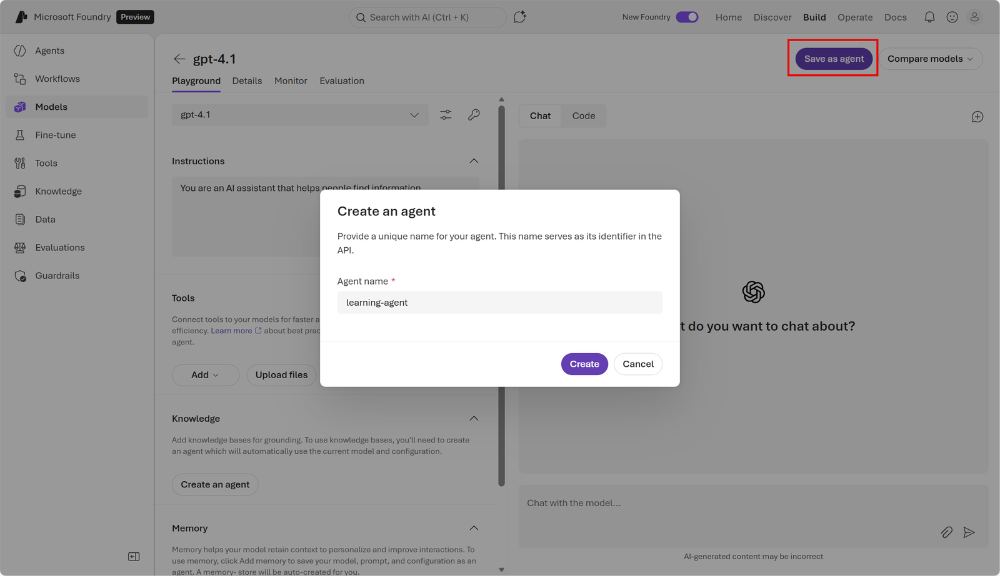

*En el Playground de **Models** configuras instrucciones, herramientas, conocimiento y memoria. Con **Save as agent** todo eso se guarda como un componente con nombre. Fíjate en los avisos del panel izquierdo: *knowledge* y *memory* requieren crear un agente. Imagen: documentación oficial de Microsoft (CC BY 4.0).*

El flujo típico:

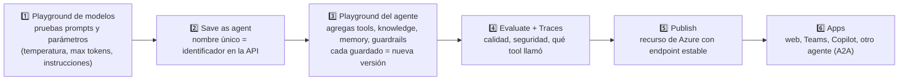

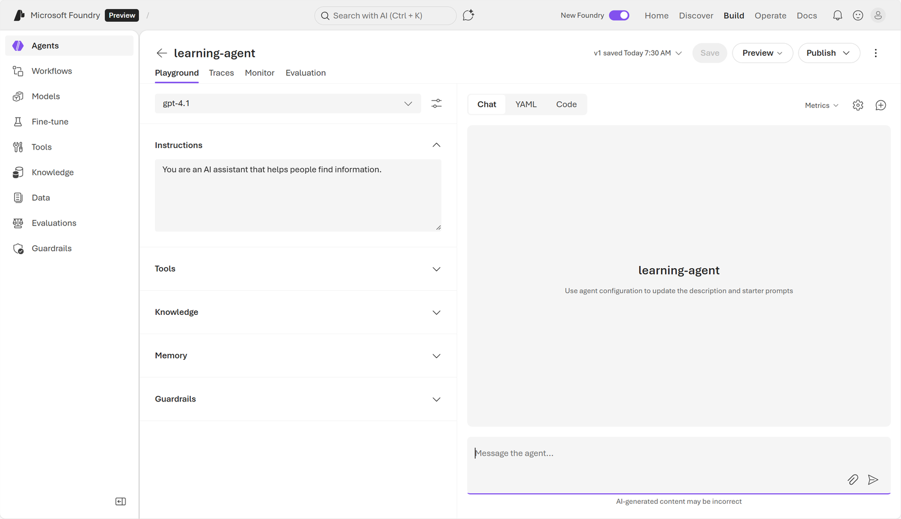

*El agente guardado (`learning-agent`, versión v1) tiene su propio Playground y, a diferencia del modelo, pestañas de **Traces**, **Monitor** y **Evaluation**, además de secciones de Tools, Knowledge, Memory y Guardrails. Imagen: documentación oficial de Microsoft (CC BY 4.0).*

Puntos que marcan la diferencia en el portal:

- **Modelo:** vive en **Build → Models**; el Playground te da el **código** equivalente (Responses API) para replicar en tu app.
- **Agente:** vive en **Build → Agents**; tiene **nombre** (su identificador en la API), **versiones** (cada cambio se guarda como snapshot y puedes volver atrás) y se puede **publicar**.
- **Publicar** convierte al agente en un **recurso administrado de Azure con endpoint estable**, con identidad de Entra y controles de acceso, que puedes compartir e integrar **sin exponer tu proyecto ni tu código**.

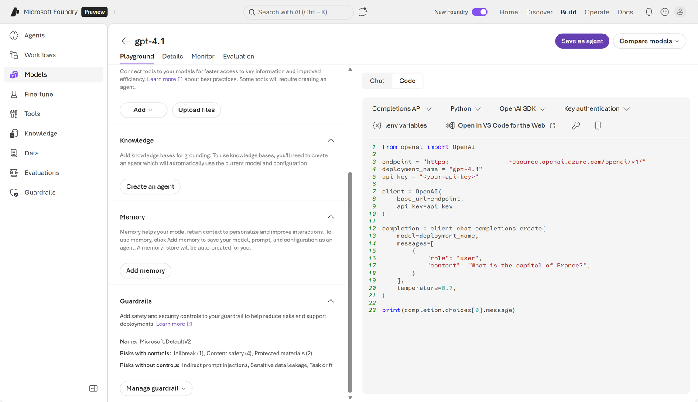

*El Playground del modelo genera el código Python que hace exactamente lo que acabas de probar en el chat. Observa también el aviso en Tools: "algunas herramientas requieren crear un agente". Imagen: documentación oficial de Microsoft (CC BY 4.0).*

---

### 4. Cómo "piensa" un agente: el ciclo de ejecución

La diferencia más profunda no es la configuración, sino el **ciclo**. Un modelo hace *una* pasada. Un agente hace un bucle: **decide → actúa → observa → vuelve a decidir** hasta que puede responder.

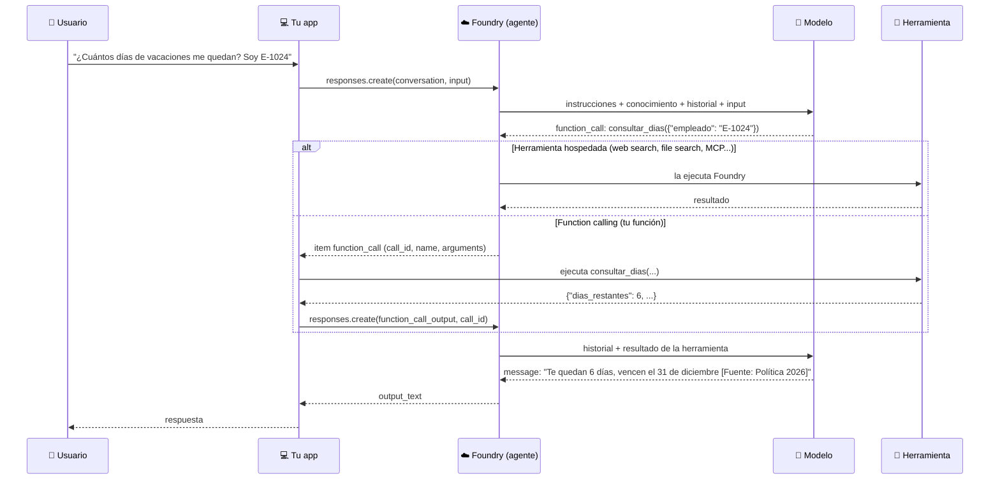

Claves del ciclo:

1. **El modelo nunca ejecuta nada.** Solo emite un *item* `function_call` con `call_id`, `name` y `arguments` (JSON). Quien ejecuta es Foundry (tools hospedadas) o tu app (function calling).
2. **El resultado regresa al modelo** como `function_call_output` con el mismo `call_id`, y el modelo decide si ya puede responder o necesita otra herramienta. Pueden encadenarse varias llamadas.
3. **Cada vuelta cuesta una llamada al modelo** (tokens y latencia). Un agente con 3 herramientas puede hacer 4 llamadas donde un modelo hace 1. Por eso "más autonomía" = "más costo".
4. **Hay límites de tiempo:** una ejecución expira a los 10 minutos; si tu función es lenta, responde con un estado y consulta después.

> [!WARNING]
> Trata los argumentos y los resultados de las herramientas como **datos no confiables**: valida el JSON, no devuelvas secretos en la salida de una tool y exige confirmación humana para acciones con efectos (pagos, borrados, envíos).

---

### 5. Los objetos del runtime en Foundry

Cuando llamas un agente desde código, trabajas con tres objetos. Entenderlos resuelve la mitad de las dudas de "¿y dónde se guarda la memoria?".

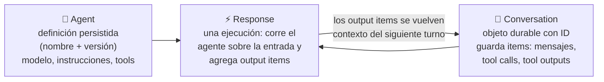

| Objeto | Qué es | Cuándo lo usas | Con un modelo directo... |
|---|---|---|---|
| **Agent** | Definición guardada: modelo + instrucciones + tools + guardrails. Se identifica por **nombre y versión** (ya no hay un `AgentID` tipo GUID). | Cuando varias peticiones deben compartir el mismo comportamiento. | No existe: pasas `model=` e `instructions=` en **cada** llamada. |
| **Conversation** | Objeto durable con ID que almacena **items** (mensajes, llamadas a herramientas, salidas). Reutilizable entre sesiones. | Cuando los turnos siguientes necesitan historial del lado del servidor. | Tú guardas y reenvías el historial. |
| **Response** | Una unidad de ejecución: toma la entrada (+ conversación) y produce **output items**. | Siempre: cada interacción es una response. | También es una response, pero "sin agente ni conversación". |

Alternativas a una conversación cuando usas el modelo directo:
- `previous_response_id=` para encadenar con la respuesta anterior almacenada.
- `store=False` + reenviar los items tú mismo (el servicio no guarda nada; el cliente lleva el contexto).

Los **items** que ves en `response.output` cuentan la historia completa: `message` (texto para el usuario), `function_call` / `web_search_call` / `file_search_call` (lo que el agente intentó) y sus salidas. Eso es exactamente lo que ves en la pestaña **Traces**.

---

### 6. Comparación completa

| Aspecto | Modelo solo | Agente |
|---|---|---|
| Alcance | Prompt → respuesta, una vez | Comportamiento consistente tipo flujo de trabajo, reutilizable |
| Componentes | Modelo (+ prompt) | Modelo + **instrucciones** + **herramientas** (+ conocimiento, memoria, guardrails) |
| Acciones | Solo genera texto | Llama herramientas: busca, lee, escribe, actualiza sistemas |
| Contexto | Solo lo que va en el prompt | Fundamentado con conocimiento (RAG) y **citas** |
| Memoria | Ninguna; tu app reenvía el historial | **Conversation** del lado del servidor (+ memory store entre sesiones) |
| Ciclo de ejecución | 1 llamada | N llamadas: decide → actúa → observa |
| Dónde viven las instrucciones | En cada app, en cada petición | Centralizadas en Foundry, versionadas |
| Empaquetado | Se prueba en el Playground de modelos | Componente con **nombre**, **versiones**, **publicable** como recurso de Azure |
| Observabilidad | Logs de tu app | **Traces** (cada llamada al modelo y a tools), Monitor, Evaluations |
| Gobernanza | Filtros de contenido del deployment | Guardrails por agente, identidad de Entra, RBAC, acceso por herramienta |
| Latencia y costo | Mínimos (1 inferencia) | Mayores (varias inferencias + tools), pero resuelve tareas completas |
| Identificador en la API | Nombre del **deployment** (`model="gpt-4.1-mini"`) | Nombre del **agente** (`agent_reference`) |
| Llamada en código | `responses.create(model="gpt-4.1-mini", instructions=..., input=...)` | `responses.create(input=..., extra_body={"agent": {"name": "...", "type": "agent_reference"}})` |

---

### 7. ¿Cuándo usar cada uno?

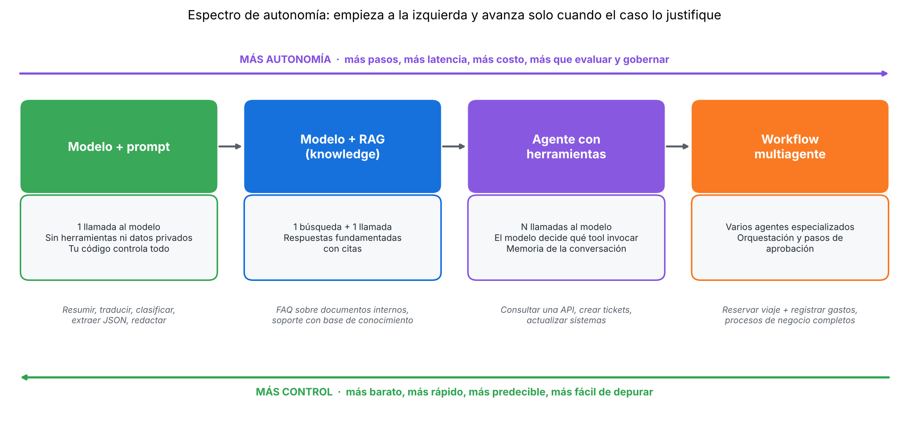

*Cuatro escalones. Cada paso a la derecha agrega capacidad y también latencia, costo y cosas que evaluar. Empieza a la izquierda.*

**Usa un modelo directamente cuando:**
- La tarea es **una sola transformación**: resumir, traducir, clasificar, extraer a JSON, generar un correo.
- No necesitas herramientas ni datos privados (o el contexto cabe cómodamente en el prompt).
- Quieres **máximo control**, mínima latencia y mínimo costo (una inferencia).
- Estás **experimentando** con prompts y parámetros en el Playground.
- El caso está tan acotado que incluso un **Foundry Tool** (idioma, PII, OCR) lo resolvería mejor que un LLM.

**Usa un agente cuando:**
- La tarea requiere **varios pasos** y decidir qué hacer en cada uno.
- Necesitas **actuar** sobre otros sistemas (crear un ticket, consultar una API, enviar un correo).
- Debe responder con **datos privados** y **citarlos** (knowledge / Foundry IQ).
- Vas a **reutilizar** el mismo comportamiento en varias apps con instrucciones centralizadas.
- Necesitas **gobernanza**: guardrails por agente, evaluación, trazas, versiones, identidad propia.
- La conversación es **larga** y quieres que el servidor guarde el historial.

**Pasa a multiagente cuando:** un solo agente acumula demasiadas herramientas e instrucciones contradictorias, o el proceso cruza dominios (viajes + gastos + aprobaciones). Cada agente se especializa y uno orquesta o se comunican por **A2A**.

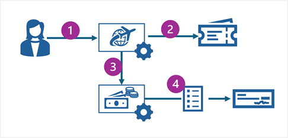

*Escenario multiagente oficial: el agente de viajes reserva vuelos y hotel y luego **inicia un reclamo de gastos** a través del agente de gastos, que lo envía a procesar. Imagen: documentación oficial de Microsoft (CC BY 4.0).*

#### Árbol de decisión rápido

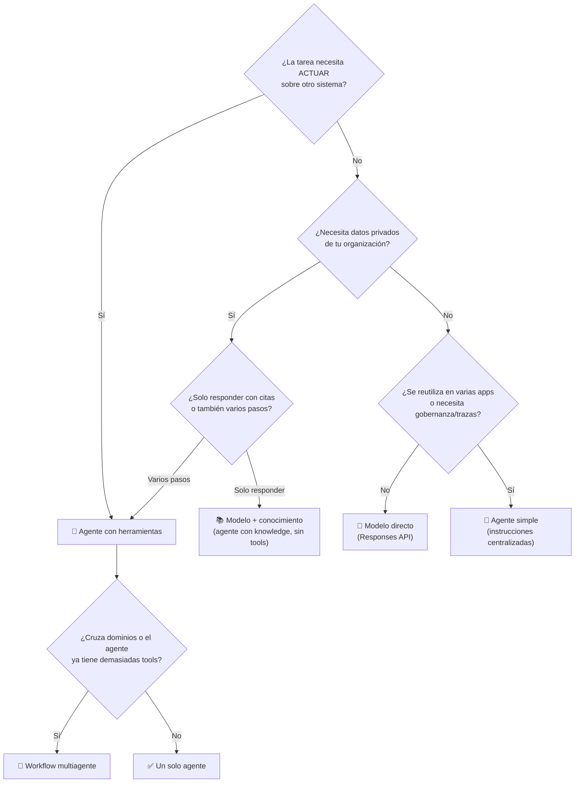

---

### 8. Mismo caso, dos enfoques
**Caso:** "¿Cuántos días de vacaciones me quedan?"
- **Con modelo:** responde algo genérico ("según la Ley Federal del Trabajo...") porque no conoce tus datos ni puede consultarlos.
- **Con agente:** consulta la política (knowledge), llama a la API de RR. HH. con tu número de empleado (tool) y responde "Te quedan 6 días; vencen el 31 de diciembre [Fuente: Política de vacaciones 2026]".

```python
# Modelo directo: inteligencia en bruto. TU código define todo en cada petición.
r = openai_client.responses.create(
    model="gpt-4.1-mini",
    instructions="Eres un asistente de RR. HH.",
    input="¿Cuántos días de vacaciones me quedan?",
)

# Agente: rol + herramientas + conocimiento ya configurados en Foundry. Tu cliente solo lo referencia.
r = openai_client.responses.create(
    input="¿Cuántos días de vacaciones me quedan?",
    extra_body={"agent": {"name": "agente-rrhh", "type": "agent_reference"}},
)
```
- **Explicación:** en la primera llamada el **modelo** se identifica por el nombre del *deployment* y las instrucciones viajan en la petición. En la segunda no hay `model` ni `instructions`: el **agente** ya trae su configuración desde Foundry; el cliente solo lo referencia por nombre.

> [!TIP]
> En versiones recientes del SDK (`azure-ai-projects` ≥ 2.0) puedes evitar el `extra_body` creando el cliente con `project_client.get_openai_client(agent_name="agente-rrhh")`: todas las `responses.create` de ese cliente van al agente. En el módulo de Learn verás la forma con `extra_body={"agent": {...}}`, que es la que cae en el examen.

---

### 9. Riesgos nuevos cuando pasas de modelo a agente

Un modelo solo puede **decir** cosas incorrectas. Un agente puede **hacer** cosas incorrectas: tiene credenciales, acceso a datos y capacidad de ejecutar acciones. Por eso Microsoft insiste en *security by design*:

| Lo que podrías ver | Riesgo | Mitigación en Foundry |
|---|---|---|
| "El agente compartió datos de nómina en un chat con un cliente" | Fuga de datos | Conocimiento y tools con **mínimo privilegio**; guardrails de datos sensibles |
| "Alguien convenció al agente de revelar la contraseña de la base" | **Prompt injection** (directa o indirecta, XPIA) | Guardrails integrados contra jailbreak y *cross-prompt injection*; tratar salidas de tools como no confiables |
| "El agente de soporte está borrando registros" | Escalación de privilegios | RBAC, identidad de Entra propia del agente, subconjunto de tools permitidas por MCP |
| "Procesó un reembolso sin verificar" | Exceso de autonomía | **Human-in-the-loop** para acciones críticas; aprobaciones en workflows |
| "No sabemos quién accedió a qué" | Falta de auditoría | **Traces** de cada llamada a modelo y tool; Application Insights |
| "Un plugin de terceros manda datos a un servidor desconocido" | Cadena de suministro | Auditar servidores MCP y APIs conectadas; Toolbox con gobernanza central |

Regla de oro: **el agente solo debe poder hacer lo que el usuario que lo invoca podría hacer** (identidad *on-behalf-of* cuando aplique).

---

### Práctica en Python

#### 1) Simulación sin Azure: el mismo problema con "modelo" y con "agente" (`sim_agente.py`)
Un modelo de juguete (no razona, solo ilustra la **estructura**: una llamada vs. un ciclo con tools, conocimiento y memoria).

```python
"""
Simulación SIN Azure: la misma pregunta resuelta por un "modelo" y por un "agente".
El 'modelo' de juguete no razona: solo sirve para ver la DIFERENCIA ESTRUCTURAL
(una llamada vs. un ciclo con herramientas, conocimiento y memoria).
"""
import json
import re

# ---------- Sistemas de la empresa (lo que un modelo solo NO puede ver) ----------
RRHH_API = {"E-1024": {"nombre": "Ana", "dias_restantes": 6, "vencen": "2026-12-31"}}
POLITICA = {"vacaciones-2026": "Los días no disfrutados vencen el 31 de diciembre. No se acumulan."}


# ---------- 1) MODELO: inteligencia en bruto. Una llamada, sin acceso a nada ----------
def modelo(prompt: str) -> str:
    """Recibe texto y devuelve texto. No conoce tus datos ni puede actuar."""
    if "vacaciones" in prompt.lower():
        return ("Según la Ley Federal del Trabajo tienes al menos 12 días en tu primer año... "
                "pero no tengo acceso a tu expediente para decirte cuántos te quedan.")
    return "No tengo suficiente contexto para responder."


# ---------- 2) AGENTE: modelo + instrucciones + herramientas + conocimiento + memoria ----------
HERRAMIENTAS = {  # tools = ACCIONES que el agente puede invocar
    "consultar_dias": lambda args: RRHH_API.get(args["empleado"], {"error": "empleado no encontrado"}),
}
CONOCIMIENTO = POLITICA  # knowledge = CONTEXTO (documentos indexados, con cita)


def modelo_con_tools(mensajes: list[dict]) -> dict:
    """Simula la decisión del modelo: ¿llamo una herramienta o ya puedo responder?"""
    ultimo = mensajes[-1]
    if ultimo["role"] == "user":
        empleado = re.search(r"E-\d+", ultimo["content"])
        if empleado and "vacaciones" in ultimo["content"].lower():
            # El modelo NO ejecuta nada: solo PIDE que se ejecute (function_call)
            return {"type": "function_call", "name": "consultar_dias",
                    "arguments": {"empleado": empleado.group()}}
    if ultimo["role"] == "tool":
        datos = ultimo["content"]
        return {"type": "message",
                "content": f"Te quedan {datos['dias_restantes']} días; vencen el {datos['vencen']} "
                           f"[Fuente: Política de vacaciones 2026]"}
    return {"type": "message", "content": "¿Me das tu número de empleado?"}


def agente(pregunta: str, memoria: list[dict]) -> str:
    instrucciones = {"role": "system", "content": "Eres un asistente de RR. HH. Cita la política."}
    # Conocimiento: se inyecta como contexto (RAG simplificado)
    contexto = {"role": "system", "content": f"[Política de vacaciones 2026] {CONOCIMIENTO['vacaciones-2026']}"}
    memoria.append({"role": "user", "content": pregunta})

    for paso in range(1, 6):  # ciclo: el agente decide, actúa, observa y vuelve a decidir
        salida = modelo_con_tools([instrucciones, contexto, *memoria])
        if salida["type"] == "function_call":
            print(f"  paso {paso}: el modelo pide ejecutar {salida['name']}({json.dumps(salida['arguments'])})")
            resultado = HERRAMIENTAS[salida["name"]](salida["arguments"])  # TU código ejecuta la acción
            memoria.append({"role": "tool", "content": resultado})           # y devuelve el resultado
            continue
        memoria.append({"role": "assistant", "content": salida["content"]})
        return salida["content"]
    return "Se alcanzó el máximo de pasos."


if __name__ == "__main__":
    pregunta = "¿Cuántos días de vacaciones me quedan? Soy el empleado E-1024"

    print("MODELO SOLO ->", modelo(pregunta))
    print()
    print("AGENTE:")
    memoria = []  # memoria de trabajo de la conversación
    print("  respuesta ->", agente(pregunta, memoria))
    print("  memoria   ->", [(m["role"], str(m["content"])[:40]) for m in memoria])
```
Salida:
```
MODELO SOLO -> Según la Ley Federal del Trabajo tienes al menos 12 días en tu primer año... pero no tengo acceso a tu expediente para decirte cuántos te quedan.

AGENTE:
  paso 1: el modelo pide ejecutar consultar_dias({"empleado": "E-1024"})
  respuesta -> Te quedan 6 días; vencen el 2026-12-31 [Fuente: Política de vacaciones 2026]
  memoria   -> [('user', '¿Cuántos días de vacaciones me quedan? S'), ('tool', "{'nombre': 'Ana', 'dias_restantes': 6, '"), ('assistant', 'Te quedan 6 días; vencen el 2026-12-31 [')]
```
- **Explicación:** la función `modelo` es un callejón sin salida: texto entra, texto sale. En `agente` aparecen las cuatro piezas: **instrucciones** (rol), **conocimiento** (la política inyectada como contexto), **herramientas** (el diccionario `HERRAMIENTAS`, que ejecuta **tu código**, no el modelo) y **memoria** (la lista que crece con cada turno, incluyendo el resultado de la tool). El `for` es el ciclo *decide → actúa → observa*; el límite de pasos evita bucles infinitos, igual que los límites de tiempo de Foundry.

#### 2) Modelo directo vs. agente con el SDK de Foundry (`modelo_vs_agente.py`)
Requiere un proyecto de Foundry con un deployment y un agente creado (ver el [tutorial del Módulo 1](../modulo1/tema4.md)).

```python
# pip install "azure-ai-projects>=2.0.0" openai azure-identity python-dotenv
import os
from dotenv import load_dotenv
from azure.identity import DefaultAzureCredential
from azure.ai.projects import AIProjectClient

load_dotenv()
project_client = AIProjectClient(endpoint=os.environ["FOUNDRY_PROJECT_ENDPOINT"],
                                 credential=DefaultAzureCredential())
openai_client = project_client.get_openai_client()

pregunta = "¿Cuántos días de vacaciones me quedan? Soy el empleado E-1024"

# ---- A) MODELO DIRECTO: tú mandas modelo + instrucciones en cada llamada ----
r_modelo = openai_client.responses.create(
    model=os.environ["FOUNDRY_MODEL_NAME"],          # nombre del deployment
    instructions="Eres un asistente de RR. HH. Responde en español.",
    input=pregunta,
)
print("MODELO:", r_modelo.output_text)

# ---- B) AGENTE: solo lo referencias por nombre; su configuración vive en Foundry ----
agente = project_client.agents.get(agent_name=os.environ["FOUNDRY_AGENT_NAME"])
r_agente = openai_client.responses.create(
    input=pregunta,
    extra_body={"agent": {"name": agente.name, "type": "agent_reference"}},
)
print("AGENTE:", r_agente.output_text)

# ---- ¿Qué hizo cada uno? Los items cuentan la historia ----
for etiqueta, r in (("modelo", r_modelo), ("agente", r_agente)):
    tipos = [item.type for item in r.output]
    print(f"items de la respuesta del {etiqueta}: {tipos}")
```
- **Explicación:** la respuesta del modelo trae normalmente un solo item `message`. La del agente puede traer `file_search_call`, `function_call` o `web_search_call` **antes** del `message`: ahí ves las herramientas y el conocimiento trabajando. Es lo mismo que muestra la pestaña **Traces**.

#### 3) El ciclo completo de function calling (`agente_tools.py`)
Aquí ves por qué el agente "da vueltas": el modelo pide una función, tu código la ejecuta y devuelve el resultado.

```python
# pip install "azure-ai-projects>=2.0.0" openai azure-identity python-dotenv
import os, json
from dotenv import load_dotenv
from azure.identity import DefaultAzureCredential
from azure.ai.projects import AIProjectClient
from azure.ai.projects.models import PromptAgentDefinition, FunctionTool
from openai.types.responses.response_input_param import FunctionCallOutput

load_dotenv()

# 1) La función REAL vive en tu app (aquí simulada)
RRHH = {"E-1024": {"dias_restantes": 6, "vencen": "2026-12-31"}}
def consultar_dias(empleado: str) -> dict:
    return RRHH.get(empleado, {"error": "empleado no encontrado"})

# 2) Su DESCRIPCIÓN (esquema JSON) es lo que el modelo lee para decidir cuándo llamarla
tool = FunctionTool(
    name="consultar_dias",
    description="Devuelve los días de vacaciones restantes de un empleado y su fecha de vencimiento.",
    parameters={
        "type": "object",
        "properties": {"empleado": {"type": "string", "description": "Número de empleado, p. ej. E-1024"}},
        "required": ["empleado"],
        "additionalProperties": False,
    },
    strict=True,   # validación estricta del esquema
)

with AIProjectClient(endpoint=os.environ["FOUNDRY_PROJECT_ENDPOINT"],
                     credential=DefaultAzureCredential()) as project:
    # 3) Agente = modelo + instrucciones + tools
    agente = project.agents.create_version(
        agent_name="agente-rrhh",
        definition=PromptAgentDefinition(
            model=os.environ["FOUNDRY_MODEL_NAME"],
            instructions="Eres un asistente de RR. HH. Usa consultar_dias para cifras; nunca las inventes.",
            tools=[tool],
        ),
    )

    with project.get_openai_client(agent_name=agente.name) as openai:
        conversacion = openai.conversations.create()        # memoria del lado del servidor

        # 4) Primer turno: el modelo DECIDE llamar la herramienta
        r = openai.responses.create(conversation=conversacion.id,
                                    input="¿Cuántos días de vacaciones me quedan? Soy E-1024")

        # 5) Tu app ejecuta lo que pidió y le devuelve el resultado (mismo call_id)
        salidas = []
        for item in r.output:
            if item.type == "function_call" and item.name == "consultar_dias":
                args = json.loads(item.arguments)
                print(f"El agente pidió: {item.name}({args})")
                salidas.append(FunctionCallOutput(type="function_call_output",
                                                  call_id=item.call_id,
                                                  output=json.dumps(consultar_dias(**args))))

        # 6) Segundo turno: con el resultado, el modelo redacta la respuesta final
        if salidas:
            r = openai.responses.create(conversation=conversacion.id, input=salidas)
        print("Respuesta:", r.output_text)

        openai.conversations.delete(conversation_id=conversacion.id)

    project.agents.delete_version(agent_name=agente.name, agent_version=agente.version)
```
- **Explicación:**
  - `FunctionTool` no contiene código: solo **nombre, descripción y esquema**. El modelo elige la herramienta por su descripción; por eso escribirla bien importa tanto como el prompt.
  - El primer `responses.create` **no devuelve la respuesta final**: devuelve un item `function_call`. Foundry no ejecuta tu función; lo hace tu app.
  - El segundo `responses.create` manda `function_call_output` con el mismo `call_id`, y como usamos `conversation=`, el agente ya tiene todo el historial para responder.
  - En producción esto va en un `while` (el modelo puede pedir varias funciones encadenadas) y con validación de `arguments`.

#### 4) Inspeccionar los items de una respuesta (`leer_items.py`)
```python
# Útil para depurar: ¿el agente usó una herramienta o respondió "de memoria"?
for item in r.output:
    if item.type == "message":
        print("[Asistente]", item.content[0].text)
    elif item.type == "function_call":
        print(f"[Tool] función: {item.name}({item.arguments})")
    elif item.type == "web_search_call":
        print(f"[Tool] búsqueda web: status={item.status}")
    elif item.type == "file_search_call":
        print(f"[Tool] búsqueda en archivos (knowledge): status={item.status}")
```
- **Explicación:** si en un escenario "el agente contestó sin consultar los documentos", lo primero es revisar que exista un `file_search_call` en los items (o en Traces). Si no aparece, el problema suele estar en las instrucciones o en la descripción de la herramienta, no en el modelo.

---

### Para el examen
- "Probar rápidamente cómo responde un modelo a distintos prompts, comparar modelos y capturar parámetros para el código" → **Playground de modelos**.
- "Una solución que consulte documentos internos y cree tickets automáticamente" → **agente** con knowledge + tools.
- "¿Qué parte del agente define su rol?" → **instrucciones**. "¿Qué le permite actuar?" → **herramientas**. "¿Qué le da contexto de la organización con citas?" → **conocimiento**.
- "Resumir, traducir, clasificar o extraer JSON de un texto, sin datos privados" → **modelo directo** (una sola transformación, mínimo costo).
- "El mismo comportamiento en web, Teams y un bot, con instrucciones centralizadas" → **agente** (componente con nombre y versiones).
- "¿Qué línea llama al agente y no al modelo?" → `responses.create(..., extra_body={"agent": {"name": ..., "type": "agent_reference"}})`. Con el modelo se pasa `model="<deployment>"`.
- "¿Cuál es el resultado de **publicar** un agente?" → se convierte en un **recurso administrado de Azure con endpoint estable**, compartible e integrable sin exponer el proyecto ni el código.
- "¿Dónde se guarda el historial de una conversación con un agente?" → en el objeto **conversation** del servidor; con un modelo directo lo guarda **tu app** (o usas `previous_response_id`).
- "El modelo devolvió `function_call` pero no hizo nada" → correcto: con **function calling tu app ejecuta la función** y devuelve `function_call_output`; Foundry solo ejecuta las tools hospedadas.
- "Necesita tomar decisiones en varios pasos y usar una API externa" → **agente**. "Necesita coordinar varios procesos de negocio" → **multiagente** (A2A / workflows).
- "¿Qué identifica a un agente en la API?" → su **nombre** (y versión), no un ID tipo GUID.

### 🖼️ Créditos de imágenes
- `ms-agente-componentes.png`, `ms-agente-gastos.png`, `ms-multiagente.png`: módulo *AI agent fundamentals*, Microsoft Learn (CC BY 4.0).
- `ms-guardar-agente.png`, `ms-agente-playground.png`, `ms-chat-code.png`: módulo *Get started with generative AI and agents in Microsoft Foundry*, Microsoft Learn (CC BY 4.0).
- `espectro-autonomia.png`: elaboración propia con matplotlib.

### Recursos
- [Get started with generative AI and agents in Microsoft Foundry – Microsoft Learn](https://learn.microsoft.com/en-us/training/modules/get-started-with-generative-ai-and-agents/)
- [Using a generative AI model (modelos vs. agentes)](https://learn.microsoft.com/en-us/training/modules/get-started-with-generative-ai-and-agents/3-using-generative-ai-models)
- [Creating an agent (tools vs. knowledge)](https://learn.microsoft.com/en-us/training/modules/get-started-with-generative-ai-and-agents/4-creating-an-agent)
- [AI agent fundamentals – What are AI agents?](https://learn.microsoft.com/en-us/training/modules/ai-agent-fundamentals/2-what-are-agents)
- [Foundry Agent Service – Overview](https://learn.microsoft.com/azure/foundry/agents/overview)
- [Runtime components: Agent, Conversation, Response](https://learn.microsoft.com/en-us/azure/foundry/agents/concepts/runtime-components)
- [Function calling en Foundry Agent Service](https://learn.microsoft.com/en-us/azure/foundry/agents/how-to/tools/function-calling)
- [Toolbox y herramientas soportadas](https://learn.microsoft.com/en-us/azure/foundry/agents/concepts/toolbox-overview)
- [Guía de estudio AI-901](https://learn.microsoft.com/es-es/credentials/certifications/resources/study-guides/ai-901)
