# Tema 1: Un agente de IA con un LLM no siempre es la solución — Por qué y cuándo usar los otros modelos de texto, visión y voz de Microsoft Foundry

### Descripción
La tentación actual es resolver todo con "un agente con GPT". Pero Foundry incluye **Foundry Tools**: servicios con modelos preentrenados y especializados (Azure Language, Speech, Translator, Vision, Document Intelligence, Content Understanding, Content Safety...) que, para tareas **bien definidas**, son **más predecibles, rápidos y fáciles de auditar** que un LLM, y en algunos escenarios también más baratos. Microsoft Learn lo plantea así: *"aunque un modelo de lenguaje grande entrenado para IA generativa suele hacer un gran trabajo analizando texto, a veces una herramienta más especializada da resultados más predecibles"*. Y la guía de arquitectura de Azure va más lejos: **empieza por los servicios preconstruidos**, personalízalos si no alcanzan, y construye un modelo propio solo cuando nada de eso cubra tu necesidad.

Analogía: un LLM es un **médico general** brillante; puede opinar de todo. Pero para una radiografía prefieres al **radiólogo** (servicio especializado): es más preciso, más rápido y su reporte siempre tiene el mismo formato. Y el mejor hospital no elige entre uno y otro: el médico general **coordina** y manda a hacer los estudios con los especialistas. Eso es exactamente un agente con Foundry Tools como herramientas.

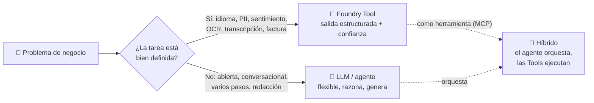

> [!NOTE]
> En el examen AI-901, más de la mitad de las preguntas son de implementación con Foundry. Varias te describen un escenario y te piden elegir **qué** usar. La regla que resume este tema: *"resultados consistentes en un pipeline automatizado"* → **Foundry Tool**; *"flexibilidad y combinar tareas en lenguaje natural"* → **LLM**.

---

## 1. Qué son las Foundry Tools (y qué no son)

**Foundry Tools** es el nombre actual de lo que antes se llamó *Cognitive Services* y luego *Azure AI services*: APIs y modelos **listos para usar** (y algunos personalizables) que resuelven una tarea concreta sin que tengas que entrenar nada ni escribir prompts. Microsoft las define como servicios para *"construir inteligencia en aplicaciones sin tener habilidades directas de IA o ciencia de datos"*.

| Foundry Tool | Modalidad | Qué hace | Personalizable con tus datos |
|---|---|---|---|
| **Azure Language** | Texto | Idioma, PII, entidades, sentimiento, frases clave, resumen, intenciones (CLU), preguntas frecuentes (CQA) | Sí: custom NER, clasificación, CLU, CQA |
| **Azure Translator** | Texto / documentos | Traducción entre 100+ idiomas conservando formato | Sí: Custom Translator |
| **Azure Speech** | Voz | Speech to text, text to speech, traducción de voz, reconocimiento de hablante | Sí: custom speech, custom neural voice |
| **Azure Vision** | Imágenes / video | OCR "en la calle", etiquetas, descripciones, detección de objetos y personas | Sí: Custom Vision |
| **Azure Document Intelligence** | Documentos | OCR de documentos, layout, modelos prebuilt (factura, recibo, ID, contrato, W-2...) | Sí: modelos personalizados |
| **Azure Content Understanding** | Documentos, imágenes, audio y video | Extrae campos según **tu esquema** con confianza y *grounding* | Sí: analizadores personalizados |
| **Azure Content Safety** | Texto e imágenes | Detecta odio, violencia, sexual, autolesión; Prompt Shields; material protegido; *groundedness* | Sí: categorías personalizadas |
| **Azure AI Search** | Texto / vectores | Búsqueda e indexación (la base de RAG) | Sí: índices y *skillsets* |
| **Custom Vision** | Imágenes | Clasificación y detección entrenadas con tus imágenes | Sí (es su razón de ser) |
| **Immersive Reader** | Texto | Lectura asistida y comprensión | No |

> [!WARNING]
> Hay servicios **retirados** que todavía ves en documentación vieja y en preguntas de práctica desactualizadas: **LUIS** (reemplazado por CLU dentro de Azure Language), **QnA Maker** (reemplazado por *custom question answering*), **Content Moderator** (reemplazado por Content Safety), **Anomaly Detector**, **Metrics Advisor** y **Personalizer**. Si una opción del examen menciona uno de estos como "la solución nueva", desconfía.

Dos detalles prácticos que sí caen en el examen:

- **Un recurso de Foundry ya incluye las Tools.** No necesitas crear un recurso de Azure Language aparte: el mismo *endpoint* y la misma llave del recurso de Foundry sirven para Language, Speech, Vision, etc. (en el portal: **Build → Models → AI services**).
- **Se prueban sin código** en el portal de Foundry (cada Tool tiene su *playground*) y se consumen con **REST** o **SDK** (`azure-ai-textanalytics`, `azure-cognitiveservices-speech`, `azure-ai-documentintelligence`...).


*En el portal de Foundry, las Tools viven junto al catálogo de modelos y se prueban desde la misma interfaz. Imagen: Microsoft Learn (CC BY 4.0).*

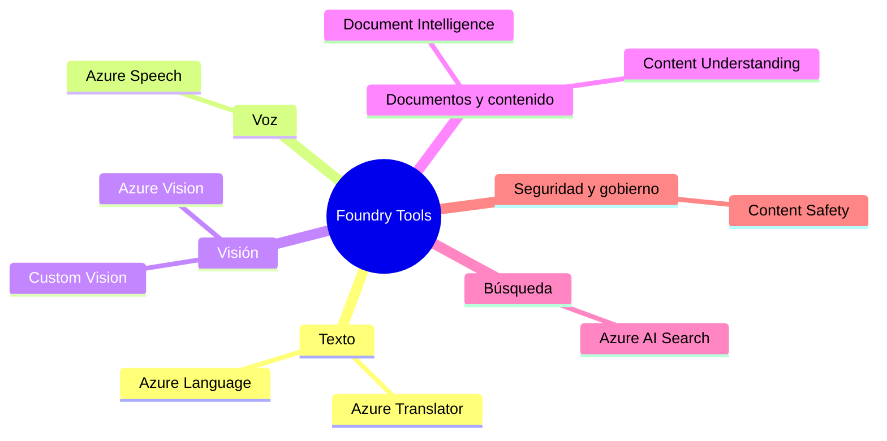

---

## 2. Por qué un LLM no siempre es la solución: las siete diferencias que importan

La tabla resume; las secciones de abajo explican el **porqué** de cada fila, que es lo que te permite razonar una pregunta que no hayas visto.

| Criterio | LLM / agente | Foundry Tool especializada |
|---|---|---|
| Salida | Texto libre; varía entre llamadas | **Estructurada (JSON) y determinista** |
| Confianza | No da un puntaje calibrado | Devuelve **confidence score** por resultado |
| Alucinación | Puede inventar campos o valores | Solo marca lo que está en la entrada (con *offsets*) |
| Costo | Por token (entrada + salida); depende mucho del modelo | Por registro de 1,000 caracteres, por página o por minuto de audio |
| Latencia | Segundos | Décimas de segundo |
| Configuración | Prompt + evaluación + iteración | Ninguna (o entrenamiento con tus datos) |
| Flexibilidad | Altísima | Limitada a su tarea |
| Auditoría y cumplimiento | Difícil de explicar y de versionar | Comportamiento documentado, versiones de modelo fijas |

### 2.1 Determinismo y estructura

Un LLM **genera** texto token por token muestreando de una distribución de probabilidad. Aunque bajes `temperature` a 0, el proveedor no garantiza bit a bit la misma salida, y basta que cambie una palabra del prompt o la versión del modelo para que el JSON cambie de forma (`"telefono"` vs `"phone"`, un campo que aparece o desaparece, un valor como lista en vez de cadena). *Structured Outputs* y *JSON schema* resuelven la **forma** de la respuesta, pero no el **contenido**: el modelo sigue decidiendo libremente qué poner en cada campo.

Un analizador de Azure Language **clasifica**: su salida es un conjunto cerrado de categorías (`Person`, `PhoneNumber`, `Address`...; `positive`, `neutral`, `negative`; códigos ISO 639-1) con un esquema fijo documentado. Mismo texto, misma versión del modelo → misma respuesta. Por eso Learn dice que son *"adecuados para pipelines automatizados donde los resultados consistentes importan"*.

### 2.2 Confianza calibrada

Cada resultado de una Tool viene con un **confidence score** entre 0 y 1 que está pensado para tomar decisiones automáticas: por debajo de un umbral, mandas el caso a revisión humana; por arriba, lo procesas solo (*straight-through processing*). Un LLM puede *decir* "estoy 90 % seguro", pero ese número es texto generado, no una probabilidad calibrada.

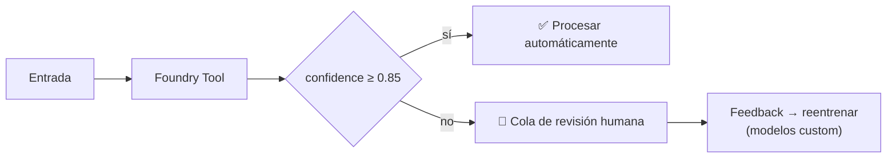

### 2.3 Alucinación de campos

Si le pides a un LLM "extrae el teléfono" y el texto no tiene teléfono, un modelo mal instruido puede **inventar uno** plausible. Azure Language devuelve cada entidad con su `offset` y `length` **dentro del texto original**: solo puede señalar algo que existe. Eso es lo que hace posible `redacted_text`, el texto con las PII reemplazadas por asteriscos sin tocar nada más.

### 2.4 Costo: la fila que más mitos tiene

La creencia común es "el servicio especializado siempre es más barato". **Depende de contra qué modelo lo compares**, porque las unidades de cobro son distintas:

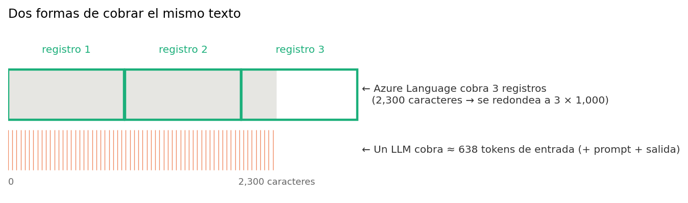

- **Azure Language** cobra por **registro de texto = 1,000 caracteres** (un texto de 2,300 caracteres son 3 registros) y **cada función se cobra por separado**: detectar idioma + PII + sentimiento sobre el mismo texto = 3 registros. Precio de lista del nivel estándar: ~**$1 USD por 1,000 registros** en los primeros 500 mil del mes, bajando por niveles (~$0.75, ~$0.30 y ~$0.25) conforme sube el volumen; el resumen cuesta ~$2 y cuenta entrada + salida; los modelos custom (NER y clasificación) ~$5 más entrenamiento y hospedaje. Hay un **nivel gratuito de 5,000 registros al mes**.
- **Un LLM** cobra por **token** de entrada y de salida (en español, ~3.5 a 4 caracteres por token), **más** los tokens del prompt del sistema en cada llamada.

Con esos precios de lista, un millón de textos de 500 caracteres con tres análisis sale así:

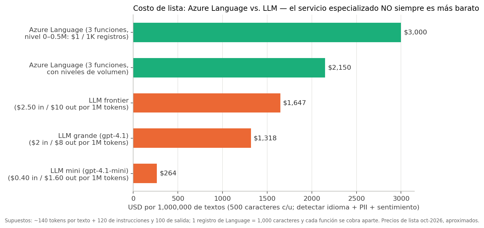

*Precios de lista aproximados (octubre de 2026, región global, USD). Confírmalos en la calculadora de precios de Azure antes de presupuestar.*

Lecturas correctas de la gráfica:

1. Frente a un **modelo mini**, Azure Language **no** es más barato por llamada; frente a un **modelo grande o de razonamiento**, sí lo es o queda parejo, y gana más conforme suben los niveles de volumen y usas *commitment tiers*.
2. El costo del LLM que no ves en la lista de precios: **prompt engineering, evaluaciones, reintentos cuando el JSON viene mal y la validación manual** porque no hay puntaje de confianza. En un pipeline con millones de registros, eso suele pesar más que la factura de tokens.
3. El costo de la Tool que tampoco ves: **cada función es una llamada cobrada**. Si necesitas seis análisis, son seis registros por texto. Pide solo lo que vas a usar.

> [!TIP]
> Para el examen basta con esto: las Tools cobran **por transacción/registro, página o minuto de audio**; los modelos cobran **por token**. Y cuando el escenario dice "millones de documentos al mes" y "resultados consistentes", la respuesta esperada es la Tool, no por el precio sino por la **predecibilidad**.

### 2.5 Latencia

Un analizador de Language o un OCR responde en **décimas de segundo**: es un modelo pequeño que clasifica. Un LLM tiene que **generar** la respuesta token por token (más *reasoning* si el modelo lo usa), así que tarda **segundos**. En un *chatbot* da igual; en un pipeline que procesa 50 textos por segundo o en una validación en tiempo real, no.

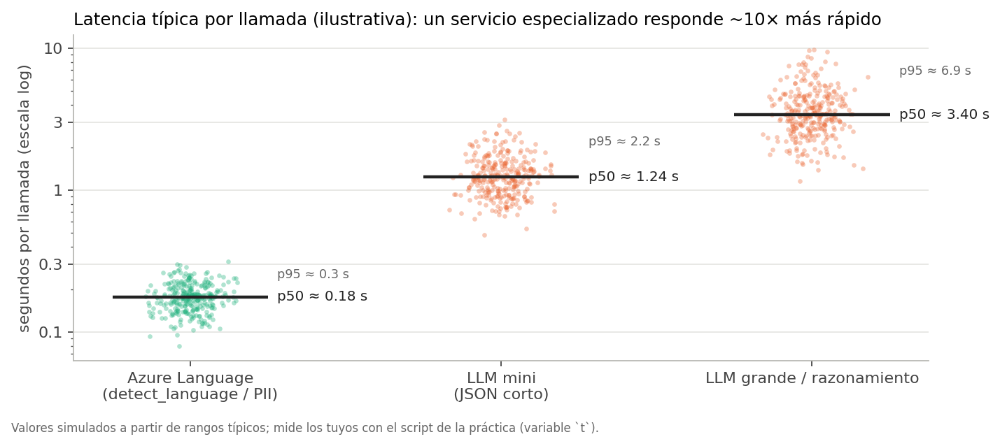

*Valores simulados a partir de rangos típicos; la práctica de abajo mide los reales en tu región.*

### 2.6 Auditoría, cumplimiento y privacidad

- **Explicabilidad:** puedes documentar "usamos el modelo de PII versión X con umbral 0.8" y un auditor lo entiende. "Usamos GPT con este prompt de 40 líneas" es mucho más difícil de defender.
- **Versionado:** las Tools dejan fijar la **versión del modelo** (`model_version`) para que el comportamiento no cambie bajo tus pies; los modelos del catálogo se retiran y actualizan con más frecuencia.
- **Datos:** ni Foundry Tools ni los modelos de Foundry usan tus datos para entrenar modelos de Microsoft, pero las Tools además permiten **ocultar PII antes** de que el texto llegue a un LLM, a un índice de búsqueda o a un almacenamiento. Ese patrón (Language como filtro previo) es el favorito de cumplimiento.
- **Residencia:** las Tools tienen contenedores y regiones específicas, útil cuando la regulación exige que los datos no salgan de cierta geografía.

### 2.7 Esfuerzo de ingeniería

Con una Tool no escribes prompts, no armas un conjunto de evaluación para comprobar que "el 97 % de las veces el JSON sale bien", y no monitoreas deriva de calidad cuando cambia el modelo. El precio de esa comodidad es la **flexibilidad**: si mañana necesitas una categoría de entidad que el servicio no tiene, o un sentimiento "sarcástico", la Tool no lo hace (salvo que entrenes un modelo custom).

### 2.8 Y entonces, ¿cuándo SÍ usar un LLM / agente?

- **Tareas abiertas** o que combinan varios pasos: "lee esta reseña, tradúcela, resume y propón una respuesta al cliente".
- **Categorías que cambian seguido** o que prefieres definir en lenguaje natural ("clasifica en *urgente*, *puede esperar* y *spam*"); con una Tool tendrías que reentrenar un modelo custom.
- **Conversación, razonamiento, redacción, generación**: nada de eso lo hace una Tool.
- **Exploración**: en el *playground* puedes refinar el análisis con preguntas de seguimiento ("ahora solo las frases negativas"), algo que una API fija no permite.
- **Contexto largo con semántica**: entender una queja de tres páginas y decidir si el cliente tiene razón.


*El mismo análisis con un LLM: sin configuración, pero la salida depende de cómo redactes el prompt. Imagen: Microsoft Learn (CC BY 4.0).*

---

## 3. Marco de decisión

Este árbol resume las preguntas que te haces (y las que te hace el examen) antes de elegir:

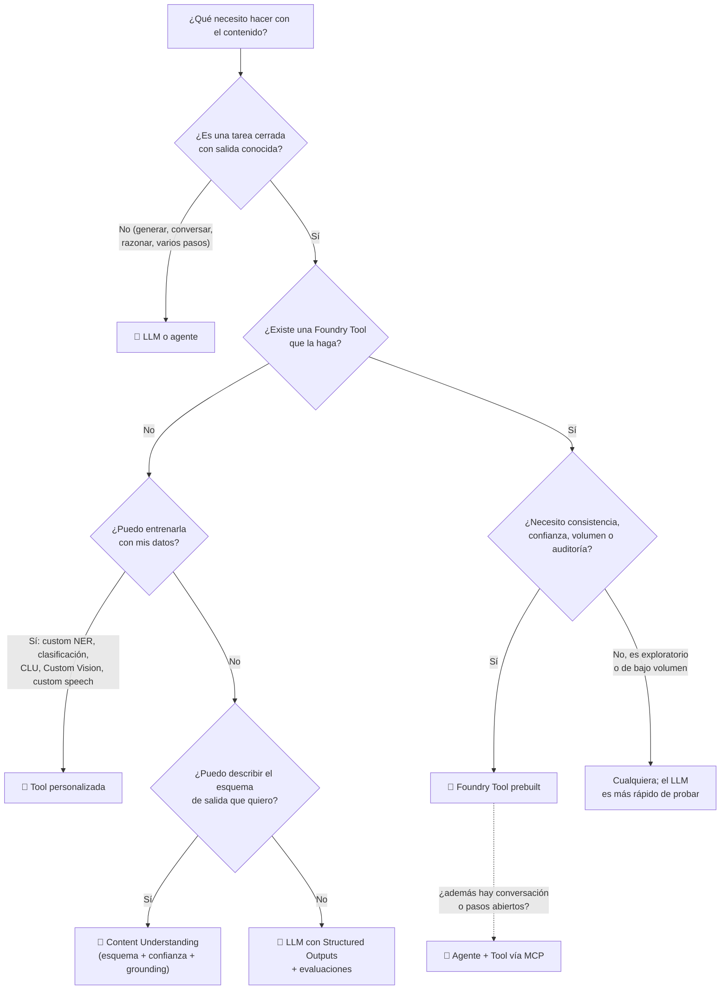

Y el mapa mental de dónde cae cada servicio según dos ejes: qué tan **cerrada** es la tarea y cuánta **consistencia/auditoría** exige:

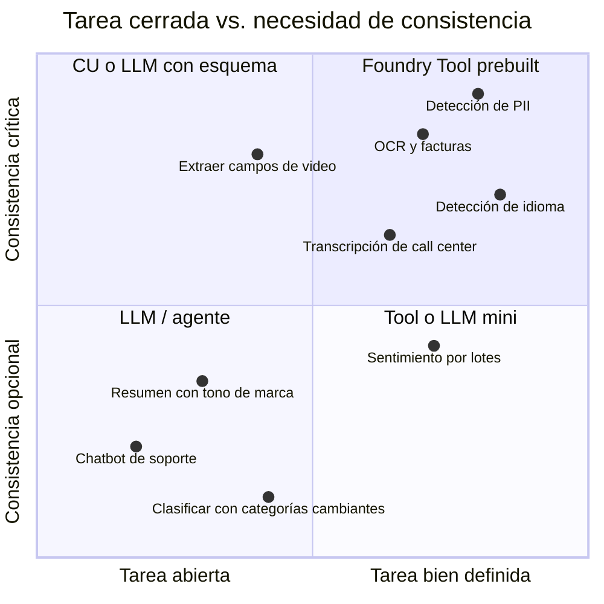

**Escenarios tipo examen** (fíjate en las palabras clave):

| Escenario | Palabra clave | Respuesta esperada |
|---|---|---|
| "Enrutar un millón de tickets al mes al equipo del idioma correcto, con resultados consistentes" | *consistentes, volumen* | Azure Language (detección de idioma) |
| "Antes de guardar transcripciones, ocultar nombres y teléfonos" | *ocultar / redactar PII* | Azure Language (PII, `redacted_text`) |
| "Un bot que responda preguntas frecuentes exactamente como las aprobó Legal" | *verbatim, aprobadas* | Custom question answering (o el agente *Exact Question Answering*) |
| "Extraer total, fecha y proveedor de facturas en PDF con puntaje de confianza" | *campos, confianza* | Document Intelligence (`prebuilt-invoice`) o Content Understanding |
| "Extraer acciones y sentimiento de grabaciones de reuniones según un esquema propio" | *audio/video, esquema* | Content Understanding |
| "Un asistente que lea la reseña, la traduzca, la resuma y proponga respuesta" | *varios pasos, redactar* | LLM / agente |
| "Clasificar correos en categorías que el negocio cambia cada mes" | *categorías cambiantes* | LLM (o custom text classification si hay datos y estabilidad) |
| "Filtrar comentarios con odio o violencia antes de publicarlos" | *moderar* | Azure Content Safety |

---

## 4. Azure Language a fondo

Azure Language es la Tool de texto y la que más aparece en este módulo. Cada capacidad es un **analizador** independiente con su propio esquema de salida.

| Capacidad | Tipo | Qué devuelve | Ejemplo de uso |
|---|---|---|---|
| **Detección de idioma** | Prebuilt | Nombre, código ISO 639-1 (`es`, `en`), confianza; detecta también dialectos y texto mixto | Enrutar tickets; elegir voz de TTS |
| **Detección de PII** | Prebuilt | Entidades (`Person`, `PhoneNumber`, `Email`, `Address`, `CreditCardNumber`, `CURP`/IDs nacionales...) con offset y confianza, y `redacted_text`; también **PHI** (salud) y PII en conversaciones y documentos | Anonimizar antes de almacenar o de pasar a un LLM |
| **Reconocimiento de entidades (NER)** | Prebuilt | Entidades por categoría y subcategoría (`Person`, `Location`, `Organization`, `DateTime`, `Quantity`...) | Indexar quién, dónde y cuándo |
| **Vinculación de entidades** | Prebuilt | Desambigua y devuelve el enlace a Wikipedia ("Mercurio" el planeta vs. el elemento) | Enriquecer artículos |
| **Frases clave** | Prebuilt | Lista de conceptos principales | Nubes de palabras, etiquetado |
| **Sentimiento y minería de opiniones** | Prebuilt | `positive` / `neutral` / `negative` / `mixed` por documento **y por oración**, con puntajes; con *opinion mining*, pares **objetivo → evaluación** ("servicio" → "lentísimo", negativo) | Analizar un millón de reseñas |
| **Resumen** | Prebuilt | **Extractivo** (oraciones del original con ranking) o **abstractivo** (texto nuevo); variantes para conversaciones y call center | Resumir chats de soporte |
| **Text Analytics for health** | Prebuilt | Entidades clínicas (diagnósticos, medicamentos, dosis) y relaciones | Notas médicas |
| **CLU (Conversational Language Understanding)** | Custom | **Intención** de una frase + **entidades**, entrenado con tus ejemplos | Bot con intenciones fijas ("cancelar pedido") |
| **Custom question answering (CQA)** | Custom | La respuesta más adecuada de una base de conocimiento que tú curas | FAQ con respuestas aprobadas |
| **Custom NER / custom text classification** | Custom | Entidades o clases que tú defines y etiquetas | Extraer "número de póliza" de tus contratos |
| **Orchestration workflow** | Custom | Conecta proyectos de CLU y CQA en un solo punto de entrada | Un bot que enruta a varios proyectos |

> [!IMPORTANT]
> La documentación actual (octubre de 2026) separa las capacidades de Azure Language en **"core"** (recomendadas para desarrollos nuevos: PII, detección de idioma, NER, custom NER y Text Analytics for health) y **"legacy"** (soportadas para implementaciones existentes: CLU, clasificación custom, vinculación de entidades, frases clave, orquestación, question answering, sentimiento y resumen). Para desarrollos nuevos Microsoft empuja esas tareas "legacy" hacia modelos generativos o Content Understanding. **Siguen funcionando, siguen en el SDK y siguen en el examen**: la AI-901 evalúa explícitamente "extracción de palabras clave, detección de entidades, análisis de sentimiento y resumen" como técnicas de análisis de texto.

Así se ven en el portal (Build → Models → AI services → Language):


*Detección de idioma: nombre, código ISO y confianza. Imagen: Microsoft Learn (CC BY 4.0).*


*PII: cada entidad con categoría y confianza, y el texto redactado listo para guardarse. Imagen: Microsoft Learn (CC BY 4.0).*


*Sentimiento por documento y por oración; con minería de opiniones también por aspecto. Imagen: Microsoft Learn (CC BY 4.0).*


*NER prebuilt: categorías y subcategorías fijas. Imagen: Microsoft Learn (CC BY 4.0).*


*Resumen extractivo: oraciones del original con puntaje de relevancia. Imagen: Microsoft Learn (CC BY 4.0).*


*CLU: intención + entidades a partir de ejemplos que tú etiquetas. Imagen: Microsoft Learn (CC BY 4.0).*

### 4.1 Prebuilt vs. custom: ¿cuándo entrenar?

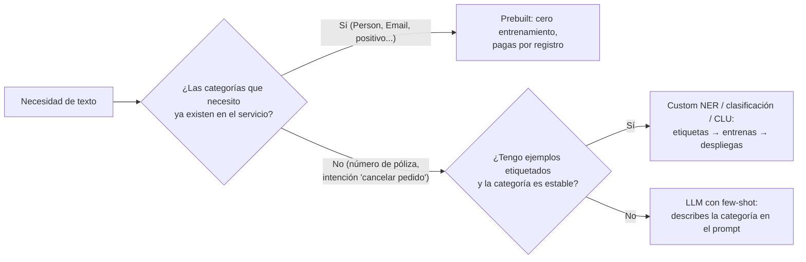

### 4.2 Cómo se consume

- **Portal:** *playground* de cada capacidad, sin código.
- **SDK:** `azure-ai-textanalytics` → `TextAnalyticsClient(endpoint, AzureKeyCredential(llave))` con métodos como `detect_language()`, `recognize_pii_entities()`, `recognize_entities()`, `extract_key_phrases()`, `analyze_sentiment(show_opinion_mining=True)` y `begin_extract_summary()` (resumen, de larga duración). Todos reciben **listas** de documentos (procesas varios por llamada) y devuelven resultados en el mismo orden.
- **REST:** `POST {endpoint}/language/:analyze-text?api-version=...` con `kind` = `LanguageDetection`, `PiiEntityRecognition`, `SentimentAnalysis`...
- **MCP:** el servidor MCP de Azure Language, para que un **agente** las use como herramientas (sección 6).

---

## 5. Voz y visión: el mismo razonamiento

El argumento no es exclusivo del texto. Hoy un modelo multimodal (GPT-4o, GPT-4.1, Phi multimodal...) puede "escuchar" audio y "ver" imágenes. Eso no vuelve obsoletas las Tools de voz y visión; cambia **cuándo** usar cada una.

### 5.1 Voz: Azure Speech vs. modelo multimodal


*Las tres capacidades principales de Azure Speech. Imagen: documentación oficial de Microsoft (CC BY 4.0).*

| Necesidad | Usa **Azure Speech** | Usa un **modelo multimodal / Voice Live** |
|---|---|---|
| Transcribir **horas** de audio (call center, podcasts) por lotes | ✅ *Batch transcription*: cobro por hora de audio, **marcas de tiempo**, **diarización** (quién habló), vocabulario personalizado (*custom speech*) | ❌ Caro por token y sin diarización confiable |
| Subtítulos en vivo | ✅ Reconocimiento continuo con resultados parciales | Solo si además necesitas "entender" |
| Voz de marca para un IVR | ✅ TTS con voces neuronales, **SSML** (pausas, énfasis, pronunciación), *custom neural voice* | ❌ Menos control fino |
| Asistente que **conversa** por voz y razona | Solo como piezas (STT → LLM → TTS) con más latencia | ✅ **Voice Live** (voz a voz, con interrupciones) |
| Traducción de voz en tiempo real | ✅ *Speech translation* | Posible, con más latencia |

> [!TIP]
> El módulo de voz de este acordeón ([Parte 2, Módulo 4](../modulo4/tema2.md)) explica cuándo armar el pipeline STT → modelo → TTS por piezas y cuándo usar Voice Live.

### 5.2 Visión y documentos: Vision vs. Document Intelligence vs. Content Understanding vs. LLM multimodal

| Necesidad | Servicio recomendado | Por qué |
|---|---|---|
| Leer texto en fotos "del mundo real": letreros, etiquetas, carteles | **Azure Vision OCR** (API síncrona) | Optimizado para imágenes sueltas, responde rápido |
| Digitalizar documentos escaneados o PDF de muchas páginas | **Document Intelligence Read** (asíncrono) | Hasta 2,000 páginas por archivo, manuscrito, idiomas mixtos |
| Extraer **campos conocidos** de facturas, recibos, IDs, contratos, W-2 | **Document Intelligence prebuilt** (`prebuilt-invoice`, `prebuilt-receipt`, `prebuilt-idDocument`...) | Esquema fijo, confianza por campo, sin entrenamiento |
| Extraer campos según **mi propio esquema** de documentos, imágenes, **audio o video** | **Content Understanding** | Tú defines el esquema; devuelve JSON con confianza y *grounding* |
| **Describir, interpretar o razonar** sobre una imagen ("¿este empaque está dañado?", "¿qué dice esta gráfica?") | **Modelo multimodal** (LLM con visión) | La tarea es abierta y semántica |
| Clasificar imágenes en categorías propias con pocos datos | **Custom Vision** | Entrenas con tus fotos etiquetadas |
| Filtrar imágenes ofensivas | **Content Safety** | Categorías y severidades estandarizadas |


*Document Intelligence con `prebuilt-invoice`: campos con nombre fijo y confianza, listos para cuentas por pagar. Imagen: Microsoft Learn (CC BY 4.0).*

**Content Understanding merece párrafo aparte** porque es el servicio que el examen AI-901 nombra explícitamente para "extracción de información" de documentos, imágenes, audio y video. Por dentro **usa IA generativa** (varios modelos que analizan y se validan entre sí), pero por fuera se comporta como una Tool: tú defines un **esquema** de campos, y para cada valor devuelve un **confidence score** (0 a 1) y el **grounding**: la región exacta del documento, imagen, audio o video de donde salió. Tiene tres modos de campo: **extract** (el valor tal cual aparece), **classify** (asigna una categoría) y **generate** (produce un valor, por ejemplo el resumen de una llamada). Es, en la práctica, "un LLM con la disciplina de una Tool".


*Content Understanding: cualquier modalidad entra a un analizador con tu esquema y sale JSON (o Markdown para RAG). Imagen: Microsoft Learn (CC BY 4.0).*

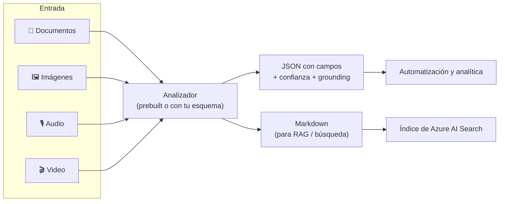

---

## 6. El mejor patrón: combinarlos

En producción casi nunca es "LLM **o** Tool"; es "LLM **y** Tool", en uno de estos cuatro arreglos.

### 6.1 Tool antes del LLM (pre-procesamiento)

La Tool limpia, enruta o protege antes de gastar tokens. El caso clásico: **detectar idioma y ocultar PII** antes de mandar el texto al modelo.

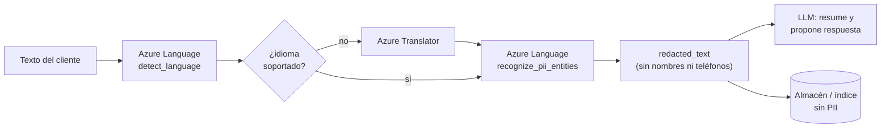

Ventajas: el LLM nunca ve datos personales (cumplimiento), el almacén queda anonimizado, y enrutas por idioma de forma determinista.

### 6.2 Tool como herramienta del agente (MCP)

El agente decide **cuándo** llamar a la Tool y qué hacer con el resultado. En Foundry esto se hace con el **servidor MCP de Azure Language**, que expone como herramientas: reconocimiento de entidades, Text Analytics for health, CLU, CQA, detección de idioma, sentimiento, resumen, frases clave y redacción de PII.

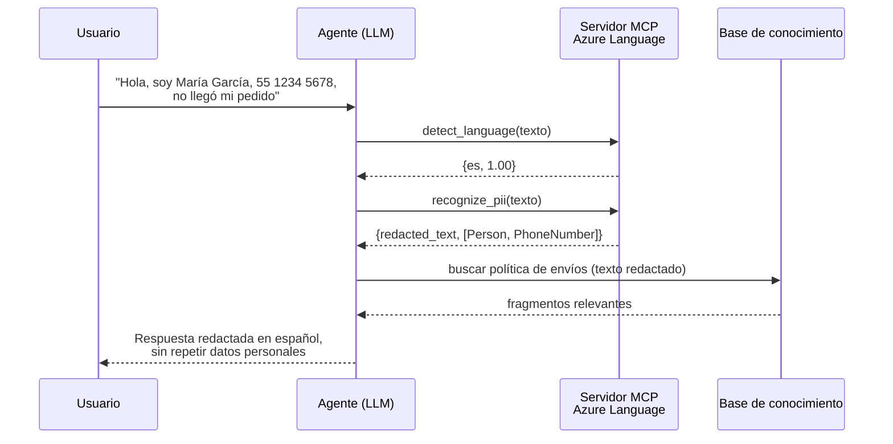

En el portal se configura sin código: despliegas un modelo, lo guardas como agente, en el *playground* agregas la herramienta **Azure Language in Foundry Tools** y la conectas con el **nombre de tu recurso de Foundry** (no hace falta un recurso de Language aparte).


*Conexión de la herramienta al agente: solo el nombre del recurso de Foundry. Imagen: Microsoft Learn (CC BY 4.0).*


*El agente invoca la Tool y usa su resultado estructurado en la conversación. Imagen: Microsoft Learn (CC BY 4.0).*

Para código, el endpoint remoto del servidor MCP tiene esta forma (en *preview*):

```
https://<recurso-foundry>.cognitiveservices.azure.com/language/mcp?api-version=2025-11-15-preview
```

Microsoft también publica dos **plantillas de agente** sobre Azure Language: **Intent Routing** (CLU + CQA con *fallback* a RAG, para enrutar conversaciones de forma determinista) y **Exact Question Answering** (respuestas *verbatim* de un proyecto de CQA, sin código). El Tema 2 de este módulo profundiza en MCP.

### 6.3 Tool después del LLM (post-procesamiento y guardrails)

La Tool valida lo que generó el modelo antes de que llegue al usuario: **Content Safety** revisa odio/violencia/sexual/autolesión y **groundedness** (si la respuesta se apoya en las fuentes), **Prompt Shields** detecta inyecciones en la entrada, y la **detección de material protegido** evita que el modelo reproduzca letras de canciones o artículos.

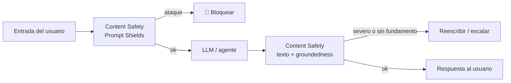

### 6.4 Enrutador por confianza (humano en el ciclo)

Combina lo mejor de ambos: la Tool resuelve lo fácil y determinista; el LLM atiende lo ambiguo; un humano revisa lo que ninguno resuelve con confianza.

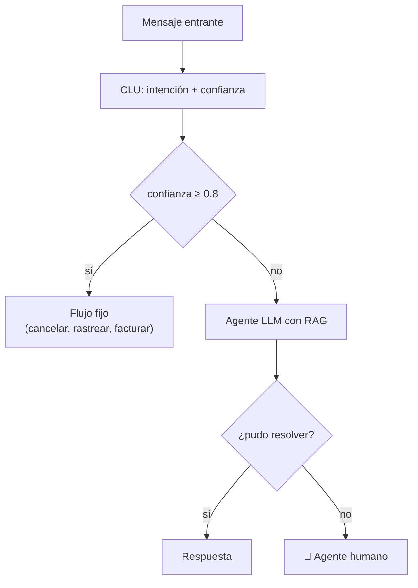

### 6.5 Antipatrones que verás en la vida real (y en opciones distractoras del examen)

| Antipatrón | Por qué está mal | Mejor |
|---|---|---|
| Usar GPT para detectar el idioma de 10 millones de tickets | Lento, no determinista, sin confianza; la Tool lo hace en milisegundos | Azure Language detección de idioma |
| Pedirle a un LLM que "oculte los datos personales" antes de guardar | Puede omitir uno o inventar el formato; no hay *offsets* | `recognize_pii_entities` → `redacted_text` |
| Usar Azure Language para "resumir con el tono de la marca" | El resumen prebuilt no tiene estilo ni instrucciones | LLM (o Content Understanding modo *generate*) |
| Entrenar un modelo custom para categorías que cambian cada mes | Reentrenar cada vez cuesta más que un prompt | LLM few-shot |
| Un agente sin Content Safety "porque el modelo ya es seguro" | El filtro del modelo no cubre tu política ni tus categorías | Content Safety como guardrail |
| Pasar PDFs escaneados como imágenes a un LLM para sacar totales | Caro, sin confianza por campo, propenso a leer mal números | Document Intelligence `prebuilt-invoice` o Content Understanding |

---

## 7. Práctica: el mismo análisis con LLM y con Azure Language (y luego combinados)

La práctica original comparaba una llamada de cada tipo. Esta versión además **repite** la llamada al LLM para que veas la variabilidad, **mide la latencia** de cada camino y termina con el patrón híbrido de la sección 6.1.

```python
# pip install openai azure-ai-textanalytics python-dotenv
import os, json, time, statistics
from dotenv import load_dotenv
from openai import OpenAI
from azure.core.credentials import AzureKeyCredential
from azure.ai.textanalytics import TextAnalyticsClient

load_dotenv()
texto = ("María García llamó desde el 55 1234 5678 para pedir que enviaran los documentos "
         "a Av. Reforma 222, CDMX. El hotel estaba precioso pero el servicio fue lentísimo.")

# ───────────────────────── Opción A: LLM (flexible, salida variable) ─────────────────────────
llm = OpenAI(base_url=os.getenv("AZURE_OPENAI_ENDPOINT"), api_key=os.getenv("API_KEY"))

formas, t = set(), []
for i in range(3):                       # 3 corridas para observar la variabilidad
    inicio = time.perf_counter()
    r = llm.responses.create(
        model=os.getenv("MODEL_DEPLOYMENT_NAME"),
        instructions="Detecta el idioma, los datos personales y el sentimiento. Responde solo con JSON.",
        input=texto,
    )
    t.append(time.perf_counter() - inicio)
    salida = r.output_text.strip().strip("`").removeprefix("json").strip()   # quita el cerco ```json ... ``` si aparece
    try:
        claves = tuple(sorted(json.loads(salida).keys()))
    except json.JSONDecodeError:
        claves = ("<JSON inválido>",)
    formas.add(claves)
    print(f"LLM corrida {i+1} ({t[-1]:.2f}s): {salida[:120]}...")
print(f"→ {len(formas)} forma(s) distinta(s) de JSON en 3 corridas; latencia mediana {statistics.median(t):.2f}s")
print(f"→ tokens: {r.usage.input_tokens} entrada + {r.usage.output_tokens} salida\n")

# ──────────────────── Opción B: Azure Language (estructurado y determinista) ────────────────────
lang = TextAnalyticsClient(endpoint=os.getenv("AZURE_LANGUAGE_ENDPOINT"),
                           credential=AzureKeyCredential(os.getenv("API_KEY")))

inicio = time.perf_counter()
idioma = lang.detect_language([texto])[0]
print(f"Idioma: {idioma.primary_language.name} ({idioma.primary_language.iso6391_name}) "
      f"confianza={idioma.primary_language.confidence_score:.2f}")

pii = lang.recognize_pii_entities([texto], language="es")[0]
print("Texto redactado:", pii.redacted_text)
for e in pii.entities:
    print(f"  {e.text!r:28} categoría={e.category:14} confianza={e.confidence_score:.2f} offset={e.offset}")

sent = lang.analyze_sentiment([texto], language="es", show_opinion_mining=True)[0]
print(f"Sentimiento del documento: {sent.sentiment} {dict(sent.confidence_scores)}")
for oracion in sent.sentences:
    for op in oracion.mined_opinions:                      # pares objetivo → evaluación
        evals = ", ".join(f"{a.text} ({a.sentiment})" for a in op.assessments)
        print(f"  {op.target.text!r} → {evals}")
print(f"→ Azure Language, 3 análisis: {time.perf_counter() - inicio:.2f}s en total; "
      f"3 registros de texto cobrados ({len(texto)} caracteres)\n")

# ───────────── Patrón híbrido (sección 6.1): la Tool protege, el LLM redacta ─────────────
r = llm.responses.create(
    model=os.getenv("MODEL_DEPLOYMENT_NAME"),
    instructions=f"Eres agente de soporte. Responde en {idioma.primary_language.name} con empatía "
                 "y propón una solución. No pidas ni repitas datos personales.",
    input=pii.redacted_text,                      # el LLM nunca ve el nombre ni el teléfono
)
print("Respuesta propuesta:\n", r.output_text)
```
`.env`:
```bash
AZURE_OPENAI_ENDPOINT=https://<recurso>.openai.azure.com/openai/v1/
MODEL_DEPLOYMENT_NAME=gpt-4.1-mini
AZURE_LANGUAGE_ENDPOINT=https://<recurso>.cognitiveservices.azure.com/
API_KEY=<tu-llave-de-foundry>
```
- **Explicación:**
  - **Opción A:** corre el script varias veces. Lo normal es ver **dos o tres formas distintas de JSON** (`"telefono"` vs `"phone"`, listas vs cadenas) y a veces un bloque ```` ```json ```` que hay que limpiar. `r.usage` te da los tokens para estimar el costo con los precios de la sección 2.4.
  - **Opción B:** la respuesta siempre tiene la misma estructura: `primary_language.name`, `iso6391_name`, `confidence_score`; `redacted_text` (por ejemplo `************ llamó desde el ************* para pedir que enviaran los documentos a *******************...`); `entities` con `category` (`Person`, `PhoneNumber`, `Address`), `confidence_score` y `offset`; y con `show_opinion_mining=True`, pares como `'servicio' → lentísimo (negative)`. Fíjate en que el sentimiento del documento sale **mixed**: una oración positiva y una negativa.
  - **Híbrido:** el LLM recibe el texto **ya redactado** y la instrucción de responder en el idioma detectado. Así la Tool aporta determinismo y privacidad, y el LLM aporta la redacción.
  - La misma llave de tu **recurso de Foundry** sirve para todo: el recurso ya incluye Azure Language.

> [!TIP]
> Si quieres reproducir la gráfica de latencia con tus números, guarda las listas `t` de cada opción y grafícalas; el script que generó las imágenes de este tema está en `images/parte2/modulo3/_generar_graficas.py`.

---

## 8. Preguntas tipo examen

<details>
<summary><b>1.</b> Una empresa procesa 2 millones de reseñas al mes y necesita el sentimiento de cada una con resultados consistentes para alimentar un tablero. ¿Qué debería usar?</summary>

**Azure Language (análisis de sentimiento).** Las palabras clave son *volumen* y *resultados consistentes*: salida estructurada, determinista y con puntajes de confianza, pensada para pipelines automatizados. Un LLM variaría entre llamadas y no da confianza calibrada.
</details>

<details>
<summary><b>2.</b> Un asistente debe leer una queja larga, traducirla al español, resumirla y proponer una respuesta amable. ¿LLM o Foundry Tool?</summary>

**LLM / agente.** Es una tarea **abierta y de varios pasos** que termina en **redacción**. Podrías apoyarlo con Translator y Language como herramientas, pero el orquestador es el modelo.
</details>

<details>
<summary><b>3.</b> Antes de almacenar transcripciones de llamadas, deben ocultarse nombres, teléfonos y direcciones. ¿Qué capacidad usas?</summary>

**Detección de PII de Azure Language**, que devuelve `redacted_text` y las entidades con categoría, offset y confianza. Para transcripciones puedes usar la variante de PII para **conversaciones**.
</details>

<details>
<summary><b>4.</b> ¿Qué ventaja tiene una Foundry Tool sobre un modelo de propósito general en un pipeline automatizado? (elige la mejor)</summary>

**Salida estructurada y determinista con puntajes de confianza.** No "siempre es más barata" ni "entiende mejor el lenguaje"; su ventaja es la **predecibilidad**.
</details>

<details>
<summary><b>5.</b> Necesitas extraer, de grabaciones de reuniones, los acuerdos y responsables según un esquema que tú defines, con un puntaje de confianza por campo. ¿Qué servicio?</summary>

**Azure Content Understanding.** Acepta audio y video, aplica **tu esquema** y devuelve JSON con confianza y *grounding*. Document Intelligence es solo para documentos; Speech transcribe pero no extrae campos.
</details>

<details>
<summary><b>6.</b> ¿Cómo le das a un agente de Foundry la capacidad de detectar idioma y PII de forma determinista sin escribir código de integración?</summary>

Agregando la herramienta **Azure Language in Foundry Tools** (servidor **MCP** de Azure Language) en el playground del agente y conectándola con el **nombre del recurso de Foundry**.
</details>

<details>
<summary><b>7.</b> ¿Cómo se cobra Azure Language y cómo se cobra un modelo del catálogo?</summary>

Azure Language por **registros de texto de 1,000 caracteres** (cada función aparte; nivel gratuito de 5,000 registros al mes); un modelo del catálogo por **tokens** de entrada y salida.
</details>

---

## Práctica oficial de Microsoft Learn
- [Módulo: Introducción al análisis de texto en Microsoft Foundry](https://learn.microsoft.com/es-es/training/modules/get-started-text-analysis-azure/) (unidades: modelos de propósito general vs. Azure Language, cliente en Python, Azure Language con un agente vía MCP)
- [Ejercicio: Introducción al análisis de texto en Microsoft Foundry](https://learn.microsoft.com/es-es/training/modules/get-started-text-analysis-azure/5-exercise)
- [Ejercicio: Explorar el análisis de texto](https://learn.microsoft.com/es-es/training/modules/introduction-language/4b-exercise)
- [Módulo: Desarrollar un agente de análisis de texto con el servidor MCP de Azure Language](https://learn.microsoft.com/es-es/training/modules/develop-text-analysis-agent-language-mcp/)

## Fuentes
- [¿Qué son las Foundry Tools? (Microsoft Learn)](https://learn.microsoft.com/en-us/azure/ai-services/what-are-ai-services)
- [Elegir una tecnología de Foundry Tools — Azure Architecture Center](https://learn.microsoft.com/en-us/azure/architecture/data-guide/technology-choices/ai-services)
- [Azure Language: información general y capacidades core vs. legacy](https://learn.microsoft.com/en-us/azure/ai-services/language-service/overview)
- [Azure Language en Foundry Tools: servidor MCP y agentes](https://learn.microsoft.com/en-us/azure/ai-services/language-service/concepts/foundry-tools-agents)
- [Precios de Azure Language (registros de texto, niveles y nivel gratuito)](https://azure.microsoft.com/en-us/pricing/details/language/)
- [Content Understanding: información general (confianza y grounding)](https://learn.microsoft.com/en-us/azure/ai-services/content-understanding/overview)
- [Document Intelligence: modelos prebuilt](https://learn.microsoft.com/en-us/azure/ai-services/document-intelligence/overview)
- [Azure Vision OCR: cuándo usar Vision y cuándo Document Intelligence](https://learn.microsoft.com/en-us/azure/ai-services/computer-vision/overview-ocr)
- [Azure Content Safety: información general](https://learn.microsoft.com/en-us/azure/ai-services/content-safety/overview)
- [Guía de estudio AI-901: habilidades evaluadas](https://learn.microsoft.com/en-us/credentials/certifications/resources/study-guides/ai-901)
